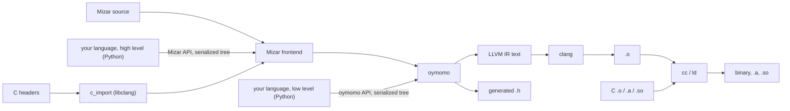
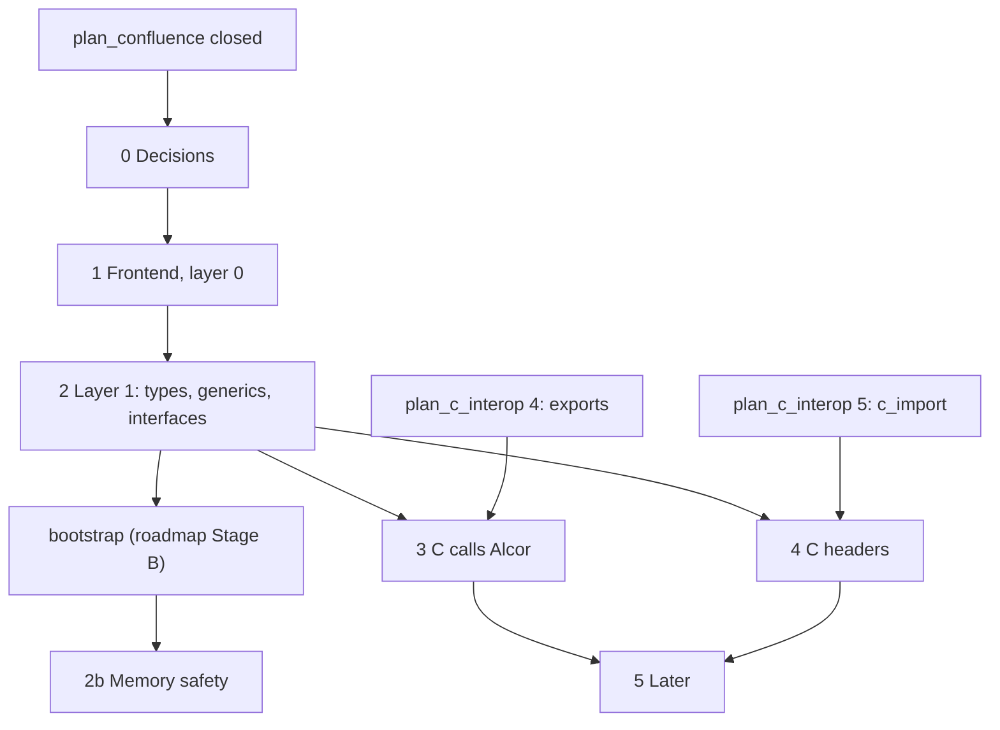
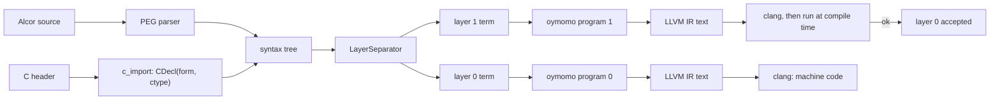
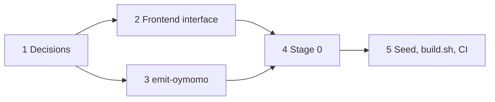
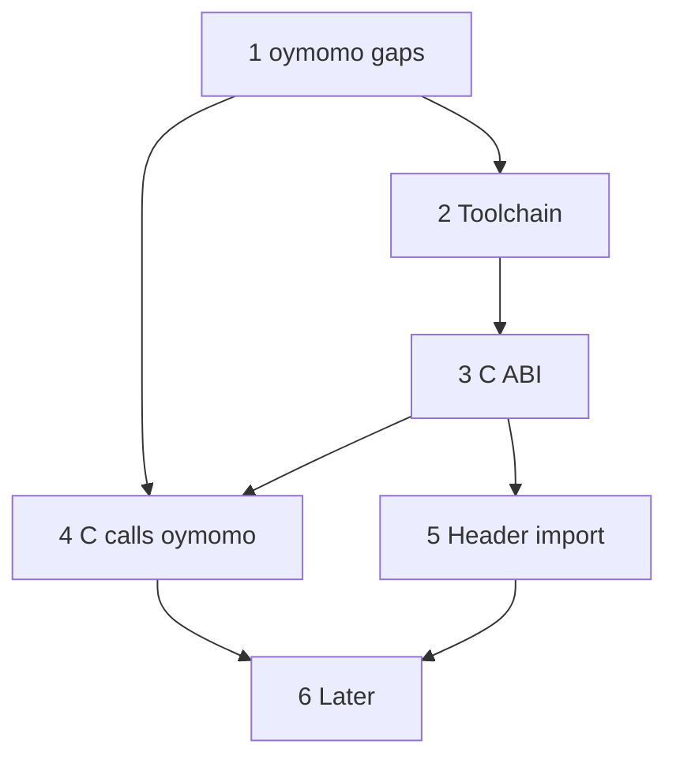
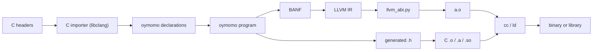
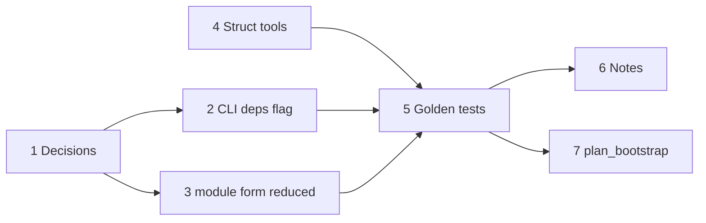
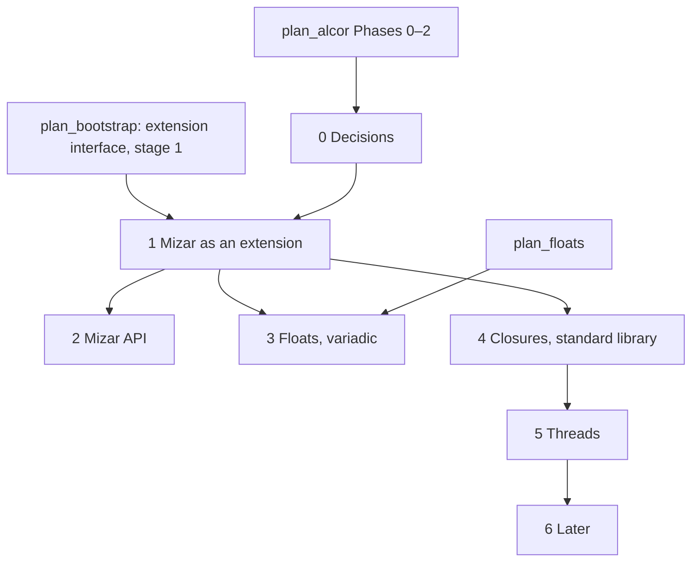

# agent_wiki

Knowledge base for the agent working on oymo. Humans don't read it: the user asks the
agent, and the agent answers from here. Later, the agent generates human docs from it.

## 1. Rules for agents

The user's orders, kept as given. Follow them in every task.

### This wiki

- `docs/agent_wiki.md` is for the agent only.
- Never point to it from anywhere (docs, `README.md`, source code, tests, comments),
  except `oymo/AGENTS.md`: a 5-line file that only says to read this wiki's Rules first.
  `AGENTS.md` is the only file that links here.
- When `notes.md` or `implemented/` are deleted, remove links to them and keep the
  comment text (in source, tests, and `semantics.tex`).
- Keep every "why" here, and any knowledge collected along the way, for the whole oymo
  project, not only the roadmap.
- Keep every agent-related thing here, including what the agent may and may not do.
- When the user gives a new order about what the agent can or cannot do, add it to this
  section.
- When the user asks a question about oymo, look for the answer here first.
- After every change to this wiki, stage it: `git add docs/agent_wiki.md`. Stage only
  this file this way; don't commit.

### Files the agent must not edit

- `docs/todo.md` is the user's scratch list; only the user manages it. Read it, never
  edit it. Its items are also merged into the roadmap tree.
- Keep `docs/story.md` and `README.md` as they are.
- `docs/semantics.tex` (`review-rules`): the agent edits it as the user directs.
  Markdown can't render LaTeX, so the rules moved from `reduction_rules.md` (deleted on
  the user's order) to `.tex`. `make -C oymo/docs` builds the PDF (git-ignored).
  Layout (user's choice): `mathpartir` rules with the name above (`lab=`), a judgment
  line over each group, `array` grammars; no boxes. Named `semantics.tex` (user's choice).
  - It is an abstract document: no θ-calculus or layering, no references to code
    (files, functions, classes, `convert`, BANF names), no de Bruijn indices.
  - Write "Oymomo" (capitalized) in it. The title is "Oymo Semantics". No intro line
    under the title.
  - Section order: Syntax, Computation, Congruence, All Combinations, Evaluation
    Strategy, Syntax Sugar, Under Binders (`shape`).
  - Each section (Syntax, Computation, ...): formulas first, explanations as bullets
    below them.
  - Every rule group (Computation, Congruence, S-Let/S-Inline): one rule per line,
    centered (`rules` env, `\axiomrow`/`\rulerow`), rule name right-aligned in a
    column; a rule with no premises has no bar. No judgment line above any rule group
    (Section 2's first bullet defines `t ⟶ t'`).
  - Introduce each notation in the section where it is first used; no notation table
    up front.
  - Byte arrays keep brackets, `[b]`, hex only: no UTF-8 / text byte arrays.
  - No built-ins (`$name`, `$fix`, `$seq`, field lists, opcodes).
  - Abstraction is two productions: without a form and with a form.
  - Before Syntax Sugar: an "All Combinations" section listing every root case,
    the rule that applies or "stuck", for completeness.
  - Sugar (`if`, `let`, unlabeled fields) has its own section.

### Docs layout

- One roadmap doc, `docs/roadmap.md`. No separate plan docs.
- Every "why" goes into this wiki, not the roadmap.
- `docs/notes.md`, `docs/glossary.md`, `docs/implemented/`, the plans and the old roadmap
  were moved here verbatim and deleted (done).
- `docs/` now holds: `roadmap.md`, `agent_wiki.md`, `todo.md`, `story.md`,
  `semantics.tex`, `Makefile`.

### Roadmap format

- Three sections:
  1. **Intro.**
  2. **Tree**: nested list, one line per node.
  3. **Leaf details**: for each leaf, only what needs to be done, like a plan doc. No
     explanations; the user asks if a broader explanation is needed.
- Each node has a short fixed id (e.g. `deps-cli`). No numbering.
- Up to 10 levels deep; at most 5 to 7 children per node.
- A blocked leaf has a prefix (🚫). Don't say what blocks it.
- An open question goes in the leaf's details as a "Decide: ..." item; a leaf with an
  undecided item is blocked.
- No fancy level names (stage, phase, milestone, epic, story, task).
- Agent's convention (approved with the tree): a leaf is also blocked when work it
  really needs isn't done. A leaf whose job is to decide (`*-decide`, `alcor-survey`,
  `alcor-layer1`, `alcor-ub`, `alcor-generics`, `alcor-safety-syntax`) is not blocked by
  its own Decide items.
- Every tree leaf has exactly one details section, in tree order.
- When a leaf is finished, remove it from the tree and remove its details section. Its
  decisions stay here, under [4. Decisions and whys](#4-decisions-and-whys). Don't
  change its parent nodes; keep their text as it is.

### oymomo design

- Nothing automatic in oymomo; everything is manual. For example, `module` declarations
  are not filled in automatically: the user will add tools to concatenate, modify and
  build structs, so they can be combined by hand.
- Before 1.0, anything may be redesigned freely: oymomo syntax, Alcor and Mizar syntax,
  public API, CLI.

## 2. Index

One line per section, to grep and jump.

| Section | Contents |
|---|---|
| [1. Rules for agents](#1-rules-for-agents) | the user's orders |
| [3. Project knowledge](#3-project-knowledge) | `notes.md`, `glossary.md`, verbatim |
| [4. Decisions and whys](#4-decisions-and-whys) | new decisions by roadmap id; old roadmap and plans, verbatim |
| [5. History](#5-history) | implemented plans, verbatim |
| [6. Work log](#6-work-log) | restructuring log |

## 3. Project knowledge

### notes.md

Moved verbatim from `docs/notes.md`. Links in it point to retired files.

#### Oymo notes

Oymo compiles **oymomo**, a small core lambda calculus, to LLVM IR. oymomo knows only
byte arrays, structs, lambdas and a few built-ins; higher layers build the rest.

```
oymomo source --parse--> terms --banf_translate--> BANF --llvm_translate--> LLVM IR
```

New here? Read in order:

1. [Overview](#overview): big picture, one program through every stage, where the code lives.
2. [oymomo syntax](#oymomo-syntax): how to write oymomo (cheat sheet first).
3. [Programs](#programs): what a whole program must look like.
4. [How to…](#how-to): run the tests, make common changes.

Words like *form*, *BANF*, *atom*, *blocker*: [Glossary](glossary.md).

##### Find an answer

| I want to… | Go to |
|---|---|
| Understand what a word means | [Glossary](glossary.md) |
| See a program go from source to LLVM | [Overview › Walkthrough](#walkthrough-one-function-through-every-stage) |
| Know which file does what | [Overview › Where the code lives](#where-the-code-lives) |
| Write a struct, lambda, let, byte array… | [oymomo syntax › Cheat sheet](#cheat-sheet) |
| Know how `f a~t` or `x~A => B` groups | [oymomo syntax › Precedence](#precedence) |
| Know what a form is and how it differs from a type | [oymomo › Forms](#forms) |
| Know why a mistake isn't reported | [Overview › A generated IR](#a-generated-ir-no-checks-for-user-mistakes) |
| Know how terms reduce (`reduce`, built-ins, `$fix`) | [oymomo](#oymomo-forms-built-ins-reduction) |
| Declare and define functions, imports and data | [Programs](#programs) |
| Find an opcode or its operand labels | [Opcodes](#opcodes) |
| Read BANF output | [BANF](#banf) |
| Understand how source becomes BANF and LLVM | [Translation](#translation-oymomo--banf--llvm) |
| Fix an error message | [Error messages](#error-messages) |
| Add an opcode, built-in or golden test | [How to…](#how-to) |
| Know *why* something is the way it is | [Design decisions](#design-decisions) |
| See what isn't decided or done yet | [Overview › Not done yet](#not-decided--not-done-yet) |
| See design changes in progress | [plans.md](plans.md) |

##### How these notes are written

- Each section: a one-line answer, an example, then the rules.
- The reasons and rejected alternatives are in [Design decisions](#design-decisions).
- When a plan lands, update the section it changes
  ([How to… › Update the notes](#update-the-notes-when-a-plan-lands)).

##### Contents

- [Overview](#overview)
  - [Type, Form, Layout](#type-form-layout)
  - [A generated IR: no checks for user mistakes](#a-generated-ir-no-checks-for-user-mistakes)
  - [The pipeline](#the-pipeline)
  - [Walkthrough: one function through every stage](#walkthrough-one-function-through-every-stage)
  - [Where the code lives](#where-the-code-lives)
  - [Testing](#testing)
  - [Not decided / not done yet](#not-decided--not-done-yet)
- [oymomo syntax](#oymomo-syntax)
  - [Cheat sheet](#cheat-sheet)
  - [Precedence](#precedence)
  - [Lambda](#lambda)
  - [Apply](#apply)
  - [Let](#let)
  - [Structs](#structs)
  - [Projection and struct apply](#projection-and-struct-apply)
  - [If](#if)
  - [Byte arrays](#byte-arrays)
  - [Function forms](#function-forms)
  - [Names](#names)
  - [Builtins and indices: `$name` and `$0`](#builtins-and-indices-name-and-0)
  - [Comments](#comments)
  - [Printer](#printer)
- [oymomo: forms, built-ins, reduction](#oymomo-forms-built-ins-reduction)
  - [Forms](#forms)
  - [Built-ins](#built-ins)
  - [`reduce`: one step at the root](#reduce-one-step-at-the-root)
- [Programs](#programs)
  - [The shape of a program](#the-shape-of-a-program)
  - [`module` declares every symbol](#module-declares-every-symbol)
  - [Symbols](#symbols)
  - [Functions are structs of blocks](#functions-are-structs-of-blocks)
  - [One argument, always a struct](#one-argument-always-a-struct)
  - [Return forms are declared](#return-forms-are-declared)
  - [Nested function forms are rejected, for now](#nested-function-forms-are-rejected-for-now)
  - [First-order only](#first-order-only)
- [Opcodes](#opcodes)
  - [Table](#table)
  - [Naming](#naming)
  - [Fields are positional, in LLVM's order](#fields-are-positional-in-llvms-order)
  - [Polymorphic in `form`](#polymorphic-in-form)
  - [Folding](#folding)
- [BANF](#banf)
  - [Module](#module)
  - [Blocks](#blocks)
  - [Ops and their forms](#ops-and-their-forms)
  - [Printer](#printer-1)
- [Translation: oymomo → BANF → LLVM](#translation-oymomo--banf--llvm)
  - [oymomo → BANF](#oymomo--banf)
  - [BANF to LLVM](#banf-to-llvm)
- [Error messages](#error-messages)
  - [Names and resolution (`reduction.py`)](#names-and-resolution-reductionpy)
  - [Shaping (`banf_shape.py`)](#shaping-banf_shapepy)
  - [Program shape (`banf_translate.py`)](#program-shape-banf_translatepy)
  - [Forms (`banf_translate.py`)](#forms-banf_translatepy)
  - [Block bodies (`banf_translate.py`)](#block-bodies-banf_translatepy)
  - [Built-ins](#built-ins-1)
  - [Opcodes](#opcodes-1)
  - [BANF verifier (`banf_terms.py`)](#banf-verifier-banf_termspy)
  - [LLVM (`llvm_translate.py`)](#llvm-llvm_translatepy)
- [How to…](#how-to)
  - [Run the checks](#run-the-checks)
  - [Try a program](#try-a-program)
  - [Add a golden test](#add-a-golden-test)
  - [Add an opcode](#add-an-opcode)
  - [Add a built-in reduction rule](#add-a-built-in-reduction-rule)
  - [Write a design change](#write-a-design-change)
  - [Update the notes when a plan lands](#update-the-notes-when-a-plan-lands)
- [Design decisions](#design-decisions)
  - [Type, Form, Layout are three words](#type-form-layout-are-three-words)
  - [BANF does not depend on LLVM](#banf-does-not-depend-on-llvm)
  - [Flat files with prefixes](#flat-files-with-prefixes)
  - [Brackets have one job each](#brackets-have-one-job-each)
  - [Struct, not record](#struct-not-record)
  - [The name `Project`](#the-name-project)
  - [The lambda arrow](#the-lambda-arrow)
  - [Forms are terms](#forms-are-terms-1)
  - [Omitted forms are `Empty`, with no default](#omitted-forms-are-empty-with-no-default)
  - [`~` binds a term to a form](#-binds-a-term-to-a-form)
  - [`Formed` binds tighter than application](#formed-binds-tighter-than-application)
  - [A byte array is only its bytes](#a-byte-array-is-only-its-bytes)
  - [Byte arrays are bracketed hex](#byte-arrays-are-bracketed-hex)
  - [Byte arrays are always little-endian](#byte-arrays-are-always-little-endian)
  - [Text byte arrays](#text-byte-arrays-1)
  - [Quoted names](#quoted-names)
  - [`$` for built-ins and indices](#-for-built-ins-and-indices)
  - [`let` is sugar](#let-is-sugar)
  - [Function forms are their own term](#function-forms-are-their-own-term)
  - [The printer lives in `printer.py`](#the-printer-lives-in-printerpy)
  - [Built-ins](#built-ins-2)
  - [One `module` binder](#one-module-binder)
  - [Functions are structs of blocks](#functions-are-structs-of-blocks-1)
  - [One argument, always a struct](#one-argument-always-a-struct-1)
  - [Return forms are declared, not inferred](#return-forms-are-declared-not-inferred)
  - [Opcodes as LLVM writes them](#opcodes-as-llvm-writes-them)
  - [BANF](#banf-1)
  - [Translation only reduces](#translation-only-reduces)
  - [Renaming](#renaming)
  - [Memory as LLVM's defaults](#memory-as-llvms-defaults)
  - [LLVM translation converts nothing](#llvm-translation-converts-nothing)
- [Glossary](glossary.md)

##### Overview

###### Type, Form, Layout

Three words, three levels. A type may have several forms; a form several layouts.

| Word | Meaning | Known by |
|---|---|---|
| **Type** | Program-level meaning | Higher layers (not oymomo) |
| **Form** | Logical structure: how components are arranged | oymomo and BANF |
| **Layout** | Physical memory representation | The backend (LLVM) |

```
Bool     type: Bool                   form: 'i1'                   LLVM layout: i1
Int32    type: Int                    form: 'i32'                  LLVM layout: i32
Point    type: Point(x: Int, y: Int)  form: {x = 'i32', y = 'i32'}  LLVM layout: { i32, i32 }
Ref      type: Ref Point              form: 'ptr'                  LLVM layout: ptr
```

- A form is **not** a type: nothing checks it. `(x~'Int' -> x) 'hello'~'Str'` gives
  `'hello'~'Int'`.
- A param's form only replaces the argument's form.
- Forms exist so the backend can generate machine code.
- More: [oymomo › Forms](#forms). Why: [Design decisions](#type-form-layout-are-three-words).

###### A generated IR: no checks for user mistakes

oymomo is an IR that other compilers generate; no one writes it by hand. Its syntax is
for debugging and tests. It assumes the producer knows what it is doing.

```
'add' {'i32', [01]~'i8', x}        accepted: the i8 operand is not compared with i32
if c then ... else ...             accepted with c~'i8'
g = => 'i32', returning [01]~'i8'  accepted: the return form is not compared
```

- **Forms are never compared**: not argument vs param, opcode operand vs `form`,
  branch condition vs `i1`, nor return value vs declared return form.
- **Only what a pass can't go on without is rejected**: unknown name, wrong argument
  count, missing struct field, an opcode call whose fields don't tell its result form.
- **The backend may still reject** what it can't lower (`llvm_translate`, or LLVM).
- When changing code: add a check only when a pass needs it to produce output, never
  only to guard against a user mistake.

###### The pipeline

```
oymomo source --parse--> oymomo terms --banf_translate--> BANF --llvm_translate--> LLVM IR
```

`banf_translate` is four passes ([Translation](#translation-oymomo--banf--llvm)):

```
terms --reduction.resolve--> BruijnIndex terms --banf_shape.shape--> BANF-shaped term
      --banf_rename.rename--> no shadowing --banf_translate.convert--> BANF
```

| Stage | What it is |
|---|---|
| oymomo | The lambda-calculus language. Syntax in `grammar.py`, terms in `terms.py`. See [oymomo syntax](#oymomo-syntax). |
| BANF | A first-order IR shaped like LLVM, with block params instead of phi nodes. See [BANF](#banf). |
| LLVM | Generated with llvmlite. See [Translation › BANF to LLVM](#banf-to-llvm). |

###### Walkthrough: one function through every stage

A recursive factorial; each stage is real output (same code as the golden tests).

**1. oymomo source.** A program is a lambda `module -> {...}` around a struct of
definitions. `fact` is a struct of blocks; each block is a lambda over its params.

```
module~{fact = => 'i32'} -> {
  fact = f -> {
    entry = args~{n = 'i32'} ->
      let t0 = 'icmp_eq' {'i32', args.n, [00000000]~'i32'} in
      if t0 then f.then0 {} else f.else0 {n = args.n},
    then0 = args~{} -> [01000000]~'i32',
    else0 = args~{n = 'i32'} ->
      let t1 = 'sub' {'i32', args.n, [01000000]~'i32'} in
      let t2 = module.fact {n = t1} in
      let t3 = 'mul' {'i32', args.n, t2} in
      t3,
  },
}
```

- `fact = => 'i32'`: a function returning `i32`, defined in the body.
- `'icmp_eq'`, `'sub'`, `'mul'` are opcodes. `module.fact {...}` is a call.
- `f.then0 {}` jumps to the sibling block `then0`.

**2. Shaped term** (`banf_translate.shape`): reduced to BANF's shape, structural
binders renamed to `module`, `f`, `args`. Here only the printing changed.

```
module~{fact= ⇒ 'i32'} → {
  fact= f → {
    entry= args~{n= 'i32'} →
      let t0 = 'icmp_eq' {'i32', args.n, [00000000]~'i32'} in
      if t0 then f.then0 {} else f.else0 {n= args.n},
    then0= args~{} → [01000000]~'i32',
    else0= args~{n= 'i32'} →
      let t1 = 'sub' {'i32', args.n, [01000000]~'i32'} in
      let t2 = module.fact {n= t1} in
      let t3 = 'mul' {'i32', args.n, t2} in t3,
  },
}
```

**3. BANF** (`banf_translate.convert`): one line per let; `args` became block
params; the `if` became a `branch`.

```
fact: i32
  entry(n: i32):
    t0 = icmp_eq 'i32', n, [00000000]:i32
    branch t0, then0(), else0(n)
  then0():
    return [01000000]:i32
  else0(n: i32):
    t1 = sub 'i32', n, [01000000]:i32
    t2 = call fact(t1)
    t3 = mul 'i32', n, t2
    return t3
```

**4. LLVM IR** (`llvm_translate.translate`): one BANF block → one LLVM block, one
let → one instruction; byte arrays became numbers.

```llvm
define i32 @"fact"(i32 %"n")
{
entry:
  %"t0" = icmp eq i32 %"n", 0
  br i1 %"t0", label %"then0", label %"else0"
then0:
  ret i32 1
else0:
  %"t1" = sub i32 %"n", 1
  %"t2" = call i32 @"fact"(i32 %"t1")
  %"t3" = mul i32 %"n", %"t2"
  ret i32 %"t3"
}
```

###### Where the code lives

Flat in `src/oymo/oymomo/`; the prefix says the stage. Each module has a test of the
same name in `tests/oymomo/`.

| File | Role |
|---|---|
| [`grammar.py`](../src/oymo/oymomo/grammar.py) | Parser: oymomo source → terms |
| [`rule_names.py`](../src/oymo/oymomo/rule_names.py) | Names of the grammar rules |
| [`terms.py`](../src/oymo/oymomo/terms.py) | oymomo term classes (`Lambda`, `Apply`, `Struct`, `Formed`…) |
| [`printer.py`](../src/oymo/oymomo/printer.py) | Prints terms, compact or pretty |
| [`reduction.py`](../src/oymo/oymomo/reduction.py) | `resolve`, `shift`, `substitute`, `reduce`, `BUILTINS` |
| [`banf_shape.py`](../src/oymo/oymomo/banf_shape.py) | Reduces a term until it has BANF's shape |
| [`banf_rename.py`](../src/oymo/oymomo/banf_rename.py) | Renames binders so none shadow each other |
| [`banf_translate.py`](../src/oymo/oymomo/banf_translate.py) | `shape`, `convert`, `translate`: oymomo → BANF |
| [`banf_terms.py`](../src/oymo/oymomo/banf_terms.py) | BANF classes, `form_of`, verifier, BANF printer |
| [`opcodes.py`](../src/oymo/oymomo/opcodes.py) | The opcodes (`OPCODES`): params, accepted forms, folding; no BANF and no LLVM; shared by reduction, BANF and LLVM |
| [`llvm_opcodes.py`](../src/oymo/oymomo/llvm_opcodes.py) | llvmlite code for each opcode (`DEFAULT_OPCODES`) |
| [`llvm_translate.py`](../src/oymo/oymomo/llvm_translate.py) | BANF → LLVM IR, `Target` |

Import rules:
- Only `llvm_*.py` imports llvmlite.
- No `banf_*.py` imports an `llvm_*.py`; BANF depends only on `oymomo.terms` and `opcodes.py`.
- `opcodes.py` imports only `terms`, so reduction, BANF and LLVM can all import it.

What LLVM needs beyond BANF is passed to the LLVM translator:

```python
Target(triple='x86_64-unknown-linux-gnu', data_layout='', opcodes=DEFAULT_OPCODES)
```

- `opcodes` maps each opcode name to its LLVM instructions; BANF only names it (`add`).
- No `byte_order` field: byte arrays are always little-endian; the target's byte
  order comes from `data_layout` (`e` or `E`).
- Why: [BANF does not depend on LLVM](#banf-does-not-depend-on-llvm),
  [Flat files with prefixes](#flat-files-with-prefixes).

###### Testing

- Unit tests per stage: `grammar_test.py`, `printer_test.py`, `opcodes_test.py`,
  `banf_terms_test.py`, `reduction_test.py`, `banf_shape_test.py`,
  `banf_rename_test.py`, `banf_translate_test.py`, `llvm_translate_test.py`.
- BANF tests build modules by hand, so they don't depend on the translator.
- Every LLVM test parses the IR with `llvmlite.binding` and verifies it.
- Golden tests (`tests/goldens/`): each `name.oymo` gives approved
  `name.shaped.oymo`, `name.banf` and `name.ll`. See
  [How to… › Add a golden test](#add-a-golden-test).

###### Not decided / not done yet

- Nested function forms (in data forms, or as a function form's param or result).
  See [Programs](#nested-function-forms-are-rejected-for-now).
- Closures and higher-order functions.
- Struct constants in LLVM, including struct data initializers.
- The `language oymomo` header of `.oymo` files is checked and stripped by the golden
  test; the parser doesn't handle layers yet.
- Void functions: every function returns a value.

##### oymomo syntax

Parsed by [`grammar.py`](../src/oymo/oymomo/grammar.py) into the terms in
[`terms.py`](../src/oymo/oymomo/terms.py). Meaning:
[oymomo](#oymomo-forms-built-ins-reduction); whole programs: [Programs](#programs).

###### Cheat sheet

```
x~'i32' -> body              Lambda (also x -> body, and → for ->)
f a b                        Apply: (f a) b
{x = e1, y = e2}             Struct
{e1, y = e2}                 Struct with an unlabeled field
s.x                          Project: field by label
s [00]                       Apply on a struct: field by position
if c then a else b           Sugar for {b, a} c
let x = e in body            Sugar for (x -> body) e
$fix g                       Builtin, applied like a function
$0                           BruijnIndex
[2a 00 00 00]                Byte array (hex)
'Hello'                      Byte array (text)
e~'i32'                      Formed: e with a form
{c = 'i8'} => 'i32'          Function form (also ⇒)
"a b"                        Quoted name
// comment                   Line comment
```

###### Brackets: one job each

```
{}  structs (ordered fields): {x = e}, also struct forms {x = 'i32'}
()  grouping only
[]  byte arrays [2a 00 00 00]
''  text byte arrays 'Hello'
""  quoted names "a b"
```

The parser never guesses. Why: [Design decisions](#brackets-have-one-job-each).

###### Reserved words

`if then else let in`. Nothing else: `fix`, `prim`, `module`, `args` are ordinary names.

###### Precedence

Highest first. Rule: **values bind tighter than things that reduce**. `Formed` and
`FunctionForm` never reduce, so `~` and `=>` bind tighter than application; `.`
tighter still (`module.T`, `args.n` read as paths).

| Level | Syntax | Associativity |
|---|---|---|
| 1 | atoms: names, `$name`, `$0`, `[..]`, `'..'`, `{..}`, `(..)` | |
| 2 | project `s.x` | left |
| 3 | function form `P => R` | right |
| 4 | formed `e~F` | right |
| 5 | apply `f a` | left |
| 6 | `x -> body`, `if`, `let` | extend as far right as possible |

| Source | Means |
|---|---|
| `f a b` | `(f a) b` |
| `f a.x b` | `(f a.x) b` |
| `a -> b -> a b` | `a -> (b -> (a b))` |
| `f [01]~'u8' [02]` | `f ([01]~'u8') [02]` |
| `f a~g b` | `f (a~g) b` |
| `$fix f~t` | `$fix (f~t)` |
| `y~f a` | `(y~f) a`; write `y~(f a)` |
| `a~b~c` | `a~(b~c)` |
| `x~A => B` | `x~(A => B)` |
| `A => B~C` | `(A => B)~C` |
| `f a => g b` | `f (a => g) b` |
| `{a = 'i8'} => {b = 'i8'} => 'i32'` | `{a = 'i8'} => ({b = 'i8'} => 'i32')` |
| `[00]~'i8' => 'i32'` | `[00]~('i8' => 'i32')`; write `([00]~'i8') => 'i32'` |
| `s [00] [01]` | `(s [00]) [01]` |
| `f s [00]` | `(f s) [00]` |
| `s [00]~t` | `s ([00]~t)` |
| `'add' {'i32', x}.a` | `'add' ({'i32', x}.a)` |
| `f $fix g` | `(f $fix) g` |
| `let x = e in a b` | `let x = e in (a b)` |

Needs parentheses:
- A lambda, `if` or `let` as an argument: `f (x -> x)`; `f x -> x` is a syntax error.
- An application inside `~`: `y~(f a)`, `(f a)~t`.
- A param with a form left of `=>`: `([00]~'i8') => 'i32'`.

Why `~` is above application (unlike Haskell, OCaml, Lean):
[Design decisions](#formed-binds-tighter-than-application).

###### Lambda

`x~form -> body`, or `x -> body`. Always one parameter.

```
x~'i32' -> x
a -> b -> a b               same as  a -> (b -> (a b))
x~{c = 'i8'} => 'i32' -> x
```

- `->` and `→` (U+2192) are the same.
- The param's form is an expression at the formed level
  ([Forms are terms](#forms-are-terms)). It ends at the first `->`: `x~a -> b -> c`
  is `x~a` with body `b -> c`. A lambda or application in it needs parens:
  `x~(a -> b) -> c`, `x~(f a) -> x`.
- No form: it is `Empty` ([oymomo](#omitted-forms-are-empty)).
- A lambda is tried before `~`: `x~F -> body` is a lambda with a param form, not
  `x~(F -> body)`.

###### Apply

`f a`: one argument, left-associative (`f a b` is `(f a) b`).

Every built-in and function takes one argument; several operands go in a struct:
`'add' {'i32', x, y}` ([One argument, always a struct](#one-argument-always-a-struct)).

###### Let

`let x = e in body` is sugar for `(x -> body) e`. No new term.

```
let t0~'i1' = 'icmp_eq' {'i32', args.n, [00000000]~'i32'} in t0
```

- Optional form on the name, as on a lambda param.
- Extends as far right as possible: `let x = e in a b` is `let x = e in (a b)`. As an
  argument: `f (let x = e in x)`.
- The printer prints *every* apply of a lambda as a `let`.
- Why: [`let` is sugar](#let-is-sugar).

###### Structs

`{label = value, ...}`: an ordered list of fields.

```
{x = e1, y = e2}
{'1', b = '2'}               unlabeled field, then field b
{x = 'i32', y = 'i8'}        a struct used as a form
```

- **Order matters**: `{x = 'i32', y = 'i8'}` ≠ `{y = 'i8', x = 'i32'}` (`{i32, i8}` vs
  `{i8, i32}` in LLVM). See [Struct, not record](#struct-not-record).
- **Every field has a value.**
- **Labels are optional** (tuples). The labeled form is parsed first, so `{a}` is an
  unlabeled field holding variable `a`.
- An unlabeled field's label is `''`. A written name is never empty (`{"" = x}` is a
  parse error), so `''` only means "no label". Printed as its value alone.
- **Labels may repeat.** `s.a` picks the first: `{a = '1', a = '2'}.a` gives `'1'`.
- In BANF, unlabeled fields are fine in value structs and data forms, not where a
  label names something ([Labels](#labels-name-params-declarations-and-blocks)).

###### Projection and struct apply

| Syntax | Picks by | Example | Gives |
|---|---|---|---|
| `s.a` | label written in the source | `{a = '1', a = '2'}.a` | `'1'` |
| `s i` | position, `i` is a term | `{a = '1', a = '2'} [01]` | `'2'` |

- `s.a` is a `Project` term. `s.` can't be written, so it never reaches an unlabeled field.
- `s i` is an ordinary `Apply` with a reduction rule
  ([reduce](#reduce-one-step-at-the-root)). It ignores labels, so every field is
  reachable (unlabeled, duplicate). `i` can be computed at run time.
- Index: unsigned little-endian, any length, from 0: `[01]`, `[0100]`, `[01000000]`
  are 1; `[0001]` is 256. A form on the index is ignored.
- Past the last field → the last field: `{a, b, c} [07]` is `c`. So the last field is
  a default, and `if` takes any nonzero index as true.
- Stuck (no reduction): `{} i`, `''`, or an argument that isn't a byte array.
- Labels stay static: no `s.(e)`, no `{(e) = v}`.
- In BANF, `s i` on a value struct is the op `GetIndex`; the index must be a literal
  ([Translation](#what-the-shape-is)).
- Why the name `Project`: [Design decisions](#the-name-project).

###### If

`if c then a else b` is sugar for `{b, a} c`: a struct applied to the condition. `c`
reduces to `[01]` (then) or `[00]` (else), read as any [struct apply](#structs)
index (any length, form ignored). Extends as far right as possible.

```
if c then t else e           parses to   {e, t} c
{e, t} c                     prints as   if c then t else e
{'1', '2'} [01]              prints as   if [01] then '2' else '1'
{x = e, t} c                 prints as   {x = e, t} c       labeled: not an if
{e, t, d} c                  prints as   {e, t, d} c        3 fields: not an if
```

- No `If` term. The printer prints every struct of two unlabeled fields, applied to
  anything, as `if` (`reduction.branch`); output parses back to the same term.
- In BANF, `{e, t} c` in tail position is a branch, labeled or not
  ([Translation](#if-only-in-tail-position)).
- Design: [plan_if_as_struct_apply.md](implemented/plan_if_as_struct_apply.md).

###### Byte arrays

No numbers, only bytes.

```
[2a000000]~'i32'             42, as an i32
[2a00 0000]                  same bytes
[2a 00 00 00]                same bytes
[]                           empty
[deadbeef cafebabe
 00112233 44556677]~{lo = 'i64', hi = 'i64'}
```

- Inside `[]`: groups of hex digits split by whitespace (newlines too). A group has
  any number of bytes, an even number of digits.
- No comments inside the brackets.
- **Always little-endian, on every target**: `[2a000000]~'i32'` is 42 everywhere
  ([why](#byte-arrays-are-always-little-endian)).
- `~form` is optional and an ordinary `Formed`, not part of the literal: `[01000000]`
  could be `'i32'` 1 or `{a = 'i16', b = 'i16'}`.

###### Text byte arrays

`'Hello'` is the same term as `[48656c6c 6f]`.

- Characters `0x20..0x7e` except `'` and `\`. No escapes (yet). Single line. `''` is empty.
- Bytes with `'`, `\` or non-printable characters: write hex.
- A named form such as `'i32'` is a text byte array.

###### Function forms

`P => R` (or `P ⇒ R`, U+21D2): form of a function from `P` to `R`. Term
`FunctionForm(param, result)`.

```
{c = 'i8'} => 'i32'          takes {c: i8}, returns i32
=> 'i32'                     param left out: FunctionForm(Empty, 'i32')
{putchar = {c = 'i8'} => 'i32'}   a function form as a field value
```

- One param, no param name: callers use the struct form's labels
  (`module.putchar {c = [41]~'i8'}`).
- `=> R` ≠ `{} => R` (no param vs. an empty struct). In `module`, `=> R` declares a
  function the body defines ([Programs](#module-declares-every-symbol)).
- `=> => R` is `=> (=> R)`. With something on its left, `=>` takes it as the param:
  `f => b` is `(f) => b`; as an argument write `f (=> b)`.
- `=>` vs `->`: a form vs a lambda at a glance; a binder's form safely ends at `->`.
- Why its own term: [Design decisions](#function-forms-are-their-own-term).

###### Names

Plain identifiers: `[A-Za-z_][A-Za-z0-9_]*` (ASCII only), except reserved words. Any
other non-empty string goes in double quotes: `"a b"`, `"if"`, `"main.1"`.

- `"x"` and `x` are the same name; the parser stores the decoded string.
- Escapes: `\"`, `\\`, `\u{hex}`. No raw newlines. `""` is rejected.
- Quotes work wherever a name appears: variables, lambda params, struct labels,
  projection labels (`s."a b"`). Form names are byte arrays (`'a b'`), not names.
- Printers (BANF's too) quote only when needed: `Data('my data', ...)` prints
  `"my data": i8`.
- Why: [Quoted names](#quoted-names).

###### Builtins and indices: `$name` and `$0`

`$` marks a reference no user name binds.

| Syntax | Term | Bound by |
|---|---|---|
| `$0`, `$1`… | `BruijnIndex` | position (`$0` = nearest binder) |
| `$fix` | `Builtin` | oymomo |

- Identifiers can't start with a digit, so the two never overlap.
- No space after `$`, no quotes: `$ fix`, `$"fix"` are errors.
- Nothing is reserved after `$`; the parser accepts any `$name`.
- `$name` is an atom, like a variable.
- What built-ins do: [oymomo › Built-ins](#built-ins).

###### Comments

`// comment` to end of line. (`#` is unused.)

###### Printer

[`printer.py`](../src/oymo/oymomo/printer.py): `printer.show(term)`,
`printer.show_form(form)`. Prints `→` for lambdas, `⇒` for function forms.

| Mode | Use | Output |
|---|---|---|
| compact (default) | tests | One line, parens only where needed: `a → b → a b`, `f (x → x)`, `(f a).x`. |
| `pretty=True` | people, goldens | Source that parses back to the same term (tested). Bytes in groups of four (`[deadbeef cafebabe]`) or as `'text'`. |
| `name_indices=True` | either mode | Prints a `BruijnIndex` as its binder's name, so resolved terms read like source. |

Both modes:
- Omitted forms are not shown. Names quoted when needed (`"if"`, `"a b"`).
- `~` has no spaces: `x~'i32' → x`, `[01]~'i8'`.
- An apply of a lambda prints as `let x~'i8' = e in body`.
- `BruijnIndex` → `$0`, `Builtin` → `$fix`, `Variable` → its name. `$0` parses back as
  a `BruijnIndex`, so resolved terms round-trip.
- `name_indices=True` keeps `$i` where an inner binder shadows the name
  (`x → x → $1`) or no binder is in scope, so output still resolves to the same term.
  Used by the shaped golden and rename tests.
- `'...'` only for a byte array with no form, all text bytes, ≤ 128 bytes; else hex
  ([why](#text-byte-arrays-1)).

Pretty mode breaks a term wider than `width` (default 80), indenting by `indent` (default 2):
- struct: one field per line, trailing comma;
- lambda: body on the next line, indented, unless it is a struct or lambda (so
  `module~{...} → {` stays together);
- apply: argument on the next line, indented;
- `let`: body on the next line at the `let`'s indentation, one let per line:
  ```
  entry = args~{n = 'i32'} →
    let t0 = 'icmp_eq' {'i32', args.n, [00000000]~'i32'} in
    if t0 then f.then0 {} else f.else0 {n = args.n},
  ```
- `if`: `then` and `else` on their own lines.

Compact mode lets grammar tests check nesting:
`show(parse('f a b')) == show(parse('(f a) b'))`.

##### oymomo: forms, built-ins, reduction

What oymomo terms mean. Syntax: [oymomo syntax](#oymomo-syntax).

###### Forms

A **form** is a value's logical structure (`'i32'`, `{x = 'i32'}`), used to generate
machine code. **Not a type**: nothing checks one form against another.

```
(x~'Int' -> x) 'hello'~'Str'        gives  'hello'~'Int'
```

A param's form only replaces the argument's form. See
[Type, Form, Layout](#type-form-layout).

###### Forms are terms

No separate form syntax or class; a form is an ordinary term:

| Form | Written | Term |
|---|---|---|
| named | `'i32'` | `ByteArray(b'i32')` (a bare `i32` is a variable) |
| struct | `{x = 'i32', y = 'i8'}` | `Struct` |
| function | `{c = 'i8'} => 'i32'` | `FunctionForm(param, result)` |
| array | `{'array', [03000000]~'i32', 'i32'}` | `Struct`, field 0 the tag; LLVM `[3 x i32]` |
| vector | `{'vector', [04000000]~'i32', 'i32'}` | `Struct`; LLVM `<4 x i32>` |
| scalable vector | `{'scalable_vector', [04000000]~'i32', 'i32'}` | `Struct`; LLVM `<vscale x 4 x i32>` |
| packed struct | `{'packed', a = 'i8', b = 'i32'}` | `Struct`; LLVM `<{i8, i32}>` |

- Any term may be a form. A binder's form (`x~F -> b`, `let x~F = v in b`) is the same
  kind of expression as `F` in `e~F`: `x~i32 -> x`, `x~module.T -> x`,
  `x~'i8' => 'i32' -> x`, `x~[00]~'i8' -> x`.
- Forms resolve like other terms: a variable in a lambda param's form is looked up
  *outside* the lambda (`x~(x) -> x`: the form is an outer `x`).
- BANF translation needs **literal** forms (named forms, structs and tagged structs of
  them); others: "form must be a literal".
- **Tagged structs** are LLVM's other aggregates (plan_memory.md decision 8): field 0
  is a tag naming the type, then its parts, positional, in LLVM's order. Reduction
  sees plain structs; only BANF and LLVM read the tag (`opcodes.tagged_form`, the one
  reader).
  - `'array'`, `'vector'`, `'scalable_vector'`, `'packed'` are reserved: never a data
    form, so `{'i32', x = 'i8'}` stays a plain struct.
  - Array / vector: exactly `count` and `element`. `count` is a byte array formed as an
    integer form, read unsigned; a vector's is above 0 and its element an integer form
    or `'ptr'`. Labels of tag, `count`, `element` are ignored; a packed struct keeps
    its field labels.
  - Scalable vector: not inside a struct, packed struct or array (as in LLVM); may be
    a param. llvmlite has no type for it, so LLVM translation rejects it.
  - Packed struct fields are read by label or index like a struct's (`v.b`); array and
    vector elements aren't (use `'getelementptr'` and `'load'`).
- `==` ignores locations on every term, so a parsed form equals one built in code
  (`terms.ByteArray(b'i32')`, `terms.struct_form(...)`).
- Why: [Forms are terms](#forms-are-terms-1).

###### Omitted forms are `Empty`

Any binder's `~form` may be left out (`x -> body`, `let x = e in ...`). Omitted =
`terms.Empty`, meaning **not written**.

- `Empty` is not void. There is no void form; `~'void'` is just a form named void.
- No default meaning: each position says what it means or rejects it. A BANF let
  takes its op's form (`let t0 = 'icmp_eq' {'i32', ...} in t0` needs no `t0~'i1'`). A
  byte array with nothing giving it a form (`[01]` alone): "form must be written".
- A byte array has no form of its own: `[2a]` is just bytes.
- Why: [Design decisions](#omitted-forms-are-empty-with-no-default).

###### `Formed`: any term with a form

`e~F` is `Formed(e, F)`, "`e`, formed as `F`". `F` is an expression, so a form can come
from a variable:

```
(x -> y -> y~x) 'i1' [01]           gives  [01]~'i1'
```

- `[01]~'i8'` is `Formed(ByteArray([01]), 'i8')`, like `y~'i8'` is `Formed(y, 'i8')`
  ([A byte array is only its bytes](#a-byte-array-is-only-its-bytes)).
- `Formed` never reduces. `reduce_until_top_stable` reduces inside `Formed.term`, and a
  struct apply (so an `if`) sees through a form on its index.
- Precedence: [Precedence](#precedence). History:
  [plan_annotation.md](implemented/plan_annotation.md).
- BANF translation: a formed byte array → a constant; any other formed atom → that
  atom with the written form.
- **The written form replaces the atom's own, unchecked**: `([01]~'i8')~'i16'` is the
  constant `[01]:i16`; `args.n~'i32'` is `n:i32` even if `n` is `i8`. LLVM translation
  rejects a formed name whose LLVM type differs.

###### Built-ins

oymomo's helpers, each a global constant written `$name`: `$fix g`.

- Machine instructions are not built-ins but opcodes: `'add' {'i32', x, y}`, a byte
  array applied to a struct ([Opcodes](#opcodes)).
- One argument; several operands go in a struct. A call is always
  `Apply(Builtin(name), arg)`.
- Each built-in is its own constant: no `$` struct to project from, apply or unpack.
- No reserved names: `fix -> fix` is an ordinary lambda.

| Table | File | Gives |
|---|---|---|
| `BUILTINS` | [`reduction.py`](../src/oymo/oymomo/reduction.py) | the built-ins' names; each has a case in `reduction.reduce` |
| `OPCODES` / `DEFAULT_OPCODES` | [`opcodes.py`](../src/oymo/oymomo/opcodes.py) / [`llvm_opcodes.py`](../src/oymo/oymomo/llvm_opcodes.py) | an opcode, and its machine code |

- A built-in's rule: a root-only case in `reduction.reduce`.
- An opcode has no rule of its own: `reduction.fold_opcode(call)` folds it at the root,
  reducing nothing.
- One rule for every `'name' arg`: the argument must be a struct literal whose fields
  are byte arrays or structs. So `banf_shape` reduces the argument, then each field,
  whatever the opcode and field count.

| Call | Rule |
|---|---|
| `$fix g` | gives `g ($fix g)` once `g` is a lambda; `g` is reduced to one first, never under it; must reduce away |
| `$fields_to_struct {more = [01], label = 'l1', value = e1, rest = ... {more = [00]}}` | gives `{l1 = e1, ...}`; reduces `more`, `label` and `rest` of each node first, never a value; stuck on a malformed list; must reduce away |
| `$struct_to_fields {l1 = e1, ...}` | gives `{more = [01], label = 'l1', value = e1, rest = ... {more = [00]}}`: labels as UTF-8 bytes, values unreduced, order kept ([plan_struct_pack.md](implemented/plan_struct_pack.md)); must reduce away |
| `$seq {d1, ..., dn, x}` | gives `x` once every `di` is a byte array, formed or not: a literal has no effect left to wait for. Every field is reduced first, the last one too; labels are ignored. Otherwise stuck, and `convert` drops it: it is the atom of `x`. It orders effects by hand ([plan_memory.md](implemented/plan_memory.md) decisions 1 to 4) |
| `'add' {...}` and every other opcode | on literal fields, the result LLVM would compute: `'add' {'i32', [01000000], [02000000]}` gives `[03000000]~'i32'`; needs a struct literal with one field per param. Never where LLVM has no defined result ([plan_constant_folding.md](implemented/plan_constant_folding.md)). See [Opcodes › Folding](#folding) |

- Every built-in but `$seq` is **reduction-only**: reduction must remove it. `convert`
  drops a stuck `$seq`.
- `$seq` says which effects a value needs; it doesn't order or keep them. `translate`
  keeps every let whose value is an op, once, in source order, chained or not (tests:
  [banf_translate_test.py](../tests/oymomo/banf_translate_test.py),
  `test_an_unused_effect_is_kept` and after):
  - **An unused effect is kept**: a store nothing waits for stays in the block.
  - **An effect used twice runs once**: two uses of one load read one `load`.
  - **Order is let order**: `$seq {b, a}` doesn't move `a` before `b`.
- `reduction.reduce` fires a built-in only once its argument has the needed
  constructor; it never reduces a part. `banf_shape.unblock` reduces the parts each
  built-in reads ([Blockers](#blockers)).
- What a leftover built-in's argument must reduce to (e.g. `'a struct'`), for the
  error message: `banf_translate._MUST_REDUCE_TO`.
- `convert` is the only gate into BANF: `'name' {...}` becomes an `OpcodeCall` only if
  `name` is in `OPCODES`; a leftover `$name` is an error
  ([Error messages › Built-ins](#built-ins-1)).
- BANF keeps instructions and symbols apart: `OpcodeCall` for opcodes, `Call` for
  `module` symbols. An opcode never becomes an LLVM symbol.
- Why built-ins (not `module` names, a `prim` binder, a `fix` term):
  [Design decisions › Built-ins](#built-ins-2),
  [plan_builtin.md](implemented/plan_builtin.md).

###### `reduce`: one step at the root

`reduction.reduce(term)` takes one step if the root is a redex, else returns `term`
itself (`reduce(t) is t` means "not a redex"). It never looks inside.

| Rule | Before | After |
|---|---|---|
| beta | `(x -> body) e` | `body` with `e` for `x` |
| beta with form | `(x~F -> body) e` | `body` with `e~F` for `x` (`e`'s own form dropped) |
| built-in | `$fix (x -> b)` | `(x -> b) ($fix (x -> b))` (only on a lambda) |
| built-in | `$struct_to_fields {a = e}` | `{more = [01], label = 'a', value = e, rest = {more = [00]}}` |
| built-in | `$fields_to_struct {more = [01], label = 'a', value = e, rest = {more = [00]}}` | `{a = e}` |
| built-in | `$seq {[01], [02]~'i8', x}` | `x` |
| opcode | `'add' {'i32', [01000000], [02000000]~'i32'}` | `[03000000]~'i32'` |
| projection | `{a = e, ...}.a` | `e` |
| struct apply | `{e0, e1, ...} [01]` | `e1` |
| if (struct apply) | `if [01] then a else b` / `if [00] ...` | `a` / `b` |

Not redexes:
- an unknown built-in (`$nope g`), or a rule that doesn't fire: an opcode on a run-time
  operand (`'add' {'i32', args.n, ...}`), on a literal of the wrong form or size, or
  where LLVM has no defined result (`'udiv'` by `[00000000]`);
- a projection with a missing label;
- a struct apply on `{}`, with `''`, or with an argument not yet a byte array (index
  read by `reduction.index_value`: unsigned little-endian, form ignored). Past the end
  → last field: `if [02] then a else b` and `if [0100] then a else b` are both `a`.

Properties:
- **Only the root.** Arguments, lambda bodies, struct fields, `if` arms are not touched,
  nor an unreduced blocker (`$fix g a`, `{p = {a = e}}.p.a`).
  [`banf_shape`](#2-banf_shapeshape-reduce-until-each-position-has-its-shape) reduces
  blockers.
- **At most one rule applies**, so order doesn't matter: beta needs a `Lambda` callee,
  struct apply a `Struct`, a built-in rule a `Builtin`.
- **Never raises, never recurses.** Loops come from calling it repeatedly, so the fuel
  limit lives in `banf_shape`.
- Helpers: `shift`, `substitute`, `beta` (`shift(substitute(body, 0, shift(arg, 1)), -1)`),
  `project`, `index_value`.

##### Programs

What a whole program must look like to compile to BANF and LLVM. Full example:
[Walkthrough](#walkthrough-one-function-through-every-stage).

###### The shape of a program

A lambda `module -> {...}` around a struct of definitions:

```
module~{putchar = {c = 'i8'} => 'i32', errno = 'i32', main = => 'i32'} -> {
  main = f -> {entry = args~{} -> let t0 = module.putchar {c = [41]~'i8'} in t0},
}
```

```
module~{ declarations } -> {                the program
  name = f -> {                             a function: a struct of blocks
    entry = args~{ params } -> body,        a block: a lambda over its params
    other = args~{ params } -> body,
  },
  name = [bytes],                           defined data
}
```

Binder names are free in the source; shaping renames them to `module`, `f`, `args`
([Translation](#3-banf_renamerename-fixed-names-and-no-shadowing)).

###### `module` declares every symbol

`module`'s form declares every symbol, imported or defined, in one struct. The body is
passed back in as `module`, so functions and imports are used the same way:
`module.fact {n = t1}`, `module.putchar {c = [41]~'i8'}`, `module.errno`.

The declaration's shape says what it is:

| Declaration | Defined in the body? | Result |
|---|---|---|
| `=> R` | yes, as a function | `banf.Function`: params from its entry block, return form `R` |
| `=> R` | no | error: "'main' declares no params, so it must be defined." |
| `{...} => R` | no | imported function, `banf.Signature`: `declare i32 @putchar(i8 %c)` |
| `{...} => R` | yes | error: "'putchar' declares its params; a definition takes them from its entry block." |
| data form `F` | no | imported read-only data, `banf.Data`: `@tbl = external constant i32` |
| data form `F` | yes, as a byte array | defined read-only data, `banf.Data` with a value: `@answer = constant i32 42` |
| `'ptr'` | no | imported cell, `banf.Cell`: `@errno = external global [0 x i8]` |
| `'ptr'` | yes, as `'global' {form, init}` | defined cell, `banf.Cell`: `@counter = global i32 41` |

Rules:
- A body label must be declared: "'f' is defined but not declared."
- A definition must fit its declaration: `=> R` needs `f -> {...}`; data needs a byte
  array ("'answer' is declared as data, so its definition must be a byte array."); `'ptr'`
  needs `'global' {...}`, and a `'global'` field needs a `'ptr'` declaration.
- **The declaration is the form of `module.x`** (plan_memory.md decisions 14 to 18):
  - Data is a read-only **value**: `module.answer` is read with `GetData` (an LLVM
    `load`), a pure read needing no `$seq`. LLVM may fold a defined one and reuse a
    read of an imported one.
  - A cell is **writable storage**: `module.counter` is its address, a `'ptr'` atom
    (`CellAddress`, printed `@counter`), used directly as an operand:
    `'load' {'i32', module.counter}`, `$seq {s, module.counter}`,
    `module.f {p = module.counter}`. Reads and writes through it are effects.
    `let c = module.counter in ...` is an error (the let's value is an atom).
  - `'global' {form, init}`: `form` a literal data form, `init` a byte array of it (bare
    or formed; an integer form's must have its width). No `init`: zeros
    (`zeroinitializer`). Storage is static, made at load time, so not an effect.
    `'global'` anywhere but a body field is an error.
  - An imported cell is `external global [0 x i8]`, as clang does for
    `extern char a[];`: every `'load'` brings its own form. A value that can change
    outside the program (`errno`) must be declared `'ptr'`; declared `'i32'` it is
    read-only, and LLVM may assume it never changes.
- A body field is reduced with `reduce_until_top_stable`, so `answer = (x -> x) [2a]`
  works. A data definition's form is the declared one; a form on the byte array
  (`[2a]~'i16'`) is dropped.
- Every parameter list is written **once**: a defined function's in its entry block,
  an imported one's in its declaration.
- Every return form is written, in the declaration
  ([Return forms are declared](#return-forms-are-declared)).
- A forgotten definition (declared `=> R`, not defined) is a translation error, not a
  link error.
- No symbols: write `module~{}`. The form is required.
- BANF bindings come out in declaration order.
- Recursion needs no `$fix`: functions call each other through `module`, as LLVM
  functions call by symbol. A source `$fix` is only unfolded during shaping; it never
  becomes a loop or call.
- Every external symbol is declared in `module`, so a module lists all it needs from
  outside; the linker resolves it.
- Why one binder (not `decls` + `defs`): [Design decisions](#one-module-binder).

###### Symbols

Each `module` declaration becomes one LLVM symbol named after its label (`@fact`,
`@putchar`, `@errno`).

###### Functions are structs of blocks

```
fact = f -> {
  entry = args~{n = 'i32'} -> ... if t0 then f.then0 {} else f.else0 {n = args.n},
  then0 = args~{} -> [01000000]~'i32',
  else0 = args~{n = 'i32'} -> ...,
}
```

Full example: [Walkthrough](#walkthrough-one-function-through-every-stage).

- The function's binder (`f`) is its own struct of blocks, so `f.then0 {}` jumps to a
  sibling. Same self-reference trick as `module`, one level down.
- Each block is a lambda over one struct (`args~{n = 'i32'} -> ...`); `args` is the
  block's param struct.
- **The first field is the entry block**, whatever its name. It can't be jumped to
  ([BANF](#the-entry-block-cannot-be-jumped-to)).
- A block body is a chain of lets ending in a terminator:
  - return an atom: `[01000000]~'i32'`, `args.n`, or a let name;
  - jump: `f.label {...}`;
  - branch: `if c then f.a {...} else f.b {...}`;
  - switch: `{f.a {...}, f.b {...}, f.c {...}} k`, three or more jumps.
- Why: [Design decisions](#functions-are-structs-of-blocks-1).

###### One argument, always a struct

A lambda takes one argument. Every block's, opcode's and imported function's argument
is a **struct** whose labels name the arguments: `{minuend = x, subtrahend = y}`.
Translation expands it **one level** into params, one-to-one with LLVM:

```
oymomo: fact = f -> {entry = args~{n = 'i32'} -> ...}
BANF:   entry(n: i32)
LLVM:   define i32 @fact(i32 %n)
```

- One level only: `args~{p = {x = 'i32', y = 'i32'}}` is one param `p` of struct form,
  one LLVM argument `{i32, i32} %p`.
- A call or jump argument is a struct literal of atoms whose labels match the callee's
  params in order, or the block's own `args` forwarded as-is: `module.add args`,
  `f.body args`.
- The expansion happens in oymomo → BANF, so BANF → LLVM stays one-to-one.
- Why: [Design decisions](#one-argument-always-a-struct-1).

###### Return forms are declared

Every function's return form, imported or defined, is in its `module` declaration
(`main = => 'i32'`). A returned value's form is not compared with it
([no checks](#a-generated-ir-no-checks-for-user-mistakes)). Recursion needs nothing
special:

```
module~{loop = => 'i8'} -> {
  loop = f -> {
    entry = args~{c = 'i1'} -> if args.c then f.a {} else f.b {},
    a = args~{} -> let t = module.loop {c = [00]~'i1'} in t,
    b = args~{} -> [07]~'i8',
  },
}
```

Why not inferred: [Design decisions](#return-forms-are-declared-not-inferred).

###### Nested function forms are rejected, for now

A function form is accepted only as a `module` declaration's whole form. Rejected
until their meaning is decided:
- inside a data form: `module~{libc = {putchar = {c = 'i8'} => 'i32'}}`;
- as a param or result: `module~{g = {c = 'i8'} => {d = 'i8'} => 'i32'}`,
  `main = => => 'i32'`;
- with a non-struct param: `module~{g = 'i8' => 'i32'}`.

`Empty` forms inside a declaration are rejected too ("form must be written"): nothing
infers a form. `Empty` alone (`main = `) can't be written: a field needs a value.

###### First-order only

No closures, no escaping lambdas. After reduction the only lambdas left are the
program, function, block and let binders. A helper lambda that reduction inlines is
fine; a leftover one is an error.

##### Opcodes

An **opcode** is one LLVM instruction, called as a byte array applied to a struct:
`'add' {'i32', x, y}` is `add i32 x, y`.

- Not a built-in (no `$`): a function on values, the same in every program.
- Table: plain data in [`opcodes.py`](../src/oymo/oymomo/opcodes.py) (`OPCODES`, no BANF,
  no LLVM). LLVM code: [`llvm_opcodes.py`](../src/oymo/oymomo/llvm_opcodes.py)
  (`DEFAULT_OPCODES`). A test checks both have the same names.
- `'name' {...}` is `Apply(ByteArray, Struct)`, a shape reduction otherwise leaves
  stuck (no rule for a byte array in function position), so no new term.

###### Table

An opcode has no declared params: it reads its fields by position (`opcodes.Opcode`).
`form_of(fields)` gives the result form; `evaluate(fields)` the result bytes when the
needed fields are literals. `T` is one of `i1 i8 i16 i32 i64`.

| Opcodes | Fields | Result form | LLVM |
|---|---|---|---|
| `add mul` | `{form, a, b}` | `form` | `add`, `mul` |
| `sub` | `{form, minuend, subtrahend}` | `form` | `sub` |
| `sdiv udiv srem urem` | `{form, dividend, divisor}` | `form` | same names |
| `shl lshr ashr` | `{form, value, amount}` | `form` | same names |
| `and or xor` | `{form, a, b}` | `form` | `and`, `or`, `xor` |
| `icmp_eq icmp_ne icmp_slt icmp_sle icmp_sgt icmp_sge icmp_ult icmp_ule icmp_ugt icmp_uge` | `{form, lhs, rhs}` | `i1` | `icmp` and the predicate |
| `zext sext trunc` | `{form, value, to}` | `to` | same names |
| `alloca` | `{form}`, `{form, count}` | `ptr` | `alloca F`, `alloca F, iN count` |
| `getelementptr` | `{form, ptr, i0, ..., in}` | `ptr` | `getelementptr F, ptr p, iN i0, ...` |
| `load` | `{form, ptr}` | `form` | `load F, ptr p` |
| `store` | `{value, ptr}` | `{}`, which only `$seq` may use | `store F value, ptr p`; binds no LLVM value |
| `global` | `{form}`, `{form, init}` | `ptr` | `@x = global F init`; only as a body field ([cells](#module-declares-every-symbol)) |

- Operands are read at `form`; `to` only gives the result form.
- Memory opcodes are impure, so they never fold. Their `form` may be any literal form,
  a struct included; other fields bring their own forms (`[1000000000000000]~'i64'`, a let).
- `getelementptr` into a struct or packed struct: an index past the first must be a
  literal `'i32'` below the field count (as in LLVM); into an array or vector it may be
  a run-time value. See [plan_memory.md](implemented/plan_memory.md) decisions 5 to 9.
- Nothing checks which forms are given
  ([no checks](#a-generated-ir-no-checks-for-user-mistakes)): `'add' {'ptr', a, b}`
  reaches LLVM, which rejects it.
- `evaluate` computes only what LLVM defines: nothing for a `form` that isn't a `T`, or
  a conversion that doesn't widen (`zext`, `sext`) or narrow (`trunc`).

###### Naming

- One opcode per LLVM instruction, named as LLVM does: `add`, `udiv`, `zext`.
- One opcode per comparison predicate: `icmp_` + LLVM's predicate (`icmp_slt`), not one
  `icmp` with a predicate field.
- Never `call`, `jump`, `branch`, `switch`, `return` (they'd read as BANF keywords);
  `banf_terms.py` asserts this.

###### Fields are positional, in LLVM's order

`'sub' {'i32', x, y}` is `sub i32 x, y` = `x - y`, as LLVM writes `sub i32 %x, %y`.

- The form sits where LLVM writes the type: `'zext' {'i8', x, 'i32'}` is `zext i8 x to i32`.
- Labels are ignored, as in a branch: `'sub' {form = 'i32', subtrahend = x, minuend = y}`
  is still `x - y`.
- BANF prints fields in the same order: `sub 'i32', x, y`.

###### Polymorphic in `form`

The form is a field, not part of the name, as in `add i32 %a, %b`.

- The fields must tell the result form: `form_of` needs a byte array where it reads one
  (`form` or `to`). It may be computed: `(f -> 'add' {f, x, y}) 'i32'` reduces to
  `'add' {'i32', x, y}`. Otherwise: `'add' cannot tell its result form from its fields.`
- BANF's `OpcodeCall` stores that form once and never asks the opcode again (like a
  `Call`'s comes from its callee's signature).
- Each field becomes an atom:
  - a bare byte array (the form `'i32'`, an operand `[01000000]`) stays bare: a `Const`
    with no form;
  - a struct literal is a form (an operand must be an atom): a `FormField`
    (`'alloca' {{x = 'i32', y = 'i64'}}`).
  - `llvm_opcodes.py` reads a form field as a form, a bare operand at `form`.
- Operand forms are not compared with `form`: `'add' {'i32', [01]~'i8', ...}` is
  accepted; LLVM may reject it. Convert explicitly with `'zext'`.

###### Folding

An opcode whose fields are all literals reduces to its result, so a constant computed
in oymomo doesn't reach BANF as an instruction:

```
'add' {'i32', [01000000]~'i32', [02000000]~'i32'}   ⇒   [03000000]~'i32'
'add' {'i8', [ff], [01]}                            ⇒   [00]~'i8'
'add' {'i32', args.n, [01000000]~'i32'}             stays: a run-time operand
```

- **One rule for every opcode** (`reduction.fold_opcode`): wraps
  `opcode.evaluate(fields)` in `opcode.form_of(fields)`. `evaluate` computes on unsigned
  integers, with no LLVM. Every opcode is `pure`, so every opcode folds.
- **Same bytes as LLVM**:
  - little-endian, `(N + 7) // 8` bytes for `iN`, arithmetic modulo `2^N`;
  - signed opcodes (`sdiv srem ashr icmp_slt icmp_sle icmp_sgt icmp_sge sext`) read
    two's complement; `sdiv` rounds toward zero; `srem` has the dividend's sign;
  - comparisons give `i1` (`[01]` or `[00]`); `zext`, `sext`, `trunc` change width as LLVM;
  - `llvm_translate_test.test_fold_matches_llvm` runs each opcode at each `T` (and each
    conversion LLVM defines) through LLVM's JIT on edge operands and compares.
- **No undefined behaviour is folded**: where LLVM gives poison or UB, `evaluate`
  returns None and the call stays: division or remainder by 0, `sdiv`/`srem` of the
  signed minimum by -1, a shift by `N` or more.
- **Operands**: a byte array of exactly `(N + 7) // 8` bytes, below `2^N`, bare or
  formed (`opcodes.decode_uint`). A written form isn't compared with `form`; bytes are
  read at `form`: `'add' {'i8', [01]~'i32', [02]}` folds to `[03]~'i8'`. Anything else
  doesn't fold.
- **Result**: formed as the opcode's result (`[03000000]~'i32'`), so BANF knows its form
  and an `if` on a folded comparison is a jump.
- **Laziness**: `banf_shape` reduces the argument, then each field; the rule reduces nothing.
- In BANF, a let whose value folds is no longer an op, so it is substituted.
- Adding one: [How to… › Add an opcode](#add-an-opcode).

##### BANF

**BANF** (block-based ANF): the first-order IR between oymomo and LLVM. SSA with
**block parameters instead of phi nodes** (as in MLIR, Cranelift). Classes, `form_of`,
verifier and printer: [`banf_terms.py`](../src/oymo/oymomo/banf_terms.py). No LLVM
dependency.

```
fact: i32
  entry(n: i32):
    t0 = icmp_eq 'i32', n, [00000000]:i32
    branch t0, then0(), else0(n)
  then0():
    return [01000000]:i32
  else0(n: i32):
    t1 = sub 'i32', n, [01000000]:i32
    t2 = call fact(t1)
    t3 = mul 'i32', n, t2
    return t3
```

###### Module

```python
Module(bindings: list[Function | Signature | Data | Cell])
Function(name, return_form, blocks)       # blocks[0] is the entry block
Signature(name, params, return_form)       # imported function
Data(name, form, value=None)               # read-only: imported (None) or defined (bytes)
Cell(name, form=None, value=None)          # writable: imported (no form), or defined
CellAddress(name)                          # an atom, `module.counter`: the cell's `ptr`
```

- `name` is the LLVM symbol (`@fact`, `@putchar`, `@errno`), stored on the binding.
- `Signature` has its own `params`: it has no entry block to hold them.
- `Data`: read-only value, read with `GetData` (an LLVM `constant`). A value that can
  change outside the program (`errno`) is a `Cell`.
- `Cell`: writable storage. Defined: the stored form and initial bytes (None: zeros).
- `CellAddress`: an atom of form `ptr`; the verifier checks it names a `Cell`, as
  `GetData` must name a `Data`.

###### Blocks

A block has params, lets, and one terminator (`return`, `jump`, `branch`, `switch`).
A join block declares what it receives; each jump passes it:

```
then0(x: i32, z: i32):
  jump join0(x, z)
else0(y: i32, z: i32):
  jump join0(y, z)
join0(v: i32, z: i32):
  t0 = add 'i32', v, z
```

The LLVM translator turns these back into phis where needed
([BANF to LLVM](#banf-to-llvm)). Why basic blocks and block params: [BANF](#banf-1).

###### Blocks are closed

A block uses only its own params and lets. A value from another block is passed as a
jump or branch argument: `else0` needs `n`, so `entry` does
`branch t0, then0(), else0(n)`.

- Names are scoped to their block, so a passed value keeps its name (`else0(n: i32)`).
- In oymomo this holds by construction: a block lambda sees only its `args`, its lets,
  and the outer `f` and `module`; built-ins are global.

###### The entry block cannot be jumped to

The entry block's params are the function's params (as in Cranelift). LLVM's entry
block can't have predecessors, and its params are arguments, not phis. A loop jumps to
a separate header:

```
entry(n: i32):
  jump loop(n)
loop(n: i32):
  ...
  jump loop(t1)
```

###### Ops and their forms

A let's value is one of these ops. Forms are stored only where they can't be worked
out; `form_of(op, forms, module)` computes the rest:

| Op | oymomo source | Result form |
|---|---|---|
| `OpcodeCall` | `'add' {'i32', ...}` | its stored `form`, told by the opcode's `form_of` in `convert` |
| `Call` | `module.g {...}` | the callee's `return_form` (`Function` or `Signature`) |
| `MakeStruct` | `{x = a, y = b}` | each label paired with its field atom's form |
| `GetField` | `args.p.x` | that field's form inside the struct's form |
| `GetIndex` | `args.p [01]` | the form of the field at that position, labeled or not; past the last field, the last field's (`Form i32 has no field at index 0.`) |
| `GetData` | `module.errno` | the `Data` binding's form |

Forms **are** stored on:

| On | Why |
|---|---|
| each `Const` | the same bytes can have many forms |
| each block param | a block must declare what its jumps pass in |
| each function's and signature's return form | calls read them, recursive calls included; they come from `module` |
| each `Data`, each defined `Cell` | |
| a `Let`, only if the source wrote one | otherwise `form_of` computes it; a stored `MakeStruct` form would repeat a full struct form on every line |

- Ops carry no form, as in Cranelift (`v0 = iadd v1, v2`).
- A written let form (`Let.form`; `Empty` if not written) replaces the op's form.
- The verifier and LLVM translator use `let_form` while walking a block (the written
  form, else `form_of` its op) and add it to the block's name table.

###### Printer

| Prints | Example | Note |
|---|---|---|
| a let | `t0 = icmp_eq 'i32', n, [00000000]:i32` | no `let` keyword, no form (unless written: `t0: i32 = ...`) |
| an opcode | `t3 = mul 'i32', n, t2` | assembly style: no parens, no `$` |
| a call | `t2 = call fact(t1)` | keyword `call`, parens, commas |
| a data read | `t0 = errno` | bare name (an opcode always has operands) |
| a `GetIndex` | `y = p.1` | a digit label would need quotes (`p."1"`), so never a `GetField` |
| an unlabeled field | `{i32, i8}`, `{n, y = [01]:i8}` | value alone |
| a function form with no param | `(=> R)` | |
| a `Signature` | `putchar(c: i8): i32` | |
| imported `Data` | `errno: i32` | |
| defined `Data` | `answer: i32 = [2a000000]` | |
| imported `Cell` | `errno: global` | |
| defined `Cell` | `counter: global i32 = [29000000]`, `zeroed: global i32` | |
| a `CellAddress` | `c = load 'i32', @counter` | `@`, as LLVM names a global |
| a `Function` | `fact: i32` then its blocks | blank line around each function |

- Every terminator starts with a keyword (`jump`, `branch`, `switch`, `return`).
- Calls and data reads use the symbol, not `module.`.
- Bindings print in declaration order.
- Block labels are indented 2 spaces, instructions 4.
- Names quoted when needed: `"my data": i8`.
- Why: [BANF](#banf-1).

##### Translation: oymomo → BANF → LLVM

###### oymomo → BANF

`banf_translate.translate(term)` runs four passes. `shape(term)` runs the first three
and returns an oymomo term in BANF's shape; `convert(shaped)` runs the last.

| # | Pass | Does |
|---|---|---|
| 1 | `reduction.resolve` | Each `Variable` becomes a `BruijnIndex`. Names stay on `Lambda.param_name`. Unbound name → error. |
| 2 | `banf_shape.shape` | Reduces only where the term doesn't have BANF's shape yet. |
| 3 | `banf_rename.rename` | Renames binders: fixed structural names, no shadowing. |
| 4 | `banf_translate.convert` | Reads the shaped term into BANF; `TranslationError` with a source location on any mismatch. |

Golden tests approve the shaped term as `name.shaped.oymo` (next to BANF and LLVM) and
check it translates to the same BANF.

###### The principle: translation only reduces

`shape` runs term reductions (beta, built-ins such as `$fix`, projection, `if`) until
each position has BANF's shape; `convert` only reads the result.

- **No defaults.** An omitted form is `Empty`, never `void`. A position needing a form
  rejects it ("form must be written").
- **Nothing inferred.** Every form BANF stores is in the source, return forms included;
  every parameter list and form is written once.
- **Unneeded forms are dropped**, not rejected, where BANF has no slot (on the `f`
  binder, on a data definition).
- **A form is not a type.** A written form replaces a computed one, never checked
  (a let's form, a formed atom). `banf.verify` checks names and counts, never forms
  ([no checks](#a-generated-ir-no-checks-for-user-mistakes)); `llvm_translate` rejects
  a replaced form whose LLVM type differs.
- A term without BANF's shape after reduction is rejected; the source fixes it.
- Why: [Translation only reduces](#translation-only-reduces),
  [plan_banf_explicit.md](implemented/plan_banf_explicit.md).

###### 1. `reduction.resolve`

Names → indices, by counting enclosing lambdas. The one-step reducer the next pass
uses: [reduce](#reduce-one-step-at-the-root).

###### 2. `banf_shape.shape`: reduce until each position has its shape

Each [position](#positions) wants certain constructors. The term there is reduced until
it has one, then its own positions are visited. Forms and binder kinds aren't checked
here (except `args`, through `k`); `convert` does that, so this pass needs no context.

###### Blockers

Some roots become a redex only after one part, the **blocker**, is reduced: in
`$fix g a`, `$fix g` must first unfold to a lambda.

| Term | Blocker |
|---|---|
| `{...} i` (callee already a struct) | `i` |
| `f a`, otherwise (including `$fix g`) | `f` |
| `s.l` | `s` |
| `if c then ...`, which is `{e, t} c` | `c` |
| `t~F` | `t` |
| `$fix g`, `$struct_to_fields s` | `g`, `s` (only the top: not under the lambda, not the fields) |
| `$fields_to_struct l` | the spine of `l`: each node, its `more`, and if `more` is `[01]`, its `label` and `rest`; never a `value` |
| `'name' a` (an opcode call), `$seq a` | `a`, then each of its fields |
| anything else | none |

- `step` reduces an apply's callee to a struct, then the index, then the root: in
  `{a = x} ((y -> y) [00])` the index must become a byte array first.
- An argument is reduced only when the callee is a struct, built-in or opcode, so
  ordinary applications stay lazy: `f ((x -> x) a)` keeps its argument.
- A built-in fires in `reduce` only once its argument has the needed constructor (a
  lambda, a struct, a literal field list). `unblock` reduces its blockers; if none
  changes, the call is stuck for good.

```
step(t) = reduce(t)           if reduce(t) is not t                  -- fire the rule at the root
        = t with blocker b'   if t has a blocker b, and              -- else unblock
                              b' = reduce_until_top_stable(b) is not b
        = t                   otherwise

reduce_until_top_stable(t) = reduce_until_top_stable(step(t))    if step(t) is not t
                           = t                                    otherwise
```

`reduce_until_top_stable` stops at every Lambda, Struct, ByteArray, BruijnIndex and
Builtin, and at stuck terms (`'add' {'i32', args.n, ...}`, `args.n`, `f.done {...}`,
`if t0 then a else b`).

- "Reduce `t` until it is X" = take `reduce_until_top_stable(t)`, *then* look at its
  constructor. Not the other way: `{f = x -> ...}.f args.n` is already an apply, but its
  callee must be reduced before it is a call such as `'add' {'i32', ...}`.
- A position already holding a wanted constructor isn't reduced further, so a
  let-bound struct stays a `MakeStruct`.

###### Positions

As numbered in [`banf_shape.py`](../src/oymo/oymomo/banf_shape.py):

1. The term, until a Lambda: `module -> <body>`.
2. `<body>`, until a Struct: `{label = <func>, ...}`.
3. `<func>`, until a Lambda: `f -> <func_body>`.
4. `<func_body>`, until a Struct: `{label = <block>, ...}`.
5. `<block>`, until a Lambda: `args -> <block_body>`.
6. `<block_body>`, a chain of lets ending in a terminal:
   ```
   block_body := terminal | (x -> block_body) <value>      -- a let
   terminal   := [bytes]                                    -- return a constant
               | args.label                                 -- return a param
               | $i, where i < k                            -- return a let
               | f.label <op_arg>                           -- jump
               | {<jump>, ..., <jump>} <atom>               -- branch (two jumps) or switch (three or more)
   ```
   `k` counts the lets since the block's `args` binder, so `args` is `$k`; it tells
   `args.label` from other projections. A let isn't reduced with
   `reduce_until_top_stable` (it is a redex that must be kept). Repeat:
   1. Let `(x -> rest) <value>`: take `reduce_until_top_stable(<value>)`. If it is an op
      (an apply, a struct, or a projection other than `args.label`), keep the let, visit
      the op (7), go on with `rest`. Else beta-reduce the let and go on.
   2. Else, if `step` changes the body, go on with that. This can make a let:
      `(x -> y -> rest) a b` leaves `(y -> rest') b`.
   3. Else visit the terminal's positions and stop.
7. `<value>`, a let's op: an apply's `<op_arg>` becomes a struct of atoms or a
   BruijnIndex (forwarding `args`); a struct's fields become atoms; a projection's
   struct is a blocker, already reduced.
8. `<jump>`, a branch arm or switch target (a field of `{a0, ..., an} c`): until
   `f.label <op_arg>`.
9. `<atom>`: until a ByteArray, `$i` with `i < k`, or `args.n`. `args` itself is not an
   atom: BANF passes a block's params one by one.

###### Consequences

- A let whose value isn't an op is beta-reduced: helpers are inlined,
  `let t = args.n in t` becomes `args.n`, a let-bound `if` lands in tail position.
- A term that can't get its shape is left for `convert` to report. The only error here
  is running out of fuel.
- **Fuel**: one unit per step, 10,000 total. `$fix (self -> self)` fails with "ran out
  of reduction steps".
- Nothing is flattened: a nested call stays nested and is an error (flattening would
  invent names).

###### 3. `banf_rename.rename`: fixed names and no shadowing

**Structural binders get fixed names.** Positions 1, 3, 5 are renamed so every shaped
program reads `module -> {main = f -> {entry = args -> ...}}`.

- `convert` checks each position by name; a wrong name means a wrong shape.
- On any root path each name appears once, so they never clash.
- A position `banf_shape` left unshaped isn't structural: its binder follows the let
  rule below, and `convert` reports the shape error.
- The fixed names don't reach BANF: `f.label` → a jump target, `args.n` → `banf.Var('n')`.

**Other binders keep their names unless they clash.** A let keeps `x` unless `x` is
*visible*: an enclosing binder's name (after renaming, so the fixed names count) or a
param label of its block. Then it becomes `x_L`, else `x__L`, and so on; `L` is its
level (number of enclosing binders; a block's first let is level 3).

| Lets | Become |
|---|---|
| `let t = ... in let t = ... in let t = ... in t` | `t, t_4, t_5` |
| two lets `n` with `args~{n = 'i8'}` | `n_3, n_4` (param labels become BANF `Var`s) |
| user's `t_4` after a renamed `t_4` | `t_4_5` |
| `t, t_5, t` | `t, t_5, t__5` |
| a let named `args` | `args_3` |
| a let named `f` | `f_3` |
| a let named `prim` | `prim` |

- Labels (struct, field, block, function, param) are never renamed; only param labels
  count as visible. The others are separate namespaces (`Jump.target`, `Call.function`,
  `GetData.name` are strings, not `Var`s), so a let `n` used as `{n = n}` keeps its name.
- Visible names are per path: sibling blocks can both have a `t` (LLVM adds `.1`, fine).
- Idempotent: a second run changes nothing.
- Linear: one set, add on the way down, remove on the way up.
- Rejected alternatives: [Design decisions](#renaming).

###### 4. `convert`: read the shaped term

###### Binders are found by index

In a block body with `k` lets so far, the binders above are, inside out: the lets
(`$0` … `$k-1`), `args` (`$k`), `f` (`$k+1`), `module` (`$k+2`). So `convert` classifies
each `BruijnIndex` by arithmetic and keeps no names. A let reference becomes a
`banf.Var` named after the BANF let already built.

###### What the shape is

- **Let**: `let x = op in rest`, i.e. `(x -> rest) (op)`. No form: the op's. A written
  form must be a literal and **replaces** the op's form unchecked:
  `let t0~'i32' = 'icmp_eq' {'i32', ...} in t0` gives `t0` form `i32` (`'icmp_eq'`
  gives `i1`). BANF prints `t0: i32 = icmp_eq 'i32', ...`; LLVM translation rejects it
  (LLVM types differ).
- **Atom**: a byte array with a literal form (`[01]~'i8'`), a let name, or
  `args.label`. Any atom may get a literal form, replacing its own (`args.n~'i32'`,
  `t~'i8'`). `let m~'i32' = args.n in m` isn't a BANF let (value not an op), so it is
  beta-reduced to `args.n~'i32'`.
- **`$seq {d1, ..., dn, x}`**, stuck because some `di` isn't a literal: the atom of `x`.
  - Every field must be an atom; the `di` are dropped (their lets are already in the
    block, and BANF keeps let order).
  - Stands wherever an atom does: op argument, jump argument, branch condition, return.
  - A let on a stuck `$seq` is a let on an atom, so `banf_shape` beta-reduces it
    (`_is_op`): each use gets the `$seq`. BANF and LLVM never see `$seq`.
- **Op**, only as a let's value:

  | Source | BANF op |
  |---|---|
  | `'opcode' {...}` | `OpcodeCall` |
  | `module.g {...}` (imported or defined) | `Call` |
  | struct literal of atoms | `MakeStruct` |
  | projection on an atom: `args.p.x` | `GetField` |
  | atom applied to an index: `args.p [01]` | `GetIndex` |
  | `module.errno` | `GetData` |

- **`GetIndex`** `s i`: `s` is an atom with a struct form (a let-bound struct, or a
  param like `args.p`).
  - `i` is read by `reduction.index_value`: any byte array literal, unsigned
    little-endian, form ignored (`[01]`, `[0100]`, `[01]~'i8'` are all 1).
  - `i` is reduced first like any op argument: `args.p ((i -> i) [01])` and
    `let i = [01] in args.p i` work.
  - A run-time value (`args.n`, a let bound to an op) or `''`: "An index must be a byte
    array literal, such as [01]." (LLVM's `extractvalue` needs a constant).
  - Past the last field → the last field, as in reduction: `args.p [02]` on `{i32, i8}`
    is `p.2`, an `i8`, lowered to `extractvalue ..., 1`.
  - A form with no fields: "Form i32 has no field at index 0.".
  - Binders are read only by label, so `args [00]` is an error.
- **Terminators**, only in tail position:
  - jump: `f.label {...}`;
  - branch: `if c then f.a {...} else f.b {...}` = `{f.b {...}, f.a {...}} c`, both arms
    jumps, labels ignored;
  - switch: `{f.a {...}, f.b {...}, f.c {...}} k`, three or more jumps, labels ignored;
  - return: an atom.

###### Labels name params, declarations and blocks

BANF reads `module`, `f`, `args` only by label, so every field needs a label in: the
module form, a signature's param form, the module body, a definition's blocks, the top
level of a block's param form, and the argument struct of a call, jump or opcode
("The module form needs a label on every field.").

Elsewhere (a value struct, a nested data form like `args~{p = {'i32', 'i8'}}`) fields
may be unlabeled, and several unlabeled fields aren't duplicates. BANF prints an
unlabeled field alone (`{i32, i8}`); LLVM names its `insertvalue` by index (`%"q.0"`).

###### Operands must be atoms

- `'add' {'i32', 'add' {'i32', ...}, ...}` is an error; bind the inner call with a let
  first (allowing it means flattening, i.e. inventing names).
- `$seq {d1, ..., x}` with atom fields is an atom (it stands for `x`).
- A struct literal in an opcode call is a form, not an operand (`'alloca' {{x = 'i32'}}`).

###### An op in tail position must be bound first

Write `args~{} -> let t0 = module.putchar {c = [41]~'i8'} in t0`, not
`args~{} -> module.putchar {c = [41]~'i8'}`. A BANF `Return` takes an atom; the
explicit `let t0` keeps every name in the source.

###### `if` only in tail position

`if c then [01]~'i8' else f.b {}` is an error. A let-bound `if` is substituted, so
`let t = if c then f.a {} else f.b {} in t` works; an `if` ending up as an operand is an
error. All of this holds for `{e, t} c` (same term).

- **Switch**: three or more fields. `{f.a {}, f.b {}, f.c {x = args.x}} args.k` is
  `switch k, a(), b(), c(x)`: jumps to field `k`, or the last field if `k` is past it.
  - BANF puts nothing on `k`'s form; LLVM translation needs an `iN` with room for the
    cases (`i1` holds 3 targets).
  - A let-bound switch is substituted into the tail, like an `if`.
  - One field: "A switch needs two or more fields; one is a jump.".
  - A block may be named more than once only with the same args ("A switch passes
    different args to 'a'."). See [plan_switch.md](implemented/plan_switch.md).
- A BANF `Branch` is a terminator with two targets. An `if` whose value is used needs a
  join block, written explicitly in the source.
- `if c then f.a {} else f.a {}` is valid BANF (Cranelift allows it). The LLVM backend
  rejects it: `a` would get two edges from one block, which an LLVM phi can't tell apart.

###### Binders can't be used as values

`f`, `args`, `module` alone are errors ("'args' cannot be used as a value."; the message
uses the fixed name), except `args` forwarded as a whole call or jump argument. So are
`module.g` and `$fix` without an argument ("$fix must be applied."). They have no
runtime value.

###### BANF to LLVM

[`llvm_translate.py`](../src/oymo/oymomo/llvm_translate.py) maps BANF one-to-one onto LLVM:

```llvm
define i32 @fact(i32 %n) {
entry:
  %t0 = icmp eq i32 %n, 0
  br i1 %t0, label %then0, label %else0
then0:
  ret i32 1
else0:
  %t1 = sub i32 %n, 1
  %t2 = call i32 @fact(i32 %t1)
  %t3 = mul i32 %n, %t2
  ret i32 %t3
}
```

| BANF | LLVM |
|---|---|
| form `iN` | `iN` |
| struct form | literal struct type, fields in order (other form names rejected) |
| form `ptr` | opaque `ptr`; a pointer can't be a literal |
| tagged struct form | `[N x E]`, `<N x E>`, `<{...}>` (packed); a scalable vector is rejected (no llvmlite type) |
| `[2a000000]:i32` | `i32 42` (little-endian bytes → number) |
| block param, one predecessor | the value that predecessor passes (no phi) |
| block param, several predecessors | `phi`, one incoming value per edge: `%v = phi i32 [%x, %a], [0, %b]` |
| `GetData` | `load` from the global |
| `GetField`, `GetIndex` | `extractvalue` (`args.p [00]` gives the same IR as `args.p.x`) |
| `MakeStruct` | one `insertvalue` per field, named `%q.x` after the let and field |
| defined `Data` | read-only `constant` with initializer: `@answer = constant i32 42` |
| imported `Data` | `external constant` |
| defined `Cell` | writable `global`: `@counter = global i32 41`; without `init`, `zeroinitializer` |
| imported `Cell` | `external global [0 x i8]` |
| `CellAddress` | the global itself: `ptr @counter` |

- Every symbol is declared first, so functions call each other in any order.
- Unreachable blocks are not emitted, so phis list only existing blocks.
- Value names are the BANF let names (`%t0`), easy to match against BANF.
- Constants: an `iN` constant needs `(N + 7) // 8` bytes (`i1`: one byte, 0 or 1). LLVM
  stores the number in the data layout's byte order, so a big-endian target (`E-...`)
  needs no swap. No struct constants yet.
- Data initializers follow the constant rules ("A i32 constant needs 4 bytes."); struct
  data forms are rejected for now, cells' too.
- Every global's address is the opaque `ptr`, like every other pointer.
- **No conversions.** A formed name or a let with a written form is used as-is if its
  LLVM type equals the original's (e.g. a struct form with other labels, same field
  types). Else rejected: "'n' is formed as i32, but its LLVM type is i8.", "Let 't0' is
  formed as i32, but its op gives i1.". No `bitcast`, widening or narrowing.

##### Error messages

Grouped by the stage that raises them; `<…>` varies. Every translation error carries a
source location. Search the source for the message text to find where it's raised.

###### Names and resolution (`reduction.py`)

| Message | Cause | Fix |
|---|---|---|
| `Unknown name '<x>'.` | A variable that no lambda or let binds. | Bind it, or check spelling. Built-ins need `$` (`$fix`). |

###### Shaping (`banf_shape.py`)

| Message | Cause | Fix |
|---|---|---|
| `Did not reach BANF shape: ran out of reduction steps.` | More than 10,000 steps, usually a term that never stops reducing, e.g. `$fix (self -> self)`. | Make sure recursion goes through `module.f` calls, not `$fix` loops. See [Translation](#consequences). |

###### Program shape (`banf_translate.py`)

| Message | Cause | Fix |
|---|---|---|
| `Expected a program of the shape module~{...} -> {...}.` | The top level isn't a lambda around a struct. | See [Programs](#the-shape-of-a-program). |
| `The module binder needs a struct form, such as module~{}.` | `module -> {...}` without a form. | Declare every symbol: `module~{main = => 'i32'} -> ...`. |
| `'<f>' is defined but not declared.` | A body field with no `module` declaration. | Add `f = => R` (function) or `f = 'iN'` (data) to the module form. |
| `'<f>' declares no params, so it must be defined.` | Declared `=> R` but missing from the body. | Define it, or declare it with params to import it. |
| `'<f>' declares its params; a definition takes them from its entry block.` | Declared `{...} => R` and also defined. | Declare a defined function as `=> R`; params go on its entry block. |
| `'<x>' is declared as data, so its definition must be a byte array.` | A data declaration defined as something else. | Define it as bytes: `answer = [2a000000]`. |
| `'<x>' is declared 'ptr', so its definition must be 'global' {form, init}.` | A cell defined as something else. | Define it: `counter = 'global' {'i32', [29000000]~'i32'}`. |
| `'<x>' is defined by 'global', so it is declared 'ptr'.` | A `'global'` field whose declaration isn't `'ptr'`. | Declare it `counter = 'ptr'`. |
| `'global' takes a form and an optional init, such as 'global' {'i32'}.` | e.g. `'global' {}`. | Write the form. |
| `'global': init must be <n> bytes for <form>, got <m>.` | An init of the wrong width. | Write `(N + 7) // 8` bytes. |
| `'global' must be a definition, such as counter = 'global' {...}.` | `'global'` in a block. | Define a cell in the module body. |
| `module.<x> is a cell's address, an atom: use it directly, as in 'load' {'i32', module.<x>}.` | `let c = module.counter in ...`. | Use `module.counter` where the pointer is needed. |
| `module.<x> is a cell, so it cannot be applied.` | `module.counter {}`. | Load from it: `'load' {'i32', module.counter}`. |
| `<what> needs a label on every field.` | An unlabeled field where a label names something (module form, blocks, params, call/jump/opcode arguments). | Add labels. See [Translation](#labels-name-params-declarations-and-blocks). |
| `<what>: function forms nested inside other forms are not supported.` | A function form inside a data form, or as a param/result. | Not supported yet. See [Programs](#nested-function-forms-are-rejected-for-now). |
| `<what>: a function form needs a struct form as its param.` | e.g. `g = 'i8' => 'i32'`. | Use `{c = 'i8'} => 'i32'`. |

###### Forms (`banf_translate.py`)

| Message | Cause | Fix |
|---|---|---|
| `<what>: form must be written.` / `Byte array: form must be written.` | A form is needed but omitted (`Empty`); nothing infers one. | Write it: `[01]~'i8'`, `args~{n = 'i32'}`. See [oymomo](#omitted-forms-are-empty). |
| `<what>: form must be a literal, got <form>.` | A form that didn't reduce to a named form or struct of them. | Use a literal like `'i32'` or `{x = 'i32'}`, or make sure it reduces to one. |
| `<what>: 'array' form must be {'array', count, element}.` | An array or a vector with other than two parts. | Write `{'array', [03000000]~'i32', 'i32'}`. |
| `<what>: 'array' count must be a literal of an integer form, such as [03000000]~'i32'.` | A bare byte array or a run-time value as `count`. | Form the count: `[03000000]~'i32'`. |
| `<what>: 'vector' count must be above 0.` | A vector of no elements. | Give it a count of 1 or more. |
| `<what>: 'vector' element must be an integer form or 'ptr', got <form>.` | A vector of structs or arrays. | Use an array instead. |
| `<what>: a scalable vector can't be inside a struct, a packed struct or an array.` | A scalable vector nested in an aggregate. | Keep it a value or param of its own. |

###### Block bodies (`banf_translate.py`)

| Message | Cause | Fix |
|---|---|---|
| `Expected an atom: a byte array, a let name, or args.label.` | An operand that is an op, e.g. a nested call. | Bind it first: `let t = 'add' {'i32', ...} in ... t ...`. See [Translation](#operands-must-be-atoms). |
| `A let's value must be an op, not an atom.` | A let in BANF position whose value is an atom. | Use the atom directly. |
| `An if must be in tail position.` | An `if` used as a value. | Branch to blocks and join explicitly. See [Translation](#if-only-in-tail-position). |
| `A switch needs two or more fields; one is a jump.` | `{f.a {}} k` in tail position. | Write the jump: `f.a {}`. See [Translation](#if-only-in-tail-position). |
| `A switch needs two or more fields.` | `{} k` in tail position. | Give it targets. |
| `Every field of a switch must be a jump, such as f.a {}.` | `{f.a {}, [01]~'i8', f.b {}} k`. | Make each field a jump. |
| `A jump must be in tail position.` | `f.label {...}` used as a value. | Put the jump last. |
| `Cannot jump to the entry block.` | `f.entry {...}`. | Jump to a separate loop header. See [BANF](#the-entry-block-cannot-be-jumped-to). |
| `'<args>' cannot be used as a value.` | `f`, `args` or `module` used alone. | Use `args.n`, `module.g {...}`, `f.b {...}`; `args` may only be forwarded whole as a call/jump argument. |
| `module.<g> must be applied.` | A function symbol used without arguments. | Call it: `module.g {...}`. |
| `module.<x> is data, so it cannot be applied.` | `module.errno {}`. | Read data without an argument: `module.errno`. |
| `'<x>' is not declared.` | `module.x` with no declaration. | Declare it in the module form. |
| `Unknown block '<b>'.` / `Block has no param '<n>'.` | A jump to a missing block, or `args.n` for a missing param. | Check the block's name and param form. |
| `The argument to <what> must be a struct literal or the block param.` | e.g. `module.f x`. | Pass `{n = x}` or forward `args`. |
| `<what> takes {a, b}, got {b, a}.` | Argument labels don't match the callee's params in order. | Match labels and order. |
| `An index must be a byte array literal, such as [01].` | `args.p i` with a run-time `i`. | Use a literal; LLVM's `extractvalue` needs a constant. |
| `Duplicate …` (`declaration`, `definition`, `block`, `name`, `field labels`) | Two items with one name where names must be unique. | Rename one. |

###### Built-ins

| Message | Cause | Fix |
|---|---|---|
| `$fix must be applied.` / `$<name> must be applied.` | A built-in used without an argument. | Apply it: `$fix g`. |
| `$<name> has no opcode, so it must reduce away: its argument must reduce to <needs>.` | A built-in whose rule didn't fire. | Make its argument reduce to what the rule needs (e.g. a struct). |
| `Unknown built-in '$<name>'.` | Not in `BUILTINS`. Opcodes have no `$`. | Check spelling; an opcode is written `'add' {'i32', a, b}` ([Opcodes](#opcodes)). |
| `$seq needs a value.` | `$seq {}`. | Write the value last: `$seq {s, p}`. |
| `$seq: every field must be an atom.` | A stuck `$seq` with a field that isn't an atom, e.g. `$seq {s, {x = p}}`. | Bind it with a let first. |
| `The argument to $seq must be a struct literal.` | e.g. `$seq args.n`. | Write the fields: `$seq {s, p}`. |
| `Target has no implementation of '<name>'.` | The LLVM `Target.opcodes` lacks the op. | Add it to `llvm_opcodes.py`. |

###### Opcodes

| Message | Cause | Fix |
|---|---|---|
| `Unknown opcode '<name>'.` | `'<name>' {...}` with a name not in `OPCODES`. | Check spelling against [Opcodes](#opcodes). |
| `'add' cannot tell its result form from its fields.` | The fields don't give the result form: a wrong number of fields, or a non-literal where the form goes (`'add' {f, a, b}` with `f` not reducing to a byte array). | Write the fields in LLVM's order, with a literal form: `'add' {'i32', a, b}`. |
| `The argument to 'add' must be a struct literal.` | e.g. `'add' args`. | Write the fields: `'add' {'i32', a, b}`. |

###### BANF verifier (`banf_terms.py`)

| Message | Cause | Fix |
|---|---|---|
| `<what> takes <n> arguments, got <m>.` | Wrong argument count. | Match the callee's params. |
| `A switch needs a target.` | A BANF `Switch` with no targets. | Give it targets. |
| `A switch passes different args to '<b>'.` | `{f.a {x = [01]~'i8'}, f.b {}, f.a {x = [02]~'i8'}} k`. | Pass the same args each time `a` is named (an LLVM phi needs equal entries from one block), or use another block. |
| `Form <form> has no field at index <i>.` | `GetIndex` on a form with no fields. | Index a struct with at least one field. |
| `A pointer can't be a literal.` | `[0000000000000000]~'ptr'`. | Get a pointer from `'alloca'`, `'getelementptr'` or a call. |
| `'load' takes 2 fields, got <n>.` / `'store' takes 2 fields, got <n>.` | e.g. `'store' {v}`. | `'load' {form, ptr}`, `'store' {value, ptr}`. |
| `'load' expects ptr: ptr, got <form>.` | The pointer field isn't of form `ptr`. | Pass a pointer. |
| `'store': value must have a form, such as [01000000]~'i32'.` | A bare byte array stored. | Write its form: `[2a000000]~'i32'`. |
| `'<s>' is the result of a store; only $seq can use it.` | A store's let used as a value. | Use it only in `$seq {s, ...}`. |
| `'<x>' is not a cell.` | A `CellAddress` naming something else. | Declare it `'ptr'`. |

###### LLVM (`llvm_translate.py`)

| Message | Cause | Fix |
|---|---|---|
| `'<n>' is formed as i32, but its LLVM type is i8.` | A formed atom whose form maps to a different LLVM type. | Forms don't convert; use an opcode such as `'zext'`. |
| `Let '<t0>' is formed as i32, but its op gives i1.` | A let's written form differs in LLVM type from its op. | Remove the form, or convert explicitly. |
| `A i32 constant needs 4 bytes.` | Wrong byte count for an `iN` constant (`(N + 7) // 8` bytes). | Write the right number of bytes: `[2a000000]`. |
| `Constant does not fit in <form>.` | e.g. an `i1` byte that isn't `00` or `01`. | Fix the bytes. |
| `Only integer constants are supported, got <form>.` | A struct constant. | Not supported yet. |
| `A branch cannot have the same block as both targets.` | `if c then f.a {} else f.a {}`; valid BANF (Cranelift allows it). | Use two blocks (LLVM phis can't tell the edges apart). See [Translation](#if-only-in-tail-position). |
| `Switch selector must be an integer form, got <form>.` | A switch on a non-`iN` value. | Switch on an integer. |
| `'getelementptr': index <i> into <form> must be a literal 'i32' below <n>.` | A run-time or out-of-range index into a struct. | Index a struct field with a literal `[01000000]~'i32'`. |
| `'getelementptr': index <i> goes into <form>, which has no parts.` | More indices than the form has levels. | Drop the extra index. |
| `'<name>': <what> must have a form, such as [01000000]~'i32'.` | A bare byte array as a count, pointer or index. | Write its form: `[1000000000000000]~'i64'`. |
| `'getelementptr' expects a pointer, got <type>.` | The pointer field isn't a `'ptr'`. | Pass a pointer. |
| `Form <vscale x 4 x i32> has no LLVM type in llvmlite.` | A scalable vector reached LLVM translation. | Not supported by llvmlite. |
| `A switch on i1 has 4 targets; it holds 3.` | More targets than the selector's form has values, plus one for the default. | Widen the selector, e.g. `'zext' {'i1', s, 'i8'}`. |

##### How to…

###### Run the checks

From `oymo/`:

```bash
hatch run full-check          # checks and tests, the pre-commit check
hatch check --fix             # lint, format, and type check
hatch test                    # all tests
hatch test tests/hello_test.py::test_hello_default   # a single test
```

###### Try a program

The whole pipeline (what the golden test does):

```python
import llvmlite.binding as llvm
from oymo.oymomo import banf_terms, banf_translate, grammar, llvm_opcodes, llvm_translate, printer

target = llvm_translate.Target(triple='x86_64-unknown-linux-gnu', data_layout='', opcodes=llvm_opcodes.DEFAULT_OPCODES)
shaped = banf_translate.shape(grammar.parse(source))
print(printer.show(shaped, pretty=True, name_indices=True))   # shaped oymomo
module = banf_translate.convert(shaped)
print(banf_terms.show(module))                                 # BANF
ir = str(llvm_translate.translate(module, target))
llvm.parse_assembly(ir).verify()
print(ir)                                                      # LLVM IR
```

Run with `hatch run python your_script.py`. On failure, see
[Error messages](#error-messages).

###### Add a golden test

1. Write `tests/goldens/<name>.oymo`, starting with the line `language oymomo`.
2. Add `run_golden_test('<name>')` to `test_goldens` in
   [`golden_test.py`](../tests/golden_test.py).
3. Run `hatch test tests/golden_test.py`. The first run writes
   `<name>.shaped.oymo.received`, `<name>.banf.received`, `<name>.ll.received`
   (approvaltests). Review, then drop `.received` to approve.

The test also rewrites the `.oymo` source into its pretty form (checking it gives the
same BANF) and checks the shaped output compiles to the same BANF.

###### Add an opcode

1. [`opcodes.py`](../src/oymo/oymomo/opcodes.py): add an `Opcode` to `_generate()`
   (`_binary` for `{form, a, b}`, `_convert` for `{form, value, to}`, or a new shape),
   with `form_of(fields)` and `evaluate(fields)`. It reads fields by position, in LLVM's
   operand order, and returns None where it can't read them or LLVM has no defined result.
2. [`llvm_opcodes.py`](../src/oymo/oymomo/llvm_opcodes.py): add its LLVM code, reading the
   BANF fields by position (`_BINARY`, `_COMPARE` or `_CONVERT` for existing shapes).
3. Don't name it `call`, `jump`, `branch`, `switch` or `return` (`banf_terms.py` checks).
4. A `pure` opcode folds; `test_fold_matches_llvm` checks `evaluate` against LLVM.
5. Add tests in `opcodes_test.py` and `llvm_translate_test.py`; a test checks both tables
   have the same names.
6. Update [Opcodes](#opcodes).

###### Add a built-in reduction rule

1. [`reduction.py`](../src/oymo/oymomo/reduction.py): add the name to `BUILTINS` and a
   case to `reduce` that fires only when the argument has the needed constructor
   (root-only: `reduce` never reduces a part).
2. [`banf_shape.py`](../src/oymo/oymomo/banf_shape.py): add a case to `unblock` reducing
   the parts the rule reads (its blockers). Parts not reduced there stay lazy. Return `t`
   itself if no part changed.
3. The parser accepts any `$name`; `convert` rejects a leftover reduction-only built-in.
   Add what its argument must reduce to in `banf_translate._MUST_REDUCE_TO` (for the message).
4. Add tests in `reduction_test.py` and `banf_shape_test.py` (what is reduced, what stays
   lazy, stuck calls keep what they reduced); update [oymomo › Built-ins](#built-ins).

###### Write a design change

Larger changes start as a plan: `docs/plan_<name>.md`, one commit per step, listed in
[plans.md](plans.md) (open until every step is done, then closed and moved to
`docs/implemented/`).

###### Update the notes when a plan lands

Each step updates the section of `docs/notes.md` it changes:

| Change to | Update |
|---|---|
| syntax, precedence, printer | [oymomo syntax](#oymomo-syntax) |
| forms, built-ins, `reduce` | [oymomo](#oymomo-forms-built-ins-reduction) |
| program shape, `module`, declarations | [Programs](#programs) |
| opcodes | [Opcodes](#opcodes) |
| BANF classes, ops, printer | [BANF](#banf) |
| shaping, renaming, `convert`, LLVM | [Translation](#translation-oymomo--banf--llvm) |
| a new or changed error message | [Error messages](#error-messages) |
| the reason for a choice, rejected alternatives | [Design decisions](#design-decisions) |
| a new word | [Glossary](glossary.md) |

##### Design decisions

Why things are as they are, and what was rejected. History of larger changes: the
`plan_*.md` files in [plans.md](plans.md).

###### Type, Form, Layout are three words

oymomo and BANF know only forms; types belong to higher layers, layouts to the backend.
Keeping the words apart stops a backend fact ("i32 is 4-byte aligned") from leaking into
oymomo, where `[2a000000]~'i32'` only means "these bytes, read as the form i32".
→ [Overview](#type-form-layout)

###### BANF does not depend on LLVM

How an opcode becomes LLVM instructions is a backend detail: BANF names the opcode
(`add`), the `Target` supplies the code. No `byte_order` field in `Target`: `data_layout`
already says it, and two sources could disagree. → [Overview](#where-the-code-lives)

###### Flat files with prefixes

The stages are small; a prefix (`banf_`, `llvm_`) shows the stage as clearly as a
subpackage, without extra `__init__.py` files and import paths.

###### Brackets have one job each

`{}` structs, `()` grouping, `[]` bytes, `''` text bytes, `""` names, so the parser never
guesses: `(` always groups, `{` is always a struct, `[` always bytes. Structs moved from
the earlier plan of `[]` to `{}` (as in C, Rust), freeing `[]` for byte arrays.
→ [oymomo syntax](#brackets-one-job-each)

###### Struct, not record

Fields keep their order, and the order sets the layout: `{x = 'i32', y = 'i8'}` is
`{i32, i8}` in LLVM, `{y = 'i8', x = 'i32'}` is `{i8, i32}`. "Struct" says that;
"record" suggests an unordered set of labels. → [oymomo syntax](#structs)

###### The name `Project`

`s.x` is the term `Project`: a one-word verb like `Apply`, and TAPL's name for `t.l` on
records (projection, E-ProjRcd); the reducer already called its step `project`.

History: first `Select`, then `FieldAccess` (pairs with the `Field` class; what C, Rust,
Java call `s.x`), with `Project` rejected as type-theory jargon. We came back to it: this
is a lambda calculus, and every other term is named after its operation, not its look.

Rejected:
- `Select`: unclear.
- `FieldAccess`: names the syntax, breaks the verb pattern.
- `Access`, `Read`: sound like memory operations next to LLVM.
- `Field`: taken by the `Field` class.
- `Member`: C++ flavored, suggests methods.
- `Get`: reads like a function call.
- `Dot`: names the syntax, not the meaning.
- `Projection`: a noun among verbs.
- `Pick`, `Take`, `Pluck`, `Extract`, `Lookup`, `Focus`.

`Project` stays a term next to struct apply (`s [00]`) because BANF's shapes and the
printer match on it. Struct apply needed no new syntax or term: `s i` is already an
`Apply`. → [oymomo syntax](#projection-and-struct-apply),
[plan_struct_apply.md](implemented/plan_struct_apply.md)

###### The lambda arrow

`->` is easy to type; `→` reads like math. Both accepted; the printer prints `→`.

###### Forms are terms

One syntax and one set of terms for values and forms, so later stages compute forms
with the same machinery as values. → [oymomo](#forms-are-terms),
[plan_term_as_form.md](implemented/plan_term_as_form.md)

###### Omitted forms are `Empty`, with no default

Quick sketches stay short, and nothing is silently defaulted: each position says what
`Empty` means or rejects it. It used to mean `void`; dropped so translation never fills
in a value the source didn't write. → [oymomo](#omitted-forms-are-empty),
[plan_banf_explicit.md](implemented/plan_banf_explicit.md)

###### `~` binds a term to a form

`e~F` reads "`e` shaped as `F`".

Rejected:
- `:`: nearly every language reads `e : T` as a type annotation, and a form is not a
  type: nothing checks it; a param's form replaces the argument's
  ([Type, Form, Layout](#type-form-layout)).
- `@`: `@name` is an LLVM global, and LLVM IR sits beside oymomo throughout.
- `as`: a new reserved word, reads as a cast, and `f a as F` looks like `(f a) as F`
  though `~` binds tighter than application.

Written without spaces (`x~'i32' -> x`) so it reads as part of its operand. One ASCII
character, so no Unicode alias. → [oymomo syntax](#precedence)

###### `Formed` binds tighter than application

Follows the rule "values bind tighter than things that reduce" ([Precedence](#precedence)).

Rejected: `~` below application, like `:` in Haskell, OCaml, Lean (`f a~g b` =
`(f a)~(g b)`): it made `~` the only value operator looser than application.
→ [oymomo syntax](#precedence), [plan_annotation.md](implemented/plan_annotation.md)

###### A byte array is only its bytes

`[01]~'i8'` is `Formed(ByteArray([01]), 'i8')`, not a literal with a built-in form. So
every `~` not on a binder is one term with one meaning, and beta reduction alone gives a
dynamic form. The same bytes can have many forms (`[01000000]`: `'i32'` 1 or
`{a = 'i16', b = 'i16'}`).

###### Byte arrays are bracketed hex

oymomo has only byte arrays, so literals are bytes, not numbers. `[]` was freed when
structs took `{}`; the brackets bound the literal, so no prefix or quotes.

Rejected:
- a prefix sigil (`#2a000000`, also `%`, `$`, `@`): needed `_` separators and a `_` line
  continuation;
- `0x...`: reads as an integer and hides the byte order;
- backticks: look like quoting;
- juxtaposed literals: juxtaposition is already application.

###### Byte arrays are always little-endian

`[2a000000]~'i32'` is 42 on every target.
- Fixed, not a default: with no integer literals, the byte order is what gives a literal
  its number; with an overridable default one source would mean two numbers. Same idea
  as WebAssembly memory and the `.bc` encoding: the encoding is fixed; the machine's byte
  order is a target detail.
- An evaluator (beta reduction plus opcodes) can run `'add'` without a target and agree
  with compiled code, so constant folding is safe.
- A big-endian target still gets big-endian bytes in memory: the translator emits the
  number (`i32 42`) and LLVM lays it out per `data_layout`.
- Later cost: once opcodes reinterpret memory (store an `i32`, read bytes), a big-endian
  target sees bytes in another order than the literal. Then either byte-swap loads and
  stores (as WebAssembly does) or call those opcodes target-dependent.

###### Text byte arrays

`'` was unused; `"` is taken by quoted names. No escapes, and `\` is kept out of the
allowed characters to leave room for escapes later.

The printer uses `'...'` only for a byte array with no form, all text bytes, ≤ 128
bytes: a written form (`[41]~'i8'`) usually means a number, so hex stays; a long blob
reads better as grouped hex. The limit is fixed, not `width`, so output doesn't depend
on layout settings.

###### Quoted names

LLVM does the same (`@main` vs `@"foo bar"`), so oymomo names map directly to symbols,
including mangled names from higher layers. SQL also uses `"..."`. Plain identifiers
stay ASCII: no Unicode identifier rules or confusable characters.

Cost: `"` is unavailable for string literals; oymomo has none. Rejected: Zig-style
`@"..."`, only worth it if strings come.

###### `$` for built-ins and indices

`$` marks a reference no user name binds: `$0` by position, `$fix` by oymomo. User names
are always bare. `#` stays unused (comments kept `//` after byte arrays moved to `[]`).

###### `let` is sugar

No new term: the parser builds `Apply(Lambda(x, body), e)`. In `(t0 -> rest) (op)` the
value comes after the whole rest of the block, far from its name; with `let`, a chain
reads top to bottom, like BANF.

###### Function forms are their own term

`FunctionForm(param, result)` used to be a tagged struct
`{tag = ' => ', param = P, result = R}`. Every consumer had to tell it from a plain
struct (shape, field order, tag checks), a hand-written struct could become a function
form by accident, and BANF output and errors showed the encoding. Now a struct is always
a struct.

Rejected: a tag member on `Struct` (nominal typing; maybe later), and `Lambda` as a Π
type (keeps `Lambda` free for form constructors). Named `FunctionForm`, not `Arrow`: it
names the meaning and leaves room for a separate function type.

`=>`, not `->`: a different arrow tells a form from a term at a glance (in
`module~{putchar = {c = 'i8'} => 'i32'} -> {...}`, `=>` is in a form, `->` binds a
lambda), and a binder's form safely ends at the first `->`.

###### The printer lives in `printer.py`

Not in the tests, so any stage can print terms. Compact mode keeps tests short and
reading like source; pretty mode round-trips, so goldens are valid source.

###### Built-ins

`$fix` is a global constant, not a name in `module` and not a binder.
- **Not in `module`**: built-ins and machine instructions are not symbols. Neither `$fix`
  nor an opcode ever becomes an LLVM symbol, while every `module` entry does
  (`@putchar`, `@fact`). BANF keeps the split: `OpcodeCall` vs `Call`.
- **Not a binder**: a binder's index depends on depth (programs used to start with
  `prim ->`, and `prim` was `$3` under three lambdas), so `reduce`, which sees only the
  term, couldn't recognize `prim.fix`. A `Builtin` is the same at any depth.
- **Separate constants**, not fields of one global struct: no `$` value to project from,
  apply or unpack.
- **`fix` is a built-in, not its own term**: a new built-in is one table entry, not a
  term, a grammar rule, a reserved word and cases in five modules.
- **Every built-in is reduction-only**: machine instructions are opcodes. Each
  built-in's `needs` gives its own error message.

→ [oymomo](#built-ins), [plan_builtin.md](implemented/plan_builtin.md)

###### One `module` binder

One binder declares every symbol, imported or defined, instead of `decls` (imports) and
`defs` (definitions). With two:
- a defined function's return form had nowhere to be written, so it was inferred;
- calls went through `decls.f` or `defs.f` depending on where `f` lived;
- a name in both was an extra error.

With one, the form lists every symbol with its return form, and the declaration's shape
says which are imported.

Rejected: an empty byte array as a "no body" sentinel for imports (a magic value; the
declaration's shape says the same).

Not done: cross-module calls by name. → [Programs](#module-declares-every-symbol)

###### Functions are structs of blocks

Plain oymomo (lambdas, structs, application): no new syntax for blocks and jumps, and
every name in the BANF output comes from the source.

###### One argument, always a struct

oymomo stays a one-argument lambda calculus, and labels name the arguments at every call
site (`{minuend = x, subtrahend = y}`), so argument order can't be mixed up silently.
Expanded one level, in oymomo → BANF, so BANF stays LLVM-shaped and BANF → LLVM has no
expansion of its own. A deeper expansion would invent names like `p.x`, and LLVM passes
struct values anyway.

###### Return forms are declared, not inferred

Written once, where the symbol is declared; nothing computed. Inference had to iterate
over the module to a fixed point, and a function with no base case
(`entry = args~{} -> let t = module.g {} in t`) had no return form at all.

###### Opcodes as LLVM writes them

One opcode per LLVM instruction, form as a field (as in `add i32 %a, %b`): about 25
entries instead of a generated name per signature. Fields are positional in LLVM's
operand order, so the order to remember is LLVM's, which the BANF and LLVM printouts
show. An opcode declares no params: it reads fields by position (`form_of`, `evaluate`,
its LLVM code), so BANF needs no opcode schema and stores the result form in the call.
Operand widths are not compared with `form`. → [Opcodes](#opcodes)

###### BANF

- **Basic blocks**: one BANF block → one LLVM block, one let → one instruction.
- **Block params instead of phi**: a join block declares what it receives, so each edge
  says what flows along it.
- **Closed blocks**: each block reads on its own; no dominance or live-in analysis to
  know what's in scope.
- **Entry block can't be jumped to**: LLVM's entry block can't have predecessors.
- **Forms only where needed**: ops carry no form, as in Cranelift; a stored `MakeStruct`
  form would repeat a full struct form on every line.
- **`name` on the binding**, not in `(name, binding)` tuples: simpler to carry and print.
- **`Data`, not `Global`**: every binding becomes an LLVM global.
- **Printer**:
  - no `let` keyword: a block holds only lets plus one terminator, and every terminator
    starts with a keyword;
  - assembly-style opcodes; `call` with parens so it doesn't read like oymomo application;
  - indentation instead of braces: labels at 2, instructions at 4, so the column tells a
    line's kind. At column 0, `entry(a: i32):` would look like the signature
    `putchar(c: i8): i32`, and nothing would mark where a function ends.

→ [BANF](#banf)

###### Translation only reduces

No defaults, nothing inferred, unneeded forms dropped, a written form replaces a
computed one. A term not in shape is rejected and the source fixes it, so every name and
form in BANF comes from the source.
→ [Translation](#the-principle-translation-only-reduces),
[plan_banf_explicit.md](implemented/plan_banf_explicit.md)

Consequences:
- **Operands must be atoms**: nested calls would mean flattening into lets, i.e.
  inventing temporary names. That is normalization.
- **A tail op must be bound first**: a BANF `Return` takes an atom; a tail op would make
  the translator invent a name.
- **`if` only in tail position**: a BANF `Branch` is a terminator; an `if` whose value is
  used needs a join block, written explicitly. Two different targets because an LLVM phi
  can't tell two edges from one block apart.
- **Binders aren't values**: no runtime value; `module` is not a struct anything could build.

###### Renaming

Structural binders get fixed names (`module`, `f`, `args`) so `convert` can check shape
by name. Other binders keep their name unless it's visible, then get a level suffix.

Rejected:
- one set per function, to avoid LLVM's `.1`: renames lets that clash only with a sibling
  block, and LLVM names don't matter;
- checking every label: separate namespaces, and collecting them needs an extra pass;
- renaming params: param labels appear in the block's form, in `args.n` and in every
  jump's `{n = ...}`, so renaming rewrites labels in many places;
- `_<level>_<original>` for every binder: unique without a set, but renames every let,
  even ones that clash with nothing;
- `name$level` (`n$3`): needs quotes, and `$` now starts a BruijnIndex or Builtin.

→ [Translation](#3-banf_renamerename-fixed-names-and-no-shadowing)

###### Memory as LLVM's defaults

- A `'load'` or `'store'` carries no `align`: LLVM assumes the form's ABI alignment.
- Byte order is the target's; a struct's layout (padding, offsets) is LLVM's for the target.
- On a big-endian target, storing `[2a000000]~'i32'` and loading `'i8'` at the same
  pointer gives `[00]`, unlike byte array literals, which are little-endian everywhere
  ([Byte arrays are always little-endian](#byte-arrays-are-always-little-endian)).
  Memory has no literals, so the two never meet.
- Nothing checks an access: a misaligned or dangling pointer is undefined, as in C.

→ [plan_memory.md](implemented/plan_memory.md) decision 12

###### LLVM translation converts nothing

A formed name or let with a written form is used as-is only if its LLVM type matches;
else it's rejected. No `bitcast`, widening or narrowing: a form is not a type, and
conversions are explicit opcodes.

### glossary.md

Moved verbatim from `docs/glossary.md`. Links in it point to retired files.

#### Oymo glossary

- Words with an Oymo-specific meaning, alphabetical.
- Standard terms (lambda, beta, redex, basic block, terminator…) keep their usual meaning.
- Code names are in `code`. **More** links to [notes.md](notes.md).

| Word | Meaning | More |
|---|---|---|
| **Alcor** | `language alcor`: the kernel systems language used to write the compiler; in the bootstrap seed. | [story.md](story.md) |
| **args** | Fixed name of a block's param binder after renaming; `args.n` is param `n`. | [Programs](notes.md#functions-are-structs-of-blocks) |
| **atom** | A BANF operand: a constant (`[01]~'i8'`), a let name, or `args.label`, optionally with a form. | [Translation](notes.md#what-the-shape-is) |
| **BANF** | *Block-based ANF*: first-order IR between oymomo and LLVM; SSA with block params instead of phi nodes. | [BANF](notes.md#banf) |
| **block** | A BANF basic block: params, lets, one terminator. In oymomo: a lambda `args~{...} -> ...` in a function's struct. | [BANF](notes.md#blocks) |
| **blocker** | The part of a term that must reduce first: an apply's callee, a projection's struct, an `if`'s condition… | [Translation](notes.md#blockers) |
| **built-in** | A global constant `$name` (`$fix`) with a reduction rule. Must reduce away before BANF. | [oymomo semantics](notes.md#built-ins) |
| **byte array** | The only literal: `[2a000000]` or `'text'`. No form unless one is written. | [oymomo syntax](notes.md#byte-arrays) |
| **convert** | Last pass of oymomo → BANF: reads a shaped term into BANF. Never reduces. | [Translation](notes.md#4-convert-read-the-shaped-term) |
| **Empty** | `terms.Empty`: a form that was *not written*. Not void, not a default. | [oymomo semantics](notes.md#omitted-forms-are-empty) |
| **f** | Fixed name of a function's self-binder (its struct of blocks) after renaming; `f.then0 {}` jumps to block `then0`. | [Programs](notes.md#functions-are-structs-of-blocks) |
| **form** | Logical structure of a value: `'i32'`, `{x = 'i32'}`, `{c = 'i8'} => 'i32'`. Not a type (oymomo has none), not a layout; never checked. | [oymomo semantics](notes.md#forms) |
| **Formed** | The term `e~F`, "`e` formed as `F`". | [oymomo semantics](notes.md#formed-any-term-with-a-form) |
| **function form** | `P => R`, the form of a function. `FunctionForm` term. | [oymomo syntax](notes.md#function-forms) |
| **Mizar** | `language mizar`: the general-purpose language, built as an extension of Alcor. | [story.md](story.md) |
| **module** | The program's outer binder; its form declares every symbol. `module.fact {...}` calls a function. | [Programs](notes.md#module-declares-every-symbol) |
| **op** | A BANF let's value: `OpcodeCall`, `Call`, `MakeStruct`, `GetField`, `GetIndex`, `GetData`. | [BANF](notes.md#ops-and-their-forms) |
| **opcode** | One LLVM instruction, `'add' {'i32', a, b}`. Folds on literal fields when `pure`. Listed in `opcodes.OPCODES`. | [Opcodes](notes.md#opcodes) |
| **oymomo** | The lambda-calculus language: terms (`terms.py`), syntax (`grammar.py`), reduction rules (`reduction.py`). | [oymomo syntax](notes.md#oymomo-syntax) |
| **position** | A place in the program that wants a certain shape (a lambda, a struct, an atom…). | [Translation](notes.md#positions) |
| **reduce_until_top_stable** | Fire the root rule or reduce the blocker until neither changes the term; its top constructor then can't change. | [Translation](notes.md#blockers) |
| **shape / shaped term** | An oymomo term reduced until every position looks like BANF. Output of `banf_translate.shape`. | [Translation](notes.md#translation-oymomo--banf--llvm) |
| **struct apply** | `s [01]`: pick a field by position. | [oymomo syntax](notes.md#projection-and-struct-apply) |


## 4. Decisions and whys

New entries are tagged with their roadmap id, e.g. `[deps-cli]`. The retired roadmap and
plans are kept verbatim below.

### `cli` (implemented)

- Code: `src/oymo/cli.py`, `main(argv) -> int`; installed as the `oymo` script
  (`[project.scripts]`). Tests: `tests/cli_test.py`. Goal program: `tests/goldens/fact.oymo`
  (also a golden).
- Errors: `file:line:column: error: message` on stderr, exit 1. Line and column are
  1-based; columns count characters, not bytes. No location: `file: error: message`.
  Term locations index the source after the header; the CLI adds the header's length.
- Header: the first line must be `language oymomo`; the CLI checks and strips it (the
  parser still doesn't know layers).
- `check`: parse, `shape`, `convert` (which verifies BANF); silent on success. It does not
  run the LLVM translation (spec says "verify the shaped program").
- `fmt`: prints the pretty form to stdout, as the golden test writes it. No in-place
  write: the parser drops `//` comments, so `fmt` loses them.
- `emit-llvm`: stdout, or `-o file`. Target fixed to `x86_64-unknown-linux-gnu`, empty
  data layout, until `target`.
- `run`: `clang -Wno-override-module -x ir program.ll -o program` in a temp dir, runs it
  (its stdout passes through), then prints the exit status as `main`'s result. Only the
  low 8 bits of `main`'s result survive; a signal is reported and gives exit 1. No
  `clang` on `PATH`: an error saying so.
- The machine used for the first version had no `clang`; `run` was checked with a fake
  `clang` in tests, and `fact.ll` built natively (llvmlite object + `cc`) returned 120.
  `test_run_fact` is skipped without `clang`.

### `deps` (from this session; plan_deps.md)

- `deps` can be any term, not only a struct.
- CLI: a flag says how deps are passed: `single` (one term) or `struct` (`label=file`
  pairs). The CLI only reads files and applies; no `$fix`, no wiring.
- Diamonds are solved by hand: the head makes a shared dependency once (`let`) and
  passes the same value on. Pure code inlined twice is harmless (only code size); a
  `module` symbol or a cell must exist once.
- The pipeline is unchanged: reduce to `module~{declarations} -> {definitions}`, then
  naming, then `convert`. Partial shaping (shaping with `deps` unbound) is postponed,
  as an optimization.
- `module` declarations are built with struct tools, not listed by hand, and not
  automatic. That needs the `module` binder's form reduced to a literal before naming;
  today `shape` never reduces forms.
- Rejected: inferring declarations from used `deps` fields. Usage is gone once inlined,
  and it breaks "module declares every symbol" and "return forms are declared".
- Name: the user prefers `deps` among the alternatives (`given`, `uses`, `inputs`,
  `needs`, ...).
- Roadmap place: the oymomo mechanism under 0.9 (module interfaces and imports); after
  0.3, since BANF must go before new oymomo features.
- Moved (user's order): `deps` is now under `foundations`, after `banf-removal`, because
  how a form alias works with `deps` must be designed together with `form-alias`.
  `imports` keeps only `l1-interfaces`.

### Retired roadmap and plans

#### roadmap.md

Moved verbatim from `docs/roadmap.md`. Links in it point to retired files.

##### Roadmap: from oymomo to a production Mizar toolchain

**Status:** proposed · 0 of 39 releases before 1.0

The order of work, cut into **releases**. Designs live in the plans ([plans.md](plans.md)),
mostly [plan_c_interop.md](plan_c_interop.md) and [plan_alcor.md](plan_alcor.md), [plan_mizar.md](plan_mizar.md).

- Every release is a toolchain someone can use.
- Releases are as small as possible: one capability each.
- The compiler writes **LLVM IR as text** and runs `clang`; **no JIT before 1.0** ([Decided](#decided)).

Four stages:

- **A — bootstrap set, in Python** (0.1–0.12): only what a compiler written in Alcor needs.
- **B — bootstrap** (0.13–0.15): oymo rewritten in Alcor, builds itself; Python compiler frozen.
- **C — single-threaded, in the Alcor-written compiler** (0.16–0.35): memory safety, C calls
  Mizar, Python package and language authors' API, full C ABI, C headers, tools.
- **D — threads, distribution, 1.0** (0.36–1.0).

###### Goal

**Anyone can write Mizar, or their own language, and mix it with C in one program, with no
glue code.** oymomo does the mixing ([plan_c_interop.md](plan_c_interop.md)).

###### One package, three ways in

One package, **`oymo`** (one version, one `oymo` command): oymomo, Alcor, Mizar and the
toolchain.

| Who | Writes | Gets |
|---|---|---|
| Mizar user | Mizar source | types (layer 1), C headers, binaries and libraries |
| Language author, high level | a frontend that **lowers to Mizar** | Mizar's type checker, C headers, C ABI |
| Language author, low level | a frontend that **lowers to oymomo** | full control; C ABI, linking, `.h` generation |

- A frontend is the author's own library and package, using only oymo's **public API** (from 0.19).
- From Stage B the compiler is native (Alcor); from 0.19 the Python package wraps it, so
  frontends are still written in Python.

###### One file extension, a `language` header

- Every source file is `.oymo`; its first line is `language <name>`.
- `oymomo`, `alcor` and `mizar` are built in; others come from Python packages via the
  `oymo.languages` entry point (from 0.20).
- A mixed build is one command: `oymo build a.oymo b.oymo c.c`.

###### Repository layout

- At 0.11, `oymo/` (Python compiler) becomes `oymo-py/`; a new self-contained `oymo/` holds
  the product. **Nothing in `oymo/` refers to a path outside it.**
- After 0.15, `oymo/` is exported to its own repository, `oymo`.

###### Rules for every release

1. **Usable alone**: a README section shows a real task done with this release.
2. **End-to-end tests**: each milestone is a CI test that builds with `clang` and runs.
3. **API tested from outside** (from 0.20): example languages are separate packages using
   only the public API.
4. **Errors, not crashes**: unsupported input names the missing feature.
5. **Green**: full check passes; closed plans move to [implemented/](implemented/).

**Installable** (every release installs with `pip install oymo` or a standalone binary) is
postponed until after 1.0; until then releases run from the repo.

Before 1.0, oymomo syntax, Alcor and Mizar syntax, public API and CLI may break (notes say
how to migrate); from 1.0 they are stable.

###### Stage A — the bootstrap set, in Python

Test for each feature: does the rewrite of oymo (0.13, 0.14) need it?

| Release | Delivers | Depends on |
|---|---|---|
| [ ] 0.1 | `oymo` CLI: `emit-llvm`, `check` (located errors), `fmt`, `run` (via `clang`) | — |
| <a id="02--confluence-reduction-order-doesnt-change-the-result"></a>[ ] 0.2 | **confluence**: reference reducer + test; form-on-form fixed; rules and `shape` commute with reduction | [plan_confluence](plan_confluence.md) 1–4; 0.1 |
| [ ] 0.3 | **BANF removed**: direct oymomo → `.ll` text via an IR builder; llvmlite dropped | [todo.md](todo.md); 0.2 |
| [ ] 0.4 | **Alcor layer 0, part 1**: syntax decided; functions, integers, locals, `if`, loops, `switch` with `oymo run`; no type checker | plan_alcor Phase 0–1; 0.3 |
| [ ] 0.5 | **Alcor layer 0, part 2**: pointers, structs, arrays, strings; `void`, null, casts, `memcpy`/`memset`; hand-written `extern` to libc | plan_alcor Phase 1; plan_c_interop 1.2; plan_memory_advanced 1–3 |
| [ ] 0.6 | **`oymo build`**: executables, `-c` objects, `.c` files linked in (Linux x86-64) | plan_c_interop Phase 2, 3.1 |
| [ ] 0.7 | **enums and tagged unions**, `switch` binding the payload | plan_alcor Phase 1; plan_c_interop 1.5 (part) |
| [ ] 0.8 | **layer 1: basic types and generics** (System F style), compiled with `clang`, run at build time, located errors | plan_alcor Phase 2; plan_metadata 1–3 |
| [ ] 0.9 | **module interfaces and imports** between files (form + layer-1 type per name); in oymomo, files joined by `deps` | plan_alcor Phase 2; [plan_deps](plan_deps.md) 1–6; 0.8 |
| [ ] 0.10 | **function pointers and callbacks**; closures to C as code + `void *` | plan_c_interop 1.6; plan_alcor Phase 3 |
| [ ] 0.11 | **bootstrap standard library** over libc, `oymo test`; new `oymo/` folder | plan_alcor Phase 5 (part); 0.8 |
| [ ] 0.12 | **debugging and editors**: `-g` line tables, ASan, `oymo lsp`, VS Code extension | plan_metadata 4 (part); 0.8 |

Milestones:

- 0.1: `oymo run fact.oymo` prints `120`.
- 0.2: confluence test passes on every golden and generated terms; counterexample fixed.
- 0.3: same output as 0.2 on every test; BANF code and llvmlite gone.
- 0.4: `fact`, `fib`, `gcd` in Alcor run with `oymo run`.
- 0.5: hello world with `puts`; linked list with `malloc`/`free`.
- 0.6: `oymo build hello.oymo util.c -o hello` runs; a program reverses a file.
- 0.7: expression evaluator: tagged-union tree, recursive `eval`.
- 0.8: `puts(42)` → `app.oymo:3:6: expected Ptr(c_char), got Int32`; evaluator type-checks;
  `List(T)` at two types, `List(i32)` for `List(u8)` is an error.
- 0.9: ten Alcor files importing each other; wrong-type imported call is an error.
- 0.10: an Alcor function passed to `qsort` and `qsort_r`.
- 0.11: word count over a large file (hash map, arena), tests via `oymo test`.
- 0.12: VS Code underlines a type error; breakpoint on an Alcor line; ASan catches use after
  free in 0.5's list with its Alcor line.

###### Stage B — bootstrap

The rewrite changes the language the compiler is written in, not what it does. Nothing new
is added during Stage B.

| Release | Delivers | Depends on |
|---|---|---|
| [ ] 0.13 | **oymo in Alcor, part 1**: PEG engine + oymomo pipeline (parser, reduction, `shape`, translation, IR builder) | 0.12; seed decision (OQ 3) |
| [ ] 0.14 | **oymo in Alcor, part 2**: Alcor grammar, both layers, layer-1 subprocess, `oymo lsp` | 0.13 |
| [ ] 0.15 | **self-hosting**: 3-stage build, committed seed, Python compiler frozen, docs move, `oymo/` exported | 0.14; [plan_bootstrap.md](plan_bootstrap.md) |

Milestones:

- 0.13: byte-identical `.ll` vs the Python compiler on every oymomo test.
- 0.14: same output as the Python compiler on every Alcor test (layer-1 errors too); VS Code
  extension works unchanged.
- 0.15: with `clang` and no Python, a fresh clone builds from the seed, builds itself twice
  to identical output, passes every test.

###### Stage C — single-threaded, in the Alcor-written compiler

| Release | Delivers | Depends on |
|---|---|---|
| [ ] 0.16 | **dependent types**: `Array(u8, ^16)`, `Index(n)`; unproven index is a build error | plan_alcor 0.6.1, Phase 2b |
| [ ] 0.17 | **substructural types**: `Own(T, A)`, second-class borrows; stdlib moves, compiler starts to | plan_alcor 0.6.2–0.6.6, Phase 2b; 0.16 |
| [ ] 0.18 | **C calls Mizar**: `export`, `.a`/`.so`, generated `.h`; scalars and pointers only | plan_c_interop 1.8, Phase 4; plan_alcor Phase 3 |
| [ ] 0.19 | **C API and Python package**: wheel with native compiler, binding, build API, serialized trees | 0.18 |
| [ ] 0.20 | **language registry and oymomo API**; example `calc` package | 0.19 |
| [ ] 0.21 | **Mizar API** for language authors; cross-language imports | plan_mizar Phase 2; 0.20 |
| [ ] 0.22 | **build systems**: `cc`-style flags, `-MD`/`-MF`, `compile_commands.json`, pkg-config | — |
| [ ] 0.23 | **floats** `f32`/`f64`; libm | plan_floats 1–5; plan_mizar Phase 3 |
| [ ] 0.24 | **by-value structs**: C ABI for x86-64 SysV, both directions; unions as C has them | plan_c_interop 1.5, 3.2–3.3, 3.5 |
| [ ] 0.25 | **varargs**: call `printf`; define `...` functions via `va_list` | plan_c_interop 1.7, 3.4 |
| [ ] 0.26 | **`volatile` and inline asm** | plan_c_interop 1.10; plan_mizar Phase 5 |
| [ ] 0.27 | **C headers → oymomo**: `c_import` via libclang, `oymo import-c` | plan_c_interop Phase 5; 0.23–0.25 |
| [ ] 0.28 | **C headers in Mizar**: type-checked, no hand-written `extern` | plan_alcor Phase 4; plan_metadata 6; 0.27 |
| [ ] 0.29 | **full debug info**: params, locals, types in DWARF | plan_metadata 4–5; 0.12 |
| [ ] 0.30 | **optimization and LTO**: `-O0..-O3`, `noalias`, LTO across C and Mizar | plan_memory_advanced 5 |
| <a id="031--safety-checks-and-sanitizers"></a>[ ] 0.31 | **safety checks and sanitizers**: checked build traps on overflow / OOB / null; UBSan on C side | plan_alcor 0.5; 0.16 |
| [ ] 0.32 | **separate compilation**, incremental rebuilds | plan_c_interop Phase 6; 0.9 |
| [ ] 0.33 | **full standard library**: formatted I/O, containers, pool and Boehm GC allocators | plan_mizar Phase 4; 0.11 |
| [ ] 0.34 | **rest of C**: `static inline` and function-like macros from headers | plan_c_interop OQ 4 |
| [ ] 0.35 | **developer tools**: `oymo fmt` for Mizar, full LSP, published VS Code extension | 0.12 |

Milestones:

- 0.16: index with no bounds test fails; inside `if (i < n)` builds; word count uses sized slices.
- 0.17: 0.5's list with `Own` type-checks; use after free / double free / leak fails the build;
  one compiler module rewritten with `Own`.
- 0.18: a C `main` calls a Mizar library through a header that reads as hand-written.
- 0.19: `pip install oymo`, then `oymo build hello.oymo`, and the same via the Python build API.
- 0.20: with `calc` installed, `language calc` / `1 + 2 * 3` builds a binary printing `7`.
- 0.21: `calc`→Mizar type error located in the `calc` file; Mizar imports from `calc` with type checks.
- 0.22: a Makefile uses `oymo -c` for `cc -c`, rebuilds only changes, links SDL via pkg-config.
- 0.23: Mizar calls `sqrt` and `pow` from libm.
- 0.24 (drop-in): a small C library rewritten in Mizar passes its unchanged C tests.
- 0.25: `printf("%d %f %s\n", ...)` from Mizar; a Mizar `...` function called from C.
- 0.26: signal handler sets a `volatile` flag; `rdtsc` via inline asm.
- 0.27: `calc` calls `sqrt` from `<math.h>` via `c_import`.
- 0.28: Mizar imports `<stdio.h>`, `<string.h>`, `<math.h>`; `puts(42)` is a layer-1 error.
- 0.29: `gdb` breaks in Mizar, steps, prints locals, in a program mixed with C.
- 0.30: a C→Mizar call is inlined under `-flto` (checked in disassembly).
- 0.31: an OOB write is caught by the checked build and by ASan (optimized), with Mizar line.
- 0.32: changing one function body in the compiler rebuilds one object.
- 0.33: one program runs with arena and Boehm allocators, switched in one line.
- 0.34: a `static inline` function and a function-like macro from a system header.
- 0.35: editor shows errors as you type, goes to definition in C headers, hover types.

###### Stage D — threads, distribution and 1.0

| Release | Delivers | Depends on |
|---|---|---|
| [ ] 0.36 | **atomics**: rmw, cmpxchg, fences, orderings; C11 `_Atomic` | plan_c_interop 1.10; plan_mizar Phase 5 |
| [ ] 0.37 | **thread-local storage**; `_Thread_local` shared with C | plan_c_interop Phase 6 |
| [ ] 0.38 | **threads in stdlib** (pthreads), thread-safe allocators, TSan | 0.36, 0.37 |
| [ ] 0.39 | **distribution**: standalone binary (bundled clang, lld), CMake module, reproducible builds | 0.22 |
| [ ] 1.0 | **production**: no new features; everything frozen and versioned, spec, fuzzing, benchmarks, docs | all above |

Milestones:

- 0.36: two pthreads share an atomic counter; total always right.
- 0.37: four threads count in thread-locals; a C `_Thread_local` read from Mizar.
- 0.38: a worker pool over a queue runs clean under TSan.
- 0.39: CMake project (C + Mizar) builds with the standalone binary, no Python or clang, twice,
  identical objects.
- 1.0: a few-thousand-line Mizar program mixed with C (e.g. JSON lib + threaded CLI), debugged
  with `gdb`, indistinguishable from C to its users; a second example language written by an
  outsider from the language author's guide alone. The compiler is the largest test.

###### After 1.0

| Release | Delivers | Depends on |
|---|---|---|
| [ ] 1.1–1.3 | **more targets**: Linux AArch64, macOS AArch64, Windows x86-64 | plan_c_interop Phase 3 |
| <a id="after-10--oymo-translate-c"></a>[ ] After 1.0 | **`oymo translate-c`**: C → Mizar that passes the C file's own tests; leftovers stay C, listed | 0.27, 0.34 |
| <a id="after-10--spindle-in-mizar"></a>[ ] After 1.0 | **Spindle in Mizar**: embeddable VM with C API, same results as LLVM | [plan_vm.md](plan_vm.md); 0.18 |

###### Non-goals

Not planned, before or after 1.0:

- **C++ interop**: no classes, templates, exceptions, name mangling.
- **A built-in GC**: memory through explicit, user-chosen allocators (as in Zig); a Boehm
  allocator is one choice, not a runtime.
- **Trampolines**: a closure never becomes a bare C function pointer (needs W+X memory). From
  0.10: a capture-free function crosses as a function pointer; a closure crosses as code +
  `void *` environment (by hand until Mizar has closures, plan_mizar Phase 4).

###### Risks

| Risk | Mitigation |
|---|---|
| Syntax changes after 0.15 edit the compiler and may need a new seed | decide syntax (incl. ownership, dependent types) in 0.4; `oymo fmt` migrates |
| Stale seed | CI builds from the seed on every change |
| Two compilers in Stage B | keep it short; no features added |
| The build runs code (layer 1) | documented from 0.8; sandbox later |
| No JIT: slower edit-run loop | measure from 0.8; caching in 1.0; JIT after 1.0 |
| Memory safety adopted late; may never finish, borrows may be too weak (plan_alcor OQ 6) | raw `Ptr(T)` stays legal; move module by module; 0.17 milestone tests it |
| `clang` required (gcc can't read LLVM IR) | bundled in 0.39 |
| Text IR is slower | measure from 0.15; LLVM C API behind the IR builder if needed |
| Moving targets (Zig, C3, Carbon aim at 1.0 in 2027–28) | keep Mizar's difference visible in docs from 0.4 |

###### Order and dependencies

```mermaid
flowchart TD
  subgraph A["Stage A: the bootstrap set, in Python"]
    v01["0.1 CLI"] --> v02["0.2 confluence"] --> v03["0.3 BANF removed"]
    v03 --> v04["0.4 Alcor: functions, integers"] --> v05["0.5 Alcor: memory, C calls"] --> v06["0.6 oymo build"]
    v06 --> v07["0.7 tagged unions"] --> v08["0.8 layer 1: types, generics"] --> v09["0.9 interfaces, imports"]
    v09 --> v10["0.10 function pointers"] --> v11["0.11 bootstrap std library, test"] --> v12["0.12 debugging, editor"]
  end
  subgraph B["Stage B: bootstrap"]
    v13["0.13 PEG engine, oymomo in Alcor"] --> v14["0.14 Alcor frontend in Alcor"] --> v15["0.15 self-hosting, seed"]
  end
  subgraph C["Stage C: single-threaded"]
    v16["0.16 dependent types"] --> v17["0.17 memory safety"] --> v18["0.18 exports, headers"]
    v18 --> v19["0.19 C API, Python package"] --> v20["0.20 registry, oymomo API"] --> v21["0.21 Mizar API"]
    v21 --> v22["0.22 build systems"] --> v23["0.23 floats"] --> v24["0.24 by-value structs"]
    v24 --> v25["0.25 varargs"] --> v26["0.26 volatile, asm"] --> v27["0.27 c_import"]
    v27 --> v28["0.28 headers in Mizar"] --> v29["0.29 full debug info"] --> v30["0.30 optimization, LTO"]
    v30 --> v31["0.31 safety checks"] --> v32["0.32 separate compilation"] --> v33["0.33 full std library"]
    v33 --> v34["0.34 rest of C"] --> v35["0.35 developer tools"]
  end
  subgraph D["Stage D: threads, distribution, 1.0"]
    v36["0.36 atomics"] --> v37["0.37 thread-local storage"] --> v38["0.38 threads in std library"]
    v38 --> v39["0.39 distribution"] --> v100["1.0 production"]
  end
  v12 --> v13
  v15 --> v16
  v35 --> v36
  v100 --> X["1.1-1.3 targets"]
  v100 --> T["translate-c"]
  v100 --> V["Spindle in Mizar"]
```



The chain orders **releases**, not work: later work may start early. Real dependencies:

- 0.2 (confluence) before 0.3 and 0.4: a hard gate.
- 0.3 (BANF removed) before 0.4 and any new oymomo feature.
- Alcor layer 0 as early as possible: 0.4–0.5 run with `oymo run`, before `oymo build` (0.6).
- Stage A holds only what the rewrite needs, plus tools to write it (0.12).
- Nothing new during Stage B.
- Memory safety (0.16, 0.17) first in Stage C.
- 0.18 before 0.19 (binding uses the C API); 0.20, 0.21 follow.
- Header import (0.27, 0.28) after the full C ABI (0.23–0.25).
- Stage C (single-threaded) before Stage D (threads).
- Free to swap: 0.22–0.26 among themselves; 0.29–0.35 among themselves.
- After 1.0: targets, translate-c and Spindle are independent tracks.

###### Decided

- **One package, `oymo`**: oymomo, Alcor, Mizar, toolchain; one version, one `oymo` command.
  Languages built on it are separate libraries using its public API.
- **Two lowering targets**: Mizar (types, C headers for free) and oymomo (full control);
  both public API.
- **Bootstrap early**: rewrite in Alcor once Alcor has what a compiler needs (Stage A, incl.
  basic types and generics); everything else goes into Mizar, in the Alcor-written compiler.
  Replaces the earlier "self-host after 1.0".
- **The seed** is the compiler's own LLVM IR, `bootstrap/oymo.ll`; Python compiler frozen at
  0.15 (storage still open: OQ 3).
- **LLVM IR as text, no JIT before 1.0**: both compilers write `.ll` through an IR builder
  (from 0.3) and run `clang`; llvmlite dropped at 0.3. An LLVM C API builder is a Stage C
  option.
- **BANF goes before Alcor (0.3)**, right after confluence (0.2).
- **Debugging and editor support before the bootstrap (0.12)**; full versions in 0.29, 0.35.
- **Language authors write frontends in Python** via a binding over the C API (0.19); trees
  cross serialized, with locations.
- **Spindle** ([plan_vm.md](plan_vm.md)) is a side project, in Mizar after 1.0.
- **1.0 is Linux x86-64 only**; other targets are 1.x.
- **Own repository `oymo` after 0.15**; until then the self-contained `tapl/oymo/`, next to
  `oymo-py/` ([Repository layout](#repository-layout)).
- **One extension, `.oymo`**, with a `language <name>` first line; others via `oymo.languages`.
- **Lowering to Mizar is by tree**, not text, so errors point at the author's source.
- **Layer 1 in two steps**: basic types + System F generics (0.8); dependent and substructural
  types after bootstrap (0.16, 0.17), no run-time cost, no GC; raw pointers and C unchecked
  ([plan_alcor.md](plan_alcor.md) 0.6).
- **Four stages**: A, B, C, D as above.

###### Open questions

1. **When is the public launch?** Recommended: **soft launch at 0.17** (site, tutorial, posts),
   **main launch at 0.28**. Decide before 0.15 ships.
   - 0.4: early feedback, but no types or `oymo build`.
   - 0.17: compiler in Alcor + memory safety; but C interop one way, no Python package.
   - 0.28: full "seamless with C" story; but feedback after most design is fixed.
2. **The name.** Decided: Alcor (kernel, compiler) and Mizar (general purpose), see
   [story.md](story.md).
3. **The seed: storage and refresh.** Decide before 0.13. Options:
   - commit `bootstrap/oymo.ll`, regenerate only when needed
   - Git LFS, or a release artifact
   - target-independent seed (like Zig's `zig1.wasm` + a small wasm interpreter in C)
   - **an oymomo seed** in two files (core + Alcor frontend), [plan_bootstrap.md](plan_bootstrap.md)

Plans have their own open questions (e.g. [plan_alcor.md](plan_alcor.md) Phase 0 syntax, before 0.4).

###### Background (for agents)

Context kept for reference; not needed to follow the plan.

###### Goal details

- TAPL's Python languages are the model: a language is a library, the toolchain is shared.
  Nothing of a language author's lives in `oymo`.
- A frontend is a Python function: source text → oymomo tree or Mizar tree, with locations;
  the tree crosses to the native compiler serialized, keeping locations.
- Entry point example: `calc = "calc_lang:frontend"`; `pip install calc-lang` is enough for
  `oymo build hello.oymo` on `language calc`. Golden tests already start with `language oymomo`.
- Unknown language name: error naming the package to install, if known, and listing installed
  languages. The standalone binary (0.39, no Python) builds built-in languages only.
- Mixed build example: `a` is `language mizar`, `b` is `language calc`, `c.c` is C → one binary.

```
oymo build app.oymo util.c -o app         # `language mizar` and C, one command, one binary
oymo build lib.oymo --emit=h,a,so         # a Mizar library C can use unchanged
oymo build gen.oymo -o app                 # `language oymomo`, from a generator
```

```python
# a language author's library, in its own package
import oymo.mizar, oymo.build
tree = my_lang_to_mizar(parse(source))          # or: my_lang_to_oymomo(...)
oymo.build.executable(tree, c_files=['util.c'], output='app')
```



**Public API** (from 0.19; every other module is internal and may change in any release):

- oymomo API: build terms (or give text), check, errors as data with locations.
- Mizar API: build a Mizar tree (or text) with the author's locations, so layer-1 errors
  point at *their* source.
- Build API: target, emit (`.ll`, `.o`, `.a`, `.so`, `.h`, binary), link C files and
  libraries; the CLI is a thin layer over it.
- C API: `c_import` → `CDecl(form, ctype)` (from 0.27).

###### Rules details

- Rule 3: examples live in `examples/<name>/` with their own `pyproject.toml`, depend on
  `oymo`, built and run in CI; needing an internal module means the API lacks something.
- Rule 5: `hatch run full-check` in Stage A; the Alcor-written compiler's own suite from
  Stage B.
- From 0.15 an Alcor syntax change means changing the compiler's source, so syntax is decided
  with care in 0.4–0.8. 1.0 freezes all four (oymomo syntax,
  Alcor and Mizar syntax, API, CLI).

###### Repository layout details

```
tapl/
  oymo-py/               the Python compiler (Stage A), removed after 0.15
    src/oymo/, tests/, pyproject.toml, docs/ (until 0.15)
  oymo/                  everything the new repository holds:
    README.md, LICENSE
    lib/                 the standard library: Alcor part (0.11), Mizar part (0.33)
    tests/goldens/       moved here from oymo-py (0.11): `.oymo` inputs and expected
                         outputs, run against both compilers in Stage B
    editors/vscode/      the VS Code extension (0.12)
    compiler/            the compiler in Alcor (0.13), mirroring oymo-py/src/oymo:
      core/                PEG engine
      oymomo/              parser, reduction, shape, translation
      ir/                  the IR builder (text first; the LLVM C API later)
      alcor/               the Alcor frontend, both layers
      mizar/               the Mizar frontend, an extension of Alcor
      driver/              the `oymo` command, `oymo lsp` included
    bootstrap/oymo.ll    the seed (0.15)
    build.sh             builds from the seed with `clang` alone (0.15)
    docs/                roadmap, plans and notes, moved from oymo-py (0.15)
    python/              the Python package (0.19): pyproject.toml, src/oymo/
    examples/calc/       the example language, its own package (0.20)
```

- Dependencies go one way: in Stages A–B `oymo-py/` reads `oymo/tests/goldens/` and builds
  `oymo/lib/` and `oymo/compiler/`; nothing in `oymo/` reaches into `oymo-py/`. CI checks by
  building and testing a copy of `oymo/` alone. The VS Code extension runs whichever `oymo`
  is on `PATH`.
- `compiler/` mirrors `oymo-py/src/oymo/` so the port is reviewed file by file.
- New tests are goldens or `oymo test` files (both compilers run them); Python-written tests
  stay with the Python compiler.
- Docs stay in `oymo-py/docs/` until 0.15 (notes.md links Python files), then move to
  `oymo/docs/` with links pointing at `compiler/`.
- Export: `git subtree split --prefix=oymo` (or `git filter-repo`) keeps history; CI workflow
  moves from tapl root to the new repo's `.github/`; `oymo-py/` deleted, tag `oymo-py-final`.

###### Per-release details

Stage A excludes floats, by-value structs, varargs, C headers, memory safety and threads (the
rewrite doesn't need them); debugging and editors (0.12) are in because the compiler is the
first large Alcor program.

- **0.1** — for language authors wanting a simple IR above LLVM; most of the pipeline exists.
  `oymo emit-llvm a.oymo -o a.ll`; `check` parses, reduces, verifies BANF, prints stuck terms
  (from 0.3 checks the shaped program); `fmt` is the printer; `run` builds the `.ll` with
  `clang` into a temp binary and prints `main`'s result (Alcor from 0.4, layer 1 from 0.8).
  Errors with file:line:column. `clang` required from here; `oymo` says if missing.
- **0.2** — for everyone generating oymomo: meaning no longer depends on reduction order. The
  form-on-form counterexample is replaced; `shape` is a reduction. Neither BANF removal nor
  Alcor starts before it, since it settles oymomo's shape.
- **0.3** — no visible change; simpler compiler before building on it and rewriting it. IR
  builder interface: new module, block, instruction, global; never LLVM or text directly; it
  writes `.ll` text itself and is ported line for line in 0.13. Every later oymomo feature
  (`void`, null, casts, `memcpy`, unions, function pointers) is built once, in the direct
  translation; the rewrite ports it with no change of behaviour or logic. Tests/plans using
  llvmlite's JIT or target data (edge-operand tests of [plan_floats.md](plan_floats.md),
  Spindle's layout in [plan_vm.md](plan_vm.md)) switch to `clang` or keep llvmlite test-only;
  decided in 0.3.
- **0.4** — first release for non-compiler-writers. Phase 0: syntax from a survey of Zig,
  C3, Odin, Hare, Jai (pros/cons per topic), memory model, UB; syntax of generics, ownership
  and dependent types decided now, checked from 0.8, 0.16, 0.17. Phase 1: grammar on the PEG
  engine, lowering to oymomo, `language alcor` built in. No type checker: mistakes give wrong code, as in C without
  warnings; release notes say so.
- **0.5** — pointer comparison, `'null' {}`, pointer casts, `'memcpy'`/`'memset'`; `oymo run`
  links libc. Calls one way, Alcor → C, first-order.
- **0.6** — a real `Target` (triple, data layout in the `.ll`), `.o` via `clang -c`, link with
  `cc`; `zeroext`/`signext` on small ints (enough for most libc); `.c` files compiled with `cc`.
- **0.7** — the compiler's syntax trees need it. Tagged unions lower to oymomo structs and
  switch; plan_c_interop 1.5's union decision as far as tagged unions need it.
- **0.8** — a compiler of oymo's size needs type errors; generics let 0.11 write containers
  once. Layer 1 lowers to a second oymomo program, written as `.ll`, built with `clang`, run
  as a subprocess; errors come back located. Basic types: integers, `Ptr(T)`, structs, enums,
  tagged unions, function types. Generics e.g. `fn get(T: Type, l: List(T), i: usize) -> T`,
  checked once for every `T`; lowering (one copy per type or shared) decided in Phase 0.
  Locations kept through reduction. Memory stays C-like (`malloc`/`free`, arenas from 0.11).
- **0.9** — interface pair like `c_import`'s: form (layer 0, what oymomo needs to call) +
  layer-1 type. Other languages read/write them from 0.21. Separate compilation is 0.32.
- **0.10** — for tables of functions (the compiler's parser and passes) and C callbacks;
  closure env written by hand ([Non-goals](#non-goals)).
- **0.11** — generic growable arrays and hash map, strings and string builder, number
  formatting (no `printf` until 0.25), file I/O, running a process (to call `clang`),
  allocator interface with arena and libc allocator; `oymo test` as `zig test` does; repo
  layout begins (`oymo-py/` rename, `lib/`, `tests/goldens/` moved).
- **0.12** — otherwise 0.13 is debugged with no line numbers. `-g`: `DICompileUnit`,
  `DISubprogram`, `!DILocation` from 0.8's locations; breakpoints, line stepping, Alcor
  backtraces in `gdb`/`lldb`. ASan: `-fsanitize=address` passed to `clang`. UBSan checks come
  from clang's C frontend so don't apply to `.ll`; oymo's own come with 0.31. `oymo lsp`:
  any `.oymo` language, parse and layer-1 errors as you type. VS Code extension in
  `oymo/editors/vscode/`: highlighting for oymomo and Alcor picked by the header, the
  server, breakpoints and launch configs via `gdb`/`lldb`.
- **Stage B** — both compilers write `.ll` and run `clang`, layer 1 is already a subprocess.
- **0.13** — in `oymo/compiler/`; no BANF to port; confluence test and oymomo goldens run
  against it. No wide arithmetic needed: widest oymomo int is `i64`; 128-bit ints, if ever,
  are Stage C.
- **0.14** — Alcor grammar on 0.13's PEG engine; layer-1 subprocess and error channel as 0.8;
  `oymo lsp` in the driver.
- **0.15** — stage 1 (built by Python) → stage 2 → stage 3; 2 and 3 byte-identical. Seed:
  `clang bootstrap/oymo.ll -o oymo-seed`, then the seed builds today's source; regenerated
  when the source uses a feature the old seed lacks. `build.sh` builds from the seed.
- **Stage C** — every remaining feature goes into the Alcor-written compiler only, language
  features into Mizar.
- **0.16** — `Matrix(^2, ^3)`, `buf: Ptr(Array(u8, n))`; facts from layer-0 tests (inside
  `if (i < n)`, `i: Index(n)`), no solver. `buf[i]` needs `i: Index(n)`, else a layer-1 error
  or a checked access that traps. Stdlib arrays and slices carry lengths in types.
- **0.17** — `Own(T, A)` linear (freed or passed on exactly once), `Ref(T)` borrows,
  live/consumed/borrowed state per name; `alloc`/`free` on allocators; explicit `Ptr(T)` ↔
  `Own(T, A)`; annotations on C functions returning/consuming owned values (`malloc`, `free`);
  interfaces carry ownership. After the bootstrap because ownership is the hardest part to
  design and to write a large program in; cost: adopting it later ([Risks](#risks)).
- **0.18** — for a fast routine in a C program, in Mizar or generated oymomo. Linkage:
  exported vs internal, C name ≠ label; exported data. Header made from the module interface,
  using layer-1 types (`unsigned`, `const char *`, named structs), which forms alone can't
  tell from `int`/`void *`. By-value struct at the boundary: error "pass a pointer" until 0.24.
- **0.19** — C API (via 0.18's exports): build, emit, check, errors as data. Package in
  `oymo/python/`; the `oymo` command is its driver. Build API: `executable`, `object_file`,
  `static_library`, `shared_library`, `header`, `emit_llvm`.
- **0.20** — oymomo terms built in Python; the driver resolves the header; `calc` in
  `oymo/examples/calc/` (arithmetic → oymomo terms, registered as `language calc`).
- **0.21** — tree classes and constructors public, layer-1 errors as data; `calc` gets a
  Mizar backend. Cross-language interfaces: Mizar-lowering frontends give forms and types;
  oymomo-lowering ones give forms only, unchecked in layer 1.
- **0.22** — for C projects adding Mizar files; `oymo build --pkg-config sdl2`.
- **0.23** — `'f32'`, `'f64'`, arithmetic, comparisons, conversions, exact intrinsics.
- **0.24** — `sret`; other targets in 1.x; differential tests against clang both directions.
- **0.25** — default argument promotions.
- **0.26** — `volatile` flag on `'load'`/`'store'`, `'asm'`, as LLVM has them.
- **0.27** — libclang's C API called from the Alcor-written compiler; `CDecl` public (Python via
  the binding); `oymo import-c stdio.h` prints declarations.
- **0.28** — "seamless" true from the user's seat. Forms to layer 0, ctypes to layer 1; error
  messages name a name's header; the compiler's own `extern`s for libc and libclang replaced.
- **0.29** — variables printed in Mizar's or a language author's source.
- **0.30** — `-O` passed to `clang`; `oymo -c -flto` emits bitcode, clang's LTO link inlines
  C into Mizar and back; cheap and strengthens the drop-in story.
- **0.31** — ASan since 0.12; TSan with threads (0.38).
- **0.33** — on top of 0.11's library.
- **0.35** — LSP: go to definition (into C headers), hover with layer-1 types, completion,
  find references, rename; extension on VS Marketplace and Open VSX; any LSP editor (Neovim,
  Emacs, Helix) works with `oymo lsp`.
- **Stage D** — pthreads are callable before via headers (0.28).
- **0.36** — `'atomicrmw'`, `'cmpxchg'`, `'fence'`, atomic `'load'`/`'store'` as LLVM has them;
  Mizar syntax.
- **0.37** — LLVM `thread_local`; Mizar syntax; `_Thread_local` imported and exported.
- **0.38** — mutexes, condition variables; libc allocator, per-thread arenas, threaded Boehm.
- **0.39** — pinned LLVM; CMake `find_package(oymo)`, `.oymo` as a source language, on 0.22's
  flags; reproducible: no time stamps, paths mapped like `-ffile-prefix-map`; CI builds twice.

**1.0** — for teams shipping on Linux x86-64 and language authors publishing languages; about trust.

| Area | Work |
|---|---|
| Stability | oymomo frozen and versioned; Mizar spec; API frozen, semver, deprecation policy; language versions in the header (`language mizar 2`), like Rust editions |
| Correctness | 0.2's confluence test kept green and extended; fuzzing parser, reduction, translation; differential tests vs clang `-O0`/`-O2` |
| Speed of code | benchmark set (same programs in C and Mizar), within a set % of `clang -O2`, in CI |
| Speed of compiler | measured on its own source; budget per 10k lines; layer-1 results cached for unchanged files; if text IR too slow, an LLVM C API builder behind the same interface |
| Target | Linux x86-64 (ELF, SysV, glibc and musl); `--target` built so 1.x only adds entries |
| Libraries | how Mizar libraries use each other: package manager, or none (vendored, or pip packages shipping `.oymo`) |
| Docs | tutorial, Mizar reference, C interop guide, language author's guide (both lowerings, API reference) |

**1.x** — each target: a `Target` entry, its C ABI, object format, linker, differential tests
in CI; no change for language authors; the seed gains an `.ll` per target.

| Release | Target | What is new |
|---|---|---|
| 1.1 | Linux AArch64 (ARM servers, Raspberry Pi) | AAPCS64: structs ≤16 bytes in registers, HFAs in float registers |
| 1.2 | macOS AArch64 | Apple's AAPCS64 variant (varargs on stack), Mach-O, `ld64`, `_` prefix |
| 1.3 | Windows x86-64 | Win64 (structs >8 bytes by pointer, 32-bit `long`), COFF, `link.exe`/`lld-link`, `.dll`, `.lib` |

**translate-c** — `oymo translate-c lib.c -o lib.oymo`, like Zig's `translate-c` and c2rust:
start a rewrite from a working translation. Uses 0.27's libclang parsing (same flags and
target) and type mapping; adds function bodies. Output passes the C file's tests unchanged
(0.24's drop-in milestone, by a tool); idiomatic Mizar is the user's job. Untranslatable parts
(some preprocessor tricks) stay C via the C ABI and are reported. Shares code with 0.34.

**Spindle in Mizar** — the tiny VM, embedded like Lua; a side project, no release waits for it.
plan_vm.md designs it "so a C port is a straight translation" (stack bytecode, pure
interpreter, state as host objects); Mizar is that port. C API + generated header (0.18):
`spindle_new`, `fiber_resume`, host functions registered from C; one `.a`/`.so`; Python via the
same API. Input: shaped oymomo (BANF gone in 0.3) or LLVM IR (plan_vm.md's second pipeline,
with LLVM's optimizer), decided in plan_vm.md first. plan_vm.md's differential tests carry over.

###### Rationale details

- **No JIT / text IR**: the two compilers do the same thing, the port is mechanical, the seed
  builds with `clang` alone. LLVM C API builder reasons: compile speed, in-process
  optimization and LTO (0.30), bundling libLLVM (0.39). Prior art: Rust, Odin, C3, Crystal use
  the LLVM API; GHC writes `.ll` text; Zig moved from the C++ API to writing bitcode itself.
  A JIT for `oymo run` or layer 1 is reconsidered only after 1.0.
- **BANF before Alcor**: Alcor never runs through BANF; no oymomo feature is built in BANF.
- **Memory safety first in Stage C**: the compiler adopts it early; the Mizar API (0.21) and
  header import (0.28) are built with ownership in place.
- **Risks, longer**: layer 1 runs code like Rust's `build.rs`, Zig's `build.zig`; `oymo run`
  and layer 1 pay a `clang` build per run (from 0.1, 0.8); the IR-builder swap is a local change.
- **Seed (OQ 3)**: whole compiler as LLVM IR for one target: likely megabytes, regenerated
  often, one more file per 1.x target. The oymomo seed shapes how the Alcor-written compiler is
  split.
- **Launch (OQ 1)**: 0.4 looks like one more C-like language; 0.17's message "a memory-safe
  language whose compiler is written in itself, with types as code", syntax tested on a large
  program; 0.28's claim "Zig-level C interop, for any language you build" is true end to end.
  Soft launch: website, tutorial, posts to programming-language communities.

#### plans.md

Moved verbatim from `docs/plans.md`. Links in it point to retired files.

##### Plans

- A plan is one design change, done in steps of one commit each.
- **Open** until every step is done; then **closed**: status **implemented**, moved to
  [implemented/](implemented/).
- Order of work (releases): [roadmap.md](roadmap.md).

###### Open

| Plan | Status | What |
|---|---|---|
| [plan_alcor.md](plan_alcor.md) | proposed · 0/7 phases | Alcor: two-layer kernel language the compiler is written in (layer 0 runs, layer 1 type-checks at compile time); uses plan_c_interop for C |
| [plan_mizar.md](plan_mizar.md) | proposed · 0/6 phases | Mizar: general-purpose language, an extension of Alcor; floats, closures, full standard library, threads |
| [plan_bootstrap.md](plan_bootstrap.md) | proposed · 0/5 steps | 0.15 seed as two oymomo files (core + Alcor frontend) instead of one `.ll` |
| [plan_deps.md](plan_deps.md) | proposed · 0/7 steps · 0.9 | `deps -> module~{...} -> {...}`: any term as deps, `--deps=single\|struct` on the CLI, manual wiring, `module` built with struct tools |
| [plan_c_interop.md](plan_c_interop.md) | proposed · 0/6 phases | oymomo and C call each other as if both were C: same ABI, headers both ways, no glue |
| [plan_confluence.md](plan_confluence.md) | proposed · 0/4 steps | Reduction order doesn't change the result; full-β reference reducer as a test |
| [plan_metadata.md](plan_metadata.md) | proposed · 0/6 steps | LLVM metadata: a table after the code, `e !dbg !4` attachments |
| [plan_memory_advanced.md](plan_memory_advanced.md) | proposed · 0/7 steps | Pointer compare, null, int casts, `memcpy`, `align`, `noalias`, `bswap` |
| [plan_floats.md](plan_floats.md) | proposed · 0/5 steps | `'f32'`, `'f64'`: arithmetic, comparisons, conversions, as in LLVM |
| [plan_vm.md](plan_vm.md) | paused · 1/6 steps | Spindle: small embeddable VM that runs programs without LLVM |

###### Closed

| Plan | What |
|---|---|
| [plan_memory.md](implemented/plan_memory.md) | `'ptr'`, `'alloca'`, `'getelementptr'`, `'load'`, `'store'` as in LLVM; effects ordered by `$seq`; globals |
| [plan_switch.md](implemented/plan_switch.md) | Struct of jumps applied to a run-time index → LLVM `switch` |
| [plan_constant_folding.md](implemented/plan_constant_folding.md) | Opcodes on literals fold to the bytes LLVM would compute |
| [plan_struct_pack.md](implemented/plan_struct_pack.md) | `$struct_to_fields` / `$fields_to_struct`: build structs dynamically |
| [plan_if_as_struct_apply.md](implemented/plan_if_as_struct_apply.md) | `if c then t else e` is sugar for `{e, t} c` |
| [plan_builtin.md](implemented/plan_builtin.md) | Every primitive is a global `$name`; `fix` is no longer a keyword |
| [plan_struct_apply.md](implemented/plan_struct_apply.md) | `s [01]` selects a field by index; labels optional |
| [plan_banf_explicit.md](implemented/plan_banf_explicit.md) | BANF translation only reduces; no defaults, no inference |
| [plan_annotation.md](implemented/plan_annotation.md) | No enforced parentheses; `e : F` is a `Formed` term |
| [plan_term_as_form.md](implemented/plan_term_as_form.md) | Forms are plain terms, same syntax as any term |

#### plan_alcor.md

Moved verbatim from `docs/plan_alcor.md`. Links in it point to retired files.

##### Plan: Alcor, a two-layer kernel language on oymomo

**Status:** proposed · 0 of 7 phases · oymo 0.4 to 0.31
· stages and releases in [roadmap.md](roadmap.md) (summary in [Background](#release-stages))

A roadmap, not one change: each phase is one or more plans (`plan_<name>.md`) of
one-commit steps; a phase is done when all its plans are closed. Code lives in
`src/oymo/alcor/`, beside `oymomo/`.

Alcor is the small systems language the compiler is written in ([story.md](story.md)).
Mizar extends it, so everything here holds for Mizar too; what only Mizar adds is in
[plan_mizar.md](plan_mizar.md).

###### Goal

Alcor programs:

1. have **two layers** in one file, as TAPL does for Python: layer 0 runs, layer 1 is
   the type checker, as real code;
2. are **memory safe where they say so**: checked at build time by layer 1 with
   dependent and substructural types (0.6, from oymo 0.16); no run-time cost, no GC;
   raw pointers and C stay unchecked;
3. lower **each layer to its own oymomo program**, then to LLVM IR text (no BANF, from
   0.3) built by `clang`; the Alcor-written compiler (from 0.13) writes the same text;
4. are **small and change rarely**: only what the compiler needs; Alcor is in the
   bootstrap seed ([plan_bootstrap.md](plan_bootstrap.md)).

###### Steps

- [ ] 0. Decisions: name, syntax, layer semantics, memory model, undefined behaviour, generics, dependent and substructural types ([Phase 0](#phase-0--decisions)) — oymo 0.4
- [ ] 1. Alcor frontend, layer 0 only ([Phase 1](#phase-1--alcor-frontend-layer-0-only)) — oymo 0.4, 0.5, 0.7
- [ ] 2. Layer 1: the type checker as code, basic types, generics, module interfaces ([Phase 2](#phase-2--layer-1-the-type-checker-as-code)) — oymo 0.8, 0.9 (across languages: [plan_mizar.md](plan_mizar.md))
- [ ] 2b. Memory safety: dependent and substructural types ([Phase 2b](#phase-2b--memory-safety-dependent-and-substructural-types)) — oymo 0.16, 0.17
- [ ] 3. C calls Alcor: `export`, function values, generated headers ([Phase 3](#phase-3--c-calls-alcor)) — oymo 0.10, 0.18
- [ ] 4. C headers in both layers ([Phase 4](#phase-4--c-headers-in-both-layers)) — oymo 0.28
- [ ] 5. Later: separate compilation, debug info, safety checks, bootstrap standard library ([Phase 5](#phase-5--later)) — oymo 0.11 (bootstrap standard library), 0.12 (line tables), 0.29, 0.31

###### Decisions

- **No C ABI work of its own**: calling C and being called by C are oymomo features
  ([plan_c_interop.md](plan_c_interop.md)). Alcor's C code is only syntax (`extern`,
  `export`, header import) and the C type ↔ Alcor type mapping in layer 1
  (Phases 3, 4). Types are Alcor's, not oymomo's.
- **Layer 1 runs at compile time**: compiled to machine code by `clang`, run as a
  subprocess; errors come back with locations; no error = layer 0 type-checks
  (as TAPL's `a1.py`).
- **No JIT before 1.0**: every oymomo program, layer 1's included, is `.ll` text built
  by `clang` ([roadmap.md › Decided](roadmap.md#decided)).
- **Starts after [plan_confluence.md](plan_confluence.md) is closed** (roadmap 0.2):
  both layers lower to oymomo, so reduction must be order-independent first.
- **Only what the compiler needs** ([plan_bootstrap.md › Two languages](plan_bootstrap.md#two-languages)):
  the compiler is written in Alcor permanently. No floats, threads, atomics or SIMD
  (those are Mizar's). A feature moves into Alcor only when the compiler needs it.
- Phase 0 decisions below (0.1–0.7), each written here or in its own plan before Phase 1.

###### Phases

###### Phase 0 — decisions

- **0.1 Name:** **Alcor** (`language alcor`, [story.md](story.md)).
  **Extension: `.oymo`** (decided)
  ([roadmap.md](roadmap.md#one-file-extension-a-language-header)).
- **0.2 Syntax:** C with small modern changes (decided); each change is its own
  `0.2.n` decision with its reason.
  - **0.2.1 `name: Type` declarations** (decided):
    `count: i32 = 0;` · `fn add(a: i32, b: i32) -> i32 { return a + b; }`.
    Keyword for functions (`fn`) and exact forms are open.
  - Rest: survey Zig, C3, Odin, Hare, Jai first (`alcor_syntax_survey.md`), then
    decide per topic, then check with sample programs and a grammar sketch
    (method in [Background](#syntax-method)).
- **0.3 What layer 1 means** (proposal): as in TAPL. A type is a layer-1 value; each
  function's layer-1 version checks its arguments' types; an error stops the build.
- **0.4 Memory model:** **allocators, chosen by the user** (decided). Code that
  allocates takes an allocator explicitly (as Zig). Manual (`malloc`/`free`, arena,
  pool) or GC (e.g. Boehm) allocators; no built-in GC or runtime. Phase 1 uses
  `malloc`/`free` via `extern`; the interface comes with the standard library.
- **0.5 Undefined behaviour** (proposal, as Zig and C3): two build modes.
  - **checked**: traps with message and location on overflow, out-of-bounds, null
  - **optimized**: undefined, as C and LLVM
  - use after free / double free: never checked at run time; layer-1 errors for owned
    pointers (0.6), undefined for raw ones
  - out-of-bounds checked at run time only where layer 1 proved nothing (0.6)
  - decided before Phase 1; implemented in 0.31 ([roadmap.md](roadmap.md#031--safety-checks-and-sanitizers))
- **0.6 Dependent and substructural types in layer 1:** both (decided), checked from
  0.16 and 0.17 ([Phase 2b](#phase-2b--memory-safety-dependent-and-substructural-types));
  syntax decided in Phase 0; details below are a proposal. Aim: no use after free,
  double free, leak or out-of-bounds, at build time. Written in layer 1 as code, so
  libraries define safe types too. Layer 0 unchanged: types erased; `Own(T, A)` lowers
  like `Ptr(T)`.
  - **0.6.1 Dependent types.** Build-time values lifted with `^` (`Array(u8, ^16)`,
    `Matrix(^2, ^3)`). Run-time values named in types (`buf: Ptr(Array(u8, n))`,
    `i: Index(n)` = integer in `0 .. n`). Facts from tests: inside `if (i < n)`,
    `i: Index(n)`. `buf[i]` needs `i: Index(n)`, else layer-1 error or a checked
    (trapping) access. First version: equalities and `<`/`<=` on variables and
    constants; no SMT solver.
  - **0.6.2 Substructural types.**

    | Kind | Uses | Examples |
    |---|---|---|
    | linear | exactly once | `Own(T, A)` (memory from allocator `A`), file handle, an allocator |
    | affine | at most once | if a use appears (open question 5) |
    | unrestricted | any | integers, `Ref(T)`, raw `Ptr(T)` |

    Use after free, double free and leaks are layer-1 errors. A struct or tagged
    union with a linear field is linear.
  - **0.6.3 Borrows.** `&p` gives `Ref(T)`, usable many times; `p` can't be freed or
    moved meanwhile. **Second-class** (as Hylo, Austral): passed to calls, never stored
    or returned; no lifetimes. Stored references: a later plan if needed.
  - **0.6.4 Checking.** One pass per body with an environment name → type, plus
    live / consumed / borrowed for linear names. Errors: use of consumed; live linear
    name at `return` or block end. `if` branches must consume the same names; loop
    bodies keep the state. 0.6.1 facts live there and drop at branch end.
  - **0.6.5 Allocators.** `alloc(a, T)` → `Own(T, A)`; `free(a, p)` consumes `p`. An
    arena gives `Ref(T)` tied to it; freeing it needs no live borrow. A GC allocator
    gives unrestricted references.
  - **0.6.6 Escape hatch and C.** Raw `Ptr(T)` is unchecked; `Ptr(T)` ↔ `Own(T, A)` is
    explicit (syntax from the survey, e.g. `unsafe`). C declarations give raw types;
    annotations mark C functions that return (`malloc`, `fopen`) or consume (`free`,
    `fclose`) owned values; standard-library wrappers use them.
  - **0.6.7 Unchecked:** raw pointers, C code, data races (until threads, 0.36–0.38),
    integer overflow (trapped by the checked build, 0.5).
- **0.7 Generics:** System F style (decided): `List(T)`, `Map(K, V)`,
  `fn get(T: Type, l: List(T), i: usize) -> T`; checked once for every `T`; a type
  parameter is a layer-1 value. To decide: syntax, inference of type arguments,
  lowering (one copy per type, or one shared copy taking sizes). Ships in 0.8.

###### Phase 1 — Alcor frontend, layer 0 only

- Grammar on the PEG engine; tree classes with `separate()`, as in TAPL.
- Layer 0 → oymomo program (`module -> {...}`): functions → structs of blocks,
  `if`/`while` → blocks and jumps, locals → `alloca`, structs → struct forms.
- Hand-written `extern` declarations to call C; first-order calls.
- Registered as `language alcor`; Alcor API: public tree classes and constructors,
  locations from any file.
- **Milestone:** hello world; linked list with `malloc`/`free`; a call into a `.c` file
  built in the same command.

###### Phase 2 — layer 1: the type checker as code

Oymo 0.8 and 0.9, Python compiler, before the bootstrap.

- Layer 1 → second oymomo program → `.ll` → `clang` → run as a subprocess (in both
  compilers); errors with locations.
- Small layer-1 runtime: type values (`Int32`, `Ptr(T)`, struct types), equality,
  located errors.
- `<expr:Type>` two-layer expressions, as in TAPL.
- **Basic types:** integers, raw `Ptr(T)`, structs, enums, tagged unions, function types.
- **Generics** (0.7).
- **Module interfaces:** each export as `<form:type>` (same shape as `CDecl(form, ctype)`).
  Used between files and languages: a frontend lowering to Mizar gives both halves; one
  lowering to oymomo gives forms only (unchecked in layer 1). The generated C header
  (0.18) comes from it.
- **Milestone:** a layer-0 type error stops the build; `List(T)` at two types, a wrong
  type argument is an error; calls across files are type-checked.

###### Phase 2b — memory safety: dependent and substructural types

Oymo 0.16 and 0.17, Alcor-written compiler, after the bootstrap; the compiler moves
from raw pointers module by module.

- **Dependent types** (0.6.1): lifted constants, then run-time values in types, facts
  from tests. 0.16.
- **Substructural types** (0.6.2–0.6.6): `Own(T, A)`, `Ref(T)`, name states, owned
  `alloc`/`free`; interfaces carry ownership. Own plan: `plan_alcor_safety.md`. 0.17.
- **Milestone:** Phase 1's list with `Own` type-checks; use after free, double free,
  leak, or unchecked `buf[i]` stop the build; calls across files or into
  `language calc` are checked with ownership.

###### Phase 3 — C calls Alcor

- `export` on a function or global → oymomo exports
  ([plan_c_interop.md](plan_c_interop.md) 1.8, Phase 4).
- Function values → function pointers (plan_c_interop 1.6). A closure crosses only as
  code + `void *` environment; no trampolines ([roadmap.md › Non-goals](roadmap.md#non-goals)).
- Generated C header from the module interface, with layer-1 types (`unsigned`,
  `const char *`, named structs).
- **Milestone:** C `main` calls an Alcor library via a header that reads hand-written;
  an Alcor function passed to `qsort`.

###### Phase 4 — C headers in both layers

A header import (syntax from 0.2) calls `c_import` once with the build's target and
flags. Each `CDecl(form, ctype)` is `<form:ctype>`; `LayerSeparator` splits it:

- **Layer 0:** the form, unchanged (import, struct form, constant).
- **Layer 1:** ctype → Alcor type: `int` → `c_int`, `const char *` →
  `Ptr(Const(c_char))`, struct → struct type, typedef → its name in messages, its
  target for equality. Pointers → raw `Ptr(T)`, never `Own` (0.6.6). The only
  C-specific code in Alcor.
- Same names in both layers; a skipped name is missing from both, with its reason.
- Layer 1 runs on the host but checks the **target's** C types (`c_long` as
  `c_import` reported it).
- Test: every Alcor type made from a ctype has the ctype's form.
- **Milestone:** import `<stdio.h>`, call `printf`, `puts`; `puts(42)` is a layer-1 error.

###### Phase 5 — later

Each its own plan, in a roadmap release (bootstrap standard library 0.11, line tables
0.12, full debug info 0.29, checked build 0.31):

- Separate compilation, on Phase 2's interfaces.
- Debug info for Alcor source (`!dbg`, metadata table, [plan_metadata.md](plan_metadata.md)).
- The checked build mode (0.5).
- Bootstrap standard library: strings, slices, I/O, allocator interface (0.4) and first
  allocators; the rest is Mizar's.

###### Open questions

1. **Does layer 1 lower exactly like layer 0**, or may it use features layer 0 can't
   (closures, a GC)? It only runs on the host, so it could.
2. ~~Host (JIT) or Spindle ([plan_vm.md](plan_vm.md))?~~ Decided: host, built with
   `clang`, run as a subprocess; Spindle is a side project ([roadmap.md › Decided](roadmap.md#decided)).
3. **How strict is the C mapping?** Is `int` → `long` implicit (as C) or an error? Is
   `char *` → `const char *` accepted?
4. **How strong are dependent-type proofs (0.6.1)?** Is an SMT solver (Z3, as Liquid
   Haskell and F*) ever worth its build time and dependency?
5. **Affine types too, or linear plus explicit `drop`?** Austral: linear only; Rust:
   affine only.
6. **Do second-class borrows (0.6.3) suffice** for the compiler's source (ownership
   from 0.17), or are stored references with regions needed?
7. **Does the compiler need closures?** If not, closures are Mizar's
   ([plan_mizar.md](plan_mizar.md)).

###### Dependencies



###### Background (for agents)

Context kept for reference; not needed to follow the plan.

###### Release stages

From [roadmap.md](roadmap.md):

- **Stage A, Python compiler, only what an Alcor-written compiler needs:** BANF removed
  0.3 (before Alcor); Phase 0 and Phase 1 functions and integers 0.4; memory and
  `extern` 0.5; enums and tagged unions 0.7; Phase 2 layer 1, basic types, generics
  0.8; module interfaces 0.9; Phase 3 function values 0.10; bootstrap standard library
  (Phase 5) 0.11; line tables and language server 0.12.
- **Stage B (0.13–0.15):** the compiler, this frontend included, rewritten in Alcor.
- **Stage C, the compiler in Alcor:** Phase 2b 0.16, 0.17; `export` and headers (Phase 3)
  0.18; header import (Phase 4) 0.28; rest of Phase 5 0.29, 0.31. Mizar from 0.15
  ([plan_mizar.md](plan_mizar.md)).

###### Pipeline



###### Starting point

| oymo has | Missing for Alcor |
|---|---|
| PEG engine ([peg.py](../src/oymo/core/peg.py)) | grammar, layer separation, lowering to oymomo |
| oymomo → BANF → LLVM IR (BANF removed in 0.3) | building and running layer 1 at compile time |
| `c_import` → `CDecl(form, ctype)`, once [plan_c_interop.md](plan_c_interop.md) Phase 5 lands | ctype → Alcor type mapping |

###### Syntax method

- 0.2.1 rationale: as Rust, Zig, Go (no colon), Swift, TypeScript, Python annotations.
  Reads left to right (`p: Ptr(Ptr(c_char))`, not C's spiral `char **p`); starts with
  the name, easy to find; no declaration/expression ambiguity (`a * b;`). It is TAPL's
  `<expr:Type>`: the type is a layer-1 expression (`m: Matrix(^2, ^3)`).
- Zig, C3, Odin, Hare, Jai each answered "C, but modern" differently; the survey is
  written before any syntax decision, and each decision cites it.
- **1. Survey** (`alcor_syntax_survey.md`): status and aim of each (Oct 2026: Zig 0.16
  pre-1.0; C3 0.8, 1.0 planned 2028; Odin stable, no 1.0 label; Hare 0.26 pre-1.0;
  Jai closed beta); then per topic, a table of the five with pros/cons, plus C:

  | Topic | Questions |
  |---|---|
  | Declarations | `name: Type`, `:=` inference, `const`/`var`/`let`, `::` constants (Odin, Jai) |
  | Functions | keyword or none (`fn`, `proc`, `name :: (...)`), params, results, multiple results |
  | Types | pointers and arrays (`*T`, `[*]T`, `[]T`, `[N]T`), slices, optionals, int names (`i32`, `u8`, `int`) |
  | Structs, enums, unions | declaration, literals, field access through a pointer (`.` or `->`) |
  | Control flow | `if`/`while`/`for`, `switch` and fallthrough, `defer`, labelled `break` |
  | Errors | error unions (Zig `!T`), optionals and faults (C3), multiple results (Odin), tagged unions (Hare) |
  | Compile-time code | Zig `comptime`, Jai `#run`, C3 macros; closeness to layer 1 |
  | Generics | Zig types as values, Odin `$T`, C3 generic modules; fit to layer-1 functions |
  | Modules and C | imports, visibility, `extern`/`export`, header import (Zig `@cImport`) |
  | Memory | allocators as params (Zig, Odin's context), `defer free`, no hidden allocation; owned pointers, borrows, unchecked code (0.6) |
  | Lexical details | semicolons, comments, string and number literals, keyword count |

- **2. Decide** (`0.2.n`): per topic, what Alcor takes, from whom, what it rejects and
  why, one example. Rules:
  - a C programmer reads it at once: keep C's form unless fixing a known C problem
    (declaration spiral, `switch` fallthrough, header files)
  - fits the two layers: a type is a layer-1 expression; constructs that exist only
    for lack of a layer 1 (C3 macros, Zig's `comptime` keyword) may be unneeded
  - lowers simply to oymomo, and a language author's tree can build it
  - borrowed, not invented: when two of the five agree, that is the default
- **3. Check** with sample programs: hello world, a struct with a function on it, a
  function as an argument, a type-level function (`Matrix(^2, ^3)`), a C header
  import. Then a grammar sketch and precedence table in the style of
  [notes.md › oymomo syntax](notes.md#oymomo-syntax). TAPL's `pythonlike` indentation
  syntax is not used.

###### Notes on 0.4 and 0.6

- 0.4: Odin passes the allocator in an implicit context; the survey compares both.
- 0.5: the survey compares how the five languages handle undefined behaviour.
- 0.6 prior art (survey beside 0.2): **ATS** (dependent + linear over C), **Idris 2**
  (quantitative type theory), **Austral** (linear + borrows, small on purpose),
  **Rust** (affine, borrow checker), **Hylo**, **Vale** (second-class references,
  regions), **Liquid Haskell** (refinement types for bounds).
- 0.6.1: lifted constants come with layer 1 at no extra cost; run-time values can't be
  computed by layer 1, so a layer-1 value stands for a layer-0 variable. No solver
  keeps checking fast and errors readable.
- 0.6.3: stored references would be regions or lifetimes as layer-1 values.
- Why layer 1 and not a separate pass: a type is code. A library writes `Own`, `Index`
  and its own linear handles in layer 1; a language author lowering to Mizar gets them
  through the Mizar API for free.
- 0.7: one copy per type is what Zig, C3 and Rust do; the syntax comes from the
  survey's Generics topic.
- Phase 3 / 4: generated headers use layer-1 types because forms alone can't tell
  `unsigned`, `const char *` or named structs from `int` and `void *`.

#### plan_bootstrap.md

Moved verbatim from `docs/plan_bootstrap.md`. Links in it point to retired files.

##### Plan: the bootstrap seed in oymomo

**Status:** proposed · 0 of 5 steps · for oymo 0.15 (self-hosting), decide before 0.13
· answers [roadmap › Open questions](roadmap.md#open-questions) 3

###### Goal

Build oymo from a fresh clone with only `clang`, using a seed that:

- **rarely changes**: a language change doesn't regenerate everything
- **is target-independent**: one seed for every target, if possible
- **can be checked**: builds are reproducible

###### Steps

- [ ] 1. Answer the [open questions](#open-questions) (before 0.13)
- [ ] 2. Frontend interface: the compiler is an oymomo core plus frontends (0.13–0.14)
- [ ] 3. `oymo emit-oymomo`: write a program's shaped oymomo as text, one file per module (0.14)
- [ ] 4. Stage 0: `stage0.ll`, translates shaped oymomo text to `.ll` (0.15)
- [ ] 5. Seed files, `build.sh`, CI builds from the seed (0.15)

###### Proposal

###### Two languages

The user-facing language is split into two ([story.md](story.md)):

| Language | Header | What | In the seed |
|---|---|---|---|
| **Alcor** | `language alcor` | kernel systems language: only what the compiler needs to compile itself | yes |
| **Mizar** | `language mizar` | general-purpose language: extends Alcor | no, built by stage 1 |

- The compiler is written in **Alcor**, **permanently**; CI checks it by building
  `compiler/` with stage 1.
- **Mizar** is an **extension** of Alcor through oymo's public language-extension
  interface, the same one users get; not a fork, no access to internals.
- Left out of Alcor, for example: floats, threads, atomics, SIMD, `goto`, `union`,
  `switch` fall-through, side-effecting expressions (inspired by seL4's StrictC subset,
  plus recursion, heap and tagged enums). New features go into Mizar; they move down
  only when the compiler needs them.
- Data structures are library code: the shaped seed keeps only what the compiler uses.
  What matters is the language features they need (e.g. generics for hash maps).

###### Seed

Commit the seed as **shaped oymomo in text form**, split so the core and Alcor change
independently, instead of one `bootstrap/oymo.ll`:

| File | Holds | Changes |
|---|---|---|
| `bootstrap/stage0.ll` | stage 0: shaped oymomo text → `.ll` | almost never |
| `bootstrap/oymomo.oymo` | oymomo core: parser, reduction, `shape`, translation, extension interface, driver | rarely, once settled |
| `bootstrap/alcor/*.oymo` | Alcor frontend, as a language library, one file per part | rarely |
| `bootstrap/clang-version` | minimum and tested clang version | on LLVM upgrades |

All `.oymo` files are generated from the compiler's source (Alcor, layer 0 only).

```
clang   stage0.ll                  -> stage0
stage0  oymomo.oymo                -> oymomo.ll
stage0  alcor/*.oymo               -> alcor/*.ll
clang   oymomo.ll alcor/*.ll       -> stage1     # knows Alcor only
stage1  compiler/                  -> stage2     # adds Mizar
stage2  compiler/                  -> stage3     # must match stage2 byte for byte
```

`compiler/` holds both frontends, all written in Alcor; stage 1 builds Mizar from
source as an extension.

- **Pro:** the seed changes only when the core or Alcor does; Mizar changes never
  touch it; no floats, atomics or threads for stage 0 to translate (the most
  target-specific `.ll`); text is diffable and reviewable; no target baked in; no
  Python; the extension interface is tested by its largest user.
- **Con:** needs a stage 0; the seed is generated and large (megabytes); the compiler
  is limited to Alcor; the extension interface must exist by 0.15.

The split needs:

- **Linkage in shaped oymomo:** each file declares the symbols it exports and imports;
  `clang` links the resulting `.ll` files.
- **No specialization across files:** `shape` stops at the file boundary, so an Alcor
  change cannot ripple into `oymomo.oymo`. The core ↔ language boundary is the
  frontend interface (question 5).
- **The extension interface in the seed:** stage 1 must build Mizar as an extension
  (questions 3, 11).

###### Open questions

1. ~~What builds stage 0 with only `clang`?~~ **Decided:** a small `stage0.ll` that
   translates *shaped* oymomo text only (no reduction): 1a and 1c combined.
   Rejected: b (second implementation), d (interpreter).
2. ~~Is `oymomo.oymo` needed?~~ **Decided:** yes, separate from the language
   frontend, so the core settles.
3. **How does the core find a language?** Leaning: **a** for 0.15, **c** after 0.19–0.20.
   - a. Linked in at build time (as in the pipeline above)
   - b. Static table of built-in languages, filled at link time
   - c. Loaded at run time as a `.so` (needs the C API)
4. **Is the seed really target-independent?** Leaning: yes, for **64-bit targets**.
   `stage0.ll` and its output use the portable `.ll` subset (see notes); 32-bit
   targets (wasm32) need a second `stage0.ll` or are left out. `c_import` (from 0.28)
   bakes in `long`, `size_t` and struct layouts: ban target-dependent C types in the
   compiler (checked in CI), or keep one seed per target.
5. **Frontend interface?** Source in; tree with locations and errors out. Designed in step 2.
6. **Seed size and build time?** Measure at 0.13.
7. **When to regenerate, and where to store?** In the repo, Git LFS or release artifacts.
8. **Trust:** should CI compare builds from the seed and from the frozen Python compiler?
9. **How is `stage0.ll` produced?** Generated once from a small oymo program and
   committed, or written by hand.
10. **How are the Alcor files split?** For example by part (lexer, parser, checker,
    lowering). Each file is a linkage unit; fewer cross-file symbols keep stage 0
    simple.
11. **What does the extension interface look like, and is it ready by 0.15?** Mizar
    uses only it. Today's roadmap has the language-author interface at 0.20–0.21; Mizar
    needs it earlier.
12. **What is in Alcor?** Start from what the compiler uses: integers, pointers,
    structs, arrays, strings, tagged enums, `switch`, recursion, heap; generics and
    closures only if the compiler needs them.
13. **Which language owns layer 1?** If the compiler's source has layer-1 types, Alcor
    must at least parse and erase them; checking could be added by Mizar (stage 2).
14. **Which language do users extend?** Usually Mizar; Alcor could be a minimal base
    (e.g. for new targets).
15. ~~Names?~~ **Decided:** **Alcor** (`language alcor`) for the kernel systems
    language and **Mizar** (`language mizar`) for the general-purpose language
    ([story.md](story.md)).

###### Dependencies



###### Background (for agents)

Context kept for reference; not needed to follow the plan.

###### Prior art

| Project | Seed | Stage 0 |
|---|---|---|
| OCaml | `boot/ocamlc`, portable bytecode, committed | bytecode interpreter in C |
| Zig | `zig1.wasm`, reduced compiler as wasm, committed | `wasm2c` turns it into C |
| Go | none: previous release (root: Go 1.4, in C) | previous release |
| Rust, GHC | none: previous release, downloaded | previous release |

This plan is closest to OCaml and Zig: a committed portable form (oymomo plays the
part of bytecode / wasm) and a small stage 0 that needs only `clang`.

###### Rejected options

- **Stage 0 = the frozen Python compiler** (was 1e): no new code, but puts Python
  back in the bootstrap, against the roadmap's 0.15 milestone.
- **Whole compiler as one `.ll`** (today's roadmap): fills the repo with regenerated
  multi-megabyte files, a language syntax change regenerates everything, and it bakes in
  one target's C ABI, data layout and triple.
- **Binary seed:** a smaller stage 0, but not diffable or reviewable (question 8).
- **One seed file for core and Alcor:** an Alcor change regenerates the core.
- **One language (Alcor and Mizar merged) in the seed:** every feature (floats, threads) lands in the seed; it
  changes often and stage 0 must translate target-specific `.ll`.
- **Compiler language and general language as two separate frontends:** two
  implementations to keep in agreement; an extension shares one.

###### Notes on the open questions

- 1: the Python compiler is ~4.6k lines; a second implementation (1b) would have to
  stay in agreement. Stage 0 needs the shaped form printable as text and stable.
- 3c: search path `OYMO_LANGUAGE_PATH`, C interface like
  `frontend(source, length, out_tree)`; needs a stable plugin interface and the C API
  (0.19) before the bootstrap, and the standalone binary (0.39) must find it. Moving
  to 3c later lets native and Python language libraries be found the same way.
- 4: Clang's own `.ll` is target-specific (triple, data layout, C ABI lowering). A
  generated `.ll` is portable if it:
  - leaves out `target triple` and `target datalayout` (clang uses the host's)
  - uses only `i8`/`i32`/`i64`, `ptr`, and `getelementptr` for offsets
  - never hard-codes pointer size
  - calls C with scalars and pointers only, no structs by value
  - avoids C `long` (32-bit on Windows); treats `size_t` as `i64` (the 64-bit limit)
  
  The CI check would build the seed for two targets.
- `clang-version`: LLVM keeps old bitcode readable, not old `.ll` text. Opaque `ptr`
  needs LLVM ≥ 15 (typed pointers removed in 17). CI builds with the minimum and
  tested versions.
- 5: the same interface serves Alcor, Mizar, `calc` and Python frontends (via the 0.19
  binding); high-level frontends may return a Mizar tree.
- Building the general language as an extension tests the language-author interface
  with the largest frontend long before 0.20–0.21.
- Prior art for "the compiler uses a subset": Go's compiler must build with an older
  Go release; Zig's `zig1` is a reduced compiler.
- Reduction and `shape` must handle a megabyte-size term in reasonable time.
- Step 3: the Python compiler gets `emit-oymomo` only if the seed is checked against
  it (question 8). Question 8 is diverse double compilation ("Reflections on
  Trusting Trust"): compare stage 3 from both builds.

#### plan_c_interop.md

Moved verbatim from `docs/plan_c_interop.md`. Links in it point to retired files.

##### Plan: oymomo and C, both directions, seamlessly

**Status:** proposed · 0 of 6 phases · ships 0.3 to 1.x
· release map in [roadmap.md](roadmap.md) (summary in [Background](#release-map))

A roadmap, not one change: each phase is one or more plans (`plan_<name>.md`) of
one-commit steps; a phase is done when all its plans are closed.

###### Goal

oymomo and C call each other as if both were C: no glue code, no stubs, no runtime.

1. **oymomo calls C**: any C function: `void`, `double`, by-value structs, varargs
   (`printf`), callbacks (`qsort`).
2. **C calls oymomo**: an oymomo function in a `.o` is called through a normal
   prototype, and can be passed to C as a function pointer.
3. **Same memory**: pointers, structs, arrays have one layout on both sides. Memory
   is manual (`malloc` / `free`); no GC.
4. **Same toolchain**: one link step (`cc a.o b.o -lc`); an oymomo `.o`, `.a` or `.so`
   looks like a C one.
5. **Headers both ways**: C header → oymomo declarations (Phase 5); oymomo module →
   C header (Phase 4).
6. **Drop-in replacement**: an oymomo library replaces one C library or file, with no
   change above or below it (same symbols, ABI, layouts, header).

###### Steps

- [ ] 1. oymomo gaps for C ([Phase 1](#phase-1--oymomo-gaps-for-c))
- [ ] 2. Toolchain: from oymomo to a running binary ([Phase 2](#phase-2--toolchain-from-oymomo-to-a-running-binary))
- [ ] 3. C ABI lowering in `llvm_abi.py` ([Phase 3](#phase-3--c-abi-lowering-llvm_abipy))
- [ ] 4. C calls oymomo: exports and callbacks ([Phase 4](#phase-4--c-calls-oymomo-exports-and-callbacks))
- [ ] 5. C headers to oymomo declarations ([Phase 5](#phase-5--c-headers-to-oymomo-declarations))
- [ ] 6. Later: TLS, separate compilation, more targets ([Phase 6](#phase-6--later))

###### Decisions

- **C interop is an oymomo feature.** A language that lowers to oymomo gets all of it,
  with no C work of its own.
- **"Seamless" is measured at the binary level**, not in oymomo syntax (oymomo is a
  generated IR); the generator decides how C looks to its users.
- **Declaration form:** `module` imports, as today (`declare i32 @putchar(i8 %c)`).
- **ABI lowering:** a pass in the LLVM stage (`llvm_abi.py`), checked against
  clang by differential tests. The ABI is a layout fact; BANF stays target-independent.
- **Header import:** through libclang, an optional dependency needed only for it.
- **`c_import` gives a pair per declaration**, `CDecl(form, ctype)` (was open question 5).
- **oymomo has no `#include`**: a file holds only the resolved declarations it uses.
- **The preprocessor runs** as part of the parse; object-like macros are evaluated by clang.
- **Does not cross:**
  - closures as bare function pointers: no trampolines; a closure crosses as a
    `module` function plus a `void *` environment, where the C API takes user data
    (`qsort_r`, `pthread_create`)
  - ownership: nothing tracks who frees a pointer, as in C
  - C++: no classes, templates, exceptions or name mangling

###### Phases

###### Phase 1 — oymomo gaps for C

| # | Plan | Why C needs it |
|---|---|---|
| 1.1 | Memory exists ([plan_memory.md](implemented/plan_memory.md)); then null, pointer comparison, casts ([plan_memory_advanced.md](plan_memory_advanced.md) steps 1–2) | pointers everywhere; `NULL` ends lists |
| 1.2 | `void`: `=> {}` returns, a call as a statement | most C APIs return `void` |
| 1.3 | Floats: `'f32'`, `'f64'`, arithmetic, comparisons, int↔float ([plan_floats.md](plan_floats.md)) | `double` in libc and libm |
| 1.4 | Field and element addresses (exists: `'getelementptr'`) | `&s->x`, `a[i]`; offsets stay in LLVM |
| 1.5 | Arrays (exist: `{'array', count, element}`); decide unions | structs hold arrays and unions |
| 1.6 | Function pointers: `module.f` as an address; indirect call through `'ptr'` with a function form | callbacks, C library vtables |
| 1.7 | Varargs: declarations, calls, `va_list` in definitions | `printf`, `open`; `vprintf`-style functions |
| 1.8 | Linkage: internal vs exported; symbol name ≠ label | export to C, hide helpers |
| 1.9 | Switch (exists: [plan_switch.md](implemented/plan_switch.md)) | `switch`, enums |
| 1.10 | Atomics (`'atomicrmw'`, `'cmpxchg'`, `'fence'`, ordered `'load'`/`'store'`), `volatile`, inline asm; own plan | C11 atomics, threads, MMIO |

###### Phase 2 — toolchain: from oymomo to a running binary

- Real `Target`: host triple and data layout in the `.ll`.
- `.o` via `clang -c` on the `.ll`; link with system `cc`.
- Driver: `oymo build a.oymo -o a`, `oymo run`, `-c`.
- End-to-end tests calling libc and a small C test library.
- **Milestone: oymomo calls C** (`puts`, built and run).

###### Phase 3 — C ABI lowering (`llvm_abi.py`)

1. Scalars and pointers: `zeroext` / `signext` on `i1`, `i8`, `i16` where needed
   (enough for most of libc).
2. By-value structs and `sret`: x86-64 SysV (0.24), then AArch64, Win64 (1.x).
3. Same lowering on both sides: imports, C-callable definitions, indirect calls (1.6).
   Internal oymomo-to-oymomo calls may skip it.
4. Varargs: default promotions (`float` → `double`, small ints → `int`), register
   rules (`%al` on x86-64).
5. Differential tests: per signature, C caller and callee from clang, both directions.

Fallback if 2 is too costly: reject by-value structs at the boundary (pass `'ptr'`),
with a clear error.

###### Phase 4 — C calls oymomo: exports and callbacks

- Exported functions (1.8): C name, C ABI, no mangling; the rest `internal`.
- Exported data and cells (`extern int counter;` reads a `'global'`).
- Callbacks: oymomo function passed to C (1.6) and called back.
- Generated `.h` from the exported part of `module` (like `cbindgen`,
  `zig -femit-h`): prototypes, structs, include guards. Uses layer-1 types if the
  frontend gives them (Alcor/Mizar: `unsigned`, `const char *`, named structs); forms alone
  give `int`-sized and `void *` types.
- Build-system flags (Make, CMake): `-c`, `-o`, `-MD` / `-MF`, `compile_commands.json`.
- Output `.a` and `.so` too.
- **Milestone: C calls oymomo** through the generated header, with a callback.
- **Milestone: drop-in** (0.24, needs by-value structs): a one-file C library rewritten
  in Mizar or oymomo passes its unchanged C test suite.

###### Phase 5 — C headers to oymomo declarations

`c_import(header, target, flags)` runs libclang **once** and returns one
`CDecl(form, ctype)` per declaration; the generator splices them in.

- **form** (term half): what oymomo needs: a `module` field, a struct form, or a
  byte-array constant.
- **ctype** (type half): the C type as plain data (signedness, width, pointee, `const`,
  fields, typedef/enum names, function pointer signatures), each with its form. Not
  tied to any type system; generators without types ignore it.
- **origin** (file, line, column), written as metadata ([plan_metadata.md](plan_metadata.md)).

| C declaration | form | ctype |
|---|---|---|
| function | import signature `{...} => R` | parameter and result C types |
| variable | data form, or `'ptr'` for a cell | C type, `const` or not |
| struct / typedef / enum | struct form / form / `'i32'` | named C type with fields or constants |
| `#define N 42` | byte array `[2a000000]~'i32'` | `int` |

- `flags` (`-I`, `-D`, `--target`) are part of the import, like the target.
- Object-like macros: evaluated by clang (see [Background](#notes-on-phase-5)).
- Skipped and listed: non-constant macros, function-like macros
  ([open question 4](#open-questions)).
- Mapping: `int`, `long` through the target (`long` = `'i64'` on Linux, `'i32'` on
  Win64); pointers → `'ptr'`; structs → struct forms in field order.
- Scope first: functions, structs, enums, typedefs, object-like macros. Later: unions,
  bitfields, function-like macros.
- Struct layout checked against clang's `sizeof` / `offsetof`.
- **Milestone:** import `<stdio.h>`, `<string.h>`; call `printf`, `strlen` with no
  hand-written declaration.

###### Phase 6 — later

- Thread-local data (`_Thread_local` exports; glibc's `errno` is a function call).
- `static inline` functions in headers: no symbol to call ([open question 4](#open-questions)).
- Separate compilation and multiple modules (0.32). Debug info: [plan_metadata.md](plan_metadata.md).
- More targets: Linux AArch64, macOS AArch64, Windows x86-64 (1.x); wasm32 not planned.

###### Open questions

1. **ABI lowering: own Python code or clang's CodeGen?** Own: control, more work.
   Clang: exact, but a C++ dependency on top of llvmlite.
2. **Unions?**
   - a. A form of their own
   - b. A byte array with size and alignment (a layout fact oymomo avoids today)
3. **Where is an export written?**
   - a. A tag on the definition in `module`'s form (like `noalias` in
     [plan_memory_advanced.md](plan_memory_advanced.md))
   - b. A separate export list
4. **`static inline` functions and function-like macros in headers?**
   - a. Skip them
   - b. Translate to oymomo (as Zig's `translate-c`, partially); shares work with
     `oymo translate-c` after 1.0 ([roadmap.md](roadmap.md#after-10--oymo-translate-c))
   - c. Compile with clang into a small `.o`: exact, but glue code
5. ~~Forms only, or also C types?~~ Decided: both, a pair per declaration
   ([Phase 5](#phase-5--c-headers-to-oymomo-declarations)).

###### Dependencies



Not every gap blocks every phase: Phase 2 needs only 1.2; Phase 4's first milestone
needs only 1.6 and 1.8 with scalar signatures.

###### Background (for agents)

Context kept for reference; not needed to follow the plan.

###### Release map

Set by [roadmap.md](roadmap.md):

| oymo | From this plan |
|---|---|
| 0.3 | BANF removed: oymomo → LLVM IR `.ll` text directly; C ABI work done there |
| 0.5 | 1.1 null, pointer comparison, casts; 1.2 `void` (C calls, `oymo run`) |
| 0.6 | Phase 2, 3.1 (small ints) |
| 0.7 | 1.5 union decision, as far as tagged unions need it |
| 0.10 | 1.6 function pointers, callbacks |
| 0.13–0.15 | compiler rewritten in Alcor: same translation and `.ll`, built by `clang` |
| 0.18 | 1.8 linkage, Phase 4 (exports, `.h`, `.a`, `.so`) |
| 0.22 | Phase 4 build-system flags; `-I`, `-L`, `-l`, pkg-config |
| 0.23 | 1.3 floats |
| 0.24 | 1.5 C unions, 3.2–3.3 and 3.5 for x86-64 SysV, drop-in milestone |
| 0.25 | 1.7 varargs, 3.4 |
| 0.26 | 1.10 `volatile`, inline asm |
| 0.27 | Phase 5 (header import via libclang's C API) |
| 0.32 | Phase 6: separate compilation |
| 0.34 | `static inline`, function-like macros (open question 4) |
| 0.36 | 1.10 atomics |
| 0.37 | Phase 6: thread-local data |
| 1.1–1.3 | 3.2 for AArch64, Win64, with their targets |
| after 1.0 | `oymo translate-c` |

###### Pipeline



See [notes.md › A generated IR](notes.md#a-generated-ir-no-checks-for-user-mistakes)
and [notes.md › BANF does not depend on LLVM](notes.md#banf-does-not-depend-on-llvm).

###### Starting point

| oymo has | Missing for C interop |
|---|---|
| Ints `i1..i64`, int opcodes | floats (`f32`, `f64`), ops, conversions |
| `'ptr'`, `'alloca'`, `'load'`, `'store'`, `'getelementptr'`, `'global'`, arrays, packed structs ([plan_memory.md](implemented/plan_memory.md)) | pointer comparison, null, casts, `memcpy` ([plan_memory_advanced.md](plan_memory_advanced.md)) |
| Structs as values, by-value params | C ABI lowering: LLVM passes `{i32, i32}` as an aggregate; x86-64 SysV C passes one `i64` |
| Imported functions, data, cells in `module`'s form ([notes.md › module](notes.md#module-declares-every-symbol)) | linkage, visibility, C name ≠ label |
| Defined functions are external by LLVM default (C can link `@fact`) | control over exports; generated `.h` |
| Every function returns a value | `void` functions (`=> {}`) |
| First-order calls by symbol | function pointers, indirect calls |
| — | unions |
| — | varargs calls and definitions (`va_list`) |
| Switch ([plan_switch.md](implemented/plan_switch.md)) | — |
| LLVM IR text | object files, linking, driver CLI |
| `data_layout=''` | real triple and data layout (`int`, `long`, pointer sizes) |

###### Prior art

| Language | Calling C | Called by C | Headers | ABI lowering |
|---|---|---|---|---|
| Zig | `extern fn`, `callconv(.C)` | `export fn` | `@cImport` / `translate-c` (clang) | own, per target |
| Rust | `extern "C" { ... }` | `#[no_mangle] extern "C" fn` | `bindgen` (libclang), external | own, in rustc |
| Swift | direct: headers are modules | `@_cdecl` | ClangImporter (embeds clang) | reuses clang CodeGen |
| D | `extern(C)` | `extern(C)` | ImportC: built-in C parser | own |
| Odin / C3 / Hare | `foreign import` / `extern fn` | `@export` / `export` | hand-written bindings | own; C ABI default |
| Nim / V | `importc` | `exportc` | `c2nim` / built-in | none: compile to C |
| Go (cgo) | `import "C"` + comment preamble | `//export` | gcc on the preamble | generated C stubs; costly stack switch |
| Carbon | imports C++ headers | — | embeds clang | reuses clang |

What they share:

1. One foreign-function declaration form: explicit C convention and types, no mangling.
2. `repr(C)` structs: fields in order, C alignment. oymomo structs already are.
3. Target-width C types: `c_int`, `c_long`.
4. ABI lowering is the hard part: LLVM IR does not implement the C ABI (by-value
   structs, `zeroext`/`signext`, `sret`, varargs per target). Write it (Zig, Rust),
   borrow clang's (Swift, Carbon), or avoid it (Nim, cgo emit C).
5. Headers read with clang, not a hand-written parser (D excepted).

This plan: `module` imports are (1); libclang (Python `clang.cindex` originally,
libclang's C API from the compiler in Alcor) for (5); an ABI pass in the LLVM stage for (4).

###### Notes on Phase 5

- **Why one call with a pair**, not one import per half: both halves come from the
  same parse, flags and target, so they can't disagree on `long`, an `#ifdef` or a
  field, and every name has both. A declaration is a two-layer value, `<term:type>`
  as TAPL writes it.
- **Why no `#include`** (LLVM IR from clang has none either): the header name belongs
  to the source language (Alcor/Mizar import, Zig `@cImport`). So an oymomo file means the
  same everywhere (no search paths, `-D`, libclang), reduction never reads a file,
  and every C call shows its form where used.
- **Preprocessor:** C can't be parsed without it (`#include`, `#ifdef`); libclang runs
  it with `flags`. Macros come from the same parse (`PARSE_DETAILED_PROCESSING_RECORD`).
- **Object-like macros** (`#define N 42`, `#define FLAGS (A | B)`): the importer adds
  `static const __auto_type __oymo_N = (N);` and reads value and type with
  `clang_Cursor_Evaluate`. C's rules (suffixes, promotions, other macros) give the
  ctype; the form follows. bindgen does the same.
- **Skipped macros**: expansion not a constant expression (a type, a statement, a
  string used as a token), and function-like macros. Skipped names are listed so a
  generator can say why a name is missing.
- Zig translates only some function-like macros.
- Phase 6: glibc's `errno` is a macro for `__errno_location()`, but other libraries
  export `_Thread_local` variables.

#### plan_confluence.md

Moved verbatim from `docs/plan_confluence.md`. Links in it point to retired files.

##### Plan: confluence, so reduction order doesn't change the result

**Status:** proposed, with open questions · 0 of 4 steps · oymo 0.2, its own release
· [roadmap › 0.2](roadmap.md#02--confluence-reduction-order-doesnt-change-the-result)

> [!IMPORTANT]
> BANF's removal (0.3) and Alcor (0.4) do not start before this plan is closed.

###### Goal

**Any two reductions of a term can be joined again** (Church–Rosser), under *full* β:
any rule of [reduction_rules.md](reduction_rules.md), at any position (under `λ`, in
fields, arguments, forms).

- A term has **at most one normal form**, whatever the order.
- **`whnf`, `shape` and full β agree**: each strategy is a subset of full β.
- Today this fails: E-BetaForm strips the argument's form, and reducing the argument
  can create one (counterexample in [Background](#background-for-agents)).

###### Steps

One commit each; each leaves `hatch run full-check` green.

- [ ] 1. A full-β reference reducer and a confluence test, test-only (`oymomo: test that reduction is confluent`)
- [ ] 2. A form on a form is replaced, and beta always wraps (`oymomo: a form replaces a form`)
- [ ] 3. A contract for built-in rules, checked by the test (`oymomo: built-in rules commute with reduction`)
- [ ] 4. `shape` keeps the meaning of its input, checked by the test (`oymomo: shape is a reduction`)

Step 1 adds the counterexample as `xfail`; step 2 fixes it. Steps 3–4 only add tests
and docs, unless the tests find a new problem.

###### Decisions

###### Rules

1. **New rule E-Reform:** `(t~G)~F → t~F`. Translation already does this. Fires at the
   root in `reduction.reduce`, so `whnf` uses it too.
2. **Beta always wraps; `strip` goes.** No beta rule looks at its argument:
   - E-Beta: `(λx. t1) t2 → [x ↦ t2] t1`
   - E-BetaForm: `(λx~F. t1) t2 → [x ↦ t2~F] t1`
3. **E-Select sees one form.** `index_value` accepts `[b]` and `[b]~F`; deeper nesting
   gets there by E-Reform first (the index is the head).
4. **Critical pairs.** The rules are left-linear; every overlap joins:

   | Overlap | Joins as |
   |---|---|
   | `((t~H)~G)~F`, inner and outer E-Reform | both give `t~F` |
   | E-BetaForm, then the argument reduces to `a~G` | `(a~G)~F` →E-Reform `a~F` |
   | E-Select on `{...} ([b]~F)` | no overlap: E-Formed can't step a byte array |
   | E-Proj, E-Fix, E-Beta | no overlap with each other |

   So the system is confluent. Step 1's test checks this; it doesn't prove it.

###### Built-ins

5. **A built-in rule must commute with reduction of its argument.** Kept by each
   built-in's `reduce` case:
   > If `rule(call, a)` gives `r`, and `a →* a'`, then `rule(call, a')` gives some `r'`,
   > and `r` and `r'` can be joined. `None` on `a` and a result on `a'` is allowed, not
   > the reverse.
   - Read only what reduction can't change: the constructor once in whnf, labels, byte
     arrays.
6. **Step 3 tests each built-in in `BUILTINS`** on sample arguments, reducing the
   argument in every order. A plan that adds a rule adds samples.
   - `$seq` samples: `$seq {[01], x}`, `$seq {{a = [01]}.a, x}`, `$seq {s, x}`.

###### `shape`

7. **`shape` is a reduction, with lets kept:** `normalize(shape(t)) == normalize(t)`
   whenever both terminate. Step 4 checks it on the `banf_reduce_test.py` and
   `banf_translate_test.py` programs.
8. **Confluence is about results, not termination.** `shape` may diverge where lazy
   reduction doesn't (e.g. `let x = $fix (s -> s) in args.n`). See open question 2.
9. **Effects aren't in the value.** Full β may drop an unused effect, copy a let used
   twice, or leave effects unordered; `shape` keeps every op let, once, in order
   (plan_memory decision 4). Decision 7 still holds. `$seq` puts an effect into the
   value, so every strategy keeps it. Samples (each checked under every strategy and
   with `shape`):

   | Program | `normalize(t)` |
   |---|---|
   | `hi`: `let q = putchar 'h' in let r = putchar {c = $seq {q, 'i'}} in r` | both calls |
   | `hi` without `$seq` | only `putchar 'i'`: the first call is dropped |
   | `let s = 'store' {n, p} in let v = 'load' {'i32', p} in v` | `'load' {'i32', p}`, no store |
   | the same with `$seq {s, p}` as the load's pointer | the store is kept |
   | `let v = 'load' {...} in let s = 'store' {...} in let w = 'add' {'i32', $seq {s, v}, v} in w` | two `'load'` subterms |
   | `let a = putchar 'h' in let b = putchar 'i' in $seq {a, b}` | `$seq {putchar 'h', putchar 'i'}`, no let |

   These tests land with whichever of this plan's step 4 and plan_memory's step 3
   comes second.

###### Testing

10. **Full-β reference reducer, test-only:** `tests/oymomo/full_beta.py`.
    - `reducts(term)`: every term one full-β step away, at any position.
    - `normalize(term, fuel, choose)`: steps with `choose(reducts)` until none left;
      raises when out of fuel.
    - Strategies: leftmost-outermost, innermost, seeded random.
11. **Confluence test:** normalize each corpus term with each strategy; all that
    terminate must give the same term (`==`). Corpus:
    - the counterexample and one term per critical pair (decision 4)
    - every source in `banf_reduce_test.py` and `banf_translate_test.py`
    - the effect samples of decision 9
    - small seeded random terms (constructors, free variables, byte arrays, `$fix`)

###### Docs to update

- [reduction_rules.md](reduction_rules.md): add E-Reform, drop `strip`, add a "Full β"
  section (congruence rules; `→`, `whnf`, `shape` as strategies).
- [notes.md › Forms](notes.md#forms): "`Formed` itself never reduces" → "a form on a
  form is replaced (E-Reform)".
- `reduction.beta` docstring: the form goes with the argument; E-Reform drops its own.
- [plan_struct_pack.md](implemented/plan_struct_pack.md),
  [plan_constant_folding.md](implemented/plan_constant_folding.md): each rule names
  its decision 5 samples.

###### Risks

- **Nested forms in shaped terms**, e.g. in data definition fields. Step 2 checks that
  `convert` takes whnf before reading a form; otherwise `convert` uses the outer form.
- **Golden files** may gain a form level; step 2 updates them.

###### Open questions

1. **E-Reform, or keep every form?** Leaning: **a**.
   - a. E-Reform, as above; matches translation
   - b. No E-Reform, no `strip`: `(a~G)~F` stays, translation reads the outermost form
2. **Should `shape` keep lazy termination?** Leaning: **a**.
   - a. No, decision 8 as written
   - b. `shape` drops a let whose binder is unused before reducing its value
3. **Random terms:** seeded hand-written generator, or `hypothesis`?
4. **Should `normalize` live in `src`** as `reduction.normalize`?

###### Dependencies

- Blocks 0.3 (BANF's removal) and 0.4 (Alcor).
- Decision 9 uses [plan_memory.md](implemented/plan_memory.md)'s samples and `$seq`.
- Decision 5 applies to rules from [plan_struct_pack.md](implemented/plan_struct_pack.md)
  and [plan_constant_folding.md](implemented/plan_constant_folding.md).

###### Background (for agents)

Context kept for reference; not needed to follow the plan.

###### The counterexample

```
(x~'i16' -> x) ((y -> y~'i8') a)

beta first (whnf):          ((y -> y~'i8') a)~'i16'   →  (a~'i8')~'i16'
argument first (shape):     (x~'i16' -> x) (a~'i8')   →  a~'i16'
```

No rule takes `(a~'i8')~'i16'` to `a~'i16'`. Translation hides it, because the written
form replaces the atom's form ([notes.md › Forms](notes.md#forms)), but reduction
itself is not confluent.

###### Notes on the decisions

- Goal: confluence is `t →* t1` and `t →* t2` ⇒ `t1 →* u` and `t2 →* u` for some `u`.
  `whnf` reduces lazily, at the root and head; `shape` also goes under the `module`,
  `f` and `args` lambdas and reduces a let's value before inlining it
  ([notes.md › Positions](notes.md#positions)).
- 2: a rule that checks its argument's shape is what breaks confluence.
- 4: E-Reform's self-overlap is the only overlap between left-hand sides. A left-linear
  system with all critical pairs joinable has the diamond property for parallel
  reduction.
- 5: today the only rule is `$fix`, which isn't strict and doesn't look at its
  argument. Strict rules (plan_struct_pack, plan_constant_folding) read it. Folding
  `$add_i32 {a = [01000000], b = [02000000]}` reads byte arrays (normal forms). A rule
  must not read a field not yet in normal form and return `None` for one shape of it and
  a result for another.
- 6: [plan_memory.md](implemented/plan_memory.md)'s `$seq {d1, ..., dn, x}` gives `x`
  once every `dᵢ` is a byte array; it only reads whether each is a byte array (a normal
  form), so it keeps the contract. `{a = [01]}.a` is not a redex until the field reduces.
- 7: each change `shape` makes is a full-β step at some position, or keeps a let that
  is a redex. `normalize` is step 1's reducer.
- 8: `shape` takes a let's value to whnf before deciding to keep the let, so
  `let x = $fix (s -> s) in args.n` runs out of fuel, while lazy reduction gives
  `args.n`. Confluence promises one normal form, not that every strategy reaches it.
- 9: with plan_memory, a term has effects: memory ops and calls to imports, which never
  reduce. Full β treats the let around one as any other redex: a load may run twice; a
  value has no order. `normalize(shape(t)) == normalize(t)` holds because the value
  doesn't record an effect nothing uses.
- 10: `reducts` uses `reduction.reduce` at the root and recurses into every child:
  `Lambda.body`, `Lambda.param_form`, struct fields, arguments and forms.
- 11: de Bruijn indices make `==` syntactic. `param_name` is compared too, which is fine
  because reduction never renames a binder.

###### Notes on the open questions

- 1: both options are confluent. (b) keeps more information in the term, but every pass
  that reads a form must look through the nesting.
- 2: oymomo is strict once in BANF anyway. (b) covers the dead-let case but not
  `let x = loop in if c then x else [00]`.
- 3: hypothesis shrinks counterexamples but adds a dependency to `hatch-test`.
- 4: it could be a debugging and printing aid; test-only keeps `reduction` small.

###### Out of scope

- **Termination** (strong normalization): `$fix` makes some terms diverge on purpose.
- **Transparent forms** for apply and projection (`(λx. t~F) a`, `({a = x}~F).a`): both
  are stuck in every order, so they don't affect confluence.

#### plan_deps.md

Moved verbatim from `docs/plan_deps.md`. Links in it point to retired files.

##### Plan: `deps`, compile-time dependencies between `.oymo` files

**Status:** proposed · 0 of 7 steps · for oymo 0.9 (after 0.3; [roadmap](roadmap.md#stage-a--the-bootstrap-set-in-python))

###### Goal

Several `.oymo` files build as one program, with:

- **no file names in source**: which file is which comes only from the command line
- **any term as a dependency**: a struct, a lambda, a form, a byte array
- **manual, in oymomo**: wiring and `module` declarations are written in oymomo, built
  with struct tools (concatenate, modify, build); nothing is automatic, nothing is
  listed twice by hand
- **pipeline unchanged**: `A D` reduces to today's `module~{declarations} -> {definitions}`,
  then naming, then `convert`
- **reuse by reduction**: library code is substituted and specialized into the program
  (generics by beta reduction)

###### Steps

- [ ] 1. Answer the [open questions](#open-questions)
- [ ] 2. CLI: a flag says how deps are passed, `single` or `struct` ([Command line](#command-line))
- [ ] 3. Before naming: reduce the `module` binder's form to a literal, so it can be built
- [ ] 4. Struct tools: concatenate, modify, build structs (own plan, to be written)
- [ ] 5. Golden tests: diamond wiring, template pattern, built `module` declarations
- [ ] 6. Notes: [notes.md › The shape of a program](notes.md#the-shape-of-a-program), glossary
- [ ] 7. Use in [plan_bootstrap.md](plan_bootstrap.md): seed files are shaped output, no `deps`

###### Proposal

###### Source shape

```
deps -> module~{ declarations } -> { definitions }      the program (head file)
anything                                                 a dependency file
```

- The head takes one argument; its name is free (`deps` here).
- A dependency file is any term. If it needs other dependencies, it is a lambda and the
  head passes them by hand.

###### Command line

The CLI may break before 1.0 ([roadmap.md](roadmap.md#stage-a--the-bootstrap-set-in-python)),
so this can be redesigned freely until then.

```
$ oymo a.oymo                                          program = A
$ oymo a.oymo --deps=single b.oymo                     program = A B
$ oymo a.oymo --deps=struct lib=b.oymo util=c.oymo     program = A {lib = B, util = C}
```

- `A`, `B`, `C` are the files' terms (after their frontends, if not `language oymomo`).
- `single`: one dependency, any term.
- `struct`: a struct of file terms, labeled by the command line.
- The CLI only reads files and applies; it adds no `$fix` and no wiring.
- Output by flag: shaped oymomo or `.ll`.

###### Wiring and diamonds

A uses B and C; B and C both use D. Pure code may be inlined twice with no harm (only
code size); a `module` symbol or a cell must exist once. Wiring is manual, so the head
makes D once and passes the same value to both:

```
$ oymo a.oymo --deps=struct b=b.oymo c=c.oymo d=d.oymo

// a.oymo
deps -> let d = deps.d in let b = deps.b d in let c = deps.c d in
  module~{...} -> {...}
```

Cycles are written by hand with `$fix`.

###### `module` declarations are built, not listed

Forms are terms ([plan_term_as_form](implemented/plan_term_as_form.md)), so a dependency
can export its declarations and definitions, and the head combines them with struct
tools (step 4; `concat` is a placeholder name):

```
// b.oymo
module -> {decls = {sort = => 'i32'}, defs = {sort = f -> {...}}}

// a.oymo
deps -> module~(concat {main = => 'i32'} (deps.lib module).decls) ->
  concat {main = f -> {...}} (deps.lib module).defs
```

- Today `shape` never reduces a form, and BANF needs literal forms. Step 3: the
  `module` binder's form is reduced to a literal struct before naming.
- The definitions struct is in BANF's skeleton, so `shape` already reduces it.

###### Shape

```
A D  --shape-->  module~{...} -> {...}  --naming-->  --convert-->  BANF
```

- `deps` exists only during reduction: compile-time input, as headers, macros and
  `comptime` are for C and Zig.
- Shaping a file whose `deps` is not given (partial shaping) is postponed: an
  optimization ([open question 7](#open-questions)).
- Linking to separately compiled code stays in `module` declarations (`{...} => R`
  imports). Two kinds of reuse:

  | | When | Becomes |
  |---|---|---|
  | `deps.lib.x` | compile time | inlined and specialized; disappears |
  | `module.x` (import) | link time | a symbol; separate `.ll` |

###### Template pattern

Recursive or large library functions can't be inlined forever; the head turns them into
module symbols:

```
// b.oymo
{sort = elem -> module -> f -> {entry = args~{...} -> ... module.sort ...}}

// a.oymo
deps -> module~{sort = => 'i32', main = => 'i32'} -> {
  sort = deps.lib.sort 'i32' module,       // a concrete i32 sort, emitted as @sort
  main = f -> {... module.sort ...},
}
```

###### Open questions

1. **Flag:** name and values (`--deps=single|struct`?). Default when no deps are given?
2. **Inline terms:** may a dependency be written on the command line (`--deps=single "'i64'"`),
   or only as a file?
3. **Struct labels:** valid label, unique in the command; an unknown `deps.x` names the
   missing label.
4. **Termination:** a hand-written `$fix` can make reduction loop. Fuel limit and
   error? Depends on [plan_confluence.md](plan_confluence.md).
5. **Code size:** every `deps.lib.x` use is inlined. Warn on large inlined terms?
6. **Locations:** errors inside inlined library code point into the library file.
7. **Partial shaping:** shape a file while its `deps` is not given. Postponed.
8. **Struct tools:** which operations (concatenate, modify, build) and where they live:
   built-ins or oymomo functions over `$struct_to_fields` / `$fields_to_struct`.

###### Dependencies



#### plan_floats.md

Moved verbatim from `docs/plan_floats.md`. Links in it point to retired files.

##### Plan: floats as in LLVM: `'f32'`, `'f64'`, arithmetic, comparisons, conversions

**Status:** proposed, with open questions · 0 of 5 steps · no breaking changes
· [plan_c_interop.md](plan_c_interop.md) 1.3

###### Goal

- **A program computes with IEEE 754 floats exactly as LLVM does.**
- `'f32'` is LLVM's `float`, `'f64'` its `double`.
- Each operation is one LLVM instruction or intrinsic: an opcode with the form as a
  field, e.g. `'fmul' {'f64', a, b}` is `fmul double a, b`.
- Reduction, the VM and LLVM agree bit for bit on every non-NaN result.

###### Steps

One commit each; each leaves `hatch run full-check` green and updates `docs/notes.md`.

- [ ] 1. The forms `'f32'` and `'f64'`: literals, params, results, imports (`oymomo: add float forms`)
- [ ] 2. Arithmetic: `'fadd'`, `'fsub'`, `'fmul'`, `'fdiv'`, `'frem'`, `'fneg'` (`oymomo: add float arithmetic`)
- [ ] 3. Comparisons: one symbol per predicate (`oymomo: add float comparisons`)
- [ ] 4. Conversions: `'fpext'`, `'fptrunc'`, `'fptosi'`, `'fptoui'`, `'sitofp'`, `'uitofp'`, `'bitcast'` (`oymomo: add float conversions`)
- [ ] 5. Exact intrinsics: `'sqrt'`, `'fabs'`, `'copysign'`, `'floor'`, `'ceil'`, `'trunc'`, ... (`oymomo: add float intrinsics`)

- Step 1 needs only forms: a float can be passed, returned, stored and given to an
  import (`sqrt` from libm) before oymomo computes with it.
- Steps 2–5 are opcodes, polymorphic in `form` ([plan_vm.md](plan_vm.md) step 3).

###### Decisions

###### Forms and literals (step 1)

1. **`'f32'` and `'f64'`**, LLVM's `float` and `double`; named like integer forms.
   Other widths: open question 1.
2. **A literal is its IEEE 754 bits, little-endian:** `[0000803f]~'f32'` and
   `[000000000000f03f]~'f64'` are 1.0.
   - Every bit pattern is a value, NaN payloads included.
   - Wrong size: `A f32 constant needs 4 bytes.`
   - Decimal syntax: open question 2.
3. **A float is a value like an integer:** param, result, struct field, let, import.
   No ABI work for scalars.
4. **No implicit change of bits or form.** Reading bits as an integer is the explicit
   `'bitcast'` (decision 10).

###### Semantics (steps 2 to 5)

5. **LLVM's default FP environment only:** round to nearest even, no traps, no
   fast-math flags, no constrained intrinsics.
   - `'f64'` is Python's `float`.
   - `'f32'` is computed in binary64, then rounded to binary32 (exact for `+ - * /`
     and `sqrt`).
6. **A NaN result is never folded.** LLVM or the hardware picks the NaN. Tests compare
   NaNs as "is a NaN". A NaN *operand* folds if the result isn't NaN.
7. **An undefined conversion stops the VM.** `fptosi`/`fptoui` of NaN, ∞ or out of
   range: not folded; VM raises `VmError: fptosi f64 to i32: 3e10 is out of range.`
   Saturating versions: open question 3.

###### Operations (steps 2 to 5)

All are opcodes ([plan_vm.md](plan_vm.md) decisions 7 to 10): pure, form as a field,
positional fields in LLVM's order, folded on literals except per decisions 6–7.

8. **Arithmetic:**

   | Symbol | Fields | LLVM |
   |---|---|---|
   | `'fadd'`, `'fmul'` | `form`, `a`, `b` | `fadd double a, b` |
   | `'fsub'` | `form`, `a`, `b` | `fsub double a, b` |
   | `'fdiv'`, `'frem'` | `form`, `a`, `b` | `fdiv double a, b` |
   | `'fneg'` | `form`, `value` | `fneg double x` |

   - `'fneg'` flips only the sign bit, so it folds even on a NaN.
   - `fdiv` by zero gives ∞ or NaN (IEEE 754), not undefined.
9. **Comparisons: one symbol per predicate, `fcmp_` + LLVM's predicate.** Fields
   `{form, lhs, rhs}`; each gives `'i1'`. The prefix keeps `'fcmp_ugt'` (unordered or
   greater) apart from `'icmp_ugt'` (unsigned greater).

   | Symbol | True when | LLVM |
   |---|---|---|
   | `'fcmp_oeq'` `'fcmp_one'` | neither is NaN, and `=` / `≠` | `fcmp oeq`, `fcmp one` |
   | `'fcmp_ogt'` `'fcmp_oge'` `'fcmp_olt'` `'fcmp_ole'` | neither is NaN, and `>` `≥` `<` `≤` | `fcmp ogt`, ... |
   | `'fcmp_ueq'` `'fcmp_une'` | either is NaN, or `=` / `≠` | `fcmp ueq`, `fcmp une` |
   | `'fcmp_ugt'` `'fcmp_uge'` `'fcmp_ult'` `'fcmp_ule'` | either is NaN, or `>` `≥` `<` `≤` | `fcmp ugt`, ... |
   | `'fcmp_ord'` | neither is NaN | `fcmp ord` |
   | `'fcmp_uno'` | either is NaN | `fcmp uno` |

   - No `fcmp false`/`fcmp true`: write `[00]~'i1'`.
   - `-0.0` equals `+0.0` under `oeq`.
10. **Conversions:** fields `{form, value, to}`, like `'zext'`
    (`'fpext' {'f32', x, 'f64'}`).

    | Symbol | From → to | LLVM |
    |---|---|---|
    | `'fpext'` | `'f32'` → `'f64'` | `fpext float x to double` |
    | `'fptrunc'` | `'f64'` → `'f32'` | `fptrunc double x to float`, rounded |
    | `'fptosi'`, `'fptoui'` | float → integer | toward zero; out of range is decision 7 |
    | `'sitofp'`, `'uitofp'` | integer → float | rounded to nearest |
    | `'bitcast'` | any → any of the same size | the same bits, read as `to` |

    - `'bitcast'` is the only way to see a float's bits; works on any same-size forms
      LLVM can bitcast (not structs).
11. **Intrinsics: only the exact ones**, `llvm.NAME` without the prefix:

    | Symbol | Fields | LLVM |
    |---|---|---|
    | `'sqrt'` | `form`, `value` | `llvm.sqrt` |
    | `'fabs'` | `form`, `value` | `llvm.fabs` |
    | `'copysign'` | `form`, `magnitude`, `sign` | `llvm.copysign` |
    | `'floor'`, `'ceil'`, `'round'`, `'roundeven'`, and round toward zero (open question 4) | `form`, `value` | `llvm.floor`, `llvm.ceil`, `llvm.round`, `llvm.roundeven`, `llvm.trunc` |
    | `'minnum'`, `'maxnum'`, `'minimum'`, `'maximum'` | `form`, `a`, `b` | `llvm.minnum`, ... |
    | `'fma'` | `form`, `a`, `b`, `c` | `llvm.fma`, `a × b + c` rounded once |

    - Transcendental functions (`sin`, `exp`, `log`, `pow`) are libm imports, e.g.
      `sin = {x = 'f64'} => 'f64'`.

###### Implementation steps

Module changes: see [Background › Design](#design).

| Step | Design | Tests (summary) | `notes.md` |
|---|---|---|---|
| 1 | A | return an `'f64'` param; `float 1.0`; NaN payload kept through JIT; float struct field; `sqrt` import under JIT; 3-byte `'f32'` error; VM gives same bits; golden `float.oymo` | `'f32'`, `'f64'` in the form and BANF→LLVM tables; literals are bits |
| 2 | B, decision 8 | edge operands vs. JIT; folding 1.0 + 2.0; NaN stays; `'fneg'` of NaN folds; `'f32'` `0.1 + 0.2`; `test_fold_matches_llvm` | arithmetic, rounding, NaNs not folded |
| 3 | B, decision 9 | every predicate × `{-∞, -1, -0, +0, 1, +∞, NaN}` vs. JIT; literal folds; `'icmp_ult'` on `'f32'` errors | predicate table |
| 4 | B, decision 10 | rounding cases; `fptosi -1.5` is `-1`; undefined `fptoui` → `VmError`; `'bitcast'`; `'fpext'` narrowing and `'bitcast'` size errors; JIT = VM | conversions; `'bitcast'` reads bits |
| 5 | B, decision 11 (decide open question 4 first) | edge operands vs. JIT; `fma` rounded once; `minnum`/`minimum` with NaN and ±0; `'sqrt'` is `llvm.sqrt.f64`; plan → **implemented** | intrinsics; why transcendentals are imports |

**Final check:** the goal program gives `hypot(3.0, 4.0) = 5.0` under the JIT and the
VM; every float symbol matches the JIT on edge operands (NaN results: "is a NaN").

###### Open questions

1. **Other float forms** (decision 1): `'f16'`, `'bf16'`, `'f128'`, `x86_fp80`. Which, and when?
2. **Decimal literals** (decision 2): `1.5~'f64'` as parser sugar for bytes? Hex float or decimal?
3. **Saturating conversions** (decision 7): add `'fptosi_sat'`/`'fptoui_sat'` with step 4?
4. **The name of `llvm.trunc`** (decision 11): overload `'trunc'` on `form`, or a distinct name?
   - a. One `'trunc'` whose meaning depends on `form`
   - b. `'trunc_toward_zero'`
   - c. `'ftrunc'`
5. **Float vectors:** after [plan_memory.md](implemented/plan_memory.md) step 5, every
   symbol accepts float vectors where LLVM does; reduction folds only scalars.

###### Dependencies

- [plan_vm.md](plan_vm.md): opcodes polymorphic in `form` (step 3, done), fold rule
  (decision 8), VM errors (decision 4).
- [plan_c_interop.md](plan_c_interop.md): this plan is 1.3; phase 3 covers structs of floats.
- Open question 5 waits on [plan_memory.md](implemented/plan_memory.md) step 5 (vectors).

###### Background (for agents)

Context kept for reference; not needed to follow the plan.

###### Example: the goal program

```
module~{hypot = => 'f64', sqrt = {x = 'f64'} => 'f64'} -> {
  hypot = f -> {
    entry = args~{x = 'f64', y = 'f64'} ->
      let xx = 'fmul' {'f64', args.x, args.x} in
      let yy = 'fmul' {'f64', args.y, args.y} in
      let s = 'fadd' {'f64', xx, yy} in
      module.sqrt {x = s},
  },
}
```

```
hypot: f64
  entry(x: f64, y: f64):
    xx = fmul f64 x, x
    yy = fmul f64 y, y
    s = fadd f64 xx, yy
    t0 = call sqrt(s)
    return t0
```

```llvm
define double @"hypot"(double %"x", double %"y")
{
entry:
  %"xx" = fmul double %"x", %"x"
  %"yy" = fmul double %"y", %"y"
  %"s" = fadd double %"xx", %"yy"
  %"t0" = call double @"sqrt"(double %"s")
  ret double %"t0"
}
```

With literal arguments, reduction folds `'fmul'` and `'fadd'` to LLVM's bits
(decision 5); the VM runs them in Python with the same bits.

###### Design

**A. Forms (step 1)**

| Module | Change |
|---|---|
| `banf_terms.py` | nothing: `'f32'` and `'f64'` are named forms |
| `llvm_translate.py` | `llvm_type`: `'f32'` → `ir.FloatType()`, `'f64'` → `ir.DoubleType()`; `_const`: a float constant from its bits (`struct.unpack('<f' / '<d', ...)`), and for a NaN with a payload, the bits bitcast from an integer constant, so no payload is lost |
| `vm_compile.py`, `vm.py` | a float value is a Python `float`; an `'f32'` value is always one an `f32` can hold; constants decoded with `struct`, results encoded the same way |
| `opcodes.py` | `FLOAT_FORMS = ('f32', 'f64')`, next to the integer forms, for `accepts` |

**B. Arithmetic, comparisons, conversions, intrinsics (steps 2 to 5)**

| Module | Change |
|---|---|
| `opcodes.py` | an entry per symbol of decisions 8 to 11; `run` on Python floats, rounding to `f32` where `form` is `'f32'`; `accepts` float forms (and integer forms for `'sitofp'`, `'uitofp'`, `'bitcast'`) |
| `reduction.py` | none: the one fold rule of [plan_vm.md](plan_vm.md) decision 8 folds float forms too, except a NaN result (decision 6) and an undefined conversion (decision 7); `run` returns `None` for both, as `opcodes.evaluate` does for division by zero |
| `llvm_opcodes.py` | `builder.fadd`, `fsub`, `fmul`, `fdiv`, `frem`, `fneg`; `builder.fcmp_ordered` / `fcmp_unordered`; `fpext`, `fptrunc`, `fptosi`, `fptoui`, `sitofp`, `uitofp`, `bitcast`; intrinsics through `module.declare_intrinsic` |
| `banf_terms.py` | printed as LLVM writes them: `fadd f64 a, b`, `fcmp olt f64 a, b`, `fptosi f64 x to i32` |

###### Notes on the decisions

- 1: they are what C needs (`float`, `double`).
- 2: byte arrays are always little-endian
  ([notes.md](notes.md#byte-arrays-are-always-little-endian)); the size error matches
  integers. Bits are hard to read, hence open question 2.
- 3: LLVM passes scalar floats in float registers by itself.
- 4: as for integers, a written form replaces the atom's form in BANF, and LLVM never
  converts ([llvm_translate.py](../src/oymo/oymomo/llvm_translate.py) rejects a let
  formed as something its op doesn't give).
- 5: no fast-math means no `nnan`, `ninf`, `nsz`, `reassoc`, ... Results are correctly
  rounded. In Python `+ - * /` and `math.sqrt` are correctly rounded binary64,
  `math.fmod` is exact. `'f32'` rounding uses `struct.pack('<f', ...)`; double rounding
  is exact because binary64 has more than `2 × 24 + 2` bits.
- 6: LLVM doesn't fix a NaN's payload or sign (varies by target); same treatment as
  integer division by zero. The VM gives some NaN. Example: `'fcmp_uno'` of a NaN
  folds to `[01]~'i1'`.
- 7: these are poison in LLVM; the VM error mirrors integer division by zero
  ([plan_vm.md](plan_vm.md) decision 4).
- 8: labels are ignored, as for every VM symbol ([plan_vm.md](plan_vm.md) decision 7):
  `'fsub' {'f64', x, y}` is `x - y`. `'fneg'` of a NaN is the one NaN result folded,
  since LLVM fixes its bits.
- 9: integer comparisons are named `icmp_` + predicate ([plan_vm.md](plan_vm.md)
  decision 10). `fcmp false`/`true` are left out because they don't read operands.
- 10: `'bitcast' {'f32', x, 'i32'}` is LLVM's `bitcast float %x to i32`; not float-only.
- 11: each has one correctly rounded or exact result, so Python can compute it. `fma` is
  exact with `math.fma` (3.13) or `fractions.Fraction` on older versions.
  Transcendentals have no one right answer across libms. `llvm.trunc` (toward zero)
  clashes with integer `'trunc'` (narrowing): open question 4.

###### Notes on the open questions

- 1: `'f16'` (LLVM `half`, `struct` `'e'`) is cheap; `'bf16'` has no Python support but
  is a truncated `f32`; `'f128'` and `x86_fp80` need software arithmetic in the VM.
- 2: sugar for `[000000000000f83f]`, so oymomo still sees only byte arrays. Hex float
  (`0x1.8p0`) is exact; decimal needs a rounding rule (nearest, as C). The printer
  would show floats the same way.
- 3: `llvm.fptosi.sat`/`llvm.fptoui.sat` define every input (NaN → 0, out of range →
  min or max), so they never trap and always fold.
- 4: (a) would be the only overload, since `'add'` and `'fadd'` are kept apart.

###### Test details per step

- **1:** `define double @"g"(double %"x")`; `[0000803f]~'f32'` is `float 1.0`; NaN
  payload read back with `struct`; golden `float.oymo` binds `sqrt` by the host in the VM.
- **2:** edge operands: `±0`, `±1`, smallest subnormal, largest finite, `±∞`, a NaN,
  both forms. `'fadd' {'f64', [000000000000f03f], [0000000000000040]}` folds to
  `[0000000000000840]~'f64'`; `0.0 / 0.0` stays; `0.1 + 0.2` in `'f32'` folds to the
  `f32` bits.
- **3:** `'fcmp_olt'` of literals folds to `[01]~'i1'` or `[00]~'i1'`; `'fcmp_uno'`
  with NaN folds to `[01]~'i1'`; error text:
  `'icmp_ult' takes an integer form, got f32; for floats use 'fcmp_ult'.`
- **4:** `fptrunc` of a non-`f32` `'f64'` rounds to nearest even; `sitofp` of
  `2^53 + 1` rounds; `fptoui` of `-1.0`, NaN, `2^32` to `'i32'`: not folded, `VmError`;
  `'bitcast'` of `1.0~'f32'` to `'i32'` is `[0000803f]`; error text:
  `'fpext': to must be wider than f64, got f32.`
- **5:** `fma` where twice-rounded differs from once; `minnum(NaN, 1.0)` is `1.0`,
  `minimum` is NaN; `minimum(-0.0, +0.0)` is `-0.0`; `'sqrt'` is
  `call double @llvm.sqrt.f64`.

###### Breaking changes

None: `'f32'` and `'f64'` had no LLVM type before, and the new symbols were unknown.

#### plan_memory_advanced.md

Moved verbatim from `docs/plan_memory_advanced.md`. Links in it point to retired files.

##### Plan: advanced memory: `noalias`, more ops, alignment and byte order

**Status:** proposed, with open questions · 0 of 7 steps · no breaking changes
· follows [plan_memory.md](implemented/plan_memory.md)

###### Goal

- **A program can tell LLVM what it knows about memory, and LLVM uses it.**
- Each part lands when a program needs it, in any order.
- [plan_memory.md](implemented/plan_memory.md) stops at LLVM's defaults (its decisions
  10 and 12); this plan designs the rest once.

| Part | The program that needs it |
|---|---|
| Comparing pointers, null | A linked list: walk `next` until null (no separate length or sentinel) |
| `'ptrtoint'`, `'inttoptr'` | A hash table keyed by address; an allocator rounding up to 16 bytes |
| `'memcpy'` and friends | Copying a 4 KiB buffer as one `memcpy` (`rep movsb` or vector stores) |
| `align` | Vector code over a 32-byte aligned buffer; an unaligned network header without UB |
| `noalias` | `dst[i] = src[i] * 2` over two `'ptr'` params, vectorized with no overlap check |
| `'bswap'` | Reading a big-endian file format or protocol on x86 |
| Alias scopes | Two pointers loaded from a struct that never overlap |

###### Steps

One commit each; each leaves `hatch run full-check` green, updates `docs/notes.md`, and
adds tests and a golden for its goal program. No step depends on another, except that
step 7 is only worth doing after step 5.

- [ ] 1. Comparing pointers, and a null pointer: `'icmp_eq'` and friends on `'ptr'`, `'null' {}` (`oymomo: compare pointers`)
- [ ] 2. `'ptrtoint'` and `'inttoptr'` (`oymomo: add pointer casts`)
- [ ] 3. `'memcpy'`, `'memmove'`, `'memset'` (`oymomo: add bulk memory ops`)
- [ ] 4. An optional `align` field on `'load'`, `'store'`, `'alloca'` and `'global'` (`oymomo: add align`)
- [ ] 5. `noalias` on params and results: the tagged form `{'noalias', 'ptr'}` (`oymomo: add noalias`)
- [ ] 6. `'bswap'`, for byte order per access (`oymomo: add bswap`)
- [ ] 7. Scoped aliasing metadata (`!alias.scope`, `!noalias`), if step 5 isn't enough (`oymomo: add alias scopes`)

###### Proposal

###### Aliasing (steps 5, 7)

- **Step 5: the tagged form `{'noalias', 'ptr'}`** (option 1 below).
  - Allowed on: an entry block's param, an import's param, an import's or definition's
    result (`malloc = {size = 'i64'} => {'noalias', 'ptr'}`).
  - Everywhere else it counts as `'ptr'` (`atom_form` gives `'ptr'`; a jump may pass it
    to a `'ptr'` param).
  - LLVM: `ptr noalias %dst`, `noalias ptr @malloc(...)`.
  - Only BANF and LLVM read it; `'noalias'` becomes a reserved tag.
  - Breaking the promise is **undefined behaviour, unchecked**; written only by hand.
- **Step 7: scoped metadata**, only for a program that needs it (open question 5).

###### More ops (steps 1–3)

Each is an opcode table entry with `form_of`, `evaluate` (fold, if any) and an LLVM
lowering, as plan_memory decision 7.

- **Comparing pointers:** `'icmp_eq' {'ptr', p, q}` and the other nine predicates, as
  on `iN`. Only the LLVM lowering changes. Ordered predicates compare addresses;
  meaningful only within one object.
- **Null:** `'null' {}`, gives `'ptr'`, pure, LLVM `ptr null`, needs no target width.
  No fold (open question 1).
- **Casts:** `'ptrtoint' {'ptr', p, 'i64'}`, `'inttoptr' {'i64', n, 'ptr'}`, shaped
  like `'zext'`.
  - Any integer form, as in LLVM (truncates or zero-extends); `'i64'` fits every
    64-bit target.
  - LLVM's provenance rules: an `'inttoptr'` pointer may only reach the object its
    integer came from. Unchecked.
  - Pure, no fold.
- **Bulk ops**, LLVM's intrinsics in their operand order:

  | Opcode | Fields | LLVM |
  |---|---|---|
  | `'memcpy'` | `{dst, src, len}` | `call void @llvm.memcpy.p0.p0.iN(ptr dst, ptr src, iN len, i1 false)` |
  | `'memmove'` | `{dst, src, len}` | `@llvm.memmove...`, overlapping allowed |
  | `'memset'` | `{dst, byte, len}` | `@llvm.memset.p0.iN(ptr dst, i8 byte, iN len, i1 false)` |

  - `len`'s integer form picks `iN`.
  - `memcpy` overlap is undefined, unchecked.
  - Impure; result `{}`, usable only by `$seq` (plan_memory decision 11).
  - `volatile` is `false`, no field (open question 3).

###### Alignment, byte order, layout (steps 4, 6)

- **`align`: one more positional field, last**, a literal power of two, read unsigned:

  | Opcode | Fields |
  |---|---|
  | `'load'` | `{form, ptr}`, `{form, ptr, align}` |
  | `'store'` | `{value, ptr}`, `{value, ptr, align}` |
  | `'alloca'` | `{form}`, `{form, count}`, `{form, count, align}`: `count` must be written to give `align` |
  | `'global'` | `{form}`, `{form, init}`, `{form, init, align}`: `init` must be written, zeros if need be |

  - Below ABI alignment: packed or unaligned access. Above: a promise for wide vector
    accesses, or a request on `alloca`/global.
  - A wrong (too large) `align` is undefined behaviour, unchecked.
- **Byte order: `'bswap' {'i32', x}`**, LLVM's intrinsic, pure, folded. Big-endian
  access via a library once a format needs it (open question 2).
- **Struct layout: no new feature.** Stays LLVM's; exact layout = packed struct with
  explicit padding; over-alignment = `align` on `alloca`/`'global'`.

###### Implementation steps

| Step | Changes | Goal program |
|---|---|---|
| 1 | `llvm_opcodes.py`: `icmp_*` lowering accepts `'ptr'`. `opcodes.py`: `'null'`, `{}` → `'ptr'`, pure, no fold; LLVM `ir.Constant(ptr, None)` | length of a linked list: load `next` until `'icmp_eq'` with `'null' {}` |
| 2 | `opcodes.py`: two conversions `{form, value, to}`, pure, no fold | round an address up to 16 bytes within a 32-byte `alloca` |
| 3 | `opcodes.py`: three impure entries giving `{}` (the verifier's store-result rule covers them). `llvm_opcodes.py`: declare `llvm.memcpy.p0.p0.iN` and friends by name, call with `i1 false` | copy 1024 `'i32'`; under `-O2` one `memcpy` call remains |
| 4 | `opcodes.py`, `banf_terms.py`, `llvm_opcodes.py`, `llvm_translate.py`: optional last field, power of two; `load.align`, `store.align`, `alloca(..., align)`, `GlobalVariable.align` | unaligned `'i32'` read from a packed struct, `align 1` |
| 5 | `opcodes.py`: `'noalias'` tag. `banf_translate.py`: only on entry block params, signature params and results; elsewhere an error. `banf_terms.py`: `atom_form` and verifier read `'ptr'`. `llvm_translate.py`: `noalias` on argument or return | the loop in [What LLVM does without it](#what-llvm-does-without-it); `-O2` leaves no `vector.memcheck` |
| 6 | `opcodes.py`: pure, folds. `llvm_opcodes.py`: `llvm.bswap.iN` | read a big-endian `'i32'` header field on a little-endian target |
| 7 | designed when a program needs it (open question 5) | — |

###### Open questions

1. Should `'icmp_eq'` of two `'null' {}` fold in reduction, or is `'null'` never folded,
   as no other pointer is?
2. How does a program learn the target's pointer width and byte order?
   - a. A module-level value
   - b. A form (`'iptr'`)
   - c. Not at all
3. One `volatile` field for `'load'`, `'store'` and the bulk ops, or `volatile`
   variants? Not needed until memory-mapped I/O.
4. Is `{'noalias', 'ptr'}` allowed on a non-entry block param? Leaning: **no** (LLVM
   has no such attribute there).
5. Alias scopes (step 7): declared in `module`, or written inline on each access?

###### Dependencies

- Builds on [plan_memory.md](implemented/plan_memory.md) (decisions 6, 7, 8, 10, 11, 12).
- Step 1 uses the `icmp_*` opcodes of [plan_vm.md](plan_vm.md).
- [plan_c_interop.md](plan_c_interop.md) 1.1 uses steps 1–2; C struct layout is its concern.
- Step 7 only after step 5.

###### Background (for agents)

Context kept for reference; not needed to follow the plan.

###### What `noalias` promises

During the call, memory reached through this pointer is reached through no other
pointer the function uses. It is C's `restrict` and what Rust emits for `&mut T`. LLVM
may assume it; breaking it miscompiles silently. That is why plan_memory decision 10
emits none, and this plan adds it only by hand.

###### What LLVM does without it

Measured with llvmlite 0.49 (LLVM 22), `-O2` (`create_pass_builder(..., speed_level=2)`):

```llvm
define i32 @f(ptr %a, ptr %b) {
  store i32 1, ptr %a
  store i32 2, ptr %b
  %v = load i32, ptr %a
  ret i32 %v
}
```

| `%a` is | After `-O2` |
|---|---|
| a plain `ptr` param | the load stays: `%b` may be `%a` |
| `ptr noalias %a` | `ret i32 1` |
| an `alloca` in `f` | `ret i32 1`: LLVM knows an `alloca` that doesn't escape is reached by no param |

The loop `dst[i] = src[i] * 2` for `i` below `n`, over `ptr %dst, ptr %src`:

| Params | After `-O2` |
|---|---|
| plain `ptr` | vectorized (`<4 x i32>`), behind a run-time overlap check (`vector.memcheck`), scalar loop kept for overlap |
| `ptr noalias` | vectorized, no overlap check |

So `noalias` buys little where LLVM can already tell (an `alloca`, a `'global'` — two
globals are distinct — a value that never escapes). It matters where LLVM can't:

- `'ptr'` params of a defined function;
- the result of an import: LLVM knows `malloc` by name, not a program's own allocator;
- pointers loaded from memory (`'load' {'ptr', p}`), such as two struct fields.

###### Aliasing options

1. **Param marker `{'noalias', 'ptr'}`** — chosen for step 5. Like plan_memory decision
   8's tags. Covers the loop and `malloc` with one tag and no new syntax.
2. **Scoped metadata per access** (`!alias.scope`, `!noalias`) — step 7 only if needed.
   Says two specific accesses never alias, loaded pointers included. Needs a new field
   on `'load'`/`'store'` and a module-level scope declaration: more power, much more
   surface.
3. **A `noalias` field on `'load'`/`'store'`** — rejected: LLVM has no per-access flag;
   it would compile to option 2 anyway.
4. **Infer it** — rejected: LLVM's own analysis already answers as well as it can; the
   rest is a promise only the program can make.

###### Null pointer options

| Option | Written | Notes |
|---|---|---|
| a `'null'` opcode (chosen) | `'null' {}` | gives `'ptr'`; pure; LLVM `ptr null`. Needs no target width |
| a literal exception | `[0000000000000000]~'ptr'` | breaks decision 6, and the width is the target's pointer width, which BANF doesn't know |
| a cast | `'inttoptr' {'i64', [0000000000000000]~'i64', 'ptr'}` | needs step 2; LLVM folds it to `null`, but it reads as a trick |

`'icmp_eq'` of two `'null' {}` could fold to `[01]~'i1'`, but nothing else about
pointers can, so `evaluate` stays empty and LLVM folds it.

###### Notes on the ops

- Comparing pointers: LLVM's `icmp` takes `ptr` like integers. `_binary` already accepts
  any byte array as `form`, and `evaluate` gives nothing for a non-integer form; only
  the LLVM lowering reads `form` as an integer form today. LLVM defines ordered
  pointer predicates.
- Casts: written as LLVM's `ptrtoint ptr %p to i64`. LLVM fits the integer to the data
  layout's pointer width; BANF doesn't know the target, so it can't insist on it
  (open question 2, shared with byte order). Rounding an address up within its object
  is fine; making one up is undefined. No fold: no pointer is a literal.
- Bulk ops: `volatile` is LLVM's last operand; a field comes once volatile loads and
  stores exist (memory-mapped I/O). llvmlite declares the intrinsic by its mangled
  name, as an ordinary function.

###### Notes on alignment, byte order, layout

- Without `align`, LLVM assumes the type's ABI alignment (plan_memory decision 12).
  Below-ABI examples: a packed struct field (decision 8), a header at an odd offset;
  without `align` such an access is UB and traps on some targets. Above-ABI example:
  a 64-byte aligned buffer.
- `align` is last because LLVM writes it last (`load i32, ptr %p, align 4`). Rejected:
  a field labelled `align` (labels are ignored everywhere else, plan_vm decision 7);
  separate opcodes (`'load_aligned'`), which double the table.
- Byte order: memory uses the target's (decision 12). Cranelift has per-access
  `little`/`big` flags; LLVM doesn't: big-endian on little-endian is load +
  `llvm.bswap`. `'bswap'` reverses bytes and is useful on its own. Big-endian access
  options: a library function taking the target's byte order as a module-level value,
  or `'load_be'`/`'load_le'` opcodes BANF lowers from the data layout. Recommended: the
  op first, the library once a format needs it.
- Layout example: `{'packed', a = 'i8', pad = {'array', [03000000]~'i32', 'i8'}, b = 'i32'}`.
  C interop needs the target's C layout, which is LLVM's for a literal struct.
- No step is breaking: each adds an opcode, a field after the existing ones, or a tag.

#### plan_metadata.md

Moved verbatim from `docs/plan_metadata.md`. Links in it point to retired files.

##### Plan: metadata as in LLVM: a separate table, referred to by index

**Status:** proposed · 0 of 6 steps · steps 1–3 for oymo 0.8, 4 (line tables) for 0.12,
6 for 0.28, 4–5 (full DWARF) for 0.29 · see [roadmap](roadmap.md#stage-a--the-bootstrap-set-in-python)

###### Goal

- Metadata lives in a **table separate from the code**, as in LLVM; code and nodes
  refer to a node by index, `!4`.
- An oymomo program carries all a full LLVM file needs besides code: provenance,
  source locations, debug info, module flags.
- `llvm_translate` writes the file clang would write.
- **oymomo never reads metadata**: removing every attachment gives the same code.

###### Steps

One commit each.

- [ ] 1. The metadata table: `!n = ...` lines after the code, in LLVM's syntax (`oymomo: add metadata table`)
- [ ] 2. Attachments: `e !dbg !4`, a new term `Attached` (`oymomo: add attachments`)
- [ ] 3. Reduction and BANF keep attachments (`oymomo: keep attachments`)
- [ ] 4. `llvm_translate` writes the table and the attachments (`oymomo: emit metadata`)
- [ ] 5. `meta_build.py`: helpers that build common nodes (`oymomo: add metadata helpers`)
- [ ] 6. `c_import` origins and debug types from a ctype (`oymomo: c_import metadata`)

###### Decisions

1. **A program is code plus a table.** `terms.Program(code, meta)`: `code` is today's
   `module~{...} -> {...}`; `meta` holds numbered nodes, named metadata, module
   properties. `translate` also takes a bare term (empty table).
2. **A reference is a term only inside an attachment**: `terms.Attached(term,
   attachments)`, a tuple of `(kind, index)`. No free-standing `!n` in code, so
   nothing computes a reference and reduction needs no rule for one.
3. **An attachment sticks to its term's result** through reduction:
   - Not a blocker: `(f !dbg !4) x` reduces as `f x`.
   - A redex keeps it on its result: `(x -> g x) y !dbg !4` gives `g y !dbg !4`;
     a folded opcode keeps its call's attachments.
   - Inside a folded operand it goes: `'add' {'i32', [01] !dbg !4, [02]}` → `[03]~'i32'`.
   - Substitution copies it (an index, never a node), so inlined code keeps its
     location, as LLVM does.
   - On a literal in tail position it stays, so `ret` gets its `!dbg`.
4. **`convert` puts attachments where LLVM wants them**: a declaration's on the BANF
   symbol, a let value's on the let, a terminator's on the terminator; elsewhere
   (operands, call argument fields) dropped. BANF carries the table unchanged, prints
   attachments after their target (`t0 = icmp_eq 'i32', n, 0, !dbg !4`), and never
   looks into a node.
5. **`llvm_translate` writes nodes as they are, interpreting nothing**:
   `add_debug_info`, `add_metadata`, `add_named_metadata`, `set_metadata`. Whether a
   node makes sense is LLVM's verifier's business. oymomo checks only that every
   reference has a line.
6. **Generators fill the table**, with `meta_build.py` (step 5): `file`,
   `subprogram`, `location`, `compile_unit`, each adds a node (reusing an equal one)
   and returns its index. `c_import` gives each `CDecl` an `origin`.

###### Design

###### Example

```
module~{
  puts = {s = 'ptr'} => 'i32' !origin !1,
  main = => 'i32' !dbg !3,
} -> {
  main = f -> {
    entry = args~{} ->
      let r = module.puts {s = module.msg} !dbg !4 in
      [00000000]~'i32' !dbg !6,
  },
  ...
}

source_filename = 'main.anv'
!0 = distinct !DICompileUnit(language: DW_LANG_C11, file: !2, producer: 'alcor 0.1')
!1 = !{'stdio.h', i32 690}
!2 = !DIFile(filename: 'main.anv', directory: '/src')
!3 = distinct !DISubprogram(name: 'main', file: !2, line: 3, unit: !0)
!4 = !DILocation(line: 5, column: 7, scope: !3)
!5 = !{i32 2, 'Debug Info Version', i32 3}
!6 = !DILocation(line: 6, column: 3, scope: !3)
!llvm.dbg.cu = !{!0}
!llvm.module.flags = !{!5}
```

gives

```llvm
source_filename = "main.anv"
declare i32 @puts(ptr) !origin !1
define i32 @main() !dbg !3 {
entry:
  %r = call i32 @puts(ptr @msg), !dbg !4
  ret i32 0, !dbg !6
}
!0 = distinct !DICompileUnit(language: DW_LANG_C11, file: !2, producer: "alcor 0.1")
...
```

###### Table syntax (step 1)

One entry per line after the code, LLVM's metadata syntax with oymomo's text literals:

```
!2 = !DIFile(filename: 'main.anv', directory: '/src')     specialized node
!3 = distinct !DISubprogram(name: 'main', file: !2, ...)  distinct node
!5 = !{i32 2, 'Debug Info Version', i32 3}               generic tuple
!llvm.dbg.cu = !{!0}                                      named metadata
source_filename = 'main.anv'                              module property
```

| Value | Example | LLVM |
|---|---|---|
| string | `'main.anv'` | `"main.anv"`, `!"main.anv"` in a tuple |
| integer field | `line: 3` | same |
| typed integer, in a tuple | `i32 2` | same |
| enum token | `DW_LANG_C11`, `DIFlagPrototyped` | same |
| reference | `!2` | same |
| null | `null` | same |

- Decimal integers and bare type names exist only in metadata.
- Indexes are unique, not necessarily dense, usable before their line.
- `distinct` is written, never inferred.
- A program with no table is unchanged.

###### Attachments: `e !kind !n` (step 2)

Postfix and repeatable (`e !dbg !4 !origin !1`). Kind is a name (`dbg`, `origin`,
`tbaa`); `!n` must be in the table.

| Where | Example | LLVM |
|---|---|---|
| declaration in `module`'s form | `puts = {s = 'ptr'} => 'i32' !origin !1` | `declare i32 @puts(ptr) !origin !1` |
| defined function's declaration | `main = => 'i32' !dbg !3` | `define i32 @main() !dbg !3` |
| let value | `let r = module.puts {...} !dbg !4 in` | `%r = call ..., !dbg !4` |
| terminator | `[00000000]~'i32' !dbg !6`, `f.done {} !dbg !7` | `ret i32 0, !dbg !6`, `br label %done, !dbg !7` |

Precedence: new level 5½, between apply (5) and `->`/`if`/`let` (6).

| Source | Means |
|---|---|
| `f a b !dbg !4` | `(f a b) !dbg !4` |
| `{s = 'ptr'} => 'i32' !origin !1` | `({s = 'ptr'} => 'i32') !origin !1` |
| `let r = g x !dbg !4 in r` | `let r = (g x !dbg !4) in r` |
| `x -> f x !dbg !4` | `x -> ((f x) !dbg !4)` |
| `(f a !dbg !4) b` | parentheses needed to apply further |

Tokens: `!` + digits is a reference; `!` + name is a kind in code, or named metadata
at the start of a table line. `!` has no other use.

###### Per step

| Step | Change | Tests |
|---|---|---|
| 1 | `terms.Program`, table grammar, printer; `translate` takes a `Program` | round trip; no table → unchanged |
| 2 | `terms.Attached`, postfix syntax, printer | precedence examples; unknown index is an error with location |
| 3 | decision 3 in `reduction`, `banf_shape`; decision 4 in `convert`, BANF | in `banf_shape_test.py`, `banf_translate_test.py`: survives beta and substitution; folded opcode keeps its call's; returned literal keeps its own; stripping attachments gives the same BANF |
| 4 | `llvm_translate` writes nodes, named entries, module properties, attachments | golden IR; passes `llvm-as` and `opt -passes=verify`; `gdb`/`lldb` breaks on a source line (binaries from plan_c_interop Phase 2) |
| 5 | helpers: compile unit with module flags, file, subprogram, location, basic and composite types | |
| 6 | `CDecl(form, ctype, origin)`; ctype → `DIBasicType`/`DIDerivedType`/`DICompositeType`, exact for C (`unsigned`, `const`, typedefs) | |

###### Open questions

1. **Metadata strings:** `'text'`, or LLVM's `"text"` so a table line is exactly LLVM's?
   (In oymomo code, `"a b"` is a quoted name.)
2. **llvmlite:** does its `ir` API allow every needed attachment (function
   declarations, globals), or must `llvm_translate` write some metadata as text?
3. **Locals:** is a location enough, or do `alloca`s need `#dbg_declare` records
   (referencing a `DILocalVariable`) from the start?
4. **Node checks:** check well-formedness before LLVM for better errors, or rely on
   LLVM's verifier?

###### Dependencies

- [plan_c_interop.md](plan_c_interop.md): Phase 2 (binaries) for the debugger test
  in step 4; `c_import` (Phase 5) for step 6.

###### Background (for agents)

Context kept for reference; not needed to follow the plan.

###### Rejected options

- **`#include` in oymomo:** oymomo is a generated IR and must mean the same on every
  machine, with no header search paths or libclang
  ([plan_c_interop.md › Phase 5](plan_c_interop.md#phase-5--c-headers-to-oymomo-declarations)).
  A header's name is kept as metadata: where a declaration came from, not what it is.

###### Notes on the decisions

- 2–3: reduction sees only indexes; only `llvm_translate` looks into the table.
- 3: a folded operand has no instruction left to carry its attachment.
- 4: BANF still doesn't depend on LLVM
  ([notes.md › BANF does not depend on LLVM](notes.md#banf-does-not-depend-on-llvm)).
- 5: e.g. a `DILocation` needing a `scope` is not checked by oymomo
  ([notes.md › no checks](notes.md#a-generated-ir-no-checks-for-user-mistakes)).
- 6: a generator turns a `CDecl`'s `origin` into a node.

#### plan_mizar.md

Moved verbatim from `docs/plan_mizar.md`. Links in it point to retired files.

##### Plan: Mizar, a general-purpose language extending Alcor

**Status:** proposed · 0 of 6 phases · oymo 0.15 to after 1.0
· stages and releases in [roadmap.md](roadmap.md)

A roadmap, not one change: each phase is one or more plans (`plan_<name>.md`) of
one-commit steps; a phase is done when all its plans are closed. Code lives in
`src/oymo/mizar/`, beside `alcor/`.

Mizar is the general-purpose language ([story.md](story.md)). It is everything in
[plan_alcor.md](plan_alcor.md) (two layers, types, memory safety, C interop) plus what
the compiler doesn't need.

###### Goal

Mizar programs:

1. are **Alcor plus more**: every Alcor program is a Mizar program;
2. are **built as an extension** of Alcor through oymo's public language-extension
   interface, the same one users get; not a fork, no access to Alcor's internals;
3. are **never in the bootstrap seed**: stage 1 builds Mizar from source
   ([plan_bootstrap.md](plan_bootstrap.md)), so Mizar changes never regenerate it;
4. can be **built by other languages**: a frontend builds a Mizar tree through the
   public Mizar API, with its own locations, and gets Mizar's type checker, C headers
   and C ABI ([roadmap.md › One package, three ways in](roadmap.md#one-package-three-ways-in)).

###### Steps

- [ ] 0. Decisions: what Mizar adds, syntax of the additions ([Phase 0](#phase-0--decisions)) — before 0.15
- [ ] 1. Mizar as an extension: `language mizar` = Alcor, built by stage 1 ([Phase 1](#phase-1--mizar-as-an-extension)) — oymo 0.15
- [ ] 2. Mizar API for language authors; cross-language imports ([Phase 2](#phase-2--mizar-api)) — oymo 0.21
- [ ] 3. Floats and variadic functions ([Phase 3](#phase-3--floats-and-variadic-functions)) — oymo 0.23, 0.25
- [ ] 4. Closures and the full standard library ([Phase 4](#phase-4--closures-and-the-full-standard-library)) — oymo 0.33
- [ ] 5. Threads: atomics, thread-locals, threads in the standard library ([Phase 5](#phase-5--threads)) — oymo 0.36–0.38
- [ ] 6. Later: SIMD, language versions, tools ([Phase 6](#phase-6--later)) — 0.35 and after 1.0

###### Decisions

- **Extension only:** Mizar uses only the public extension interface. If it needs
  something the interface lacks, the interface grows, for every language author.
- **Mizar-only features:** floats, threads, atomics, SIMD, closures (unless the compiler
  needs them, [plan_alcor.md](plan_alcor.md) OQ 7), the full standard library.
- **Moving down:** a feature moves from Mizar to Alcor only when the compiler needs it.
- **Same syntax as Alcor:** additions follow Alcor's syntax decisions and its survey
  ([plan_alcor.md › Phase 0](plan_alcor.md#phase-0--decisions)).

###### Phases

###### Phase 0 — decisions

- **0.1 Name:** **Mizar** (`language mizar`, [story.md](story.md)).
- **0.2 Additions:** list what Mizar adds and the syntax of each, checked against
  Alcor's survey.
- **0.3 How Mizar lowers:** to an Alcor tree, or straight to oymomo (OQ 1).

###### Phase 1 — Mizar as an extension

- `language mizar` registered as an extension of Alcor that adds nothing yet.
- Built by stage 1 from `compiler/` ([plan_bootstrap.md](plan_bootstrap.md)).
- **Milestone:** every Alcor test passes as `language mizar`; stage 2 knows Mizar.

###### Phase 2 — Mizar API

- Public tree classes and constructors, locations from any file.
- Module interfaces across languages ([plan_alcor.md › Phase 2](plan_alcor.md#phase-2--layer-1-the-type-checker-as-code)).
- **Milestone:** a `calc` → Mizar type error points into the `calc` file; Mizar
  imports from `calc` with type checks.

###### Phase 3 — floats and variadic functions

- `f32`, `f64` on [plan_floats.md](plan_floats.md); libm through headers.
- Variadic functions: call C's `printf`; a Mizar `...` function called from C.
- **Milestone:** Mizar calls `sqrt` and `pow`; `printf("%d %f %s\n", ...)` from Mizar.

###### Phase 4 — closures and the full standard library

- Closures; split into code + `void *` environment when passed to C.
- Formatted I/O, containers, pool and Boehm GC allocators.

###### Phase 5 — threads

- Atomics syntax (0.36), thread-local storage (0.37), threads in the standard library,
  thread-safe allocators (0.38) ([plan_c_interop.md](plan_c_interop.md)).
- **Milestone:** two pthreads share an atomic counter; a C `_Thread_local` read from Mizar.

###### Phase 6 — later

- `oymo fmt` for Mizar (0.35).
- SIMD.
- Language versions in the header (`language mizar 2`).
- Target of `oymo translate-c` and the Spindle port ([roadmap.md](roadmap.md)).

###### Open questions

1. **Does Mizar lower to an Alcor tree or straight to oymomo?** An Alcor tree reuses
   Alcor's checker; oymomo gives full control.
2. **Can an extension add types to layer 1** (`f32`, atomics), or only syntax?
3. **Is the extension interface ready by 0.15?** ([plan_bootstrap.md](plan_bootstrap.md) OQ 11).
4. **Which language owns layer-1 checking?** ([plan_bootstrap.md](plan_bootstrap.md) OQ 13).
5. **How does a closure capture a linear value?** May a function value be linear
   (called exactly once)?

###### Dependencies



#### plan_vm.md

Moved verbatim from `docs/plan_vm.md`. Links in it point to retired files.

##### Plan: Spindle, a virtual machine that runs BANF without LLVM

**Status:** paused · 1 of 6 steps · side project, no release waits for it; rewritten in
Mizar after 1.0 · [roadmap › Spindle in Mizar](roadmap.md#after-10--spindle-in-mizar)

> [!NOTE]
> Step 3 is done, without VM code, under the name **opcode**. Read *VM symbol*,
> `vm_symbols.py`, `VmSymbol`, `VmCall`, `run` as *opcode*, `opcodes.py`, `Opcode`,
> `OpcodeCall(opcode, forms, args)`, `evaluate`; folding is `reduction.fold_opcode`.

###### Goal

- Run a verified BANF module in Python with **the same results as under LLVM**.
- A **tiny VM embedded like Lua**: it knows integers, control flow and calls; structs,
  memory, imports and coroutine scheduling are host functions.
- State is two host objects, `Spindle` and `Fiber`: the host creates, runs, resumes
  them, and calls into them from its own functions.
- Written so a C (later Mizar) port is a straight translation.

###### Steps

One commit each; each leaves `hatch run full-check` green and updates `docs/notes.md`.

- [ ] 1. Stack bytecode, and a compiler from BANF to it (`oymomo: add VM bytecode`)
- [ ] 2. The VM: `Spindle` and `Fiber` objects, host functions, host calls back into the VM (`oymomo: add the VM`)
- [x] 3. Opcodes are VM symbols, polymorphic in `form`: `$add_i32 {a, b}` becomes `'add' {'i32', a, b}`, fields in LLVM's order (`oymomo: opcodes are VM symbols`) — **breaking**
- [ ] 4. Coroutines: a host function yields the fiber, the host resumes it, yields cross host calls by continuations (`oymomo: VM coroutines`)
- [ ] 5. VM symbols that are not LLVM instructions: `'ctpop'`, `'trace'`, as host functions (`oymomo: add VM-only symbols`)
- [ ] 6. Memory as a host library (`oymomo: add memory to the VM`)

Pipeline (option A; option B in [Open questions](#open-questions) 8):

```
convert(term) → BANF → verify → spindle_compile → bytecode → Spindle(program, host) → fiber.resume
                              ↘ llvm_translate → LLVM IR → JIT / object file
```

###### Decisions

###### What the VM runs (steps 1, 2)

1. **Bytecode compiled from verified BANF.** Names → slots, labels → offsets once;
   the loop does no lookups. `spindle_compile` accepts only modules
   `banf_terms.verify` accepts, so it never checks a form.
2. **The VM knows integers; every other value is the host's.** `iN` is an unsigned
   Python `int` below `2^N`. Structs, pointers, fibers are opaque host values.
   Constants decoded once at compile time, little-endian.
3. **A stack machine, as Wren's.** Ten instructions (table below). A frame is a
   window of the fiber's one value stack: params, then block params and lets, then
   operands. A jump pushes args, then stores them last to first (no temporaries
   for parallel moves). `Branch`/`Switch` edges with moves get a stub.

   | Instruction | Stack | BANF |
   |---|---|---|
   | `const k` | → v | constant atom, defined data |
   | `get s` | → v | variable |
   | `set s` | v → | let, block param |
   | `op o` | a... → r | `OpcodeCall` (a core `VmCall` from step 3) |
   | `call f` | a... → r | `Call` to a function |
   | `host h, n` | a... → r | `Call` to an import; `MakeStruct`, `GetField`, `GetIndex`; non-core `VmCall` |
   | `jump L` | | `Jump`, after its moves |
   | `jump_if L` | c → | `Branch`: to `L` on `c != 0`, else next |
   | `switch n, L0 ... Ln` | s → | `Switch`: the `s`-th target, or the last |
   | `return` | r → | `Return`: pop frame, push `r` in the caller's |

4. **An operation LLVM leaves undefined stops the VM.** Where `opcodes.evaluate`
   gives `None`: `SpindleError: udiv i32: division by zero, in 'main' block 'entry'.`
5. **No Python stack for VM calls; fuel suspends.** One loop over frames. `resume`
   takes `fuel` (instructions); past it, returns `OutOfFuel()` and the next `resume`
   goes on. Only host callbacks nest a loop (decision 14).

###### Host functions and VM symbols (steps 2, 3, 5)

6. **Two kinds of host function, both bound by the host:**
   - **import** (`module.putchar {...}`): declared by the program; bound by
     `Spindle(..., imports=...)` in the VM, by the linker in LLVM. Data too.
   - **VM symbol** (`'add' {...}`): fixed table in `vm_symbols.py`; core runs integer
     ones; the rest come from `Spindle(..., symbols=...)`, defaulting to `run` via
     `spindle_lib.default()`.
   - The compiler's own symbols: `'struct'` (`MakeStruct`), `'field'` (`GetField`,
     `GetIndex`); default struct is a Python tuple.
   - Unbound: `SpindleError: import 'putchar' is not bound.` / `symbol 'ctpop' is not bound.`
7. **A VM symbol is a byte array applied to a struct**, `'name' {args}`, already stuck
   in reduction, so no new term. Table entry fields: `params`, `result`, `accepts`,
   `pure`, `core`, `run`, `llvm`. `convert` makes `VmCall(name, forms, args)`, printed
   as LLVM (`add i32 a, b`). **Fields are positional in LLVM's order; labels are
   ignored**; only the count is checked (`'sub' takes 3 fields, got 2.`); optional
   params last. Unknown: `Unknown VM symbol 'foo'.`; no `llvm`: `'name' runs only in
   the VM.`
8. **Reduction folds a pure VM symbol on literal arguments**, one rule for all:
   literal form params (integer forms for now) and literal values → `run`, formed as
   `result`. Impure symbols never fold. Folding uses the table's `run`, never the
   host's binding.
9. **`$` only where reduction or `convert` treats a term specially:** `$fix`,
   `$struct_to_fields`, `$fields_to_struct`, `$seq`.

###### Opcodes polymorphic in `form` (step 3)

10. **The form is an operand, not part of the name.** One symbol per LLVM
    instruction. A form param must reduce to a literal form, stays in place, never
    let-bound.

    | Before | Step 3 | LLVM |
    |---|---|---|
    | `$add_i32 {a, b}` | `'add' {'i32', a, b}` | `add i32 a, b` |
    | `$sub_i32 {minuend, subtrahend}` | `'sub' {'i32', a, b}` | `sub i32 a, b` |
    | `$udiv_i32 {dividend, divisor}` | `'udiv' {'i32', a, b}` | `udiv i32 a, b` |
    | `$shl_i32 {value, amount}` | `'shl' {'i32', a, b}` | `shl i32 a, b` |
    | `$zext_i8_i32 {value}` | `'zext' {'i8', x, 'i32'}` | `zext i8 x to i32` |
    | `$slt_i32 {lhs, rhs}` | `'icmp_slt' {'i32', a, b}` | `icmp slt i32 a, b` |

    - Same for `mul`, `sdiv`, `srem`, `urem`, `lshr`, `ashr`, `and`, `or`, `xor`;
      `sext`, `trunc` as `zext`.
    - Comparisons: one symbol per predicate, `icmp_eq|ne|ugt|uge|ult|ule|sgt|sge|slt|sle`,
      `{form, lhs, rhs}` → `'i1'`; floats use `fcmp_`.
    - Still monomorphic: result read from the call, strict widths
      (`'add' expects a: i32, got i8.`), conversion target in `to`.
    - A literal operand must have exactly `form`'s bytes:
      `'add': a must be 4 bytes for i32, got 1.`
    - `accepts`: integer forms; `and`, `or`, `xor`, `icmp_eq`, `icmp_ne` also `'i1'`;
      `zext`/`sext` need `to` wider, `trunc` narrower
      (`'zext': to must be wider than i32, got i8.`); integer vectors once
      plan_memory step 5 adds them (folded only for scalars).
    - BANF ops carry their form params, as LLVM instructions carry types.
11. **One table replaces three files and draws the core's line.** `opcodes.py`
    names → ~25 entries; `evaluate` → `run`; `llvm_opcodes.py` builders → `llvm`;
    `OpcodeCall` → `VmCall`. Today's opcodes are `core`; every later symbol is a host
    function unless moved into the core on purpose.

###### The VM as a host object (steps 2, 4)

12. **State is two host objects, nothing global** (Lua's `global_State`/`lua_State`):
    - `Spindle(program, symbols, imports)`: program and bindings, shared by fibers.
    - `Fiber` from `machine.fiber(function, args)`: value stack, frame stack, status
      `'suspended' | 'running' | 'normal' | 'dead'`.
      `fiber.resume(value=None, fuel=None)` → `Returned(v)`, `Yielded(v)`, `OutOfFuel()`;
      an error raises `SpindleError` and kills it.
    - `fiber.frames()` for messages; `fiber.host` slot for host per-fiber state.
    - `machine.call(function, args, fuel=None)`: new fiber run to the end; may not yield.
13. **A host function is `f(fiber, *args)`** returning a value, `Yield(value, k=None)`
    or `Call(function, args, k=None)`; `k(fiber, v)` returns any of the three again
    (Lua 5.2 continuations without `longjmp`). Python exceptions become
    `SpindleError: host function 'putchar' failed: ...`.
14. **A host function may call back into the VM, recursively:** `fiber.call(...)`
    nests a loop (no yield or fuel-out inside; depth ≤ `max_host_depth=200`);
    `Call(...)` nests nothing and may yield. Errors in `fiber.call` are catchable.
    Resuming another fiber nests a loop; the resumer is `'normal'`.
15. **Coroutines are host functions, not instructions.** `spindle_lib.coroutines()`
    gives `'yield' {form, value}`. Fibers from oymomo code wait for function values.
16. **A pure interpreter, C-port-ready.** No JIT; bytecode checked once at load
    (jump targets, stack depths, arity, bindings); then the loop checks only fuel and
    traps. Plain data: integer code array, constant pool, function table, host slots.

###### Memory (step 6)

17. **Memory is a host library.** `spindle_lib.memory(layout)` binds `'alloca'`,
    `'getelementptr'`, `'load'`, `'store'` on one `bytearray` per `Spindle`; a pointer
    is an `int` offset. Laid out as LLVM's data layout for the target, in its byte
    order. `alloca` uses a per-fiber stack, freed by `'stacksave'`/`'stackrestore'`.
    Offset 0 never handed out; out of range: `SpindleError: load of 4 bytes at 0x10 is outside memory.`

###### Design

Modules per step (tests in [Background](#tests-per-step)).

| Step | Module | Change |
|---|---|---|
| 1 | `spindle_bytecode.py` (new) | opcodes and sizes; `Function(name, arity, slots, max_stack, entry)`, `HostSlot(kind, name, arity)`, `Program(code, constants, functions, host_slots, data)`; `show(program)` listing |
| 1 | `spindle_compile.py` (new) | `compile(module) -> Program`: slots, pushes and `set`s, jump moves last to first, edge stubs, labels in a second pass, `max_stack`; `MakeStruct` = `host 'struct', n`; `GetField` = `const i; host 'field', 2` (`banf_terms.field_index`); constants decoded with their form |
| 2 | `spindle.py` (new) | `Spindle(program, symbols, imports, max_host_depth)` checks bytecode and bindings; `Fiber` (`resume`, `call`, `status`, `frames`, `host`); `Returned`, `OutOfFuel`, `Call`; `SpindleError` with function and block; `op` runs `opcodes.evaluate` |
| 2 | `spindle_lib.py` (new) | `default()`: `'struct'` (tuple), `'field'` (index) |
| 3 | `vm_symbols.py` (new) | `VmSymbol(name, params, result, accepts, pure, core, run)`, `VM_SYMBOLS`; all `core`; `run` from `evaluate`'s templates |
| 3 | `opcodes.py` | removed; `bit_width`, `byte_width` move to `vm_symbols.py` |
| 3 | `reduction.py` | `_fold` rules → one rule for `Apply(ByteArray, Struct)` |
| 3 | `banf_shape.py` | form params reduced in place; value params as atoms |
| 3 | `banf_terms.py` | `OpcodeCall` → `VmCall(symbol, forms, args)`; `form_of` from `result`; verifier from `params`/`accepts`; LLVM-style print |
| 3 | `banf_translate.py` | `'name' {...}` → `VmCall`; other `$name` → `Unknown built-in '$add_i32'; opcodes are VM symbols now: 'add' {'i32', a, b}.` |
| 3 | `llvm_opcodes.py`, `printer.py` | builders keyed by name, taking form params; prints `'add' {'i32', x, y}` |
| 3 | `spindle_compile.py`, `spindle.py`, `spindle_lib.py` | `core` → `op` (form params as immediates), else `host`; `op` runs `run`; `default()` binds non-`core` entries |
| 3 | tests, goldens, `docs/notes.md` | every `$name_iN` rewritten |
| 4 | `spindle.py` | `Yield`; `resume(value)`; `k` in `Yield`/`Call`; `'normal'`; decision 14 errors |
| 4 | `vm_symbols.py`, `spindle_lib.py` | `yield` (form, value; impure; not core; no `llvm`); `coroutines()` |
| 5 | `vm_symbols.py` | `ctpop` (pure; LLVM `llvm.ctpop`), `trace` (impure; no `llvm`); both not core |
| 5 | `spindle_lib.py` | `default()` binds `ctpop`; `tracer(out)` binds `'trace'` (appends, returns value) |
| 5 | `llvm_translate.py` | no lowering → `'trace' runs only in the VM.` |
| 6 | `spindle_layout.py` (new) | size, alignment, offsets from llvmlite target data |
| 6 | `spindle_lib.py`, `spindle_compile.py` | `memory(layout)` incl. `stacksave`/`stackrestore`, target byte order; save/restore around functions calling `'alloca'` |

###### Open questions

> [!IMPORTANT]
> 1. **Trap or not** (decision 4)? Stricter than LLVM suits tests, but a program relying
>    on LLVM's actual result would run under LLVM and stop in the VM.
> 2. **Which VM-only symbols first** (step 5)? `trace` for tests; next likely Alcor/Mizar
>    layer-1 helpers (type values, errors).
> 3. **Common imports in `spindle_lib`** (`putchar`, `malloc`)? Unbound is still an error.
> 4. **Function values:** passing functions to the host and creating fibers from oymomo
>    wait for function pointers ([plan_c_interop.md](plan_c_interop.md) 1.6).
> 5. **REPL and CLI** (`oymo run --spindle a.oymo`)? A plan of their own.
> 6. **Speed:** if Alcor/Mizar layer 1 runs in the VM, make `struct`/`field` core
>    instructions (against "no data structures")?
> 7. **Values in a C port** (decision 16): `iN` ≤ 64 fits a word; wider ints and host
>    values need handles, released by the host when a fiber dies (no GC).
> 8. **What Spindle runs, now that BANF goes in oymo 0.3?** Decide before the Alcor rewrite.
>    - a. The shaped oymomo program
>    - b. LLVM IR, after LLVM's optimizer (`llvm_translate → LLVM IR → spindle_compile`)

###### Dependencies

- Step 6 needs [plan_memory.md](implemented/plan_memory.md) steps 2 and 3, which needed step 3.
- Steps 1, 2: nothing new in reduction or BANF.
- Fibers from oymomo, host function values: [plan_c_interop.md](plan_c_interop.md) 1.6.

###### Background (for agents)

Context kept for reference; not needed to follow the plan.

###### Name

A drop spindle is a stick until a hand spins it; the VM is inert bytecode until the
host resumes it, on the host's data. And a spindle spins fibers. Modules:
`spindle.py`, `spindle_bytecode.py`, `spindle_compile.py`, `spindle_lib.py`,
`spindle_layout.py`. The symbol table keeps a non-Spindle name (`vm_symbols.py`,
`VmCall`): reduction and LLVM read it too.

###### Prior art

| Like | What we take |
|---|---|
| Lua | VM is a host value, no globals; a fiber (`lua_State`) is created, resumed, yields; host functions call back in; yields cross them by continuation (5.2 `lua_callk`) |
| Wren | stack machine: params and lets are slots in a window of one value stack per fiber |
| wasm3 | pure interpreter, no JIT; bytecode checked once at load, loop checks only fuel and traps |

###### Example

```
module~{main = => 'i32', putchar = {c = 'i32'} => 'i32', ask = {c = 'i32'} => 'i32'} -> {
  main = f -> {
    entry = args~{n = 'i32'} ->
      let q = module.putchar {c = [68000000]~'i32'} in
      let a = module.ask {c = $seq {q, args.n}} in
      let r = 'ctpop' {'i32', a} in
      'add' {'i32', r, [01000000]},
  },
}
```

```python
program = spindle_compile.compile(banf_translate.convert(term))
output = []
machine = spindle.Spindle(program, symbols=spindle_lib.default(), imports={
    'putchar': lambda fiber, c: output.append(c) or c,
    'ask': lambda fiber, c: spindle.Yield(c),   # suspend; the resumed value is the result
})
fiber = machine.fiber('main', [7])
fiber.resume()     # Yielded(7), and output == [0x68]
fiber.resume(15)   # Returned(5): ctpop(15) + 1
```

`'add'` runs in the core, `'ctpop'` (LLVM `llvm.ctpop`) in `spindle_lib`; reduction
folds both on literals. Imports are bound by the host (VM) or linker (LLVM). `ask`
yields; the next `resume` gives its result. `$seq` is plan_memory step 1.

###### Pipeline option B

```
convert(term) → BANF → verify → llvm_translate → LLVM IR → spindle_compile → bytecode → Spindle(program, host) → fiber.resume
                                                         ↘ JIT / object file
```

Leverages LLVM's optimizer.

###### Notes on the decisions

- 1: not oymomo terms (no blocks, calls, effect order) and not BANF directly.
- 2: `iN` is what `opcodes.evaluate` takes and gives; the VM moves host values and
  passes them to host functions, never looks inside. Little-endian as every byte
  array ([notes.md › Byte arrays are always little-endian](notes.md#byte-arrays-are-always-little-endian)).
- 3: jump-then-store-last-to-first makes `jump loop(b, a)` into `loop(a, b)` correct.
  The core is the ten instructions and nothing else.
- 4: division by zero, shift by width or more: LLVM undefined/poison; reduction
  doesn't fold these either.
- 5: deep recursion costs memory, not Python depth. Fuel is both a test's guard
  against endless loops and the host's time-slicing.
- 6: struct-as-host-call is how the VM has no data structures; an embedder may make a
  struct anything. A host may replace any default symbol.
- 7: entry fields:

  | Field | Meaning |
  |---|---|
  | `params` | LLVM operand order, each named; a form param (decision 10) or a value param with fixed form (`'ptr'`) or named by a form param |
  | `result` | fixed or named by a form param |
  | `accepts` | allowed forms per form param: `'add' takes an integer form, got ptr.` |
  | `pure` | reads and writes only its arguments and result |
  | `core` | run by the core as `op`; else a host function |
  | `run` | Python function on Python values: core `op`, `spindle_lib` default, and fold |
  | `llvm` | LLVM lowering, or `None` |

  `'sub' {'i32', x, y}` is `x - y` as LLVM's `sub i32 %x, %y`; a form param sits where
  LLVM writes the type. `'sub' {form = 'i32', subtrahend = x, minuend = y}` is still
  `x - y`. Optional params are left off the end (`'alloca' {form, count}`). Drops
  [notes.md › Labels fit the op](notes.md#fields-are-positional-in-llvms-order): the order to remember is
  LLVM's, shown by BANF and LLVM printouts. Also why plan_memory decision 8 writes
  aggregate types as tagged structs (`{'array', count, element}`), not `'array' {...}`
  (that shape is a call).
- 8: replaces per-opcode rules of [plan_constant_folding.md](implemented/plan_constant_folding.md).
  Impure symbols stay calls, ordered by `$seq` like imports. Reads only literals, so
  commutes with reduction ([plan_confluence.md](plan_confluence.md)). `vm_symbols.py`
  imports only `terms` so `reduction` can use it; LLVM lowerings live in
  `llvm_opcodes.py`, keyed by name, keeping llvmlite out. A host that replaces a
  symbol can't change what reduction computes.
- 9: a VM symbol is a function on values, so no `$`. `$fix`: rule on terms;
  `$struct_to_fields`/`$fields_to_struct`: rewrite terms, gone before BANF; `$seq`:
  gives its last field only once the others are literals, `convert` drops a stuck one.
- 10: form params are the other exception (with `$seq`) to
  [notes.md › Operands must be atoms](notes.md#operands-must-be-atoms). Per-predicate
  names (vs LLVM's one `icmp` with a predicate field) keep `icmp_ugt` (unsigned
  greater) distinct from `fcmp_ugt` (unordered or greater)
  ([plan_floats.md](plan_floats.md)); BANF prints `icmp slt i32 a, b`. Monomorphic
  per [notes.md › Monomorphic](notes.md#polymorphic-in-form): the form
  just moves into a field. A literal takes its form from `form`, as bare literals did
  (`$add_i8 {a = [ff], b = [01]}`); a byte array is never widened.
  [notes.md › BANF](notes.md#banf)'s "ops carry no form, as in Cranelift" no longer
  holds for `VmCall`.
- 11: integer arithmetic, bitwise, comparisons, `zext`, `sext`, `trunc` are core; the
  core doesn't grow with the table (`ctpop`, floats, memory are host functions).
- 12: two `Spindle`s share nothing. `'suspended'` = new, yielded or out of fuel;
  `'normal'` = resumed another fiber; `'dead'` = returned or failed. Errors:
  `SpindleError: cannot resume a running fiber.`,
  `SpindleError: 'main' yielded, but machine.call can't resume it.` `fiber.frames()`
  lists `(function, block)` from the top; `fiber.host` is Lua's extra space, used by
  host libraries (decision 17).
- 13: args come as VM values in field order. `Yield`: `resume` returns `Yielded(value)`;
  next `resume(v)` calls `k(fiber, v)`, or with no `k`, `v` is the result. `Call`: runs
  a program function on the same fiber and loop; result to `k`, or is the result. The
  host function returns before the VM runs anything, so nothing on the Python stack
  unwinds. Exceptions are chained and carry `fiber.frames()`.
- 14:

  ```python
  def twice(fiber, x):        # nested: simple, but nothing inside may yield
      return fiber.call('double', [fiber.call('double', [x])])

  def twice_k(fiber, x):      # through the loop: anything inside may yield
      return spindle.Call('double', [x], lambda fiber, y: spindle.Call('double', [y]))
  ```

  `fiber.call` is `lua_call`, runs above the host function's frame; depth limit is
  Lua's `LUAI_MAXCCALLS`: `SpindleError: host calls nested deeper than 200.` A yield
  (or fuel out) inside:
  `SpindleError: 'ask' yielded inside fiber.call from host function 'twice'; return spindle.Call(...) to let it yield.`
  An error raises in the host function with nested frames popped; caught, the fiber
  goes on (Lua's `pcall` for free); uncaught, it dies.
- 15: no `yield` instruction; a program yields via an import or symbol returning
  `Yield`. `'yield'` gives back what `resume` was given, so the host drives a fiber as
  a generator. Function values: [plan_c_interop.md](plan_c_interop.md) 1.6.
- 16: load checks, as wasm3 validates: jump targets in range, equal stack depth at
  every label along every path and within `max_stack`, arity of every `call`/`host`,
  every binding present. `Program`: opcodes of fixed size with immediates; function
  table (entry, arity, slots, `max_stack`); host slots (name, arity). A fiber is one
  value list and one frame list of `(function, pc, base)`. Loop is `while` over
  `match`; no closures, generators or exceptions in the core except host
  continuations (in C: function pointer and context). C loop may be `switch`,
  computed `goto`, or wasm3 tail-call threading.
- 17: plan_memory's entries. Sizes, alignment, padding from llvmlite's
  `get_abi_size`/`get_element_offset`; target byte order per plan_memory decision 12;
  so the VM and LLVM read the same bytes. `stacksave`/`stackrestore` are LLVM's
  `llvm.stacksave`/`llvm.stackrestore`, inserted on entry and before each return. Zero
  pointer faults; out of range is an error where LLVM is undefined.

###### Step 3 as implemented

Old `$add_i32` names give a plain `Unknown built-in '$add_i32'.` with no hint of the new
spelling; an unaccepted form reads `'add': form must be one of i8, i16, i32, i64, got ptr.`

###### Breaking changes

Only step 3: every opcode renamed, form as a field. Steps 1, 2, 4, 5, 6 break nothing
(`'name' {args}` was stuck in reduction and an error in `convert`).

| Before | After |
|---|---|
| `$add_i32 {a = x, b = y}` | `'add' {'i32', x, y}` |
| `$sub_i32 {minuend = x, subtrahend = y}` | `'sub' {'i32', x, y}` |
| `$zext_i8_i32 {value = x}` | `'zext' {'i8', x, 'i32'}` |
| BANF `add_i32 x, y` | BANF `add i32 x, y` |

The plan intended the old names' error to name the new spelling (design step 3).

###### Tests per step

- **1:** every BANF op/terminator → decision 3's instructions; slots for params and
  block params; two-param jump pushes two, sets two; swap is correct; `GetField` →
  `const i; host 'field', 2`; `max_stack` is the deepest operand stack. Each `.banf`
  golden gets a `.spindle` listing. notes.md: VM section (pipeline, instructions, frame window).
- **2:** each opcode on edge operands (0, 1, top bit, all ones) matches
  `opcodes.evaluate`; sum 1..n loop; recursion 10000 deep; `udiv` by zero kills the
  fiber; endless loop → `OutOfFuel()`, resumable; unbound import error; bad bytecode
  (jump out of range, uneven depth) rejected; imports reach the host; two `Spindle`s
  independent. Callbacks: three-deep `fiber.call` chain; past `max_host_depth` errors;
  caught error lets the fiber go on; `Call(f, args, k)` gives `k` the result.
  Differential: every golden and JIT-run `llvm_translate_test` program matches.
  notes.md: values, `Spindle`/`Fiber`, host functions, callbacks, traps, fuel.
- **3 (done):** every `run` matches old `evaluate` on edge operands (old table as
  oracle); `'add' {'i32', [01000000], [02000000]}` → `[03000000]~'i32'`; variable
  stays; form computed by β (`(f -> 'add' {f, ...}) 'i32'`) folds; non-literal form
  stays; `add i32 n, ...`, `zext i8 x to i32`; mislabelled `'sub'` subtracts by
  position; every message of decisions 7, 10; core → `op`, non-core → `host`;
  `test_fold_matches_llvm` over the table; lowerings match; all old tests pass.
  notes.md: Opcodes, Built-ins (four `$`), `VmCall`, folding, the core line.
- **4:** goal program with `'ctpop'` as identity yields `7`, resumed with `15` returns
  `16`; generator 0..4 over five resumes then `Returned`; yield crosses a host `Call`,
  `k` runs after resume; yield in `fiber.call` errors; resuming running/dead errors;
  resuming another fiber sees its yields, own status `'normal'`. notes.md: coroutines,
  `Yield`, `Call`, continuations.
- **5:** `'ctpop' {'i32', 7}` is 3; `trace` records and returns; two `trace`s with
  `$seq` in order; rebinding `'ctpop'` changes the VM, not folding; `ctpop` folds,
  `trace` never; `ctpop` → `call i32 @llvm.ctpop.i32`, same under JIT; `trace` in LLVM
  errors; golden `vm_symbol.oymo` runs the goal program. notes.md: VM-only symbols,
  `spindle_lib`.
- **6:** layout of `{i8, i32}`, `<{i8, i32}>`, `[3 x i32]` matches llvmlite; plan_memory's
  goal gives 42; store `'i32'`, load `'i8'` gives target's low/high byte; out-of-bounds
  errors; `alloca` freed on return; two fibers' `alloca`s don't overlap; differential
  on memory programs. notes.md: memory. Then mark this plan **implemented**.

###### Verification

`hatch run full-check` after every step. Final: every JIT-run test program gives the
same result in the VM; the goal program calls `putchar` once, yields `7`, and resumed
with `15` returns `5`.

## 5. History

### plan_annotation.md

Moved verbatim from `docs/implemented/plan_annotation.md`. Links in it point to retired files.

#### Plan: no enforced parentheses, and `expression : expression`

Status: **implemented**.

##### Steps

One commit each. Details are in [Implementation steps](#implementation-steps).

- [x] 1. Add the `Formed` term, with no syntax yet (`oymomo: add Formed term`)
- [x] 2. Parse `e : F` as `Formed`, not breaking (`oymomo: parse e : F as Formed`)
- [x] 3. Remove `ByteArray.form`, breaking (`oymomo: a byte array is only bytes; its form is Formed`)
- [x] 4. `:` binds tighter than application, breaking (`oymomo: : binds tighter than application`)
- [x] 5. Binder forms are ordinary expressions (`oymomo: binder forms are ordinary expressions`)
- [x] 6. Wrap up (`docs: plan_annotation implemented`)

Steps 1 to 5 must be done in order.

##### Goals

1. **Any syntax has a meaning without parentheses, based on precedence.** Parentheses
   are only ever needed to *override* precedence. No construct is illegal in an
   operand position just because it isn't parenthesized, except a lambda, `if`, `let`
   or `fix`: they bind looser than any operand, so as an operand they always need
   parentheses.
2. **Any term can be built dynamically from variables.** Every part of a term that is a
   term itself can come from a variable or any other expression. The motivating
   example builds a byte array's form from a variable:

```
(x -> y -> y : x) 'i1' [01]   ⇒   [01]:'i1'
```

##### Decisions

1. **One new term, `Formed(term, form)`**, for `term : form`: "`term`, formed as `form`".
   It keeps oymo's word *form* for the thing after `:`. `Formed` is the whole pairing of
   an expression with its form. Other names considered: `Annotation`, `WithForm`, and
   `Form`. `Form` was rejected: it reads as if `y : x` *is* a form, and a `Form` class was
   deleted by `plan_term_as_form.md`.
2. **`ByteArray.form` is removed.** A byte array is only its bytes. `[01] : 'i8'` is
   `Formed(ByteArray([01]), 'i8')`, just like `y : 'i8'` is `Formed(y, 'i8')`. Every `:`
   that isn't on a binder is then one term with one meaning.
3. **Values bind tighter than reducibles.** `Formed` and `FunctionForm` never reduce, so
   `:` and `=>` bind tighter than application. Projection binds tighter still, since
   `decls.T` and `args.n` read as paths. A lambda, `if` and `let` extend as far right as
   they can, and need parentheses as an operand (no trailing expressions). Precedence,
   highest first: atom, project, `=>`, `:`, apply, expression
   (see [A1](#a1-precedence-highest-first)).
4. **`FunctionForm` stays its own term, and `=>` stays its own arrow.** A lambda with an
   empty param name is a constant function that beta-reduces, and one arrow for both would
   make `x -> b` ambiguous and end binder forms at the first `=>`.

---

##### The problems

###### Problem 1: no term can hold "expression `y` with form `x`"

Before this plan, only two places in the term set held a form:

| Term | Form field | What the form attaches to |
|---|---|---|
| `ByteArray` | `form` | `value`, which is raw `bytes`, not a term |
| `Lambda` | `param_form` | the parameter |

`ByteArray.value` is literal data. So `[01] : (x)` could be built, but `y : (x)` couldn't:
there was no slot where the bytes go that a variable could fill. That's why the grammar
only allowed `:` after a byte array literal or a binder name.

**Solved by:** `Formed` (decision 1). The byte array's own slot goes away (decision 2).

###### Problem 2: evaluation never moves a form onto a value

The closest encoding without a new term is a formed lambda parameter,
`let v : (x) = y in v`. It parses, but evaluating it loses the form:

```
(x -> y -> let v:(x) = y in v) 'i1' [01]   ⇒   [01]      (expected [01]:'i1')
```

I checked this with `banf_reduce.whnf`. `reduction.beta` substitutes the argument and never
looks at `param_form`, and no other rule moves a form onto a value.

**Solved by:** nothing has to be moved any more. `y : x` is `Formed(y, x)`, and beta puts
`[01]` in for `y`, giving `Formed([01], 'i1')`. That's exactly what `[01] : 'i1'` parses to.
No new reduction rule is needed, and beta and evaluation order don't change.

###### Problem 3: the syntax enforces parentheses (goal 1)

These were errors only because they weren't parenthesized:

| Source | Before | After |
|---|---|---|
| `y : x` | error: `:` only followed a binder name or a byte array | `Formed(y, x)` (step 2) |
| `x: i32 -> x` | error: a form after `:` must be a struct, byte array, group or `=>` | lambda with param form `i32` (step 5) |
| `x: s.f -> x` | error: same | lambda with param form `s.f` (step 5) |

These stay errors: a lambda, `if` or `let` is at the expression level and `fix` at the
apply level, both looser than an operand, so as an operand they need parentheses (A1).

| Source | Write |
|---|---|
| `f x -> x` | `f (x -> x)` |
| `f if c then a else b` | `f (if c then a else b)` |
| `f let x = a in x` | `f (let x = a in x)` |
| `a => x -> x` | `a => (x -> x)` |
| `fix x -> b` | `fix (x -> b)` |
| `f fix g` | `f (fix g)` |

These already had a meaning without parentheses:

| Source | Means |
|---|---|
| `{a = x -> x}` | a lambda as a field value |
| `if c then x -> y else z` | a lambda as a branch |
| `[00]: 'i8' => 'i32'` | `[00] : ('i8' => 'i32')` |
| `x : 'i8' : 'i16' -> x` | param form `'i8' : 'i16'` (so `:` is already right-associative) |

**Solved by:** design A.

###### What goal 2 does and doesn't need

| Part | From an expression before? | After this plan |
|---|---|---|
| Lambda / `let` param form (`z : x -> z`) | yes | yes |
| **Form of any expression, including a byte array from a variable** (`y : x`) | **no** (only on literals) | **yes** |
| `=>` param and result, struct field values, operands of `if`, apply, `fix`, project | yes | yes |
| Bytes of a byte array | no | no: they are literal data |
| Struct labels, project labels, binder names | no | no: they are names, not terms. A label can be picked dynamically by a struct apply (`s l`, see `plan_struct_apply.md`) |

---

##### Design

###### A. Syntax

###### A1. Precedence, highest first

| Level | Syntax | Associativity |
|---|---|---|
| atom | name, `$i`, `[bytes]`, `'text'`, `{struct}`, `( )` | |
| project | `s.a` | left |
| arrow | `P => R` | right |
| formed | `e : F` | right |
| apply | `f a`, `fix f` | left |
| expression | `x -> e`, `if … then … else e`, `let x = e in e` | extends right |

The rule behind it (decision 3): **values bind tighter than reducibles.**

- `:` and `=>` build values (`Formed`, `FunctionForm`), so they bind tighter than
  application. Inside them, only an application needs parentheses: `y : (f a)`,
  `(List 'i8') => 'i32'`.
- Projection is a reducible, but it is a postfix on an atom that reads as a path
  (`decls.T`, `args.n`, `s.a.b`), and it is the usual way to reach a form. So it binds
  tightest, as in every mainstream language: `x : decls.T` needs no parentheses.
- `=>` is tighter than `:`, so `x : A => B` is `x : (A => B)` and `A => B : C` is
  `(A => B) : C`. A form on a function form param needs parentheses: `(a : b) => c`.
- `->`, `if` and `let` stay loosest, so a body takes the rest of the input:
  `x -> f a` is `x -> (f a)`. Binding `->` tighter than application would turn
  `x -> f a` into `(x -> f) a` and force parentheses around almost every body.
- A lambda, `if`, `let` or `fix` is never an operand without parentheses: `f (x -> x)`,
  `a => (x -> x)`, `fix (x -> b)`, `f (fix g)`. They sit below the operand levels, so
  this is their precedence, not an enforced rule. Rejected: trailing expressions
  (Haskell's `BlockArguments`), which let them be the last operand.

Before this plan, `=>` was already tighter than application and `.` tighter than `=>`.
Step 2 put `:` below application; step 4 moves it above, next to `=>`.

###### A2. One `:` everywhere

`FORM`, `FORM_ATOM` and `rn.FORM*` go away. The form after `:` is always a formed-level
expression.

- **Lambda binder** `x : T -> b` is `Lambda.param_form`. A formed-level expression never
  contains a lambda, so the form ends at the first `->`: `x : a -> b -> c` is the lambda
  `x : a` with body `b -> c`. The parser tries the lambda first, so `x : T -> b` is a
  lambda whenever `x` is a plain name.
- **`let` binder** `let x : T = v in b` is also `Lambda.param_form`. The form ends at `=`.
- **Anything else**, `e : F`, is `Formed(e, F)`. This includes byte arrays: `[01] : 'i8'`.

###### What unparenthesized code means: full table

| Source | Means |
|---|---|
| `y : x` | `Formed(y, x)` |
| `[01] : 'i8'` | `Formed([01], 'i8')` |
| `x : decls.T` | `x : (decls.T)` |
| `s.a : t.b` | `(s.a) : (t.b)` |
| `s.a => t.b : u.c` | `((s.a) => (t.b)) : (u.c)` |
| `x : A => B` | `x : (A => B)` |
| `A => B : C` | `(A => B) : C` |
| `a : b : c` | `a : (b : c)` |
| `a => b => c` | `a => (b => c)` |
| `f a : g b` | `f (a : g) b` |
| `f [01] : 'u8' [02]` | `f ([01] : 'u8') [02]` |
| `f a => b c` | `f (a => b) c` |
| `fix f : T` | `fix (f : T)` |
| `y : f a` | `(y : f) a`; write `y : (f a)` for a computed form |
| `x -> y : T` | `x -> (y : T)` |
| `x -> f a : t` | `x -> (f (a : t))` |
| `if c then a else b : T` | `if c then a else (b : T)` |
| `let x = v : T in b` | `let x = (v : T) in b` |
| `{a = e : T}` | `{a = (e : T)}` |
| `x : T -> b` | lambda with param form `T` |
| `x : i32 -> b` | lambda with param form `i32` (a variable) |
| `x : decls.T -> b` | lambda with param form `decls.T` |
| `x : 'i8' => 'i32' -> b` | lambda with param form `'i8' => 'i32'` |
| `x : a -> b -> c` | lambda `x : a` with body `b -> c` |
| `x : (f a) -> b` | lambda with param form `f a` |
| `(x -> y -> y : x) 'i1' [01]` | `(x -> (y -> (y : x))) 'i1' [01]` |

Needs parentheses: an application inside `:` or `=>`, and a lambda, `if`, `let` or `fix`
as an operand.

| Meant | Written |
|---|---|
| form computed by an apply | `y : (f a)`, `x : (List 'i8') -> x` |
| apply with a form | `(f a) : t` |
| function form from an apply | `(List 'i8') => 'i32'` |
| project on a formed value | `(x : t).a` (`x : t.a` is `x : (t.a)`) |
| form on a function form param | `(a : b) => c` |
| lambda, `if` or `let` as an operand | `f (x -> x)`, `a => (x -> x)`, `y : (x -> b)`, `f (if c then a else b)` |
| `fix` as an operand | `f (fix g)`, `fix (fix g)`, `fix (x -> b)` |

Alternative considered: `:` below application (`f a : g b` = `(f a) : (g b)`), as in
Haskell, OCaml and Lean. Step 2 shipped it. It reads well for `y : f a`, but it makes
`:` the only value operator looser than application, and `f [01] : 'u8' [02]` changes
meaning. Rejected in favour of decision 3.

Alternative considered: `:` and `=>` on one right-associative level. `a => b : c` would
then be `a => (b : c)`. Rejected: separate levels keep today's relation (`=>` tighter).

###### B. Terms

```python
@dataclass
class ByteArray(Term):
    value: bytes
    location: Location | None = field(default=None, compare=False)

    def children(self) -> Generator[Term, None, None]:
        yield from ()


# `term : form`: `term`, formed as `form`.
@dataclass
class Formed(Term):
    term: Term
    form: Term
    location: Location | None = field(default=None, compare=False)

    def children(self) -> Generator[Term, None, None]:
        yield self.term
        yield self.form
```

Named forms get simpler. A named form such as `i32` is the byte array `'i32'`:

```python
def name_to_form(name: str) -> ByteArray:
    return ByteArray(name.encode('ascii'))


def form_to_name(form: Term) -> str | None:
    """The name of a named form: the text of a byte array. None otherwise."""
    if isinstance(form, ByteArray):
        ...  # decode as today
    return None
```

###### C. Evaluation

No new reduction rule. `Formed` itself never reduces. Two existing things learn about it:

- **C1. `whnf` reduces inside `Formed.term`.** It becomes a head position in `banf_reduce`
  (`_head` and `_with_head`), next to `Apply.function`, `Project.struct` and
  `If.condition`. So `((x -> x) [01]) : 'i1'` reduces to `[01] : 'i1'`, which is an atom.
- **C2. `if` sees through a form.** In `reduction.reduce`, the `if` rule matches a condition
  `[01]` or `Formed([01], F)`, so `if [01]:'i1' then a else b` still reduces to `a`.

###### The example, step by step

```
(x -> y -> y : x) 'i1' [01]
→ (y -> y : 'i1') [01]          beta x
→ [01] : 'i1'                   beta y   = Formed(ByteArray([01]), 'i1') = parse("[01]:'i1'")
```

---

##### Affected modules

| Module | Change |
|---|---|
| `terms.py` | add `Formed`. `ByteArray` loses `form`. `name_to_form` and `form_to_name` simplify (done) |
| `rule_names.py` | add `FORMED`, remove `FORM` and `FORM_ATOM` (done) |
| `grammar.py` | A1–A2: `FORMED` above `APPLY` and below `ARROW`, binder forms at formed level, `BYTE_ARRAY` without a form (done) |
| `printer.py` | levels in A1 order: `_EXPRESSION, _APPLY, _FORMED, _ARROW, _PROJECT`. An apply argument and a `fix` operand print at `_FORMED`. `Formed(t, f)` prints `t:f` (compact) or `t: f` (pretty), with `t` at `_ARROW` and `f` at `_FORMED`. Binder forms at `_FORMED` (`x:(i32)` → `x:i32`). `_form_text` and `_form_atom_text` go away (done) |
| `reduction.py` | `Formed` in `_map_children`, C2 in `reduce` (done) |
| `banf_reduce.py` | C1: `Formed.term` is a head position (done) |
| `banf_rename.py` | `other` walks into both sides of `Formed` (done) |
| `banf_translate.py` | `atom`: `Formed(ByteArray(v), F)` → `banf.Const(v, F)` (done) |
| `banf_terms.py`, `llvm_translate.py` | none: `banf.Const` keeps its own `value` and `form` |
| `docs/notes.md` | both goals, the precedence table and its rule, `Formed`, a byte array is only bytes (done) |

Sketch of the final grammar:

```python
rn.EXPRESSION: First(LAMBDA, IF, LET, APPLY),
rn.LAMBDA:  Seq(NAME, Optional(':' FORMED), '->', EXPRESSION),
rn.LET:     Seq('let', NAME, Optional(':' FORMED), '=', EXPRESSION, 'in', EXPRESSION),
rn.APPLY:   First(Seq(APPLY, FORMED), FIX, FORMED),
rn.FIX:     Seq('fix', FORMED),
rn.FORMED:  First(Seq(ARROW, ':', FORMED), ARROW),
rn.ARROW:   First(Seq(PROJECT, '=>', ARROW), PROJECT),
rn.PROJECT: First(Seq(PROJECT, '.', NAME), PRIMARY),
rn.PRIMARY: First(BYTE_ARRAY, STRUCT, GROUP, BRUIJN_INDEX, VARIABLE),
```

`FORMED` never contains a lambda, so a lambda binder form ends at the first `->`.

---

##### Breaking changes

> [!WARNING]
> **Python API (step 3, done).** `ByteArray(value, form)` became `ByteArray(value)`, and
> `.form` on a byte array is gone. The printed text didn't change, and the golden files
> stayed as they were.

> [!WARNING]
> **Syntax (step 4).** `:` moves from below application to above it:
> - `f a : g b` was `(f a) : (g b)`; it becomes `f (a : g) b`.
> - `fix f : t` was `(fix f) : t`; it becomes `fix (f : t)`.
> - `f [01] : 'u8' [02]` was `(f [01]) : ('u8' [02])` after step 3; it becomes
>   `f ([01] : 'u8') [02]` again, as before step 3.
> - `y : f a` was `y : (f a)`; it becomes `(y : f) a`.
>
> Affected tests: `test_precedence_order`, `test_byte_array_as_argument`,
> `test_byte_array_form_takes_the_rest_of_the_apply`, and the printer round trips with
> `f a : g b` and `(f : g) x`. The golden sources don't use `:` next to an application.

> [!NOTE]
> Step 5 only gives a meaning to code that is an error today (`x: i32 -> x`,
> `x: s.f -> x`). The test asserting those errors changes:
> `test_form_other_than_struct_byte_array_or_function_needs_parens`. A lambda, `if`,
> `let` or `fix` used as an operand stays an error (`f x -> x`, `f fix g`), as today.

---

##### Resolved questions

1. **A form on a formed byte array in BANF**, as in `([01]:'i8') : 'i16'`. It's a fine
   term (`Formed(Formed(…))`), but BANF accepts only its own shapes, and a constant has
   one literal form. So `banf_translate` keeps rejecting it ("Only a byte array without
   a form can be given a form.", tested in `banf_translate_test.py`). If BANF's shape
   rules ever allow nested forms, the translation follows them.
2. **Goal 2 scope.** Struct and project syntax keep static labels: no `s.(e)` or
   `{(e) = v}`. A label is picked dynamically by applying a struct to the label's UTF-8
   bytes instead: `{a = '23'} 'a'` evaluates to `'23'`. See
   [plan_struct_apply.md](plan_struct_apply.md).

---

##### Implementation steps

Each step is one commit and leaves `hatch run full-check` green. Each step updates
`docs/notes.md` for its own part, and its tests are listed with it.


Steps 1 to 3 are goal 2. Steps 4 and 5 put `:` in its final place and make
binder forms use it, so they must be done in order.

###### Step 1: add the `Formed` term, with no syntax yet (done)

Nothing parses to `Formed` yet. Tests build it in Python.

- `terms.py`: add `Formed`.
- `reduction.py`: a `Formed` case in `_map_children`. C2: the `if` rule sees through `Formed`.
- `banf_reduce.py`: C1, so `Formed.term` is a head position.
- `printer.py`: the `_FORMED` level. `Formed(t, f)` prints `t:f` / `t: f`, and gets
  parentheses where something tighter is needed.
- `banf_translate.py`: in `atom`, a formed byte array → `banf.Const(v, F)`. Any other
  `Formed` raises a `TranslationError`.

Commit: `oymomo: add Formed term`

###### Step 2: parse `e : F` (done, not breaking)

- `rule_names.py` and `grammar.py`: the `FORMED` level, right-associative, building
  `Formed`, placed below application. `BYTE_ARRAY` kept its own `: form`.
- Tests: the `:` rows of `test_precedence_order`, printer round trips, and the motivating
  example compared by printed text.

Commit: `oymomo: parse e : F as Formed`

###### Step 3: remove `ByteArray.form` (done, breaking)

- `terms.py`: `ByteArray(value)`. `name_to_form` and `form_to_name` simplify.
- `grammar.py`: `BYTE_ARRAY` has no `: form`, so `[01] : 'i8'` goes through `FORMED`.
  `FORM_ATOM` accepts a byte array with its own `: form` (as a `Formed`) until step 5.
- `printer.py`: a formed byte array prints its bytes as hex, and a bare one uses the
  `'text'` rule. `_arrow_param` and `_ends_with_form` are gone.
- `reduction.py`, `banf_translate.py`: match `Formed(ByteArray(v), F)`.
- Tests: every place that built or read `ByteArray.form`; the motivating example compares
  terms: `whnf(...) == parse("[01]:'i1'")`.

Commit: `oymomo: a byte array is only bytes; its form is Formed`

###### Step 4: `:` binds tighter than application (done, breaking)

- `grammar.py`: `FORMED` moves between `APPLY` and `ARROW`:
  `APPLY: APPLY FORMED | FIX | FORMED`, `FIX: 'fix' FORMED`,
  `FORMED: ARROW ':' FORMED | ARROW`.
- `printer.py`: levels `_EXPRESSION, _APPLY, _FORMED, _ARROW, _PROJECT`. An apply argument
  and a `fix` operand print at `_FORMED`; the left side of `Formed` at `_ARROW`.
- Tests:
  - `test_precedence_order`: the `:` rows follow the full table (`f a : g b` →
    `f (a : g) b`, `fix f : t` → `fix (f : t)`), and the "all levels" rows are recomputed.
  - `f [01] : 'u8' [02]` means `f ([01] : 'u8') [02]`; `f ([01]:'u8') [02]` prints
    `f [01]:'u8' [02]`.
  - Printer: `show(Apply(f, Formed(y, x))) == 'f y:x'`, `show(Formed(Apply(f, y), x)) ==
    '(f y):x'`, and round trips.
  - Golden output stays the same.

Commit: `oymomo: : binds tighter than application`

###### Step 5: binder forms are ordinary expressions (done, goal 1)

- `grammar.py`: remove `FORM` and `FORM_ATOM`. A lambda binder form is `FORMED`, so it
  ends at the first `->`. A `let` binder form is `FORMED`.
- `printer.py`: binder forms print at `_FORMED`, so `x:(i32) → x` becomes `x:i32 → x`.
  `_form_text` and `_form_atom_text` go away.
- Tests:
  - `x: i32 -> x`, `x: s.f -> x`, `x : decls.T -> x` and `x : a -> b -> c` parse.
  - `x : (f a) -> x` keeps its parentheses.
  - Update `test_form_other_than_struct_byte_array_or_function_needs_parens`.
  - Update the printer expectations that used parentheses.

Commit: `oymomo: binder forms are ordinary expressions`

###### Step 6: wrap up (done)

- The binder-form entries of the problem 3 table parse, and the operand entries stay
  errors (a single test lists them all).
- Status of this plan: **implemented**.

Commit: `docs: plan_annotation implemented`

---

##### Verification

After every step:

```
hatch run full-check
```

The final check is the motivating example, as a term comparison:

```python
def test_dynamic_byte_array_form():
    assert banf_reduce.whnf(reduction.resolve(parse("(x -> y -> y : x) 'i1' [01]"))) == parse("[01]:'i1'")
```

### plan_banf_explicit.md

Moved verbatim from `docs/implemented/plan_banf_explicit.md`. Links in it point to retired files.

#### Plan: BANF translation has no defaults

Status: **implemented**.

##### Steps

One commit each. Details are in [Implementation steps](#implementation-steps).

- [x] 1. `terms.Void` goes back to `terms.Empty` (`oymomo: an omitted form is Empty, not void`)
- [x] 2. A let's form replaces its op's form (`oymomo: a let's form replaces its op's form`)
- [x] 3. A formed atom has the written form (`oymomo: any atom can be formed`)
- [x] 4. `=> R`: a function form without params (`oymomo: a function form's param may be omitted`)
- [x] 5. One `module` binder declares every symbol (`oymomo: merge decls and defs into module`)
- [x] 6. Data defined in the module body (`oymomo: module data can be defined`)
- [x] 7. Wrap up (`docs: plan_banf_explicit implemented`)

Step 1 comes first. Step 4 comes before step 5, and step 5 before step 6. Steps 2 and 3
don't depend on the others.

##### Goal

**BANF translation only reduces terms.** `shape` runs term reductions (beta, fix, project,
`if`) until each position has BANF's shape, and then renames binders (`banf_rename`).
`convert` only reads the result:

- no default values: an omitted form is `Empty`, and `Empty` is never read as `void`,
  or as anything else;
- nothing inferred: every form BANF stores is written in the source, including return
  forms;
- unneeded forms are dropped: a form written where BANF has no slot for it is dropped,
  not rejected;
- **a form is not a type**: a written form is never checked against a computed one. It
  replaces it.

A term that doesn't have BANF's shape after reduction is rejected, with the usual
message. The source fixes it explicitly.

##### Decisions

1. **An omitted form is `Empty`.** `terms.Void = syntax.Empty` goes back to
   `terms.Empty = syntax.Empty`. `Empty` means "not written". There is no void form;
   `'void'` is just a name.
2. **`Empty` is a shape like any other.** Each BANF position either needs a form, takes
   an optional one, or has no slot for one:
   - needs a form (`Const`, block params, the `module` binder and each symbol in it):
     `Empty` is rejected ("form must be written");
   - takes an optional form (a let, an atom, a function declaration's params): `Empty`
     has the meaning that position gives it, and a written form is used as written;
   - no slot for a form (`prim` and `blocks` binders, a data definition): a written form
     is dropped, as today. It isn't rejected.
3. **`banf_rename` only changes its fixed names.** Structural binders can have any name
   and are renamed to `prim`, `module`, `blocks` and `args`, so `main = f -> {...}`
   shapes to `main = blocks -> {...}`. A clashing let is still renamed (`t`, `t_6`, ...).
4. **A let's form replaces its op's form.** `let t: 'i32' = prim.eq_i32 {...} in t`
   gives `t` the form `i32`, with no check against `i1`. `banf.Let` gets a `form`
   field: `Empty` means `form_of(op)`.
5. **A formed atom has the written form.** `args.n : 'i32'` and `t : 'i32'` are atoms
   with the form `i32`, whatever the form of `args.n` or `t`. So
   `let m: 'i32' = args.n in m` reduces to `args.n : 'i32'` (new beta) and translates.
   Same for a formed byte array: `([01]:'i8'):'i16'` has the form `i16`.
6. **`=> R` is a function form without params.** `FunctionForm.param` may be `Empty`,
   written by leaving it out: `=> 'i1'`. It differs from `{} => 'i1'`, which declares
   zero params.
7. **One `module` binder for declarations and definitions.** `decls` and `defs` merge.
   The binder's form declares every symbol, and each declaration's shape says whether
   the body defines it. See [The module binder](#the-module-binder).
8. **Return forms are declared, not computed.** Every function's result form, imported or
   defined, is written in the `module` binder's form. `_infer_return_forms` goes away,
   and recursion needs nothing special.
9. **Every parameter list and form is written once.** A defined function's params come
   only from its entry block; an imported function's only from its declaration. A
   defined data's form comes only from its declaration.
10. **`banf_reduce` only changes its positions.** Its reductions are allowed, and it
    already leaves a term it can't shape for `convert` to report.

---

##### What is implicit today

| Where | Today | After |
|---|---|---|
| `terms.Void` | an omitted form is called void; `show_form` prints `void` | `terms.Empty`; `show_form` prints nothing for it |
| structural binders | renamed to `prim`, `decls`, `defs`, `blocks`, `args` | renamed to `prim`, `module`, `blocks`, `args` |
| clashing lets | renamed to `t_6`, `t__6`, ... | same |
| written let form | must equal the op's form | replaces the op's form |
| formed atom other than a byte array | rejected | the written form |
| formed formed byte array | rejected | the outer form |
| return forms | inferred, iterated to a fixed point over the module | declared in the `module` binder's form |
| imports vs definitions | two binders, `decls` and `defs` | one `module` binder; the declaration's shape says which |
| module data | imports only | imported or defined with a byte array |
| `defs` binder form | any form, dropped | gone |
| `prim`, `blocks` binder forms | any form, dropped | same |
| `args` binder form | must be a struct | same |

Unchanged: `banf.verify` still checks call and jump arguments against params, the
condition of a branch against `i1`, and each return against the declared return form.
These compare a form with a *required* form, not a written form with a computed one. The
source meets them explicitly with a let form or a formed atom.

---

##### The module binder

```
prim -> module: {
  putchar = {c = 'i8'} => 'i32',
  errno = 'i32',
  answer = 'i32',
  main = => 'i32',
} -> {
  answer = [2a 00 00 00],
  main = blocks -> {
    entry = args: {a = 'i32'} -> let t = module.putchar {c = [41]:'i8'} in t,
  },
}
```

The `module` binder's form is a struct with one field per symbol. The shape of each
declaration says what the body must do with it:

| Declaration | Defined in the body | Result |
|---|---|---|
| `=> R` | as a function | `banf.Function`: params from its entry block, return form `R` |
| `=> R` | no | rejected: "'main' declares no params, so it must be defined" |
| `{...} => R` | no | import, `banf.Signature` |
| `{...} => R` | yes | rejected: "'putchar' declares its params; a definition takes them from its entry block" |
| data form `F` | no | import, `banf.Data` |
| data form `F` | as a byte array | defined data, `banf.Data` with a value |

More rules:
- **A body label must be declared**: "'f' is defined but not declared".
- **A definition must fit its declaration**: a function declaration (`=> R`) needs a
  function definition (`blocks -> {...}`); a data declaration needs a byte array
  ("'answer' is declared as data, so its definition must be a byte array").
- **Checks on declarations**, as for `decls` today: a function form's param is a struct
  or `Empty`, and no function forms are nested inside other forms. `Empty` alone
  (`main = `) can't be written, since a struct field needs a value.
- **One way to use a symbol**: `module.f {...}` is a `Call` and `module.errno` is a
  `GetData`, whether the symbol is imported or defined. A call reads the callee's params
  from its declaration (import) or its entry block (definition), and its return form from
  its declaration.
- **Recursion** needs nothing special, since the return form is declared:

```
prim -> module: {loop = => 'i8'} -> {
  loop = blocks -> {
    entry = args: {c = 'i1'} -> if args.c then blocks.a {} else blocks.b {},
    a = args: {} -> let t = module.loop {c = [00]:'i1'} in t,
    b = args: {} -> [07]:'i8',
  },
}
```

- **A forgotten definition is caught.** A function meant to be defined is declared as
  `=> R`, so leaving its definition out is an error in translation, not at link time.
- **Shape**: `prim -> module -> {...}`, one structural binder fewer. In a block body with
  `k` lets, `args` is `$k`, `blocks` `$k+1`, `module` `$k+2` and `prim` `$k+3`.
- **Order of BANF bindings**: in declaration order.

###### `=> R` syntax

`ARROW: PROJECT '=>' ARROW | '=>' ARROW | PROJECT`. So `=> 'i1'` is
`FunctionForm(Empty, 'i1')`, `=> => 'i1'` is `FunctionForm(Empty, FunctionForm(Empty, 'i1'))`,
and `f => b` is still `FunctionForm(f, b)`. As an apply argument it needs parentheses:
`f (=> b)`. The printer prints `Empty` as nothing, so `=> 'i1'` and `{} => 'i1'` print as
written.

###### Defined data

`answer = [2a 00 00 00]` with `answer = 'i32'` declared is a `banf.Data` with
`value=b'\x2a\x00\x00\x00'` and form `i32`.

- The definition reduces to a byte array: `banf_reduce` takes it to whnf.
- Its form is the declared one. A form written on the definition (`[2a 00 00 00] : 'i8'`)
  is dropped (decision 2).
- `banf.Data` gets `value: bytes | None`; `None` is an import.
- `llvm_translate` emits a writable LLVM `global` (not `constant`) with an initializer,
  like imported data. Details such as constness will come later with the data's form.
  The initializer uses the rules that
  constants use today: integer forms only, and the byte count must fit the form
  ("A i32 constant needs 4 bytes."). Struct data forms are rejected there until struct
  constants are supported.
- `module.answer` is a `GetData` (a load), the same as for imported data.

---

##### LLVM for a replaced form

Decisions 4 and 5 let a value have a form whose LLVM type differs from the op's or the
atom's: `let t: 'i32' = prim.eq_i32 {...}` makes an `i1` value with the form `i32`.
BANF accepts it, since a form isn't a type. `llvm_translate` rejects it when the LLVM
types differ ("let 't' is formed as i32, but its op gives i1"). Nothing is converted
or reinterpreted: no `bitcast`, no widening, no narrowing. When the LLVM types are equal
(for example, two struct forms with the same layout), the value is used as it is.

---

##### Implementation steps

Each step leaves `hatch run full-check` green and updates `docs/notes.md` for its part.

###### Step 1: `Void` → `Empty`

- `terms.py`: `Empty = syntax.Empty`, comment "An omitted form: not written."
- `grammar.py`, `printer.py`, `reduction.py`, `banf_terms.py`, `banf_translate.py`: rename
  every use. `show_form(Empty)` prints nothing, as the oymomo printer does.
- `_check_data_form`: "form must be written" instead of "form must be known".
- Tests: `grammar_test.py`, `reduction_test.py`, `banf_reduce_test.py`, `printer_test.py`,
  `banf_terms_test.py` (`show_form(Empty) == ''`, `{f: => i32}`).
- `notes.md`: "Forms are optional; omitted means void" becomes "omitted means `Empty`",
  without "each later stage decides what it can infer".

###### Step 2: a let's form replaces its op's form

- `banf_terms.py`: `Let(name, value, form=Empty)`. A helper `let_form(let, forms, module)`
  returns `let.form` unless it is `Empty`, else `form_of(let.value, ...)`. The verifier,
  printer and `llvm_translate` use it. The printer shows `t: i32 = prim.eq_i32 ...` when
  the form is written.
- `banf_translate.py`: `body` stores the written form in the `Let`, after
  `_check_data_form`. Delete `written_forms` and `_check_written_forms`.
- `llvm_translate.py`: reject a replaced form whose LLVM type differs (see
  [LLVM for a replaced form](#llvm-for-a-replaced-form)), with a test.
- Tests: `test_let_with_wrong_written_form` becomes a let whose form replaces the op's;
  printer and LLVM tests for a let with a form.
- `notes.md`: "What the shape is", **Let**; "Forms are stored only where they can't be
  worked out" gets the optional let form.

###### Step 3: a formed atom has the written form

- `banf_terms.py`: `Var(name, form=Empty)`; `atom_form` returns the written form unless
  it's `Empty`. A `Const` already has its form.
- `banf_translate.atom`: `Formed(inner, form)` → the atom of `inner` with `form` (after
  `_check_data_form`); a `Const` takes the outer form.
- `llvm_translate.py`: reject a replaced form whose LLVM type differs (see
  [LLVM for a replaced form](#llvm-for-a-replaced-form)), with a test.
- Tests: `args.n : 'i32'`, `t : 'i32'`, `([01]:'i8'):'i16'`, and
  `let m: 'i32' = args.n in m`. Remove the "Only a byte array without a form can be given
  a form." test.
- `notes.md`: "Atoms", and the `Formed` section ("It rejects any other `Formed`" goes).

###### Step 4: `=> R`

- `grammar.py`: the `'=>' ARROW` alternative of `ARROW`, building
  `FunctionForm(Empty, R)`.
- `printer.py`: `FunctionForm(Empty, R)` prints `=> R` (compact and pretty); as an apply
  argument it gets parentheses.
- `banf_terms.show_form`: `(=> R)`.
- `banf_translate`: until step 5, a `decls` function form with an `Empty` param is
  rejected ("definition is not found").
- Tests: parse and print `=> 'i1'`, `=> => 'i1'`, `{} => 'i1'`, `f => b`, `f (=> b)`.
- `notes.md`: "Function forms".

###### Step 5: one `module` binder (breaking)

- `banf_rename.py`: fixed names `PRIM`, `MODULE`, `BLOCKS`, `ARGS`; `DECLS` and `DEFS` go.
- `banf_reduce.py`: positions `prim -> <module> -> <body>`; one `lambda_then` fewer.
- `banf_translate.py`:
  - `_unwrap`: `prim -> module: {...} -> {...}`; the module form must be a struct.
  - `_imports` becomes `_declarations`: one entry per declared symbol, with the same
    checks as `_imports` today, and an `Empty` param allowed.
  - `_function_header`: the label must be declared as `=> R`; the return form is `R`; the
    params come from the entry block.
  - The table in [The module binder](#the-module-binder): undefined `{...} => R` and data
    declarations become `banf.Signature` and `banf.Data`; the error rows are rejected.
  - `_Block.binder`: `(ARGS, BLOCKS, MODULE, PRIM)`.
  - `op`: one `MODULE` case for calls (`Call`) and data (`GetData`); the `DECLS` and
    `DEFS` cases merge.
  - Delete `_known_return_form` and `_infer_return_forms`.
- Tests: every program in `banf_translate_test.py`, `banf_reduce_test.py`,
  `banf_rename_test.py`, `llvm_translate_test.py` and the golden `simplest.oymo` moves to
  `prim -> module: {...} -> {...}`. New tests: one per row of the table; defined but not
  declared; recursion without a let form. The return-form inference tests go.
- `notes.md`: "Program shape", "`decls`" and "`defs`" become one "`module`" section;
  "Binders get fixed names"; "`convert` finds binders by index"; replace "Return forms
  are inferred, to a fixed point" with "Return forms are declared".

###### Step 6: defined data

- `banf_terms.py`: `Data(name, form, value=None)`. The printer shows
  `answer: i32 = [2a000000]`.
- `banf_reduce.py`: a module body field that isn't a lambda is taken to whnf.
- `banf_translate.py`: a data declaration defined in the body by a byte array (or a
  formed one, whose form is dropped) becomes `banf.Data` with that value. Anything else
  is rejected.
- `llvm_translate.py`: a `Data` with a value is a writable `global` with an initializer, using
  `_const`'s rules.
- Tests: translate, print and emit LLVM for defined data; a wrong byte count; a struct
  data form rejected in LLVM; a function definition for a data declaration, and the
  reverse.
- `notes.md`: the "`module`" section.

###### Step 7: wrap up

- `notes.md`: the goal of this plan in "oymomo to BANF".
- Status: **implemented**.

##### Verification

```
hatch run full-check
```

### plan_builtin.md

Moved verbatim from `docs/implemented/plan_builtin.md`. Links in it point to retired files.

#### Plan: built-ins are global constants written `$name`

Status: **implemented**.

##### Steps

One commit each. Details are in [Implementation steps](#implementation-steps).

- [x] 1. A value struct applied to an index is `GetIndex`; `prim.extractvalue` goes (`oymomo: s [01] on a value struct is GetIndex`)
- [x] 2. `$name` built-ins replace the `prim` binder, breaking (`oymomo: prims are $name built-ins`)
- [x] 3. Built-ins can have a reduction rule, and `fix` is `$fix`, breaking (`oymomo: fix is $fix`)
- [x] 4. A strict built-in's argument is a head in `banf_reduce` (`oymomo: banf_reduce reduces a strict built-in's argument`)
- [x] 5. Write the constant folding plan and update plan_struct_pack, docs only (`oymomo: plan constant folding; struct pack on built-ins`)

Step 1 is independent of the rest; it comes first so that steps 2 to 4 have no dynamic
prims to carry along. [plan_struct_pack.md](plan_struct_pack.md) builds on step 4:
`$unpack` and `$pack` become two rules instead of two new terms and two reserved words.
Constant folding (`$add_i32` on literals) is a later plan, on the same rules; step 5
writes it.

##### Goal

**One kind of primitive, written the same way from anywhere, and added by a table
entry.** Today there are two kinds:

| Kind | Today | Cost of a new one |
|---|---|---|
| opcodes (`add_i32`) | `prim.add_i32 {...}`, where `prim` is the program's outermost binder | a table entry |
| built-ins (`fix`) | `fix g`, its own term and keyword | a term, a rule, a keyword, cases in 5 modules |

`prim` can't hold `fix`: it is a binder, so its index depends on depth (`$3` under three
lambdas), and `reduce`, which sees only the term, can't recognize `prim.fix`.

After this plan, each primitive is its own global constant, the same at any depth:

```
module: {main = => 'i32'} -> {main = f -> {entry = args: {a = 'i32'} -> ...}}
                                     the program no longer starts with `prim ->`
$add_i32 {a = args.a, b = args.a}    an opcode, as prim.add_i32 today
$fix g                               ⇒   g ($fix g)
$fix (self -> n -> n) a              ⇒   a
let y = args.p [01] in y             BANF `y = p.1`, LLVM `extractvalue`
prim -> fix -> prim fix              plain names: nothing is reserved
```

##### Decisions

###### Index access in BANF (step 1)

1. **A value struct applied to a literal index is a BANF op, `GetIndex`.** `s [01]`,
   where `s` is an atom (a let name or `args.p`), reads field 1, as `s.y` reads field
   `y`. Reduction's struct apply rule already gives `s i` this meaning; BANF now keeps
   it when `s` is a value instead of a struct literal. LLVM translates it to
   `extractvalue`, as it does `GetField`.
2. **`prim.extractvalue`, `DynamicPrim`, `DYNAMIC_PRIMS` and `PrimFormError` go.** They
   existed only for this. One syntax, `s [01]`, reads a field by index in reduction
   and in BANF.
3. **The index is a byte array literal, read by `reduction.index_value`**: unsigned
   little-endian, any length, a form on it ignored. It needs no int form, unlike
   `prim.extractvalue`'s index, since it is never a run-time value: `args.p [01]` is
   enough. The index is reduced first, as any op argument is, so
   `args.p ((i -> i) [01])` and `let i = [01] in args.p i` work (an atom let is
   substituted). A run-time value as index (`args.n`, or a let bound to an op) or `''`
   is an error, since LLVM's `extractvalue` needs a constant.
4. **BANF prints it as `p.1`.** A label written as digits needs quotes (`p."1"`), so
   `p.1` is never a label.

###### Built-ins (steps 2 to 4)

5. **One leaf term, `Builtin(name)`, written `$name`.** `$` followed by digits stays a
   `BruijnIndex` (`$0`); an identifier can't start with a digit, so the two never
   overlap. `$` marks a reference that no user name binds: `$0` is bound by position,
   `$fix` by oymomo. User names are always written bare. No trivia between `$` and
   the name; the name is a plain identifier.
6. **Every built-in is a separate constant**, not a field of a global struct: there is
   no `$` value to project from, apply, or unpack.
7. **The program has no `prim` binder.** It is `module: {...} -> {...}`. `prim`, `fix`
   and every other word become plain names: nothing is reserved.
8. **Every built-in takes exactly one argument.** A built-in with several operands takes
   a struct, as prims do today. So a call is always `Apply(Builtin(name), arg)`, with no
   arity and no partial application. `$fix g a` is `($fix g) a`: the root is not a
   redex, and `$fix g` is its head, as `(fix g) a` is today.
9. **A name can be in two tables.** Reduction rules are in `reduction.BUILTIN_RULES`;
   machine code is in `banf_opcodes.OPCODES` and `llvm_opcodes.DEFAULT_OPCODES`:

   | Name | Rule | Machine code |
   |---|---|---|
   | `fix` | yes | no: it must reduce away |
   | `add_i32` and the other prims | later: constant folding | yes |
   | `unpack`, `pack` (plan_struct_pack) | yes | no |

10. **Reduction-only built-ins never reach BANF.** A built-in is reduction-only when it
    has a rule and no opcode (`fix`, `unpack`, `pack`). This comes from the tables,
    with no flag to keep in sync. An opcode is a name in `OPCODES`, and the existing test
    keeps `OPCODES` and `DEFAULT_OPCODES` in step.
    - **Reduction removes them.** Every position `banf_reduce` visits is taken to whnf,
      and an applied built-in whose rule fires is gone: `$fix g` always fires, and
      `$unpack {...}` fires once its argument is a struct.
    - **`convert` is the only gate.** A `Builtin` enters BANF only through one case,
      `Apply(Builtin(name), arg)` to `OpcodeCall`, and that case accepts only names in
      `OPCODES`. Any other position that still holds a `Builtin` is not a BANF shape and
      is rejected anyway. `banf.verify` checks `OPCODES` again, as it does today.
    - **One message for each way a reduction-only built-in can be left over:**

      | Left over | Why | Message |
      |---|---|---|
      | `$fix` | not applied | `$fix must be applied.` |
      | `$unpack args.p` | strict, and its argument is a run-time value, not a struct literal | `$unpack has no opcode, so it must reduce away: its argument must reduce to a struct.` |
      | `$nope {}` | in no table | `Unknown built-in '$nope'.` |

      The second message's ending comes from the rule (`BuiltinRule.needs`, here
      `'a struct'`), so a new built-in brings its own message.
    - The parser doesn't know the tables: `$nope` parses, and only `convert` rejects it.
11. **A strict built-in's argument is a head (step 4).** A rule may need its argument
    reduced first: `$unpack s` needs `s` to be a struct. `banf_reduce` reads a flag on
    the rule, so a new built-in needs no change there. `$fix` is not strict.
12. **BANF prints machine built-ins assembly style (step 2).** The name, then the
    operands separated by commas, with no parentheses and no `prim.`; a function call
    gets the keyword `call`, as in Cranelift:
    ```
    t0 = eq_i32 n, [00000000]:i32          (today: t0 = prim.eq_i32(n, [00000000]:i32))
    t2 = call fact(t1)                     (today: t2 = fact(t1))
    t3 = mul_i32 n, t2
    jump next(t0, b)                       (unchanged)
    ```
    - A data read stays a bare name (`t0 = errno`): a machine built-in always has
      operands, so `t0 = add_i32` can only be data.
    - Struct ops don't change: `{x = n, y = [01]:i8}`, `s.y`, `p.1`.
    - The golden `.banf` and `.ll` files have no prim calls and no calls, so they don't
      change; the BANF printer's unit tests do.
13. **Precedence doesn't change.** `$name` is a primary, like a variable:
    `$fix f: t` is `$fix (f: t)`, `f $fix g` is `(f $fix) g`. The rule "a lambda, `if`,
    `let` or `fix` needs parentheses as an operand" loses `fix`.
14. **`If`, `Project` and `Lambda` stay terms.** They have their own syntax, and BANF
    matches on them.
15. **"prim" goes from the code (step 2).** Everything written `$name` is a
    **built-in**. A built-in with machine code is an **opcode**, the word Cranelift and
    LLVM use for `iadd` / `add`; a reduction-only built-in has a rule and no opcode. The
    printed name (`add_i32` in `t3 = add_i32 n, t2`) is the opcode's mnemonic.

    | Today | After |
    |---|---|
    | `banf_terms.PrimCall(op, args)` | `banf_terms.OpcodeCall(opcode, args)` |
    | `banf_prim.py`, `PRIMS`, `PrimSignature` | `banf_opcodes.py`, `OPCODES`, `OpcodeSignature` |
    | `llvm_prims.py`, `DEFAULT_PRIMS`, `PrimImpl` | `llvm_opcodes.py`, `DEFAULT_OPCODES`, `OpcodeImpl` |
    | `Target.prims` (also in `tests/golden_test.py` and the notes' `Target(...)` example) | `Target.opcodes` |
    | `banf_prim_test.py` | `banf_opcodes_test.py` |
    | notes: "Prim ops" | "Opcodes" |

---

##### Design

###### A. `GetIndex` (step 1)

```python
@dataclass
class GetIndex:
    struct: Atom
    index: int
    location: Location | None = field(default=None, compare=False)
```

- `banf_translate.op`: before today's cases,
  `Apply(function=f, argument=i)` where `f` is an atom and `reduction.index_value(i)` is
  not None gives `GetIndex(atom(f), index)`. An atom applied to anything else is
  `An index must be a byte array literal, such as [01].`
- `banf_terms.form_of`: the field at `index` of the struct atom's form, or
  `Form {x: i32} has no field at index 2.`
- `banf_terms.show_op`: `p.1`.
- `llvm_translate`: `builder.extract_value(struct, index)`, as for `GetField`.
- `banf_reduce`: nothing. `args.p [01]` is an apply, so it is already kept as a let's op,
  and its argument is already in whnf.

###### B. `Builtin` (step 2)

```python
@dataclass
class Builtin(Term):
    """A built-in, written `$name`, applied like a function: `$fix g`."""

    name: str
    location: Location | None = field(default=None, compare=False)

    def children(self) -> Generator[Term, None, None]:
        yield from ()
```

```python
rn.PRIMARY: First(
    Ref(rn.BYTE_ARRAY), Ref(rn.STRUCT), Ref(rn.GROUP), Ref(rn.BRUIJN_INDEX), Ref(rn.BUILTIN), Ref(rn.VARIABLE)
),
# `$name`. No trivia between `$` and the name. `$` with digits is a BruijnIndex, tried first.
rn.BUILTIN: Seq(_punct('$'), Identifier(reserved=frozenset(), skip=(), ...), action=...),
```

- Printer: `$name`, at the `_PROJECT` level, like a variable.
- `reduction`, `banf_rename`: a leaf, so `_map_children` and `other` need no case.

BANF without the `prim` binder:

| Module | Change |
|---|---|
| `banf_reduce.py` | position 1 (`prim -> <module>`) goes; the program starts at `module -> <body>` |
| `banf_rename.py` | `PRIM` is no longer a fixed name; `program` starts at `module` |
| `banf_translate.py` | the program shape is `module: {...} -> {...}`; `binder` loses `PRIM` (above a block body: lets, `args` `$k`, `blocks` `$k+1`, `module` `$k+2`); `op` turns `Apply(Builtin(name), arg)` into an `OpcodeCall` |

Messages: `prim.add_i8 must be applied.` becomes `$add_i8 must be applied.`,
`prim.sub_i32 takes {...}` becomes `$sub_i32 takes {...}`, `Unknown prim op 'add'.`
becomes `Unknown built-in '$add'.`, `'prim' cannot be used as a value.` goes, and the
program shape message drops `prim ->`.

###### C. Rules (step 3)

```python
@dataclass(frozen=True)
class BuiltinRule:
    name: str
    strict: bool  # The argument must be in whnf before the rule can fire.
    needs: str | None  # What a strict argument must reduce to, for the error: 'a struct'.
    rule: Callable[[syntax.Term, syntax.Term], syntax.Term | None]


def _fix(call, function):
    """`$fix g` becomes `g ($fix g)`."""
    return terms.Apply(function=function, argument=call, location=call.location)


BUILTIN_RULES: dict[str, BuiltinRule] = {rule.name: rule for rule in (BuiltinRule('fix', False, None, _fix),)}
```

In `reduce`, disjoint from beta (a `Lambda` callee) and struct apply (a `Struct` callee):

```python
case terms.Apply(function=terms.Builtin(name=name), argument=argument) if (
    (builtin := BUILTIN_RULES.get(name)) is not None
    and (result := builtin.rule(term, argument)) is not None
):
    return result
```

`Fix`, `unfold`, the `fix` keyword and the `FIX` rule go away.

###### D. Heads (step 4)

| Term | Head |
|---|---|
| `$name a`, with `name` strict | `a` |
| `$name a`, otherwise | `$name` (as today: the callee, already in whnf) |

---

##### Affected modules

| Module | Step | Change |
|---|---|---|
| `banf_terms.py` | 1, 3 | `GetIndex`, and no dynamic prims (1); remove `fix` from the printer's `_RESERVED` (3) |
| `banf_prim.py`, `llvm_prims.py` | 1, 2 | remove the dynamic prims and `extractvalue` (1); renamed `banf_opcodes.py`, `llvm_opcodes.py` (2, decision 15) |
| `banf_terms.py`, `llvm_translate.py` | 2 | `PrimCall` is `OpcodeCall`; `Target.prims` is `Target.opcodes` (decision 15); `show_op` prints assembly style (decision 12) |
| `tests/golden_test.py` | 2 | `llvm_opcodes.DEFAULT_OPCODES`, `Target(opcodes=...)` |
| `llvm_translate.py` | 1 | `GetIndex` |
| `terms.py` | 2, 3 | add `Builtin` (2); remove `Fix` (3) |
| `rule_names.py`, `grammar.py` | 2, 3 | the `BUILTIN` rule (2); remove `FIX` and `fix` from `RESERVED` (3) |
| `printer.py` | 2, 3 | `$name` (2); remove the `Fix` cases (3) |
| `reduction.py` | 3 | `BuiltinRule`, `BUILTIN_RULES`, the `reduce` case; remove `unfold` and the `Fix` cases |
| `banf_reduce.py` | 2, 4 | no position 1 (2); the strict head (4) |
| `banf_rename.py` | 2, 3 | no `PRIM` fixed name (2); remove the `Fix` case (3) |
| `banf_translate.py` | 1, 2, 3 | `GetIndex`, no dynamic prims (1); B (2); the gate and messages of decision 10 (3) |
| golden files | 2 | `.oymo` and `.shaped.oymo` lose `prim ->`; `.banf` and `.ll` don't change |
| `docs/notes.md` | 1–4 | see each step |
| `docs/plan_struct_pack.md`, `docs/plans.md` | 5 | `$unpack` and `$pack` as rules; this plan closed |

---

##### Open questions

None.

---

##### Implementation steps

Each step is one commit and leaves `hatch run full-check` green. Each step updates
`docs/notes.md` for its own part.

###### Step 1: a value struct applied to an index is `GetIndex`

- A, and remove `prim.extractvalue`: `DynamicPrim`, `DYNAMIC_PRIMS`, `PrimFormError`,
  `_dynamic_form`, the dynamic-prim cases in `form_of`, `_check_op` and
  `banf_translate.op`, and `DEFAULT_PRIMS['extractvalue']`.
- Tests (the `prim.extractvalue` tests become `GetIndex` tests):
  - `banf_translate`: `let y = args.p [01] in y` on a labeled and on an unlabeled param
    struct, and on a let-bound struct, prints `y = p.1`; `[0100]` and `[01]: 'i8'` are
    index 1 too; so are `args.p ((i -> i) [01])` and `let i = [01] in args.p i`;
    `args.p args.n`, `args.p t` with `t` bound to an op, and `args.p ''`, are
    `An index must be a byte array literal, such as [01].`; `args.p [02]` on a
    two-field struct is `Form {i32, i8} has no field at index 2.`; `args.n [00]` with
    `n: 'i32'` is `Form i32 has no field at index 0.`; `args.p [01]` in tail position is
    the usual `An op in tail position must be bound by a let, ...`
  - `banf_terms`: `form_of`, `show_op` and `verify` for `GetIndex`.
  - `llvm_translate`: `args.p [00]` gives the same `extractvalue` as `args.p.x`.
  - `PRIMS` and `DEFAULT_PRIMS` have the same names again.
- `docs/notes.md`: the "Dynamic prims" section goes; `GetIndex` in "What the shape is",
  `form_of`, the BANF printer, and "BANF to LLVM".
- `plan_struct_apply.md` stays as written: it is closed. `plans.md` notes that step 1
  here replaces its `prim.extractvalue`.

Commit: `oymomo: s [01] on a value struct is GetIndex`

###### Step 2: `$name` built-ins replace the `prim` binder

- `terms.py`, `rule_names.py`, `grammar.py`, `printer.py`: `Builtin` and `$name` (B).
- `banf_reduce.py`, `banf_rename.py`, `banf_translate.py`: BANF without `prim` (B).
- `banf_terms.show_op`: assembly style (decision 12); the expected BANF text in
  `banf_terms_test`, `banf_translate_test` and `docs/notes.md` changes with it.
- The rename of decision 15, in code, tests and `docs/notes.md`.
- Every program in the tests and golden files drops `prim ->`; `prim.x` becomes `$x`.
- Tests:
  - Grammar: `$fix` is `Builtin('fix')`; `$0` is still `BruijnIndex(0)`; `$fix g a` is
    `($fix g) a`; `$ fix` (with a space) and `$"fix"` are errors.
  - Printer: round trips of `$add_i32`, `$add_i32 {a = x, b = x}`, `$0`.
  - `resolve`: `$add_i32` is kept; `prim -> prim` is an ordinary lambda.
  - `banf_translate`: each changed message; a program starting with `prim ->` is
    rejected with the program shape message; `let t = $nope {} in t` is
    `Unknown built-in '$nope'.`
- `docs/notes.md`: "Program shape" and "`prim`: the machine primitives" (no binder,
  `$name`); "Kernel syntax decisions" (`$name` next to `$0`); "`convert` finds binders
  by index"; BANF positions; every example with `prim ->` or `prim.`.

Commit: `oymomo: prims are $name built-ins`

###### Step 3: rules, and `fix` is `$fix`

- `reduction.py`: C. `banf_translate.py`: the gate and the messages of decision 10; the
  `OpcodeCall` case accepts only names in `OPCODES`.
- Remove `Fix`, `FIX`, `fix` from both `RESERVED` sets, the printer's `Fix` cases,
  `unfold`, and the `Fix` cases in `reduction` and `banf_rename`.
- Tests:
  - `reduce`: `$fix g` → `g ($fix g)`; stuck: `$fix` alone, `$fix g a` (the root only),
    `$nope g`.
  - `banf_reduce`: `$fix (self -> n -> n) a` → `a`.
  - `banf_translate`: `let t = $fix in t` is `$fix must be applied.`
  - Every `fix g` in the tests becomes `$fix g`. `fix -> fix` is a lambda.
- `docs/notes.md`: the oymomo syntax table, precedence, reserved words
  (`if then else let in`), the `reduce` list, "Heads", the fuel example, and
  "Why recursion needs no `fix`".

Commit: `oymomo: fix is $fix`

###### Step 4: a strict built-in's argument is a head

- `banf_reduce.py`: D.
- Tests in `banf_reduce_test.py`, with a test-only strict rule (monkeypatched
  `reduction.BUILTIN_RULES`), such as `$first s` giving the first field of a struct:
  - `$first ((x -> x) {a = '1'})` → `'1'`: the argument is reduced, then the rule fires.
  - `$first e`, with `e` a free name, is stuck and unchanged.
  - `$fix g` still doesn't reduce `g`.
- `docs/notes.md`: the strict head in "Heads".

Commit: `oymomo: banf_reduce reduces a strict built-in's argument`

###### Step 5: write the constant folding plan, and update plan_struct_pack

Docs only. Write `docs/plan_constant_folding.md` in the same format as this plan, with
its own steps, and add it to `plans.md` as open. It gives opcodes a rule in
`reduction.BUILTIN_RULES`, so `$add_i32 {a = [01000000]: 'i32', b = [02000000]: 'i32'}`
reduces to `[03000000]: 'i32'`. It must decide at least:

- **Same result as LLVM.** Folding must give the bytes the compiled code would give:
  little-endian, wrapping arithmetic, `i1` as one byte holding 0 or 1. A test compares
  the folded result with the result of running the LLVM code, for each prim template.
- **No undefined behaviour.** `sdiv`/`udiv`/`srem`/`urem` by zero, `sdiv`/`srem` of the
  minimum by -1, and shifts by the bit width or more are poison or undefined in LLVM.
  These must stay unreduced (the rule returns None), not fold to some value.
- **Operand shapes.** The argument is a struct, and every field must be a byte array
  literal with the right byte count; a form on it is read or ignored. That needs
  strictness on each field, not only on the argument, so step 4's `strict` flag may
  need to become per field.
- **The result's form.** The signature's result form, as a `Formed` byte array
  (`[03000000]: 'i32'`), so BANF still knows the constant's form.
- **What changes in BANF.** `let t = $add_i32 {...literals...} in t` becomes a constant,
  so lets disappear, BANF output changes, and the golden files may change. The notes'
  "Prims are not run" goes.
- **Scope.** Which templates fold first (arithmetic, comparisons, conversions), and
  whether `GetIndex` on a struct literal needs anything (it already reduces as a struct
  apply).

Also rewrite `plan_struct_pack.md` on this plan: `unpack s` and `pack l` become
`$unpack s` and `$pack l`, two entries in `reduction.BUILTIN_RULES` (both strict, both
reduction-only), instead of two terms and two reserved words. Its decision 1 and its
affected modules change; its open questions stay.

- Status of this plan: **implemented**; `plans.md` moves it to Closed.

Commit: `oymomo: plan constant folding; struct pack on built-ins`

---

##### Verification

After every step:

```
hatch run full-check
```

The final check: `plan_struct_pack.md` can add `$unpack` and `$pack` by adding two
entries to `reduction.BUILTIN_RULES` (and their tests), with no other module changed.

### plan_constant_folding.md

Moved verbatim from `docs/implemented/plan_constant_folding.md`. Links in it point to retired files.

#### Plan: opcodes on literals fold to a constant

Status: **implemented**.

##### Steps

One commit each. Details are in [Implementation steps](#implementation-steps).

- [x] 1. Opcode signatures move to a neutral `opcodes.py` (`oymomo: move opcode signatures to opcodes.py`)
- [x] 2. Fold `add sub mul and or xor` (`oymomo: fold add, sub, mul, and, or, xor on literals`)
- [x] 3. Fold division and shifts, except where LLVM has no defined result (`oymomo: fold division and shifts`)
- [x] 4. Fold comparisons and conversions (`oymomo: fold comparisons and conversions`)

Step 1 comes first; steps 2 to 4 each add templates to the same evaluator, and step 2
adds the test that checks it against LLVM. Built on [plan_builtin.md](plan_builtin.md):
opcodes are built-ins (`$add_i32`), and a built-in can have a rule in
`reduction.BUILTIN_RULES`. Also built on [plan_struct_pack.md](plan_struct_pack.md)
(implemented): a built-in reduces its own call through
`BuiltinRule.reduce(call, reduce_part)`, and `banf_shape.unblock` already passes
`reduce_until_top_stable` to every built-in in `BUILTIN_RULES`.

##### Goal

**An opcode whose operands are all literals reduces to its result**, so constants
computed in oymomo code don't reach BANF as instructions:

```
$add_i32 {a = [01000000]: 'i32', b = [02000000]: 'i32'}      ⇒   [03000000]: 'i32'
$add_i32 {a = [01000000], b = [02000000]}                    ⇒   [03000000]: 'i32'
$eq_i8 {a = [07]: 'i8', b = [07]: 'i8'}                       ⇒   [01]: 'i1'
$zext_i8_i32 {value = [ff]: 'i8'}                             ⇒   [ff000000]: 'i32'
$sdiv_i32 {dividend = [07000000]: 'i32', divisor = [00000000]: 'i32'}
                                                              stays: division by zero
$add_i32 {a = args.n, b = [01000000]: 'i32'}                  stays: args.n is a run-time value
```

Today the notes say "Opcodes are not run": every opcode is an `OpcodeCall` in BANF,
even on literals, and an `if` on a computed condition is always a `branch`. After this
plan, `let c = $eq_i8 {a = [07]: 'i8', b = [07]: 'i8'} in if c then f.a {} else f.b {}`
is the jump `f.a {}`.

##### Decisions

1. **Each opcode gets a rule in `reduction.BUILTIN_RULES`, generated from its signature.**
   No new term and no new syntax: `$add_i32 {...}` is already a call of a built-in, and a
   name may be in both tables (plan_builtin decision 9). The opcode keeps its entry in
   `opcodes.OPCODES` and `llvm_opcodes.DEFAULT_OPCODES`, so a call that doesn't fold
   is still an `OpcodeCall`. An opcode is not reduction-only (it has an opcode), so
   `convert` is unchanged and `banf_translate._MUST_REDUCE_TO` gets no entry.
2. **Signatures and the evaluator live in a neutral `opcodes.py`.** Today's
   `banf_opcodes.py` is renamed: it holds no BANF and no LLVM, only `OpcodeSignature`,
   `OPCODES` and their generators, and imports only `terms`. So `reduction`,
   BANF (`banf_terms`, `banf_translate`) and LLVM (`llvm_opcodes`) all import it, and no
   layer imports one above it. The one BANF-specific line, the check that no opcode is
   named like a BANF keyword (`_BANF_KEYWORDS`), moves to `banf_terms.py`, which prints
   `OpcodeCall`s.
   Rejected: `reduction` importing `banf_opcodes` (reduction would depend on BANF), and
   `banf_opcodes` registering rules into `reduction.BUILTIN_RULES` (an import side effect:
   whether `$add_i32` folds would depend on what was imported).
3. **The evaluator is plain Python on integers, next to the signatures.**
   `opcodes.evaluate(signature, operands: list[int]) -> int | None` computes the
   result from the operands' unsigned values; `None` means "no defined result" (decision
   5). The rule decodes the operand bytes, calls it, and encodes the result. No LLVM, so
   `opcodes.py` stays LLVM-free (notes: "BANF does not depend on LLVM").
4. **Same result as LLVM.** The folded bytes are the bytes the compiled code would
   produce:
   - operands and results are little-endian, `(N + 7) // 8` bytes for `iN`
     (notes: "Byte arrays are bracketed hex"), so `i1` is one byte holding 0 or 1;
   - arithmetic wraps modulo `2^N`;
   - signed templates (`sdiv srem ashr slt sle sgt sge sext`) read operands as two's
     complement; the rest read them as unsigned;
   - comparisons give `i1`; `zext`, `sext` and `trunc` change the width as LLVM does.

   A test (`llvm_translate_test.test_fold_matches_llvm`) runs each folded opcode
   through LLVM: llvmlite's JIT on the opcode's `DEFAULT_OPCODES` code, which is what
   `llvm_translate` emits for an `OpcodeCall`, wrapped as `i64 f(i64, ...)` (operands
   truncated, the result zero-extended). It tries every pair of edge operands (0, 1,
   2, `N - 1`, the signed maximum, the signed minimum, -1) and compares with the fold,
   for every width, skipping the cases `evaluate` doesn't fold (decision 5). 2 and
   `N - 1` were added in step 3, so shifts are tried by more than 0 and 1.
5. **No undefined behaviour is folded.** Where LLVM gives poison or undefined
   behaviour, `evaluate` returns `None` and the call stays unreduced, exactly as today:
   - `sdiv udiv srem urem` with divisor 0;
   - `sdiv srem` of the signed minimum by -1;
   - `shl lshr ashr` by an amount of `N` or more.

   Folding never picks a value that LLVM doesn't promise.
6. **Operands must be literals of the right size; a form is optional.** The rule fires
   only when its argument is a struct whose labels are the signature's params, in order
   (as `convert` checks), and every field is a byte array literal:
   - with exactly `(N + 7) // 8` bytes, and a value below `2^N` (`i1`: `00` or `01`);
   - with no form, or with the param's form (`[01000000]: 'i32'` for an `i32` param).

   A bare literal folds: `$add_i32 {a = [01000000], b = [02000000]}` gives
   `[03000000]: 'i32'`. The opcode's signature says how to read the bytes, so a form on
   the operand adds nothing; the byte count is the check. Such a call is rejected by
   `convert` today (`Byte array: form must be written.`); after folding it is valid,
   since the result carries the form (decision 7). A *wrong* form or byte count is not
   a redex: the call stays and reaches `convert`, which reports what it reports today
   (`$add_i32 expects a: i32, got i8.`). A form is not a type, but folding a mismatched
   form would hide that error.

   So the operand reader can't be `reduction._bytes`, which ignores forms: it compares
   the form with the param's (term `==` ignores locations).
7. **The result has the signature's result form**: `Formed(ByteArray(bytes), result)`,
   such as `[03000000]: 'i32'` or `[01]: 'i1'`. So BANF still knows the constant's form,
   and an `if` on a folded comparison reduces by the existing `if` rule.
8. **An opcode reduces its argument and, if the labels match, each field.** Folding
   reads every field reduced: in `$add_i32 {a = (x -> x) [01000000]: 'i32', b = ...}` the
   field must be reduced before the rule can read it. Following the `BuiltinRule.reduce`
   contract (plan_struct_pack decision 1), each opcode rule gives the argument to
   `reduce_part`; once it is a struct whose labels are the params (decision 6), it gives
   each field to `reduce_part`, in order. With wrong labels the call is stuck anyway, so
   no field is reduced. No change in `banf_shape`.

   Fields stay lazy where they are not read. `reduction.reduce` itself stays root-only:
   it passes `keep`, so the rule only checks that the fields are already literals.
9. **BANF output changes where operands are literals.** `banf_shape.block_body`
   reduces a let's value with `reduce_until_top_stable` before `_is_op` looks at it, so
   a let whose value folds is no longer an op and is beta-reduced (notes: "a let whose
   value isn't an op is beta-reduced"). Lets disappear, and an `if` on a folded
   condition becomes a jump. The golden files have no opcode, and the unit tests
   always have a run-time operand (`args.n`), so neither changes; a test that does use
   only literals to get an `OpcodeCall` switches to `args.n`. The notes' "Opcodes are not
   run" goes.
10. **Scope.** All templates fold: arithmetic and logic (step 2), division and shifts
    (step 3), comparisons and conversions (step 4). `GetIndex` needs nothing: a struct
    literal applied to an index already reduces as a struct apply, and `GetIndex` is only
    for a value struct, which is never a literal.

---

##### Design

###### A. `opcodes.py` (step 1)

`banf_opcodes.py` → `opcodes.py`, `banf_opcodes_test.py` → `opcodes_test.py`, with no
change in content except `_BANF_KEYWORDS`, which moves to `banf_terms.py`. Imports:

```
terms  ←  opcodes  ←  reduction, banf_terms, banf_translate, llvm_opcodes
```

###### B. Reducing the operands

Already in place (plan_struct_pack step 1): `banf_shape.unblock` calls
`builtin.reduce(term, self.reduce_until_top_stable)` for every name in `BUILTIN_RULES`,
and takes what comes back. With the opcode rules (D), it reduces:

| Term | Reduced by `step` |
|---|---|
| `$add_i32 a`, `a` not yet a struct | `a`, then its fields if it becomes a struct with the params' labels |
| `$add_i32 {a = e1, b = e2}` | each field `ei` in order; the call fires in the same step if they all become literals |
| `$add_i32 {x = e1, y = e2}` | nothing: stuck, reaches `convert` |

###### C. The evaluator (steps 2 to 4)

```python
def evaluate(signature: OpcodeSignature, operands: list[int]) -> int | None:
    """The unsigned result of `signature` on unsigned operands, as LLVM computes it.
    None where LLVM has no defined result."""
```

One table per template group, keyed by `signature.template`, like `llvm_opcodes._impl`:
`_BINARY` (step 2), then `_COMPARE` and `_CONVERT`. Each entry is a Python function on
`(bits, *operands)` that may return an out-of-range result (`evaluate` wraps it to the
result's width) or None. `FOLDED_TEMPLATES` is the set of templates in the tables; only
their opcodes get a rule. Helpers: `form_bits(form)` and `byte_count(bits)`.

###### D. The rule (step 2)

Uses `_with_value`, already in `reduction.py` (from `$fields_to_struct`):

```python
def _fold(signature: opcodes.OpcodeSignature) -> BuiltinRule:
    labels = [label for label, _ in signature.params]

    def reduce(call, reduce_part):
        argument = reduce_part(call.argument)
        if isinstance(argument, terms.Struct) and [f.label for f in argument.fields] == labels:
            for position, field in enumerate(argument.fields):
                argument = _with_value(argument, position, reduce_part(field.value))
        call = call if argument is call.argument else replace(call, argument=argument)
        operands = _literal_operands(signature, argument)  # None unless decision 6 holds
        if operands is None:
            return call
        result = opcodes.evaluate(signature, operands)
        if result is None:
            return call
        data = result.to_bytes(opcodes.byte_count(opcodes.form_bits(signature.result)), 'little')
        return terms.Formed(terms.ByteArray(data), signature.result)

    return BuiltinRule(signature.name, reduce)
```

- `_literal_operands(signature, argument)`: the operands as unsigned ints, or None
  unless the labels match and every field is a byte array of the right size and value
  range, bare or under the param's form (decision 6), read by `_literal_operand`.

`BUILTIN_RULES` gets one such rule per name in `opcodes.OPCODES` whose template is
folded so far. The comment above `BUILTIN_RULES` (reduction-only means "a rule and no
opcode") still holds.

---

##### Affected modules

| Module | Step | Change |
|---|---|---|
| `banf_opcodes.py` → `opcodes.py` | 1, 2, 3, 4 | renamed (A); `evaluate` (C), a template group per step |
| `banf_terms.py`, `banf_translate.py`, `llvm_opcodes.py` | 1 | import `opcodes`; `banf_terms` gets the keyword check |
| `banf_opcodes_test.py` → `opcodes_test.py`, `llvm_translate_test.py` | 1 | renamed import |
| `reduction.py` | 1 | the `BUILTIN_RULES` comment names `opcodes.OPCODES` |
| `reduction.py` | 2 | the opcode rules (D), `_literal_operands`, `_literal_operand` |
| `banf_shape.py`, `banf_translate.py` | — | none: B is in place; an opcode isn't reduction-only |
| `reduction_test.py` | 2, 3, 4 | the rule under `reduce` (`keep`) |
| `banf_shape_test.py` | 2 | the rule under `reduce_until_top_stable`; `SAMPLES` for the `reduce` contract |
| `opcodes_test.py`, `llvm_translate_test.py` | 2 | `evaluate`; fold vs LLVM JIT, per folded opcode |
| `banf_translate_test.py` | 2, 4 | folded lets and jumps; the bare-literal case |
| `docs/notes.md` | 1–4 | see each step |
| `docs/reduction_rules.md` | 2 | an `E-Opcode` computation rule; the "Stuck terms" example becomes `$add_i32 {a = args.n, ...}` |
| `docs/plan_memory.md` | 1 | `banf_opcodes` → `opcodes` (the memory opcodes' signatures) |

---

##### Implementation steps

Each step is one commit and leaves `hatch run full-check` green. Each step updates
`docs/notes.md` for its own part.

###### Step 1: opcode signatures move to `opcodes.py`

- `git mv` `banf_opcodes.py` → `opcodes.py` and `banf_opcodes_test.py` →
  `opcodes_test.py`; the module docstring says it is shared by reduction, BANF and LLVM.
- `_BANF_KEYWORDS` and its check move to `banf_terms.py`.
- Imports in `banf_terms.py`, `banf_translate.py`, `llvm_opcodes.py`,
  `llvm_translate_test.py`; the `reduction.BUILTIN_RULES` comment.
- `docs/notes.md`: every `banf_opcodes` reference (module table, unit test list,
  built-in names table, Opcodes section, `OpcodeCall` form row, "Add an opcode",
  glossary). `docs/plan_memory.md`. Implemented plans stay as they are.
- No behaviour change: the existing tests pass unchanged apart from imports.

Commit: `oymomo: move opcode signatures to opcodes.py`

###### Step 2: fold `add sub mul and or xor`

- `opcodes.py`: `evaluate` for these templates. `reduction.py`: D.
- Tests:
  - `reduction_test` (`reduce`): the goal's `$add_i32`, with forms and bare; wrapping
    (`$add_i8` of `ff` and `01` is `00`); a wrong form or byte count is stuck, a
    run-time operand is stuck, wrong labels are stuck.
  - `banf_shape_test` (`reduce_until_top_stable`):
    `$add_i32 {a = (x -> x) [01000000]: 'i32', b = …}` reduces the field, then folds;
    with wrong labels no field is reduced; `SAMPLES` entries.
  - `banf_translate`: a folded let disappears; a bare-literal `$add_i32` is accepted
    and folds; `$add_i8 {a = [01]: 'i32', b = ...}` still gives
    `$add_i8 expects a: i8, got i32.`
  - Fold vs LLVM (decision 4) for these templates, every width.
- `docs/notes.md`: "Opcodes are not run" goes; the built-ins table row for opcodes
  (now "folds on literals"); a fold row in the `reduce` table and `$add_i32 {...}` out
  of "Not redexes" (keep it with a run-time operand); "Add an opcode" gets a step: add
  the template to `opcodes.evaluate`.
- `docs/reduction_rules.md`: `E-Opcode`; the "Stuck terms" example.

Commit: `oymomo: fold add, sub, mul, and, or, xor on literals`

###### Step 3: fold division and shifts

- `opcodes.py`: `sdiv udiv srem urem shl lshr ashr`, with decision 5's guards.
- Tests: each guard is stuck (divisor 0, signed minimum by -1, shift by `N` and more);
  fold vs LLVM on the defined cases.
- `docs/notes.md`, `docs/reduction_rules.md`: the guards.

Commit: `oymomo: fold division and shifts`

###### Step 4: fold comparisons and conversions

- `opcodes.py`: `eq ne slt sle sgt sge ult ule ugt uge`, `zext sext trunc`.
- Tests: the goal's `$eq_i8` and `$zext_i8_i32`; `sext` of `ff` to `i32` is
  `ffffffff`; `banf_translate`: an `if` on a folded comparison is a jump. Fold vs LLVM.
- Status of this plan: **implemented**; move it to `docs/implemented/`, and `plans.md`
  moves it to Closed (fix the links in `notes.md`, `plan_memory.md` and
  `plan_confluence.md`).

Commit: `oymomo: fold comparisons and conversions`

---

##### Verification

After every step:

```
hatch run full-check
```

The final check: for every name in `opcodes.OPCODES`, `reduction.BUILTIN_RULES` has a
rule, and the fold-vs-LLVM test passes for it on every edge operand.

### plan_if_as_struct_apply.md

Moved verbatim from `docs/implemented/plan_if_as_struct_apply.md`. Links in it point to retired files.

#### Plan: `if` is sugar for a struct applied to a condition

Status: **implemented**.

##### Steps

One commit each. Each step leaves `hatch run full-check` green.

- [x] 1. Write the plan, docs only (`oymomo: plan if as struct apply`)
- [x] 2. BANF accepts `{e, t} c` as a branch, additive (`oymomo: a struct applied to an atom is a branch`)
- [x] 3. `if` parses to `{e, t} c`, and `If` goes (`oymomo: if is sugar for {else, then} c`)
- [x] 4. Write the switch plan, docs only (`oymomo: plan switch`)

Step 2 leaves `If` in place, so every existing test still passes. Step 3 changes no
syntax: `if c then t else e` still parses and still prints. Only the term behind it changes.
Step 4 writes [plan_switch.md](plan_switch.md) for the N-way case, which this plan leaves out (decision 12).

##### Goal

**One way to choose: a struct applied to an index.** The struct apply rule already
covers what `If` does:

```
{a, b} [00]                  ⇒  a
{a, b} [01]                  ⇒  b
if [00] then t else e        ⇒  e      same as {e, t} [00]
if [01] then t else e        ⇒  t      same as {e, t} [01]
```

So `if c then t else e` is `{e, t} c`. The else arm comes first because `[00]` (false)
picks field 0. `If` is a term with cases in 7 modules (`terms`, `grammar`, `reduction`,
`banf_reduce`, `banf_rename`, `banf_translate`, `printer`), all for a special case of a
rule that already exists.

After this plan, `if` is only syntax. The parser expands it, and the printer folds it back:

```
if c then t else e           parses to   {e, t} c
{e, t} c                     prints as   if c then t else e
{a, b} [01]                  prints as   if [01] then b else a
{x = a, y = b} c             prints as   {x = a, y = b} c       labeled: not an if
{a, b, d} c                  prints as   {a, b, d} c            3 fields: not an if
```

##### Decisions

###### Syntax

1. **`if c then t else e` stays, as sugar.** `grammar._if` builds
   `Apply(Struct([Field('', e), Field('', t)]), c)`. The `rn.IF` rule, its precedence
   (expression level, reaching as far right as it can), and the reserved words
   `if then else` are unchanged.

   ```python
   def _if(c):
       """`if c then t else e` is `{e, t} c`: `[00]` picks field 0, the else arm."""
       condition, then_clause, else_clause = c.values
       location = _location(c)
       struct = terms.Struct(
           fields=[
               terms.Field(label='', value=else_clause, location=getattr(else_clause, 'location', None)),
               terms.Field(label='', value=then_clause, location=getattr(then_clause, 'location', None)),
           ],
           location=location,
       )
       return terms.Apply(function=struct, argument=condition, location=location)
   ```

2. **The printer prints by shape, always.** `{a, b} c` is the general case that prints
   back as `if`. An `Apply` whose function is a `Struct` with exactly two fields, both
   unlabeled, prints as `if <argument> then <field 1> else <field 0>`, whatever the
   argument is. That is exactly what `_if` builds, so `parse(print(t)) == t` for every term.
   - A literal argument is not special: `{'1', '2'} [01]` prints as
     `if [01] then '2' else '1'`, and a stuck `{a, b} [02]:'i8'` as
     `if [02]:'i8' then b else a`. One rule, no exceptions.
   - A labeled field would be lost by `if`, so `{x = a, y = b} c` prints as it is.
3. **A shape helper** tells the printer when to print `if`. BANF does not use it, since it accepts labels (decision 10):

   ```python
   # reduction.py
   def branch(term: syntax.Term) -> tuple[syntax.Term, syntax.Term, syntax.Term] | None:
       """`(condition, then, else)` if `term` is `{e, t} c` with both fields unlabeled, else None."""
       match term:
           case terms.Apply(
               function=terms.Struct(fields=[terms.Field(label='', value=e), terms.Field(label='', value=t)]),
               argument=c,
           ):
               return c, t, e
       return None
   ```

###### Reduction

4. **No new reduction rule.** `reduction.reduce` already steps `Apply(Struct, index)`. The
   `If` case and `_TRUE`/`_FALSE` go.
5. **The condition is read by `reduction.index_value`**, as for any struct apply: unsigned
   little-endian, any length, with a form ignored. `if [0100] then t else e` ⇒ `t`, which
   `If` didn't accept (it wanted exactly one byte). `if [02] ...` stays stuck, as before.
6. **The arms stay lazy.** `banf_reduce._head` makes the index the head of an
   `Apply(Struct, _)`, so `whnf` reduces only `c`, never `e` or `t`. That is what
   `If(condition=head)` did.

###### BANF (step 2)

7. **A struct literal applied to an atom, in tail position, is a `Branch`.**
   `banf_reduce.terminal` gets the case that `If` has today:

   ```python
   case terms.Apply(function=terms.Struct(fields=fields) as struct, argument=condition):
       return replace(
           term,
           function=replace(struct, fields=[replace(f, value=self.jump(f.value)) for f in fields]),
           argument=self.atom(condition),
       )
   ```

8. **Such an apply is not an op**, so a let-bound branch is substituted, as a let-bound
   `if` is today (`let t = if args.c then f.a {} else f.b {} in t` is fine). `_is_op`
   adds:

   ```python
   case terms.Apply(function=terms.Struct()):
       return False
   ```

   This loses nothing: a struct literal picked by a run-time index is not a BANF op
   today either. `GetIndex` needs an atom callee and a literal index.

9. **`banf_translate.body` reads it as a `Branch`**, with field 1 as `then` and field 0
   as `else`:

   ```python
   case terms.Apply(function=terms.Struct(fields=[else_field, then_field]), argument=condition):
       atom = self.atom(condition, block)
       else_jump = self.jump(else_field.value, block)
       then_jump = self.jump(then_field.value, block)
       if then_jump is None or else_jump is None:
           raise TranslationError('Both branches of an if must be jumps, such as blocks.then0 {}.', location)
       if then_jump[0] == else_jump[0]:
           raise TranslationError('Both branches of an if jump to the same block.', location)
       return banf.Branch(atom, *then_jump, *else_jump, location)
   case terms.Apply(function=terms.Struct()):
       raise TranslationError('A branch needs two fields, {else, then}.', location)
   ```

   It must come before the `isinstance(term, terms.Apply | ...)` fallback. In `op`, a
   `case terms.Apply(function=terms.Struct())`, placed before the generic cases, raises
   `'An if must be in tail position.'`. The error messages keep saying `if`, since
   that is what the source says.
10. **Field labels are ignored in BANF**, as struct apply ignores them. Only the
    position matters, so `{x = f.b {}, y = f.a {}} c` is also a branch. It just doesn't
    print as `if`: only the printer needs unlabeled fields (decision 2).
11. **The `i1` check stays** (`banf_terms.verify`: `Branch condition must be i1`).

###### Scope

12. **A branch has exactly two fields.** `banf_translate` rejects any other count with
    `'A branch needs two fields, {else, then}.'`. Reduction already reduces
    `{a, b, c} [02]`; only BANF limits the count. Allowing N fields is an N-way switch,
    which needs a new terminator, a selector form, a default, and a rule for repeated
    targets. That is a feature, while this plan is a refactor, so it gets its own plan
    (step 4).

###### Removal (step 3)

13. **`terms.If` goes**, along with every `If` case. The printer's `if` cases now match
    `reduction.branch(term)` instead of `terms.If`, so `_compact`, `_flat`, `_pretty`,
    `_has_let_chain` and `_loosest` keep their layout. A branch prints at the
    expression level, as `If` did.

##### Implementation steps

###### Step 2: BANF accepts `{e, t} c` as a branch

| File | Change |
|---|---|
| [banf_reduce.py](../../src/oymo/oymomo/banf_reduce.py) | `terminal`: struct-apply case (decision 7). `_is_op`: `Apply(Struct)` is not an op (decision 8). |
| [banf_translate.py](../../src/oymo/oymomo/banf_translate.py) | `body`: struct-apply branch (decision 9). `op`: tail-position error. |
| tests | Add a `{e, t} c` copy of each BANF `if` test (see Verification). |

###### Step 3: `if` is sugar, and `If` goes

| File | Change |
|---|---|
| [terms.py](../../src/oymo/oymomo/terms.py#L97-L107) | Delete `If`. |
| [grammar.py](../../src/oymo/oymomo/grammar.py#L146-L148) | `_if` builds `{e, t} c` (decision 1). `rn.IF`, `RESERVED` unchanged. |
| [reduction.py](../../src/oymo/oymomo/reduction.py#L55-L56) | Delete the `If` cases in `_map_children` and `reduce`, and `_TRUE`/`_FALSE`. Add `branch` (decision 3). |
| [banf_reduce.py](../../src/oymo/oymomo/banf_reduce.py#L101-L107) | Delete the `If` cases in `terminal`, `_head`, `_with_head`. |
| [banf_rename.py](../../src/oymo/oymomo/banf_rename.py) | Delete the `If` case. `Apply` and `Struct` already cover a branch. |
| [banf_translate.py](../../src/oymo/oymomo/banf_translate.py#L299-L342) | Delete the `If` cases in `op` and `body`. |
| [printer.py](../../src/oymo/oymomo/printer.py) | In `_compact`, `_flat`, `_pretty`, `_has_let_chain`, `_loosest`: `case terms.If(...)` becomes `case terms.Apply() if (b := reduction.branch(term))`, placed before the generic `Apply` case. |
| tests | `reduction_test.test_reduce_if_sees_through_a_form` builds `If` directly: build it with `grammar.parse` or a `Struct` instead. Add printer round-trip tests (decision 2). The other `if` tests parse source, so they stay as they are. |
| [notes.md](../notes.md#L527-L530) | The **If** section: `if` is sugar for `{e, t} c`, with the printing rule. The `reduce` table (l. 798): the `if` row points at struct apply. Heads (l. 1248): the head of `if c ...` is still `c`, through the struct apply rule. The BANF shape grammar (l. 1295) and the tail-position rules (l. 1404, 1431-1437) stay, worded in terms of `{e, t} c`. |

###### Step 4: Write the switch plan

Docs only: [plan_switch.md](plan_switch.md), and a row for it under **Open** in
[plans.md](../plans.md). It starts from decision 12: `{a0, a1, ..., an} i` in tail position,
with every field a jump, is an N-way jump. It must decide:

- **The BANF terminator:** a new `Switch`, or `Branch` generalized to N targets.
- **The selector's form:** `i8`, `i32`, any integer, or only some. `i1` with two fields
  stays a `Branch`.
- **An index past the last field:** LLVM `switch` needs a default. It could be
  `unreachable`, the last field, or an error the source must rule out.
- **Repeated targets:** two fields that jump to the same block are rejected for `if`,
  because an LLVM phi can't tell the two edges apart. With N fields, several cases
  sharing one block is normal, so the rule needs a real design: for example, the
  same target only with the same args, lowered to one edge.
- **Printing:** how BANF and the oymomo printer lay out an N-way jump.
- **LLVM:** lowering to `switch`, with case values from the field positions.

##### Verification

- Step 2: for each BANF `if` test in `banf_reduce_test`, `banf_translate_test` and
  `llvm_translate_test`, add the same test written as `{e, t} c`, expecting the same
  BANF/LLVM. New tests:
  - a let-bound branch is substituted;
  - a 3-field struct is rejected;
  - a labeled struct is still a branch (`{x = f.b {}, y = f.a {}} args.c`);
  - a field that isn't a jump is rejected;
  - two fields jumping to the same block are rejected.
- Step 3:
  - `grammar.parse('if c then t else e') == grammar.parse('{e, t} c')`.
  - Printer: `{e, t} c` prints as `if c then t else e`, and so do `{'1', '2'} [01]`
    (`if [01] then '2' else '1'`) and the stuck `{a, b} [02]:'i8'`. `{x = a, y = b} c`
    and `{a, b, d} c` print as written. `parse(print(t)) == t` for each.
  - `reduction_test`: `if [0100] then a else b` ⇒ `a`, and `if [02] ...` is stuck.
  - Every existing `if` test passes unchanged, except the one that builds `If`.
- Each step, the docs-only ones included, must pass this from `oymo/` before its commit:

  ```bash
  hatch run full-check
  ```

  It runs `hatch check --fix`, then `hatch test`.

### plan_memory.md

Moved verbatim from `docs/implemented/plan_memory.md`. Links in it point to retired files.

#### Plan: memory as in LLVM: the `'ptr'` form, alloca, getelementptr, load and store

Status: **implemented**; 7 of 7 steps.

##### Steps

One commit each. Details are in [Implementation steps](#implementation-steps).

- [x] 1. `$seq {d1, ..., x}`: gives `x` once every `dᵢ` is a literal, so an effect it waits for stays (`oymomo: add $seq`)
- [x] 2. The `'ptr'` form, `'alloca'` and `'getelementptr'` (`oymomo: add the ptr form`)
- [x] 3. `'load'` and `'store'` (`oymomo: add load and store`)
- [x] 4. Tests: what `translate` does to effects without `$seq` (`oymomo: test unordered effects`)
- [x] 5. Arrays, vectors and packed structs as tagged structs (`{'array', count, element}`) (`oymomo: add aggregate forms`)
- [x] 6. Globals: data is a read-only `constant`; `'global'` makes a writable cell (`oymomo: add globals`)
- [x] 7. A plan for advanced memory: `noalias`, more ops, alignment and byte order, docs only (`docs: plan advanced memory`)

Step 1 doesn't depend on the others: it orders effects, which memory ops are, as calls
to imports already are. Step 2 makes and moves pointers, but nothing reads or writes
through them until step 3. Step 4 needs step 3: it uses loads and stores. Step 5 needs only forms, but its tests use step 3's loads and stores.
Step 6 needs step 3: a cell is read and written with `'load'` and `'store'`.
Step 7 is docs only; it is last so its examples can use loads, stores and globals.
Steps 2 and 3 build on [plan_vm.md](../plan_vm.md) step 3 (done): memory ops are
entries of the opcode table, called as `'name' {...}`, as every opcode is.
Reduction never folds a memory op (decision 13); LLVM does.
Only step 6 is breaking (see [Breaking changes](#breaking-changes)).

##### Goal

**A program can read and write memory with LLVM's instructions and their operands.**
A pointer is a value of form `'ptr'`, LLVM's opaque `ptr`. `'alloca'` makes one,
`'getelementptr'` moves it, `'load'` reads through it, `'store'` writes through it. Each
is one LLVM instruction with LLVM's operands, in LLVM's order, and where LLVM writes
a type, oymomo passes the form as a value (`form = 'i32'`, `form = {x = 'i32', y =
'i64'}`), as every opcode does ([plan_vm.md](../plan_vm.md) decision 10). Nothing more:
no bounds checks, no regions, no tokens.

Memory ops are effects, like calls to imports. The term doesn't order them; a
program orders them by hand with `$seq` (decisions 1 to 4), as it orders calls to
imports. [plan_confluence.md](../plan_confluence.md)'s guarantee covers the term, not the
order of effects (decision 4).

Today every value is immutable, and the only memory a program touches is a data symbol,
read with `module.errno` (BANF `GetData`). Step 6 splits data in two: a value,
read-only and read as today, and a cell, a `'ptr'` to writable static storage made
by `'global'` and used with `'load'` and `'store'` (decisions 14 to 18).

```
module~{bump = => 'i32'} -> {
  bump = f -> {
    entry = args~{n = 'i32'} ->
      let p = 'alloca' {'i32'} in
      let s = 'store' {args.n, p} in
      let v = 'load' {'i32', $seq {s, p}} in
      let w = 'add' {'i32', v, [01000000]} in
      w,
  },
}
```

```
bump: i32
  entry(n: i32):
    p = alloca i32
    s = store n, p
    v = load i32, p
    w = add i32 v, [01000000]:i32
    return w
```

```llvm
define i32 @"bump"(i32 %"n")
{
entry:
  %"p" = alloca i32
  store i32 %"n", ptr %"p"
  %"v" = load i32, ptr %"p"
  %"w" = add i32 %"v", 1
  ret i32 %"w"
}
```

`$seq {s, p}` is `p`, but it makes the load wait for the store (decision 1), and
`convert` drops it, so BANF and LLVM never see it. Without it nothing uses `s`:
`translate` still keeps the store (decision 4), but the term no longer says the load
needs it. With `[29000000]~'i32'` in place of `args.n`, reduction
still leaves the three memory lets alone (decision 13), and LLVM's `mem2reg` turns the
body into `ret i32 42`.

A struct in memory, and the address of its second field:

```
let q = 'alloca' {{x = 'i32', y = 'i64'}} in
let y = 'getelementptr' {{x = 'i32', y = 'i64'}, q,
                         [0000000000000000]~'i64', [01000000]~'i32'} in
...
```

```llvm
  %"q" = alloca {i32, i64}
  %"y" = getelementptr {i32, i64}, ptr %"q", i64 0, i32 1
```

`$seq` also orders calls to imports:

```
let q = module.putchar {c = [68000000]~'i32'} in
let r = module.putchar {c = $seq {q, [69000000]~'i32'}} in
r
```

```
q = putchar [68000000]:i32
r = putchar [69000000]:i32
return r
```

##### Decisions

###### Ordering effects (step 1)

1. **`$seq {d1, ..., dn, x}` gives `x` once every `dᵢ` is ready.** The last field
   is the value; the ones before it are what it waits for. It is named after
   Haskell's `seq a b`, with any number of fields: `$seq {a, b, x}` is
   `seq a (seq b x)`. Fields read in time order and the result comes last, as in
   `seq` and `a >> b`. The effects themselves run in let order (decision 4). Unlike
   Haskell's `seq`, it forces nothing in reduction. Fields are positional, and labels are
   ignored, as in a branch. A `dᵢ` is *ready* when it is a byte array, formed or not:
   a literal has no effect left to wait for. Then `reduce` gives `x`:
   `$seq {[01], x}` → `x`, and `$seq {x}` → `x`. Otherwise it is stuck: an effect
   (`'store' {...}`, `module.putchar {...}`) never reduces to a literal (decision
   13), so `$seq` releases `x` only at run time, where `convert` drops it (decision
   3). A lambda or a struct is not ready, even with no effect inside: the rule reads
   only the root of each `dᵢ`. `seq` is not an opcode; it keeps its `$` because
   `convert` treats it specially. Since `x` uses every `dᵢ` that isn't ready, the
   term itself says `x` needs them, and a let that uses `$seq` comes after every let
   it waits for:

   ```
   let q = module.putchar {c = [68000000]~'i32'} in
   let r = module.putchar {c = $seq {q, [69000000]~'i32'}} in
   r
   ```

   Without `$seq`, nothing uses `q`: `translate` still keeps the first call (decision
   4), but the term doesn't say it is needed
   ([plan_confluence.md](../plan_confluence.md) decision 9). `$seq` orders calls to imports and memory ops
   (`'load' {'i32', $seq {s, p}}`).
2. **`$seq` may be an operand.** With atoms as fields it is an atom: an op argument,
   a jump argument, a branch condition, a return, or a let's value. This is one
   exception to [notes.md › Operands must be atoms](../notes.md#operands-must-be-atoms),
   because it stands for its last field, which is an atom. (The other is a form field of
   an opcode, such as `form` ([plan_vm.md](../plan_vm.md) decision 10).)
3. **`convert` drops what reduction leaves.** A stuck `$seq {..., x}` becomes the
   atom `x`, and `let c = $seq {...}` binds no BANF let: a let on an atom,
   `banf_shape` beta-reduces it, so each use of `c` gets the `$seq`. So BANF, the
   verifier, `form_of` and LLVM never see it, and it needs no form. After `convert`,
   order is let order alone, which BANF keeps: no BANF pass reorders or removes a let,
   and LLVM keeps calls to imports and memory ops in order.
4. **Ordering is by hand and unchecked.** `banf_shape` keeps every let whose value
   is an op (`_is_op`), used or not, once, in source order, so `translate` never
   drops, copies or reorders an effect, chained or not. What other reduction
   strategies do to an unchained effect is
   [plan_confluence.md](../plan_confluence.md) decision 9. `$seq` gives a program a way
   to say which effects a value needs, not a guarantee. Nothing checks it: an unchained effect may be a mistake or the
   program's intent, and the program is trusted to chain what it means to. A
   warning may come later; an error, or a token every effect takes and gives
   (`'io'`, as GHC's `RealWorld`), is rejected.

###### Pointers and memory ops (steps 2, 3)

5. **A pointer is a value of form `'ptr'`: LLVM's opaque `ptr`.** It says nothing
   about what it points to; the op that reads or writes says that. A pointer is a
   value like any other: a block param, a function param or result, a struct field,
   a let, and a param or result of an imported function, where it is C's `T *` (a
   step toward [plan_c_interop.md](../plan_c_interop.md) 1.1). It is named `'ptr'`, as
   in LLVM, not `'address'`: every name in this plan is LLVM's.
6. **A pointer can't be a literal.** oymomo's byte arrays have no address to
   name, and a null pointer is step 7's plan. The verifier rejects
   `[0000000000000000]~'ptr'`: `A pointer can't be a literal.`
7. **Memory ops are LLVM's instructions, with the form as an operand.** LLVM's
   `alloca`, `getelementptr` and `load` take a type, and the type can be any type:
   `i32`, `{i32, i64}`, `[16 x i8]`. So they take it as a `form` field, as every
   opcode does after [plan_vm.md](../plan_vm.md) step 3 (`'add' {'i32', a, b}`),
   and as forms are terms ([notes.md › Forms are terms](../notes.md#forms-are-terms)).
   The field is called `form`, not `type`: oymomo's word, as in plan_vm decision 10.
   Labels are ignored, so the name shows only in docs and messages.
   They are four impure entries of the opcode table, named as in LLVM, with
   fields in LLVM's operand order:

   | Symbol | Fields | Gives | LLVM |
   |---|---|---|---|
   | `'alloca'` | `form`, and `count` if not 1 | `ptr` | `alloca F` / `alloca F, iN count` |
   | `'getelementptr'` | `form`, `ptr`, `i0`, ..., `in` | `ptr` | `getelementptr F, ptr ptr, iN i0, ...` |
   | `'load'` | `form`, `ptr` | `F` | `load F, ptr ptr` |
   | `'store'` | `value`, `ptr` | `{}` | `store F value, ptr ptr` |

   - `form` must reduce to a literal form (a named form, a struct, or a tagged struct of
     decision 8, of literal forms), as a binder's form must for BANF; it is a form,
     not an operand, so it stays in place and is never let-bound. `'ptr'` is a literal
     form too, so a pointer can be stored and loaded.
   - `'store'` has no `form`: LLVM's `store F value` names the value's own type, and an
     oymomo value carries its form (`form_of`).
   - `count` and each index may be any integer form, as in LLVM. An index into a
     struct or packed struct must be a literal `'i32'` inside its field count, as in
     LLVM: `'getelementptr': index 1 into {x: i32} must be a literal 'i32' below 1.`
     Struct fields are indexed by position, not label, as in LLVM. An index into an
     array or a vector may be known only at run time.
   - The indices of `'getelementptr'` are fields after `ptr`, flat, as LLVM writes
     them. The first steps by whole `F`s, so a byte offset is
     `'getelementptr' {'i8', p, o}`. It is not `inbounds`.
   - A struct form is a struct literal in the call: an operand must be an atom, so a
     struct literal there can only be a form. BANF keeps it as a `FormField`.
   - `count`, `ptr` and each index bring their own form: a bare byte array is an error
     (`'alloca': count must have a form, such as [01000000]~'i32'.`).
   - Fields are positional and labels are ignored, as for every opcode
     ([plan_vm.md](../plan_vm.md) decision 7): `'store' {v, p}` stores `v` at `p`, as
     LLVM's `store F v, ptr p`.
8. **LLVM's other aggregate types are tagged structs.** A plain struct form stays
   LLVM's struct, as today. Every other LLVM type that is not a named form is a flat
   struct: field 0 is a tag, a byte array naming the type, and the fields after it
   are its parts, positional and in the order LLVM writes them, as an opcode's
   operands (`'add' {'i32', a, b}`):

   | Form | LLVM | Parts |
   |---|---|---|
   | `{x = 'i32', y = 'i64'}` | `{i32, i64}` | the fields, as today |
   | `{'packed', x = 'i8', y = 'i32'}` | `<{i8, i32}>` | the fields, as for a struct; no padding |
   | `{'array', [03000000]~'i32', 'i32'}` | `[3 x i32]` | `count`, `element` |
   | `{'vector', [04000000]~'i32', 'i32'}` | `<4 x i32>` | `count`, `element` |
   | `{'scalable_vector', [04000000]~'i32', 'i32'}` | `<vscale x 4 x i32>` | `count`, `element` |

   - **Only BANF and LLVM read the tag.** To reduction a tagged struct is a struct like
     any other: no rule, no built-in, no change to reduction. β builds them as it builds
     any struct: `let bytes = n -> {'array', n, 'i8'} in ...`.
     BANF needs them literal, as every form.
   - **The tag can't be mistaken for a field's form.** The named forms LLVM accepts
     are a closed set (`'i1'` to `'i64'`, and `'ptr'` from step 2), so `'array'` is
     never a data form, and no plain struct that reaches LLVM has it as field 0.
     `{'i32', x = 'i8'}` is still a plain struct,
     `{i32, i8}`. The four tags are reserved names: a later plan that lets a
     program name its own forms can't use them.
   - An array or a vector has exactly three fields: `'array' form must be
     {'array', count, element}.` A packed struct has its tag and then any number of
     fields, `{'packed'}` being `<{}>`. The tag's label is ignored, and so are the
     labels of `count` and `element`; a packed struct's own field labels are kept,
     as a struct's.
   - `count` is a literal of any integer form, read unsigned; a vector's is above 0.
     `element` is a literal form; a vector's is an integer form or `'ptr'`. A
     scalable vector can't be inside a struct, a packed struct or an array, as in
     LLVM.
   - `'alloca'`'s `count` stays: `'alloca' {{'array', [10000000]~'i32', 'i32'}}` is
     a `[16 x i32]` slot, and `'alloca' {'i32', n}` is `n` slots, where `n` may be known only at run time, as in LLVM.
   - Rejected:
     - a tag field (`{tag = 'array', element = 'i32', ...}`): it reserves the label
       `tag`, so `{tag = 'i8', data = ...}`, an ordinary struct, would read as a
       tagged form; or every struct writes `{tag = 'struct', ...}`, which breaks
       every program. The tag is a position, not a label, and its value is a
       name no data form has.
     - `$array {...}` and friends: a `$` built-in is for something with special
       behaviour, and these have none.
     - `'array' {...}`, a byte array applied to a struct: that shape is kept for
       calls to virtual machine symbols ([plan_vm.md](../plan_vm.md)).
     - `{...}~'array'`: `~` means a value with a form, and here there is no value.
     - a pair, `{'array', {count, element}}`: one more struct for nothing, and unlike
       an opcode call, whose operands follow the opcode's form in one struct.
   - Not here: LLVM's named (identified) structs (`%T = type {...}`), which allow
     recursive types, and opaque structs. Floating-point forms are their own plan;
     once they exist, a vector's element may be one.
9. **An `alloca` may be in any block, as in LLVM.** One in a loop block grows the
   stack on each pass, and only entry-block ones are promoted by `mem2reg`. Its memory
   dies with the function, and a pointer to it used after that is undefined, as in
   LLVM; nothing checks it.
10. **Two different pointers may alias, and nothing says otherwise.** LLVM's own alias
    analysis is all there is: it knows two `alloca`s are distinct, two globals are
    distinct, and an `alloca` that doesn't escape isn't reached through a param. No
    `noalias` and no `!alias.scope` are emitted: each is a promise nothing checks, and
    breaking it is undefined behaviour. The cost is speed where LLVM can't tell:
    `'ptr'` params of a defined function, and the result of an import such as `malloc`.
    Under `-O2`, `store 1, a; store 2, b; load a` keeps its load with `ptr %a, ptr %b`,
    and is `ret i32 1` with `ptr noalias %a`, or with `%a` an `alloca`. Saying more
    is step 7's plan.
11. **A store gives `{}`, which only `$seq` may use.** LLVM's `store` gives no
    value, and oymomo has no `void` yet ([plan_c_interop.md](../plan_c_interop.md) 1.2).
    The result form is the empty struct, so the let has a name to wait for, and the
    verifier rejects any other use: `'s' is the result of a store; only $seq can
    use it.` In LLVM the let binds nothing.
12. **Accesses are as LLVM's defaults: target byte order, ABI alignment, no checks.**
    A load or store carries no `align`, so LLVM assumes the type's ABI alignment, and
    an access through a misaligned or dangling pointer is undefined, as in C. Byte
    order is the target's: on a big-endian target, storing `[2a000000]~'i32'` and
    loading `'i8'` at the same pointer gives `[00]`. This is unlike byte array
    literals, which are little-endian everywhere
    ([notes.md › Byte arrays are always little-endian](../notes.md#byte-arrays-are-always-little-endian)),
    but memory has no literals, so the two never meet. A struct's layout (padding,
    field offsets) is LLVM's for the target. Saying otherwise is step 7's plan.
13. **Memory ops never fold in reduction.** `alloca`, `getelementptr`, `load` and
    `store` are impure opcodes, and reduction folds only pure ones
    ([plan_vm.md](../plan_vm.md) decision 8), so they are stuck: no change to reduction.
    oymomo has no memory to run them on. LLVM folds what can be folded (`mem2reg`,
    SROA, `instcombine`).

###### Globals (step 6)

14. **`module.x` is what its definition is.** A program is the fixed point of the
    record of its definitions, `$fix (module -> {...})`, so `module.f` is the function
    and `module.answer` is the value `[2a000000]`. The address is SSA's: every LLVM
    symbol is one, and translation adds it (`call @f`, `load @answer`). A writable
    global is a pointer allocated once, before the recursion:

    ```
    let counter = 'global' {'i32', [29000000]~'i32'} in
    $fix (module -> {counter = counter, ...})
    ```

    so `module.counter` is that pointer, and copying it copies the pointer, not the
    allocation. The source writes the allocation as the body field, and translation
    hoists it. For every kind, **the declaration is the form of `module.x`**, and the
    definition, if any, is what `module.x` stands for:

    | | Value: read-only | Cell: writable |
    |---|---|---|
    | Defined | decl `answer = 'i32'`, body `answer = [2a000000]` | decl `counter = 'ptr'`, body `counter = 'global' {'i32', [29000000]~'i32'}` |
    | Imported | decl `tbl = 'i32'`, no body field | decl `errno = 'ptr'`, no body field |
    | `module.x` | the value, read as today | a `'ptr'`, used with `'load'` and `'store'` |
    | LLVM | `@answer = constant i32 42`, `@tbl = external constant i32` | `@counter = global i32 41`, `@errno = external global [0 x i8]` |

    ```
    module~{answer = 'i32', tbl = 'i32', counter = 'ptr', errno = 'ptr', main = => 'i32'} -> {
      answer = [2a000000],
      counter = 'global' {'i32', [29000000]~'i32'},
      main = f -> {
        entry = args~{} ->
          let a = module.answer in
          let t = module.tbl in
          let c = 'load' {'i32', module.counter} in
          let d = 'add' {'i32', c, a} in
          let s = 'store' {d, module.counter} in
          let e = 'load' {'i32', $seq {s, module.errno}} in
          let r = 'add' {'i32', e, t} in
          r,
      },
    }
    ```

    ```llvm
    @answer  = constant i32 42
    @tbl     = external constant i32
    @counter = global i32 41
    @errno   = external global [0 x i8]

    define i32 @main() {
    entry:
      %a = load i32, ptr @answer
      %t = load i32, ptr @tbl
      %c = load i32, ptr @counter
      %d = add i32 %c, %a
      store i32 %d, ptr @counter
      %e = load i32, ptr @errno
      %r = add i32 %e, %t
      ret i32 %r
    }
    ```

15. **A value is read-only.** A defined one is `@x = constant T init`, an imported one
    `@x = external constant T`. `module.x` is read with `GetData`, a `load` in LLVM,
    and the read is pure: no effect, no `$seq`. Under `-O2`, LLVM folds a load of a
    defined constant to its value, and reuses a load of an imported one across calls,
    since nothing may write it. Data definitions are emitted as writable `global`s
    today; they become `constant`.
16. **`'global' {form, init}` makes a cell.** The fields are in LLVM's order
    (`@x = global T init`); without `init`, `'global' {'i32'}` is LLVM's
    `zeroinitializer`, as `'alloca' {'i32'}` has no initial value either. It is an
    impure entry of the opcode table with result `'ptr'`, so it never folds (decision
    13). It may only be a body field: anywhere else it is
    `'global' must be a definition, such as counter = 'global' {...}.` `form` is a
    literal data form; `init` is a byte array of that form, as a data definition is
    today. The declaration must be `'ptr'`:
    `'counter' is defined by 'global', so it is declared 'ptr'.` The allocation is
    static, done when the program is loaded, so it is not an effect and needs no
    `$seq`.
17. **A cell's `module.x` is a `'ptr'` atom.** It can be an operand directly, as
    `@counter` is in LLVM: `'load' {'i32', module.counter}`, `$seq {s, module.counter}`,
    `module.f {p = module.counter}`. Reading and writing through it are effects,
    ordered with `$seq` like any memory op.
18. **An imported `'ptr'` declaration is a cell: `external global [0 x i8]`.** `errno =
    'ptr'` doesn't say what is stored there, and LLVM wants a type. `[0 x i8]` is what
    clang emits for C's `extern char a[];`: LLVM assumes nothing about the size behind
    it, and every `'load'` brings its own form. So an imported read-only pointer
    (C's `extern T *const p`) can't be declared; a declaration that records the
    storage form (`errno = {'global', 'i32'}`) would also break decision 14's rule.
    Both are left for later.

    Not here, each a later plan if a program needs it: `internal` linkage for data the
    module doesn't export, `thread_local`, `section` and `align` on a global, and
    initializers of struct and tagged forms (an `init` is a byte array, as today).

---

##### Design

###### A. `$seq` (step 1)

| Module | Change |
|---|---|
| `reduction.py` | `'seq'` in `BUILTINS`; a case in `reduce`: `$seq {d1, ..., dn, x}` with every `dᵢ` a byte array (`bytes_of` is not None) gives `x`. Root-only, as every rule: it reduces no field |
| `banf_shape.py` | `_is_op`: a stuck `$seq` is not an op, so `let c = $seq {...} in b` is beta-reduced, as a let on an atom is, and each use of `c` gets the `$seq`; `unblock`: `$seq` joins the opcode-call case: the argument is reduced to a struct, then every field with `reduce_fields`, the result too, so `$seq {{a = [01]}.a, x}` fires; `atom`: a stuck `$seq {...}` has each field reduced as an atom, so `$seq {{a = q}.a, r}` reaches `$seq {q, r}` |
| `banf_translate.py` | `SEQ = 'seq'`, checked in `op` before anything else; `_Translator.atom` reads a stuck `$seq {d1, ..., dn, x}` as the atom of `x`, after checking that each `dᵢ` is an atom |
| `banf_terms.py`, `llvm_translate.py` | none |

###### B. Pointers, `'alloca'`, `'getelementptr'` (step 2)

Everything generic is already in plan_vm step 3: the call shape, the `OpcodeCall` op,
form params reduced in place and never let-bound, fields read by position, and
lowering through an entry's `llvm`. What is left is two table entries and their
checks.

| Module | Change |
|---|---|
| `reduction.py`, `banf_shape.py` | none (decision 13; form params are plan_vm's) |
| `opcodes.py` | entries `alloca` (`{form}` or `{form, count}`) and `getelementptr` (`{form, ptr, i0, ..., in}`), impure, `form_of` giving `'ptr'` when `form` is a literal form (`is_literal_form`); `evaluate` never gives a value |
| `banf_translate.py` | `opcode_field`: a struct literal in an opcode call is a form, kept as a `FormField` after `_check_data_form` |
| `banf_terms.py` | `FormField(form)`, printed with `show_form`: `alloca {x: i32, y: i64}`, `getelementptr {x: i32, y: i64}, q, [00..]:i64, [01000000]:i32`; the verifier skips it; `atom_form` rejects a `Const` of form `ptr` (decision 6) |
| `llvm_opcodes.py` | `alloca`: `builder.alloca(llvm_type(form), size=count)`; `getelementptr`: `builder.gep(ptr, indices, source_etype=llvm_type(form))`, after checking each index into a struct is a literal `'i32'` below its field count; `count`, `ptr` and the indices must bring their own form; each result's type is set to the opaque `ptr`, as llvmlite types a pointer by what it points to |
| `llvm_translate.py` | `llvm_type`: `'ptr'` → `ir.PointerType()` |

###### C. `'load'` and `'store'` (step 3)

| Module | Change |
|---|---|
| `opcodes.py` | entries `load` (`{form, ptr}`, `form_of` giving `form` when it is a literal form) and `store` (`{value, ptr}`, `form_of` always `{}`, `STORE_RESULT`), impure; `evaluate` never gives a value. The field count is left to the verifier, so the message says how many fields it takes |
| `banf_terms.py` | verifier: `load` and `store` take 2 fields (`'store' takes 2 fields, got 1.`), `ptr` has form `ptr` (`'load' expects ptr: ptr, got i32.`), a stored value brings its own form; a name bound by a `store` let is used nowhere, in an op or a terminator (decision 11): `$seq` is gone by then, so any use is an error |
| `llvm_opcodes.py` | `load`: `builder.load(ptr, typ=llvm_type(form))`; `store`: `builder.store(value, ptr)`; both recheck the field count and that `ptr` is a pointer |
| `llvm_translate.py` | a let whose instruction is `void` (a `store`) names no LLVM value |
| `banf_translate.py` | none |

###### D. Tagged structs for arrays, vectors and packed structs (step 5)

| Module | Change |
|---|---|
| `reduction.py`, `terms.py` | none: a tagged struct is a struct |
| `banf_shape.py` | none: a struct form is already reduced to normal form in place |
| `opcodes.py` | `FORM_TAGS`, `tagged_form(form) -> (tag, parts) \| None`, the one reader every BANF and LLVM stage uses, and `tag_count`; here, not in `banf_terms.py`, since `is_literal_form` (an opcode's form field) needs it and `opcodes` imports only `terms` |
| `banf_terms.py` | `show_form`: `[3 x i32]`, `<4 x i32>`, `<vscale x 4 x i32>`, `<{a: i8, b: i32}>`, as LLVM prints them (a packed struct keeps its labels); `value_fields`: a packed struct's fields are read by label or index (`GetField`, `GetIndex`), an array's aren't; the verifier compares forms with `==`, which already covers structs |
| `banf_translate.py` | `_check_data_form` reads a struct with `tagged_form` first, and checks a tagged struct by the rules of decision 8, recursively; `count` read as an unsigned little-endian integer; a param struct's fields are checked one by one, so a scalable vector may be a param; an opcode's fields are read before its result form, so a malformed struct form says what is wrong |
| `llvm_translate.py` | `llvm_type`: `ir.ArrayType(e, n)`, `ir.VectorType(e, n)`, `ir.LiteralStructType(fs, packed=True)`; a scalable vector raises, as llvmlite has no scalable vector type |
| `llvm_opcodes.py` | `getelementptr` accepts a run-time index into an array or vector; into a packed struct, a literal `'i32'` as into a struct |

###### E. Globals (step 6)

| Module | Change |
|---|---|
| `reduction.py`, `banf_shape.py` | none: `'global'` is an impure opcode (decision 13), and a body field is already reduced with `reduce_until_top_stable` |
| `opcodes.py` | entry `global` (`{form}` or `{form, init}`, result `'ptr'`), impure; its LLVM code only raises, as it is never in a block; decision 16's checks are in `banf_translate._define_cell` |
| `banf_terms.py` | `Data` is read-only; a new binding `Cell(name, form, value)`, where `form` and `value` are None for an import; a new atom `CellAddress(name)` of form `'ptr'`, printed `@counter`; `Cell` printed `counter: global i32 = [29000000]` or `errno: global`; verifier: `GetData` names a `Data`, `CellAddress` a `Cell` |
| `banf_translate.py` | `_declarations`: a `'ptr'` declaration is a `Cell`; its body field, if any, must be `'global' {...}`, and a `'global'` field needs a `'ptr'` declaration (decision 16); `atom`: `module.x` for a `Cell` is `CellAddress(x)`; `op`: `module.x` for a `Data` stays `GetData`; `'global'` in a block is an error |
| `llvm_translate.py` | `Data` → `GlobalVariable` with `global_constant = True`, external when it has no value; `Cell` → a writable `GlobalVariable` with its `init` or `ir.Constant(typ, None)` (`zeroinitializer`), or `external global [0 x i8]` when imported; `CellAddress` → the global itself; `GetData` unchanged (`load`); every global's address is typed as the opaque `ptr` (llvmlite would type it by what it points to), so `GetData` loads with `typ=value_type` |
| notes | `CellAddress` has a written `form`, as `Var` does; `let c = module.counter in ...` is an error, since the let's value is an atom and `banf_shape` can't tell a cell from data |

---

##### Cranelift's memory model

How Cranelift IR (CLIF) does memory, next to LLVM and this plan.

| | Cranelift | LLVM | Here |
|---|---|---|---|
| Address | no pointer type: an integer of pointer width (`i64` on 64-bit targets) | opaque `ptr` | `'ptr'` (decision 5) |
| Type of an access | a suffix on the opcode (`load.i32`); only scalar and vector types | an operand, any first-class type, aggregates included | `form`, any literal form (decision 7) |
| Load, store | `v = load.i32 flags p+16`, `store flags v, p+16`: an immediate `i32` offset is part of the access; store gives nothing | `load`, `store`; the offset is a separate `getelementptr` | `'load'`, `'store'`, `'getelementptr'` |
| Narrow access | `uload8`, `sload8`, `uload16`, `sload16`, `uload32`, `sload32` extend; `istore8`, `istore16`, `istore32` truncate | `load i8` then `zext`/`sext`; `trunc` then `store i8` | the same as LLVM: `'load' {'i8', p}` then `'zext'` |
| Stack | `ss0 = explicit_slot 8` in the function preamble, sized in bytes; `stack_load`, `stack_store`, `stack_addr`; `dynamic_stack_slot` for scalable vectors | `alloca T` or `alloca T, iN n` anywhere | `'alloca'` (decisions 7 to 9) |
| Field address | integer arithmetic: the frontend computes the offset | `getelementptr` with struct and array indices | `'getelementptr'` with struct indices (decision 7) |
| Globals | `global_value` entities: `symbol` (a linker symbol), `vmctx`, `load` and `iadd_imm` chains; `symbol_value`, `global_value`, `tls_value` instructions | a global is a `ptr` constant | a cell's `module.x` is a `'ptr'`; read-only data is a value (decisions 14 to 18) |
| Flags on an access | `MemFlags`: can trap or not (`notrap`, trap code), `aligned`, `readonly`, `can_move`, `checked`, byte order `little`/`big` per access, an alias region | `align`, `volatile`, `atomic`; `!noalias`, `!tbaa`, `!invariant.load` metadata; byte order is the target's | none (decision 12) |
| Aliasing | alias regions on `MemFlags`: two accesses in different regions don't alias; regions are named by the frontend | `noalias`, scopes, TBAA, and its own analysis | LLVM's own analysis (decision 10) |
| Atomics | `atomic_load`, `atomic_store`, `atomic_rmw`, `atomic_cas`, `fence`; sequentially consistent only | `load atomic`, `store atomic`, `atomicrmw`, `cmpxchg`, `fence`; every ordering | no |
| Bulk | no instruction: `FunctionBuilder::call_memcpy`, `call_memset`, `call_memmove` call libc, and `emit_small_memory_copy` inlines small ones | `llvm.memcpy`, `llvm.memmove`, `llvm.memset` | no (step 7's plan) |
| Bounds-checked heaps | there was a `heap` entity and `heap_addr`; it was removed from CLIF, and Wasmtime's translator now emits the checks as plain compares and traps | none | none: the regions of the earlier draft were this, and were dropped |
| Effect order | a block's side-effecting instructions stay in order; the optimizer moves only pure ones, and loads flagged `readonly` and `can_move` | instruction order, then alias analysis | let order after `convert`, set by hand with `$seq` (decision 4) |

Two things to take from it. A pointer-width integer address (Cranelift) would save the
`'ptr'` form, but then an imported function's `T *` param and an `i64` would look the
same, and LLVM, which this plan follows, would need `inttoptr` everywhere. And both
IRs keep effects in instruction order; oymomo's term doesn't, which is why `$seq`
comes first.

---

##### LLVM memory operations

Every LLVM instruction, intrinsic and annotation that reads, writes, allocates or
describes memory, and where it stands in this plan. "Used" means a step emits it.

###### Instructions

| LLVM | What it does | Here |
|---|---|---|
| `alloca` | a stack slot in the frame | used, step 2: `'alloca'` |
| `getelementptr` | address arithmetic on a pointer | used, step 2: `'getelementptr'` |
| `load` | read a value at an address | used, step 3: `'load'` |
| `store` | write a value at an address | used, step 3: `'store'` |
| `load volatile`, `store volatile` | an access LLVM may not drop or reorder | no: memory-mapped I/O, later |
| `load atomic`, `store atomic` | an access with a memory ordering | no: no threads |
| `atomicrmw` | atomic read-modify-write (`add`, `xchg`, ...) | no: no threads |
| `cmpxchg` | atomic compare and exchange | no: no threads |
| `fence` | order accesses between threads | no: no threads |
| `ptrtoint`, `inttoptr` | pointer to integer and back | no: step 7's plan |
| `icmp` on `ptr` | compare pointers | no: step 7's plan |
| `addrspacecast` | change a pointer's address space | no: one address space |

###### Intrinsics

| LLVM | What it does | Here |
|---|---|---|
| `llvm.memcpy`, `llvm.memcpy.inline` | copy bytes; source and destination don't overlap | no: step 7's plan |
| `llvm.memmove` | copy bytes that may overlap | no: step 7's plan |
| `llvm.memset`, `llvm.memset.inline` | fill bytes with one byte | no: step 7's plan |
| `llvm.experimental.memset.pattern` | fill bytes with a repeated value | no |
| `llvm.lifetime.start`, `llvm.lifetime.end` | where an `alloca` is live | no |
| `llvm.invariant.start`, `llvm.invariant.end` | memory that doesn't change for a while | no |
| `llvm.launder.invariant.group`, `llvm.strip.invariant.group` | C++ vtable invariants | no |
| `llvm.stacksave`, `llvm.stackrestore` | scope a dynamic `alloca` | no: would bound the stack growth of an `alloca` in a loop (decision 9) |
| `llvm.masked.load`, `llvm.masked.store` | vector access with a lane mask | no: no vector forms |
| `llvm.masked.gather`, `llvm.masked.scatter` | vector access at a vector of addresses | no: no vector forms |
| `llvm.masked.expandload`, `llvm.masked.compressstore` | vector access to consecutive lanes | no: no vector forms |
| `llvm.vp.load`, `llvm.vp.store`, `llvm.vp.gather`, `llvm.vp.scatter`, `llvm.experimental.vp.strided.load`, `llvm.experimental.vp.strided.store` | vector-predicated access | no: no vector forms |
| `llvm.prefetch` | a cache hint | no |
| `llvm.objectsize` | the size of the object behind a pointer | no |
| `llvm.ptrmask` | mask a pointer's bits | no |
| `llvm.threadlocal.address` | the address of a thread-local global | no: no threads |
| `llvm.load.relative` | load a pointer stored as a relative offset | no |
| `llvm.assume` | a fact the optimizer may use | no |

###### Metadata and attributes

| LLVM | What it says | Here |
|---|---|---|
| `align` on an access | the address is a multiple of N | not emitted: ABI alignment (decision 12; step 7's plan) |
| `inbounds` on `getelementptr` | the result stays inside the object | no (decision 7) |
| `!alias.scope`, `!noalias` | which accesses don't alias | no (decision 10; step 7's plan) |
| `noalias` on a param | the param's memory is reached only through it | no (decision 10; step 7's plan) |
| `dereferenceable(N)`, `nonnull` | the pointer reaches N bytes | no |
| `!tbaa` | type-based alias analysis | no |
| `!invariant.load` | the loaded memory never changes | no |
| `!nontemporal` | the access is not reused soon | no |
| `memory(...)` on a function | what memory a function touches | no |

C's `malloc`, `realloc` and `free` are calls, not LLVM operations: with a `'ptr'`
result, an import declares them (`malloc = {size = 'i64'} => 'ptr'`).

---

##### Breaking changes

Steps 1 to 5 aren't breaking. `'ptr'` is a new named form, and `'alloca'`, `'getelementptr'`, `'load'`
and `'store'` were unknown opcodes, an error in `convert`. (Renaming `$add_i32` to
`'add' {'i32', a, b}` is breaking, but it is [plan_vm.md](../plan_vm.md) step 3.)
`$seq` was an unknown built-in, and the parser
already accepts any `$name`. A
plain struct form keeps its meaning; a struct whose field 0 is `'array'`, `'vector'`,
`'scalable_vector'` or `'packed'` had no LLVM type before, so no working program
changes meaning.

Step 6 is breaking, and quietly: data declared with a data form is now read-only
(decision 15). A defined one never changed anyway. An imported one that can change
outside the program, such as `errno = 'i32'`, still translates, but LLVM may now
assume it doesn't change. Redeclare it `errno = 'ptr'` and read it with
`'load' {'i32', module.errno}`.

---

##### Implementation steps

Each step is one commit and leaves `hatch run full-check` green. Each step updates
`docs/notes.md` for its own part.

###### Step 1: `$seq`

- A.
- Tests:
  - `reduction`: `$seq {[01], x}`, `$seq {[01]~'i8', x}` and `$seq {x}` reduce to
    `x`; `$seq {s, x}` with `s` a variable, `$seq {{}, x}` and `$seq {[01], s, x}`
    are not redexes; `$seq {{a = [02]}.a, [01]}` is not a redex, as the rule
    reduces no field.
  - `banf_shape`: `$seq {{a = [01]}.a, x}` reduces to `x`; a field of a stuck
    `$seq` that reduces (`{a = q}.a`) is reduced to `q`.
  - `banf_translate`: `hi` gives two `putchar` lets in order, the second on
    `[69000000]:i32`; `$seq` inline in an op argument, as a jump argument, as a
    branch condition and as a return; `let c = $seq {...}` is substituted, so it
    binds no BANF let, and a later let still resolves to the right name; labels in `$seq` are ignored;
    `$seq {}` is `$seq needs a value.`; a field that isn't an atom is
    `$seq: every field must be an atom.`
  - `llvm_translate`: `hi`'s IR has both calls, in order, and no trace of `$seq`.
  - golden `seq.oymo`: `hi`, and a loop that calls `putchar` once per iteration and
    ties the call to the counter with `$seq`.
- `docs/notes.md`: a row for `seq` in Built-ins and in reduction_rules.md (gives
  the last field once the others are byte arrays; a stuck one is dropped by `convert`);
  the `BUILTINS` docstring no longer says every built-in reduces away before BANF;
  `$seq` in Translation › oymomo → BANF and in Operands must be atoms; the messages
  in Error messages › Built-ins.

Commit: `oymomo: add $seq`

###### Step 2: the `'ptr'` form, `'alloca'` and `'getelementptr'`

- B.
- Tests:
  - `reduction`: `'alloca' {'i32'}` is not a redex.
  - `banf_shape`: a `form` that reduces (`{f = 'i32'}.f`) is reduced to `'i32'` and
    not let-bound.
  - `banf_translate`: `'alloca'` without `form`, or with a form that isn't a literal,
    is an error; `'getelementptr'` with a run-time index into a struct is an error;
    fields out of order are an error.
  - `llvm_translate`: a function with a `'ptr'` param that returns it is
    `define ptr @"g"(ptr %"h")`; `'alloca' {'i32'}` is `alloca i32`; with
    `count` it is `alloca i32, i64 16`; a struct form is `alloca {i32, i64}`; the
    struct `'getelementptr'` of the goal; a byte offset is `getelementptr i8`; a
    pointer passed from `entry` to a loop block is a phi of `ptr`; an import with a
    `'ptr'` param and result.
  - `banf_terms`: a `'ptr'` literal is `A pointer can't be a literal.`
  - golden `pointer.oymo`: an `alloca` of a struct, a field address passed to a call.
- `docs/notes.md`: `'ptr'` in the BANF to LLVM table; Overview's Type/Form/Layout
  table gets a pointer row; the memory entries in opcodes (impure, form params);
  the form field in Operands must be atoms; the messages in Error messages.

Commit: `oymomo: add the ptr form`

###### Step 3: `'load'` and `'store'`

- C.
- Tests:
  - `reduction`: a store then a load stay stuck (decision 13).
  - `banf_translate`: the goal program gives its BANF, with the load after the store
    (without `$seq`: step 4);
    `'store' {v}` is `'store' takes 2 fields, got 1.`;
    `'load' {'i32', args.n}` with `args~{n = 'i32'}` is
    `'load' expects ptr: ptr, got i32.`; returning a store's result is
    `'s' is the result of a store; only $seq can use it.`
  - `llvm_translate`: the goal program's IR; a store then a load of each integer
    form, of `'ptr'` and of a struct form through LLVM's JIT gives the stored value;
    the goal with `[29000000]~'i32'` for `args.n` is `ret i32 42` after LLVM's `-O2`
    pipeline.
  - golden `memory.oymo`: the goal example, and a loop that sums into an `alloca`,
    chained with `$seq`.
- `docs/notes.md`: memory symbols and `$seq` in Translation; byte order,
  alignment and layout in Design decisions (decision 12).

Commit: `oymomo: add load and store`

###### Step 4: effects without `$seq`

No code change. Memory ops are stuck (decision 13), but the let around them is not:
`let x = e in body` is `(x -> body) e`, a β-redex whatever `e` is. `banf_shape`
keeps a let whose value is an op (decision 4). These tests pin down what `translate`
does to effects that `$seq` doesn't chain, so a later change to `banf_shape` that
alters it fails a test. What full β does to the same programs is
[plan_confluence.md](../plan_confluence.md) decision 9, which uses them as samples.

- Tests (`banf_translate`, and `llvm_translate` where it says so):
  - **An unused effect is kept.**
    `let s = 'store' {args.n, p} in let v = 'load' {'i32', p} in v`: the block is
    `alloca`, `store`, `load`; the store's let is kept, unused.
  - **An effect used twice runs once.**
    `let v = 'load' {'i32', p} in let s = 'store' {args.n, p} in
    let w = 'add' {'i32', $seq {s, v}, v} in w`, the load written before the store:
    the block is `load`, `store`, `add`, one load, in source order. With `p` first
    stored `[01000000]~'i32'`, `bump(41)` under LLVM's JIT is `2` (`1 + 1`).
  - **Order is let order.**
    `let a = module.putchar {c = [68000000]~'i32'} in
    let b = module.putchar {c = [69000000]~'i32'} in $seq {a, b}`: the block is
    `putchar h` then `putchar i`; with `$seq {b, a}` it is the same: `$seq` keeps an
    effect, it doesn't move it.
- `docs/notes.md`: under `$seq` in Built-ins, the three cases, one line each, with
  a link to these tests.

Commit: `oymomo: test unordered effects`

###### Step 5: tagged structs for arrays, vectors and packed structs

- D.
- Tests:
  - `reduction`: none needed: a tagged struct is a struct. One test that β builds one:
    `(e -> {'array', [03000000]~'i32', e}) 'i8'` reduces to
    `{'array', [03000000]~'i32', 'i8'}`.
  - `banf_translate`: each tagged struct as a block param's form, a function param's
    form and a memory op's `form`; nested (an array of packed structs, a struct
    holding an array); `{'i32', x = 'i8'}` stays a plain struct; every message of
    decision 8: an array or a vector with two or four fields,
    a count that isn't a literal, a vector of a struct, a scalable
    vector inside a struct or an array; a packed struct keeps its field labels.
  - `banf_terms`: `show_form` prints `[3 x i32]`, `<4 x i32>`, `<vscale x 4 x i32>`,
    `<{i8, i32}>`.
  - `llvm_translate`: `llvm_type` gives `[3 x i32]`, `<4 x i32>`, `<{i8, i32}>`;
    `'getelementptr'` into an array with a run-time index; through LLVM's JIT, a
    store then a load of an array and of a packed struct gives the stored value, and
    a `{'packed', a = 'i8', b = 'i32'}` alloca is 5 bytes (`'getelementptr'` to
    field `b` is offset 1); a scalable vector is
    `Form <vscale x 4 x i32> has no LLVM type in llvmlite.`
  - golden `aggregate.oymo`: a function that sums an array of `'i32'` in memory with
    a loop and a run-time `'getelementptr'` index.
- `docs/notes.md`: tagged structs in Forms are terms (a row each) and in the BANF to
  LLVM table; the reserved tags; the messages in Error messages.
Commit: `oymomo: add aggregate forms`

###### Step 6: globals

- E.
- Tests:
  - `banf_translate`: the program of decision 14 gives its BANF; `'global'` in a
    block, `'global'` with a non-`'ptr'` declaration, a `'ptr'` declaration defined
    by a byte array, and an `init` of the wrong width are errors, with the messages
    of decision 16; a cell's `module.x` as an op argument, a call argument, a jump
    argument and in `$seq`.
  - `banf_terms`: printing `Cell` and `CellAddress`; the verifier rejects `GetData`
    of a `Cell` and `CellAddress` of a `Data`.
  - `llvm_translate`: the IR of decision 14 (`constant`, `external constant`,
    `global`, `external global [0 x i8]`); `'global' {'i32'}` is `zeroinitializer`;
    through LLVM's JIT, a `bump` that adds 1 to a `'global'` counter returns 42, then
    43; after `-O2`, a read of a defined value folds to its value; existing data tests
    now expect `constant`.
  - golden `globals.oymo`: the program of decision 14, without the imports.
- `docs/notes.md`: `module` declares every symbol: rows for a cell, defined and
  imported, and data becoming `constant`; `CellAddress` and `Cell` in the BANF and
  BANF to LLVM tables; `'global'` in opcodes; the messages in Error messages.
Commit: `oymomo: add globals`

###### Step 7: a plan for advanced memory

Docs only. This plan stops at what a program needs to read and write memory, with
LLVM's defaults. This step writes `docs/plan_memory_advanced.md`, proposed, for the
rest, so each part is designed once and lands when a program needs it.

- **Aliasing** (decision 10): what `noalias` promises (C's `restrict`, Rust's
  `&mut T`), and that breaking the promise is undefined behaviour, unchecked.
  - The `-O2` experiment of decision 10, and the loop case: `dst[i] = src[i] * 2`
    over two `'ptr'` params, vectorized with a run-time overlap check without
    `noalias` and without one with it.
  - Where LLVM can't tell on its own: `'ptr'` params of defined functions, results
    of imports such as `malloc`, and pointers loaded from memory.
  - The options: a param-only marker, such as a tagged form `{'noalias', 'ptr'}` in
    an entry block's params and an import's signature, counted as `'ptr'` everywhere
    else; and scoped metadata (`!alias.scope`, `!noalias`) on each access.
- **More ops:**
  - `'ptrtoint'` and `'inttoptr'`: a pointer as an integer and back, with LLVM's
    provenance rules, and which integer form (pointer width from the data layout).
  - Comparing pointers: `'icmp_eq'` and the other predicates on `'ptr'`, as the
    integer ones are on `iN` ([plan_vm.md](../plan_vm.md)).
  - A null pointer: a `'null'` opcode, or a literal exception to decision 6, and what
    reduction may fold.
  - `'memcpy'`, `'memmove'` and `'memset'`, as LLVM's intrinsics (`llvm.memcpy` and
    friends), with their length form and the `volatile` flag LLVM takes.
  - Each as an entry of the opcode table, impure or pure, with its `check`, `llvm`
    lowering and fold, as decision 7 does for the first four.
- **Alignment and byte order** (decision 12):
  - An optional `align` field on `'load'`, `'store'`, `'alloca'` and `'global'`, as
    LLVM's `align N`: below ABI alignment for packed or unaligned data, above it for
    vector and cache-line use. What a wrong `align` does (undefined behaviour), and
    how the field fits positional fields that are otherwise in LLVM's order.
  - Byte order per access for portable formats, as Cranelift's `little`/`big`
    flags: LLVM has no such flag, so a big-endian access is a load plus
    `llvm.bswap` on a little-endian target. Whether that is an op or a library.
  - Struct layout: padding and field offsets are LLVM's for the target (decision 12),
    and whether a program may ask for a layout, beyond packed structs (decision 8).
- For each part, a program whose speed or correctness needs it, as its goal.
- `docs/plans.md`: a row for it.
- Status of this plan: **implemented**.

Commit: `docs: plan advanced memory`

---

##### Verification

After every step:

```
hatch run full-check
```

The final check: the goal program's LLVM IR runs under `llvmlite`'s JIT and `bump(41)`
returns 42; with a literal 41, the goal keeps its three memory lets in BANF and is
`ret i32 42` after LLVM's optimizer; the `hi` program of step 1 translates with both
`putchar` calls, in order; the program of decision 14 gives its IR, and a `bump` on
a `'global'` counter returns 42, then 43.

### plan_struct_apply.md

Moved verbatim from `docs/implemented/plan_struct_apply.md`. Links in it point to retired files.

#### Plan: a struct applied to an index selects the field

Status: **implemented**.

> [!NOTE]
> Since [plan_switch.md](plan_switch.md) step 1, an index past the last field selects
> the last field instead of being stuck (`{a = '23'} [01]` is `'23'`); only `{} i` stays
> stuck. Decision 6 and the examples below describe the rule as first implemented.

##### Steps

One commit each. Details are in [Implementation steps](#implementation-steps).

- [x] 1. A struct field's label is optional (`oymomo: a struct field's label is optional`)
- [x] 2. The struct apply rule in `reduction.reduce` (`oymomo: a struct applied to an index selects the field`)
- [x] 3. `banf_reduce` reduces the index of a struct apply (`oymomo: banf_reduce reduces a struct apply's index`)
- [x] 4. `prim.extractvalue`: a field of a value struct by index, in BANF (`oymomo: add prim.extractvalue`)

##### Goal

**Pick a struct field by a position computed at run time.** `s.a` picks a field by a
name written in the source (`Project`). `s i` picks a field by its position, and `i` is a
term, so it can come from a variable. A field needs no label, so a struct can be a tuple.

```
{a = '23'} [00]                          ⇒   '23'
(i -> {a = '23', b = '45'} i) [01]       ⇒   '45'
{'1', '2'} [01]                          ⇒   '2'
{a = '1', a = '2'} [01]                  ⇒   '2'
{a = '1', a = '2'}.a                     ⇒   '1'
{a = '23'} [01]                          stuck
```

In BANF, a value struct (a let, or a param such as `args.p`) has its fields read by
index with `prim.extractvalue {struct = s, index = [01]: 'i8'}`, as well as by label with `s.a`.

##### Decisions

###### Reduction

1. **A field's label is optional.** `{'1', b = '2'}` has an unlabeled field and a field
   `b`. An unlabeled field's label is the empty string (`Field.label == ''`). A written
   name is still never empty: `{"" = x}` stays a parse error, so `''` only ever means
   "no label".
2. **Labels can be duplicated, and `Project` picks the first.** This is today's
   behavior (`reduction.project`), now written down: `{a = '1', a = '2'}.a` gives `'1'`.
   Unlabeled fields are many fields with the label `''`.
3. **Labels by name, positions by index.** `Project` is the only way to pick a field by
   its label. A struct apply never looks at labels. An unlabeled field can only be reached
   by its index, since `s.` can't be written.
4. **No new syntax for access and no new term.** Struct and project syntax keep static
   labels: no `s.(e)`, no `{(e) = v}`. `s i` is already an `Apply`; it only gets a
   reduction rule.
5. **An index is an unsigned little-endian integer of any length.** `[01]`, `[0100]` and
   `[01000000]` are all index 1; `[0001]` is index 256. Indexes start at 0. Any spelling
   of the same number is the same index.
6. **A missing field is stuck, not an error**, as for projection: the term is not a redex
   and is left as it is. The same goes for an index past the last field, for `''` (no
   bytes is not a number), and for an argument that is not (yet) a byte array.
7. **Every field is reachable by index**, duplicates and unlabeled fields included.
   `{a = '1', a = '2'} [01]` gives `'2'`, which `Project` can't reach.
8. **A form on the index is ignored**: `{a = x} ([00] : 'i8')` gives `x`. The index is its
   bytes. Same as an `if` condition, which sees through `Formed` (plan_annotation C2).
9. **`Project` stays its own term.** `s.a` and `s i` reduce to the same field only when `a`
   is the first field with that label and `i` is its position. BANF's shapes (`args.n`,
   `blocks.label`, `prim.op`, `decls.f`) and the printer match on `Project`.

###### BANF

10. **`prim`, `module`, `blocks` and `args` are always accessed by a label.** They are
    binders, not structs. In reduction a struct apply works on any struct, so a struct of
    functions can be called by index: `(blocks -> blocks [01] x) {a = f, b = g}` reduces
    to `g x`. In BANF, `args [00]`, `blocks [01] {...}`, `module [00] {...}` and
    `prim [00] {...}` stay stuck, and `convert` rejects them with today's messages. A
    struct apply that reduces away (the struct and the index are known) leaves nothing
    behind.
11. **Every other struct is read by index with `prim.extractvalue`**, or by label with `s.a` as
    today. `prim.extractvalue {struct = s, index = [01]: 'i8'}` is the field at position 1 of
    the value struct `s`. It is written like any prim call. Its index must be a byte array
    literal with an integer form (`i1` to `i64`), read as decision 5 says; LLVM's
    `extractvalue` needs a constant index. A let name as index, an index past the last
    field, or a `struct` that is not a struct is a `convert` error.
12. **`prim.extractvalue` is a dynamic prim.** Its result form depends on the struct's form
    and the index, so it can't be a `PrimSignature`, which stays as it is. A new class,
    `banf_prim.DynamicPrim`, has the param labels and a function that computes the result
    form from the arguments; dynamic prims live in their own table, `DYNAMIC_PRIMS`. In BANF
    it is still a `PrimCall`: no new op.
13. **Unlabeled fields are allowed in value structs and data forms**, and reached only
    with `prim.extractvalue`. They are rejected where a label names something: the top level of
    a block's param form (`args: {p = {'i32', 'i32'}}` is fine, `args: {'i32'}` is not),
    declarations, definitions, blocks, and a call's or a prim's argument struct. Duplicate
    labels stay an error in BANF; several unlabeled fields are not duplicates.

---

##### Design

###### A. Optional labels

**Grammar.** A field is `NAME = EXPRESSION` or just `EXPRESSION`. The labeled form is
tried first, so `{a = b}` is a labeled field and `{a}` is an unlabeled field whose value is
the variable `a`.

```python
rn.STRUCT: Seq(
    _punct('{'),
    Separated(
        First(
            Seq(NAME, _punct('='), Ref(rn.EXPRESSION), action=_field),
            Seq(Ref(rn.EXPRESSION), action=_unlabeled_field),
        ),
        _punct(','),
        trailing=True,
    ),
    _punct('}'),
    action=...,
),
```

```python
def _unlabeled_field(c):
    return terms.Field(label='', value=c.values[0], location=_location(c))
```

| Source | Fields |
|---|---|
| `{'1', '2'}` | `('', '1')`, `('', '2')` |
| `{a}` | `('', a)` |
| `{a = b}` | `('a', b)` |
| `{x -> x}` | `('', x -> x)`: `x` then `->` is not `x =` |
| `{'1', b = '2'}` | `('', '1')`, `('b', '2')` |

**Printer.** A field with label `''` prints only its value, in all three modes
(`_compact`, `_flat`, `_pretty`). Today `_name('')` would fail on `name[0]`, so the field
text goes through one helper that checks for `''` first.

**BANF (decision 13).**

- `banf_translate`:
  - `_check_data_form` and the struct case of `op` skip `''` when looking for duplicate
    labels.
  - An unlabeled field is an error in the module form (`_declarations`), the module body
    (`convert`), the blocks (`_blocks`), a block's param form, a signature's param form,
    and the argument struct of a call, a jump or a prim (`args`):
    `'This struct needs a label on every field.'`.
- `banf_terms`: `show_form` and `show_op` print an unlabeled field as its form or atom
  only.
- `llvm_translate`: `MakeStruct` names an unlabeled field's value `{let}.{index}`
  instead of `{let}.{label}`. Each `insertvalue` gets the name of the field it inserts:

  ```llvm
  ; let p = {x = a, y = b}            (today)
  %"p.x" = insertvalue {i32, i8} undef, i32 %"a", 0
  %"p.y" = insertvalue {i32, i8} %"p.x", i8 %"b", 1

  ; let q = {a, b}                    (with {let}.{label}: "q." and llvmlite's "q..1")
  %"q.0" = insertvalue {i32, i8} undef, i32 %"a", 0
  %"q.1" = insertvalue {i32, i8} %"q.0", i8 %"b", 1

  ; let r = {a, y = b}                (mixed)
  %"r.0" = insertvalue {i32, i8} undef, i32 %"a", 0
  %"r.y" = insertvalue {i32, i8} %"r.0", i8 %"b", 1
  ```

  The names only make the IR readable; LLVM doesn't use them.

###### B. Reduction rule

One new case in `reduction.reduce`, next to projection, and a helper that reads an index:

```python
case terms.Apply(function=terms.Struct(fields=fields), argument=argument) if (
    (position := index_value(argument)) is not None and position < len(fields)
):
    return fields[position].value
```

```python
def index_value(term: syntax.Term) -> int | None:
    """The index a byte array spells, unsigned little-endian. A form on it is ignored.

    None for `''` and for anything that is not a (formed) byte array.
    """
    match term:
        case terms.ByteArray(value=value) | terms.Formed(term=terms.ByteArray(value=value)) if value:
            return int.from_bytes(value, 'little')
    return None
```

- It still holds that at most one rule applies to a term: beta needs a `Lambda` callee,
  this rule a `Struct` callee.
- Before this plan, an apply of a struct was never a redex, and nothing gave it a meaning
  (BANF has no such shape). So no existing program changes meaning.
- A long index such as `[ffffffffffffffffff]` is just a large number past the last field:
  stuck, with no overflow.
- `reduction.project` doesn't change: it already picks the first field with the label, and
  no `Project` label is `''`.

###### C. Heads in `banf_reduce`

`reduction.reduce` only looks at the root, so `{a = x} ((y -> y) [00])` is not a redex until
the argument is reduced. The argument becomes the head of an apply **once its callee is a
struct**:

| Term | Head |
|---|---|
| `Apply(f, a)`, `f` not a `Struct` | `f` (as today) |
| `Apply(Struct, a)` | `a` |
| `Project(s, l)` | `s` (as today) |
| `If(c, t, e)` | `c` (as today) |
| `Formed(t, F)` | `t` (as today) |

```python
def _head(term):
    match term:
        case terms.Apply(function=terms.Struct(), argument=head):
            return head
        case terms.Apply(function=head) | terms.Project(struct=head) | ...:
            return head
    return None
```

`_with_head` mirrors it: for an apply with a struct callee, the new head replaces the
argument.

So `step` first reduces the callee to a struct, then the index to a byte array, then the
root fires. An argument is reduced only when the callee is already a struct, so ordinary
applications stay lazy (`f ((x -> x) a)` doesn't touch the argument). Each step still
costs fuel, and an index that never becomes a byte array leaves the apply stuck.

###### D. `prim.extractvalue`

**Source.** An ordinary prim call, so `banf_reduce` already shapes it: `op_arg` reduces
the argument struct to atoms.

```
prim -> module: {first => 'i32'} -> {
  first = blocks -> {entry = args: {p = {'i32', 'i32'}} ->
    let x = prim.extractvalue {struct = args.p, index = [00]: 'i8'} in x}}
```

**`banf_prim`: a second kind of prim.** `PrimSignature` doesn't change. Prims whose
result form depends on their arguments get their own class and their own table:

```python
class PrimFormError(Exception):
    """A dynamic prim's arguments don't fit it. `banf_terms` turns it into a FormError."""


@dataclass(frozen=True)
class DynamicPrim:
    """A prim with no fixed signature: its result form depends on its arguments.

    `result_form` gets each argument's form and, for a constant, its bytes (None for a
    name). It returns the result form, or raises PrimFormError.
    """

    name: str
    labels: tuple[str, ...]
    result_form: Callable[[list[terms.Term], list[bytes | None]], terms.Term]


def _extractvalue_form(forms, values):
    struct_form, index_form = forms
    _, index = values
    if not isinstance(struct_form, terms.Struct):
        raise PrimFormError('prim.extractvalue: struct must have a struct form.')
    if index is None or not index:
        raise PrimFormError("prim.extractvalue needs a literal index, such as [00]: 'i8'.")
    if not (isinstance(index_form, terms.ByteArray) and index_form.as_str in INT_FORMS):
        raise PrimFormError('prim.extractvalue: the index form must be one of i1, ..., i64.')
    position = int.from_bytes(index, 'little')
    if position >= len(struct_form.fields):
        raise PrimFormError(f'prim.extractvalue: the struct has no field at index {position}.')
    return struct_form.fields[position].value


DYNAMIC_PRIMS: dict[str, DynamicPrim] = {
    prim.name: prim for prim in (DynamicPrim('extractvalue', ('struct', 'index'), _extractvalue_form),)
}
```

`banf_prim` only imports `terms`, so it reads the index with `int.from_bytes` itself, the
same rule as `reduction.index_value` (decision 5). A name in `PRIMS` is never in
`DYNAMIC_PRIMS`.

**BANF term.** None: it stays a `PrimCall('extractvalue', [struct, index])`. It prints with
today's `show_op` as `prim.extractvalue(p, [00]:i8)`.

**`banf_translate.op`.** The prim case looks in both tables. For a dynamic prim only
the labels are checked here, by today's `args`:

```python
if base == PRIM:
    if name in banf_prim.PRIMS:
        params = banf_prim.PRIMS[name].params
    elif name in banf_prim.DYNAMIC_PRIMS:
        params = [(label, terms.Empty) for label in banf_prim.DYNAMIC_PRIMS[name].labels]
    else:
        raise TranslationError(f'Unknown prim op {name!r}.', location)
    return banf.PrimCall(name, self.args(arg, params, f'prim.{name}', block), location)
```

The rest (`struct` is a struct, `index` is a literal of an int form, in range) is checked
by `result_form` when `convert` calls `banf.verify`, and reported as a `TranslationError`
as every `FormError` is.

**`banf_terms`.**

- `form_of(PrimCall)`: for a dynamic prim, call `result_form` with the arguments' forms
  and the bytes of each `Const` (None for a `Var`); a `PrimFormError` becomes a
  `FormError` at the op's location.
- `_check_op(PrimCall)`: for a dynamic prim, check the argument count against `labels`,
  then call `form_of`.

**`llvm_prims`.** One more entry in `DEFAULT_PRIMS`. The index arrives as the
`ir.Constant` that `_const` built, so its Python int is `.constant`:

```python
DEFAULT_PRIMS['extractvalue'] = lambda builder, args: builder.extract_value(args[0], args[1].constant)
```

`llvm_translate` doesn't change: it already calls `target.prims[name]` for every
`PrimCall`. As for any constant, the index's bytes must fit its form exactly in LLVM:
`[00]: 'i8'`, or `[00000000]: 'i32'`.

###### E. What doesn't change

| Module | Why |
|---|---|
| `terms.py`, `rule_names.py` | `Field.label` is already a `str`; no new term or rule |
| `banf_rename.py` | `Apply` is already walked |
| `PrimSignature`, `PRIMS` | `extractvalue` is a `DynamicPrim`, in its own table |
| `banf_terms.Op` | `prim.extractvalue` is a `PrimCall` |
| golden files | they use no struct apply, no unlabeled field and no `prim.extractvalue` |

###### Precedence

Nothing new: a struct apply is an application.

| Source | Means |
|---|---|
| `{a = '23'} [00]` | `({a = '23'}) [00]` |
| `s.t [00]` | `(s.t) [00]` |
| `s [00] [01]` | `(s [00]) [01]`: a nested struct, then its field |
| `f s [00]` | `(f s) [00]`; write `f (s [00])` to pass the field |
| `s [00] : t` | `s ([00] : t)`, which decision 8 reads as `s [00]`; write `(s [00]) : t` for a form on the field |

---

##### Affected modules

| Module | Change |
|---|---|
| `grammar.py` | an unlabeled field (A) |
| `printer.py` | an unlabeled field prints only its value (A) |
| `reduction.py` | `index_value` and the struct apply case in `reduce` (B) |
| `banf_reduce.py` | `_head` / `_with_head`: the argument of a struct apply (C) |
| `banf_prim.py` | `PrimFormError`, `DynamicPrim`, `DYNAMIC_PRIMS` with `extractvalue` (D) |
| `banf_translate.py` | unlabeled fields (A); the prim case looks in `DYNAMIC_PRIMS` too (D) |
| `banf_terms.py` | unlabeled fields in the printer (A); `form_of` and `_check_op` for a dynamic prim (D) |
| `llvm_prims.py` | `extractvalue` in `DEFAULT_PRIMS` (D) |
| `llvm_translate.py` | unlabeled field names (A) |
| `docs/notes.md` | "Kernel syntax decisions": optional labels, duplicates and `Project` picking the first, `s [00]` next to `s.x`; "`reduce`" gets the rule; "Heads" gets the new head; the BANF prims get dynamic prims and `prim.extractvalue`; the LLVM section gets `extractvalue` |

---

##### Open questions

None.

---

##### Implementation steps

Each step is one commit and leaves `hatch run full-check` green. Each step updates
`docs/notes.md` for its own part.

###### Step 1: a struct field's label is optional

- `grammar.py`: `_unlabeled_field` and the `STRUCT` rule (A).
- `printer.py`: the field helper, used by all three modes (A).
- `banf_translate.py`, `banf_terms.py`, `llvm_translate.py`: unlabeled fields (A).
- Tests:
  - Grammar: each row of the table in A; `{}` is still an empty struct; `{"" = x}` is an
    error; a trailing comma after an unlabeled field.
  - Printer: round trips of `{'1', '2'}`, `{'1', b = '2'}`, `{a}`, and a broken pretty
    struct with unlabeled fields.
  - `reduce`: `{a = '1', a = '2'}.a` → `'1'` (decision 2, today's behavior, now tested);
    `{'1'}.a` is stuck.
  - BANF: a let-bound `{[01]: 'i32', [02]: 'i32'}` translates, and its form prints as
    `{i32, i32}`. An unlabeled field in a block's param form, a declaration, a call's
    argument and a prim's argument is rejected with the new message.
- `docs/notes.md`: optional labels and duplicates in "Kernel syntax decisions"; unlabeled
  fields in the BANF section.

Commit: `oymomo: a struct field's label is optional`

###### Step 2: the struct apply rule in `reduction.reduce`

- `reduction.py`: `index_value` and the `reduce` case (B).
- Tests in `reduction_test.py`, each on `reduce` of a resolved term:
  - `{a = '23'} [00]` → `'23'`; `{a = '23', b = '45'} [01]` → `'45'`.
  - Unlabeled fields: `{'1', '2'} [01]` → `'2'`; `{'1', b = '2'} [00]` → `'1'`.
  - Duplicate labels: `{a = '1', a = '2'} [01]` → `'2'`.
  - Longer spellings: `{a = '23', b = '45'} [0100]` → `'45'`; `{a = '23'} [0000]` → `'23'`.
  - A formed index: `{a = '23'} ([00] : 'i8')` → `'23'`.
  - Stuck (`reduce(t) is t`): `{a = '23'} [01]`, `{a = '23'} [0001]`, `{a = '23'} ''`,
    `{} [00]`, `{a = '23'} $0` under a binder, and `{a = '23'} ((x -> x) [00])` (the root only).
  - `index_value`: `[01]` → 1, `[0001]` → 256, `''` → None, `$0` → None.
- `docs/notes.md`: the rule in the `reduce` list, and `s [00]` in "Kernel syntax decisions".

Commit: `oymomo: a struct applied to an index selects the field`

###### Step 3: `banf_reduce` reduces a struct apply's index

- `banf_reduce.py`: `_head` and `_with_head` (C).
- Tests in `banf_reduce_test.py`, on `whnf`:
  - The goal: `(i -> {a = '23', b = '45'} i) [01]` → `'45'`.
  - A computed callee and index: `{p = {a = '23'}}.p ((x -> x) [00])` → `'23'`.
  - Nested: `{{'1'}} [00] [00]` → `'1'`.
  - A struct of functions called by index: `(s -> s [01] '7') {x -> '1', x -> x}` → `'7'`.
  - Stuck and unchanged: `{a = '23'} [01]`.
  - Still lazy: in `f ((x -> x) [00])` under a binder `f`, the argument is not reduced.
- Tests in `banf_translate_test.py`:
  - A block returning `{args.n} [00]` translates like one returning `args.n`.
  - Rejected with today's messages (decision 10): `args [00]`, `blocks [01] {...}`,
    `module [00] {...}`, `prim [00] {...}`.
- `docs/notes.md`: the new head in "Heads".

Commit: `oymomo: banf_reduce reduces a struct apply's index`

###### Step 4: `prim.extractvalue`

- `banf_prim.py`: `PrimFormError`, `DynamicPrim`, `_extractvalue_form`, `DYNAMIC_PRIMS` (D).
- `banf_terms.py`: `form_of` and `_check_op` for a dynamic prim (D).
- `banf_translate.py`: the prim case looks in `DYNAMIC_PRIMS` too (D).
- `llvm_prims.py`: `extractvalue` in `DEFAULT_PRIMS` (D).
- Tests:
  - `banf_prim_test.py`: `PRIMS` and `DYNAMIC_PRIMS` share no name; `_extractvalue_form`
    on `{x: i32, y: i8}` with index `[01]` is `i8`; each `PrimFormError` (not a struct, a
    name as index, `''`, a non-int index form, index 2).
  - `banf_terms_test.py`: `form_of(PrimCall('extractvalue', [Var('p'), Const(b'\x01', 'i8')]))`
    is `i8`; a `PrimFormError` becomes a `FormError` with the op's location; a wrong
    argument count; `show_op` prints `prim.extractvalue(p, [01]:i8)`.
  - `banf_translate_test.py`: the example in D, on a labeled and on an unlabeled param
    struct; `prim.extractvalue` on a let-bound struct; wrong labels
    (`prim.extractvalue takes {struct, index}, got {...}.`); each `result_form` error, as
    a `TranslationError`.
  - `llvm_translate_test.py`: `prim.extractvalue` with index `[00]: 'i8'` gives the same
    `extractvalue` as `args.p.x`; index `[00]: 'i32'` is rejected (`A i32 constant needs 4 bytes.`).
- `docs/notes.md`: dynamic prims and `prim.extractvalue` in the BANF and LLVM sections.
- Status of this plan: **implemented**.

Commit: `oymomo: add prim.extractvalue`

---

##### Verification

After every step:

```
hatch run full-check
```

The final checks are the goals:

```python
def test_dynamic_index():
    term = reduction.resolve(parse("(i -> {a = '23', b = '45'} i) [01]"))
    assert banf_reduce.whnf(term) == parse("'45'")


def test_prim_extractvalue():
    # A block reading `prim.extractvalue {struct = args.p, index = [01]: 'i8'}` on
    # `p = {'i32', 'i8'}` translates to a PrimCall of form i8, and to an extractvalue.
    ...
```

### plan_struct_pack.md

Moved verbatim from `docs/implemented/plan_struct_pack.md`. Links in it point to retired files.

#### Plan: `$struct_to_fields` and `$fields_to_struct`, a struct to a list of fields and back

Status: **implemented**.

##### Steps

One commit each. Details are in [Implementation steps](#implementation-steps).

- [x] 1. A built-in reduces its own call (`oymomo: a built-in reduces its own call`)
- [x] 2. `$struct_to_fields s`: a struct to a list of fields (`oymomo: add $struct_to_fields`)
- [x] 3. `$fields_to_struct l`: a list of fields to a struct (`oymomo: add $fields_to_struct`)

Built on [plan_builtin.md](plan_builtin.md). [plan_constant_folding.md](plan_constant_folding.md)
builds on step 1.

##### Goal

**Users can build a struct dynamically**: computed labels, a computed number of fields,
and fields mapped or filtered by oymomo code. Today a struct's labels and field count are
fixed by the syntax.

```
$fields_to_struct ($struct_to_fields {a = '1', b = '2'})            ⇒   {a = '1', b = '2'}
(l -> v -> $fields_to_struct {more = [01], label = l, value = v, rest = {more = [00]}}) 'a' '23'
                                                                    ⇒   {a = '23'}
```

Mapping a struct's fields:

```
let map = $fix (map -> f -> l ->
  if l.more then {more = [01], label = l.label, value = f l.value, rest = map f l.rest}
  else l)
in $fields_to_struct (map g ($struct_to_fields {a = x, b = y}))
⇒ {a = g x, b = g y}
```

##### Overview

1. **Step 1** lets a built-in reduce parts of its argument. Today
   `$struct_to_fields ({p = s}.p)` is stuck: the rule sees a projection, not a struct,
   and nothing reduces it.
2. **Steps 2 and 3** add the two built-ins. Each is one entry in `reduction.BUILTIN_RULES`:
   no new term, no grammar change, no reserved word.

##### Decisions

| # | Decision | Step |
|---|---|---|
| 1 | A built-in reduces its own call, with a `reduce_part` it is given | 1 |
| 2 | Two built-ins, `$struct_to_fields s` and `$fields_to_struct l` | 2, 3 |
| 3 | A list of fields is a chain of `{more, label, value, rest}` structs | 2, 3 |
| 4 | A label is the UTF-8 bytes of the field's name | 2, 3 |
| 5 | Field values stay lazy | 2, 3 |
| 6 | Field order is kept | 2, 3 |
| 7 | A malformed input is stuck, not an error | 2, 3 |
| 8 | `banf_shape` reduces both away; a stuck one is rejected | 2, 3 |

###### 1. A built-in reduces its own call

A built-in takes one argument, and only it knows which parts of the argument it reads.
So it reduces them itself:

```python
BuiltinRule.reduce(call, reduce_part) -> Term
```

- `reduce_part(part)` reduces `part` until its top constructor can't change.
- The built-in calls `reduce_part` on the parts it needs, then checks if it can fire.
- It returns:
  - **the result**, if it fires;
  - **`call` with the reduced parts put back**, if something changed but it can't fire yet;
  - **`call` itself**, if nothing changed.

The caller replaces the call with what comes back. There are two callers:

| Caller | Passes as `reduce_part` | Effect |
|---|---|---|
| `reduction.reduce` | `keep` (returns the part unchanged) | Root-only, as today: fires only if the parts are already reduced |
| `banf_shape.unblock` | `reduce_until_top_stable` | Reduces the parts; one case for every built-in |

Example, `$fields_to_struct` on a list whose parts need reducing:

```
$fields_to_struct {more = (x -> x) [01], label = l, value = v, rest = (x -> x) {more = [00]}}
  reduce more  → [01], so this node has a field
  reduce label → l
  reduce rest  → {more = [00]}, the end
  fire         → {l = v}
```

**Rules every `reduce` follows** (step 1 tests them for every built-in):

1. Read a part only after giving it to `reduce_part`. Otherwise the result could depend
   on a part that still reduces to something else.
2. Build a new call only if some part changed (`new is not part`). So with `keep`,
   `reduce(t) is t` still means "not a redex".
3. Then "returns `call` itself" means stuck for good, and `banf_translate.convert` can
   report it (decision 8).

**Rejected:**

- *The built-in lists paths to the parts it reads, and `banf_shape` reduces them.* Needs
  path helpers, splits each built-in into two functions, and rewalks the paths every
  step (O(n²) on a list).
- *A fixed set of argument shapes in `banf_shape`.* Every new shape changes `banf_shape`.
- *Return None when nothing changed.* `reduce`, `step` and `unblock` already return the
  term itself for that.

###### 2. Two built-ins, `$struct_to_fields s` and `$fields_to_struct l`

- Reduction-only: no opcode, so they must reduce away before BANF (plan_builtin
  decision 10).
- The names say both sides of the conversion and mirror each other.

Rejected names: `$pack` / `$unpack` (elsewhere they mean bytes), `$construct_struct` /
`$deconstruct_struct` (don't name the fields side), `$to_list` / `$from_list` and similar
(unclear about direction).

###### 3. A list of fields is a chain of `{more, label, value, rest}` structs

oymomo has no lists, so a list is plain structs that today's syntax can build and read:

```
empty    = {more = [00]}
nonempty = {more = [01], label = 'a', value = e, rest = <list>}
```

Code walks a list with `if l.more then … else …`.

Rejected: Scott/Church lists (a rule can't look inside a lambda), `head` / `tail` with
`{label, value}` entries (two levels per field), `tag` instead of `more` (reads worse in
an `if`).

###### 4. A label is the UTF-8 bytes of the field's name

A bare byte array, no form. `''` is an unlabeled field (plan_struct_apply decision 1).

###### 5. Field values stay lazy

Neither built-in reduces a value: `$struct_to_fields {a = (x -> x) y}` keeps
`(x -> x) y` as the `value`.

###### 6. Field order is kept

Order matters for layout (notes: "Struct, not record").

###### 7. A malformed input is stuck, not an error

As for projection, the call just doesn't reduce.

- `$struct_to_fields`: stuck unless the argument reduces to a struct literal.
- `$fields_to_struct`: stuck unless every node is `{more = [00]}` or
  `{more = [01], label, value, rest}` with a valid UTF-8 label.
- A form on `more` or `label` is ignored (`more = [01] : 'u8'` works); a form on a node
  is not.
- Extra fields in a node are ignored; in a node, the first of two equal labels counts.
- Duplicate labels across nodes are kept, as a struct literal may have them.

Non-UTF-8 labels are stuck so that every struct stays one a literal could write.

###### 8. `banf_shape` reduces both away; a stuck one is rejected

`banf_shape` reduces each call with its `reduce` (decision 1). A call still stuck reaches
`banf_translate.convert`, which rejects it like any reduction-only built-in:

```
$struct_to_fields has no opcode, so it must reduce away: its argument must reduce to a struct.
```

The "must reduce to …" text is hard-coded in `banf_translate`, the only code that
reports it, in a dict by built-in name (`'a struct'`, `'a list of fields'`). So
`BuiltinRule` drops its `needs` field: a rule only says how to reduce.

---

##### Design

###### Syntax

None. They are built-ins and apply like any function: `$struct_to_fields s.a` is
`$struct_to_fields (s.a)`; write `f ($fields_to_struct l)`, not `f $fields_to_struct l`.

###### Step 1: `reduction.py` and `banf_shape.py`

```python
ReducePart = Callable[[syntax.Term], syntax.Term]


def keep(part):
    """Reduces nothing: `reduction.reduce` passes it, so it stays root-only."""
    return part


@dataclass(frozen=True)
class BuiltinRule:
    name: str
    reduce: Callable[[terms.Apply, ReducePart], syntax.Term]
```

The two call sites:

```python
# reduction.reduce
case terms.Apply(function=terms.Builtin(name=name)) if (builtin := BUILTIN_RULES.get(name)) is not None:
    return builtin.reduce(term, keep)

# banf_shape._Shaper.unblock, before the generic apply
case terms.Apply(function=terms.Builtin(name=name)) if (builtin := reduction.BUILTIN_RULES.get(name)) is not None:
    return builtin.reduce(term, self.reduce_until_top_stable)
```

- `$fix` never calls `reduce_part`, so `g` stays lazy.
- Each reduction costs fuel, so an endless list (built with `$fix`) runs out of fuel.

###### Steps 2 and 3: the two rules

```python
BuiltinRule('struct_to_fields', _struct_to_fields)
BuiltinRule('fields_to_struct', _fields_to_struct)


def _struct_to_fields(call, reduce_part):
    argument = reduce_part(call.argument)
    if isinstance(argument, terms.Struct):
        return to_field_list(argument)
    return call if argument is call.argument else replace(call, argument=argument)


def _fields_to_struct(call, reduce_part):
    field_list = _reduce_field_list(call.argument, reduce_part)
    if (struct := from_field_list(field_list)) is not None:  # None unless the list is literal
        return struct
    return call if field_list is call.argument else replace(call, argument=field_list)


def _reduce_field_list(field_list, reduce_part):
    """Reduces each node, its `more`, and if `more` is [01], its `label` and its `rest`.
    Never a `value`. A loop, not recursion, so a long list costs fuel, not Python stack."""
    parents = []  # (node, position of its rest), outermost first
    node = reduce_part(field_list)
    while isinstance(node, terms.Struct) and (more := _field_position(node, 'more')) is not None:
        node = _with_value(node, more, reduce_part(node.fields[more].value))
        if _bytes(node.fields[more].value) != b'\x01':
            break
        if (label := _field_position(node, 'label')) is not None:
            node = _with_value(node, label, reduce_part(node.fields[label].value))
        if (rest := _field_position(node, 'rest')) is None:
            break
        parents.append((node, rest))
        node = reduce_part(node.fields[rest].value)
    for parent, rest in reversed(parents):
        node = _with_value(parent, rest, node)
    return node
```

`_field_position(struct, label)` is the position of the first field with that label, or None.
`_bytes(term)` is a byte array's bytes, form ignored. `_with_value(struct, i, v)` returns
`struct` itself when `v` is already the value at `i`.

###### Modules

| Module | Step | Change |
|---|---|---|
| `reduction.py` | 1 | `ReducePart`, `keep`, `BuiltinRule.reduce`, no `needs`, `reduce` passes `keep` |
| `banf_translate.py` | 1, 2, 3 | the "must reduce to" texts, by built-in name, replace `builtin.needs` (1); one entry per built-in (2, 3) |
| `reduction.py` | 2, 3 | `to_field_list`, `from_field_list`, `_reduce_field_list`, the two rules |
| `banf_shape.py` | 1 | the built-in case in `unblock` |
| `banf_shape_test.py`, `banf_translate_test.py` | 1 | test rules use `reduce(call, reduce_part)` |
| `docs/notes.md` | 1, 2, 3 | "Blockers", "How to add a built-in" (1); built-ins table (2, 3) |
| `docs/reduction_rules.md` | 1 | an `E-Builtin` congruence rule |

No change to the grammar, printer, terms, `banf_terms` or LLVM modules.

##### Breaking changes

None for users. `BuiltinRule(name, needs, rule)` becomes `BuiltinRule(name, reduce)`.

##### Out of scope

- **A finer error**, saying which part was wrong ("field `b` must reduce to a byte
  array"). A separate change in `banf_translate`.

---

##### Implementation steps

Each step is one commit, leaves `hatch run full-check` green, and updates
`docs/notes.md` for its part.

###### Step 1: a built-in reduces its own call

- Code: "Step 1" in Design. `_fix` takes `reduce_part` and ignores it. `needs` moves
  from `BuiltinRule` to a dict in `banf_translate` (decision 8).
- Tests in `banf_shape_test.py`, with test-only rules:
  - `$first ({p = {a = x}}.p)` reduces the projection and fires in one `step`.
  - `$both {a = (i -> i) [01], b = {c = [02]}.c}` reduces both fields, then fires.
  - `$both {a = e, b = (i -> i) [02]}` (`e` free) comes back with `b = [02]`, unfired.
  - A rule that reduces field 1 only when field 0 is `[01]`.
  - `$fix g` doesn't reduce `g`; `reduction.reduce` alone doesn't reduce parts.
- Tests of the three rules of decision 1, for every built-in.
- Docs: notes "Blockers" and "How to add a built-in"; `reduction_rules.md` `E-Builtin`.

Commit: `oymomo: a built-in reduces its own call`

###### Step 2: `$struct_to_fields s`

- Code: `to_field_list`, the rule.
- Tests:
  - `$struct_to_fields {}` → `{more = [00]}`.
  - `$struct_to_fields {a = '1', "λ" = x}` → labels `'a'` and `[cebb]`, in order.
  - `$struct_to_fields $0` is stuck; `$struct_to_fields ({p = {a = x}}.p)` reduces.
  - Values stay unreduced.
  - `banf_translate`: `let t = $struct_to_fields args.p in t` gives the decision 8 error.

Commit: `oymomo: add $struct_to_fields`

###### Step 3: `$fields_to_struct l`

- Code: `from_field_list`, `_reduce_field_list`, the rule.
- Tests:
  - `{more = [00]}` → `{}`; a two-node list → the struct, in order.
  - Duplicate labels kept; label `''` → unlabeled field; `more = [01] : 'u8'` works.
  - Stuck: no `more`, `more = [02]`, label `[ff]`, a node under a form.
  - `_reduce_field_list` never reduces a `value`, and stops after `more = [00]`.
  - The goal and `map` examples.
  - An endless list built with `$fix` runs out of fuel.
  - Round trips both ways.
- Mark this plan **implemented**, move it to `docs/implemented/`, update `docs/plans.md`.

Commit: `oymomo: add $fields_to_struct`

##### Verification

`hatch run full-check` after every step. The final check is the goal:

```python
def test_dynamic_struct():
    source = "(l -> v -> $fields_to_struct {more = [01], label = l, value = v, rest = {more = [00]}}) 'a' '23'"
    assert banf_shape.reduce_until_top_stable(reduction.resolve(parse(source))) == parse("{a = '23'}")
```

### plan_switch.md

Moved verbatim from `docs/implemented/plan_switch.md`. Links in it point to retired files.

#### Plan: a struct of jumps applied to an integer is a switch

Status: **implemented**.

##### Steps

One commit each. Each step leaves `hatch run full-check` green. Details are in
[Implementation steps](#implementation-steps).

- [x] 1. A struct applied to an index past its last field selects the last field, in reduction and in BANF `GetIndex` (`oymomo: an index past the last field selects the last field`)
- [x] 2. BANF `Switch` terminator, verified and lowered to LLVM `switch`, additive (`oymomo: banf Switch terminator`)
- [x] 3. `{a0, a1, ..., an} i` with three or more fields is a `Switch` (`oymomo: a struct of jumps applied to an index is a switch`)
- [x] 4. A switch may repeat a target with the same args (`oymomo: a switch may repeat a target`)

Step 1 changes what reduction means, so that step 2's `Switch` keeps reduction's
meaning instead of adding one. Step 2 only adds BANF and LLVM code, tested on BANF
modules built directly. Step 3 is the only step that changes what oymomo source
translates to. Step 4 is independent of step 3 and could be dropped. Built on
[plan_if_as_struct_apply.md](plan_if_as_struct_apply.md): `if c then t
else e` is `{e, t} c`, and in tail position a two-field struct of jumps applied to an
atom is a BANF `Branch` (its decision 12 leaves out other counts).

##### Goal

**A struct of jumps applied to a run-time index jumps to the field at that index.**
After step 1 reduction gives `{a0, ..., an} i` that meaning for a literal `i`, with an
index past the last field selecting the last field (decision 1). BANF keeps it when
`i` is a value, as it does for two fields:

```
{f.b {}, f.a {}} args.c                      branch c, a(), b()            today: i1, two fields
{f.a {}, f.b {}, f.c {x = args.x}} args.k    switch k, a(), b(), c(x)      after step 3: i8 k
{f.a {}, f.b {}, f.a {}} args.k              switch k, a(), b(), a()       after step 4
{f.a {}} args.k                              error: use a jump
```

In LLVM, `switch k, a(), b(), c(x)` is:

```
switch i8 %"k", label %"c" [i8 0, label %"a"  i8 1, label %"b"]
```

Today the second line is "A branch needs two fields, {else, then}.". A choice among N
blocks needs N-1 compares and branches, each in its own block.

##### Decisions

###### Reduction (step 1)

1. **A struct applied to an index at or past its length selects its last field.**
   In [`reduce`](../../src/oymo/oymomo/reduction.py): `{a, b, c} [07]` → `c`, where today it
   is stuck. The last field is a catch-all: `{a, b, other} k` is case 0, case 1,
   default. With two fields, `if` gets any nonzero index as true: `{e, t} [02]` → `t`.
   The rule is still a function of the literal, so confluence
   ([plan_confluence.md](../plan_confluence.md)) is unaffected. The cost: a wrong index
   no longer leaves a stuck term to see; it silently takes the last field.
2. **`{} i` stays stuck**, as there is no last field, and so does an index that is not
   a byte array literal (`''`, `$0`), as today. Labels don't matter, as today:
   `{x = [01], y = [02]} [05]` → `[02]`. Indexing a built-in (`$f [i]`,
   [plan_builtin.md](plan_builtin.md)) is a different rule and is unchanged.
3. **BANF `GetIndex` agrees: an index past the last field reads the last field.**
   `op_form` and the LLVM lowering both use `min(index, len(fields) - 1)`; a struct
   form with no fields is still "has no field at index {index}". `GetIndex` keeps the
   index as written, so BANF printing shows the source literal.

###### BANF (step 2)

4. **A new terminator, `Switch`; `Branch` stays.**

   ```python
   @dataclass
   class Switch:
       selector: Atom
       targets: list[tuple[str, list[Atom]]]  # target i is taken when selector == i
       location: Location | None = field(default=None, compare=False)

   type Terminator = Jump | Branch | Switch | Return
   ```

   `Branch` keeps its printing (`branch c, a(), b()`), its `i1` check and its `br`
   lowering, so every `if` stays exactly as it is. Merging the two would change every
   printed BANF branch and every LLVM `br` for no gain.
5. **BANF puts no requirement on the selector's form**, as reduction puts none on an
   index. `verify` checks the selector's scope and each target's arg count, nothing
   about the selector's form or how many targets it can hold. Which selectors can be
   lowered is LLVM translation's concern (decision 11). A switch with no targets is
   rejected ("A switch needs a target."), as `{} i` is stuck: there is no last target.
6. **Target `k` is taken when the selector equals `k`**, read as unsigned, as
   `reduction.index_value` reads an index.
7. **An index past the last target takes the last target**, as in reduction
   (decision 1). It needs no default in BANF, so it keeps
   [plan_banf_explicit.md](plan_banf_explicit.md)'s "no defaults".
   Undefined behavior (`unreachable`) and requiring exactly as many targets as the
   form has values were the other options.
8. **Printing:** `switch k, a(), b(), c(x)`: the selector, then the targets in order,
   like `branch`.

###### LLVM (step 2)

9. **`switch` whose default is the last target**, with one case per other target, in
   order: `0` to `n-1` for targets `a0` to `a(n-1)`. No extra block is added.
10. **Phis count edges, not blocks**, as today: `_successors` returns one entry per
    target, so `predecessors` already counts a switch's targets one by one. The default
    is the last target's one edge.
11. **LLVM translation rejects a selector it can't lower.** The selector must be an
    integer form, `iN` ("Switch selector must be an integer form, got {x: i8}."), and
    every case value must fit in it: `n` targets need `n-1` cases, `0` to `n-2`, so `i1`
    holds 3 targets and `i8` 257 ("A switch on i1 has 4 targets; it holds 3."). Any `iN`
    LLVM translation accepts is allowed, `i1` included; translation never makes a
    two-target switch on `i1` (step 3 makes a `Branch`), but nothing forbids one.

###### Translation (step 3)

12. **`{a0, ..., an} i` in tail position with three or more fields is a `Switch`.** Two
    fields stay a `Branch` (decision 4). One field is an error: "A switch needs two or
    more fields; one is a jump." No fields is "A switch needs two or more fields.", and a
    field that isn't a jump is "Every field of a switch must be a jump, such as blocks.a
    {}." Labels are ignored, as they are for a branch.
13. **`banf_reduce` needs no change.** Its `terminal` case already reduces every field
    of `{...} c` to a jump and `c` to an atom, whatever the count. `_is_op` already makes
    a let-bound one substitute into the tail.
14. **The oymomo printer adds no sugar.** `{f.a {}, f.b {}, f.c {}} args.k` prints as
    written. A `case`/`match` syntax would be its own plan.

###### Repeated targets (step 4)

15. **A switch may name a target more than once, only with the same args.**
    `{f.a {}, f.b {}, f.a {}} args.k` is fine; `{f.a {x = [01]: 'i8'}, f.b {}, f.a {x =
    [02]: 'i8'}} args.k` is "A switch passes different args to 'a'." An LLVM phi needs
    one entry per edge, and entries from the same block must have the same value, so
    the same args are the only case LLVM can express.
16. **`Branch` keeps rejecting the same target twice.** Allowing it would be the same
    rule; it is left out so that `if` stays as it is. It could follow later.

##### Affected modules

| Module | Step | Change |
|---|---|---|
| [reduction.py](../../src/oymo/oymomo/reduction.py) | 1 | `reduce`: the struct apply case selects the last field for an index at or past the length (decisions 1, 2). |
| [banf_terms.py](../../src/oymo/oymomo/banf_terms.py), [llvm_translate.py](../../src/oymo/oymomo/llvm_translate.py) | 1 | `GetIndex`: `op_form` and lowering read the last field for an index past it (decision 3). |
| [banf_terms.py](../../src/oymo/oymomo/banf_terms.py) | 2 | `Switch`, `Terminator`, `_verify_function` (decision 5), `show_terminator` (decision 8). |
| [llvm_translate.py](../../src/oymo/oymomo/llvm_translate.py) | 2 | `_successors`, `terminator`: `builder.switch` to the last target, with `add_case` per other target (decision 9); the selector checks (decision 11). |
| [banf_translate.py](../../src/oymo/oymomo/banf_translate.py) | 3 | `body`: three or more fields make a `Switch`; one field is an error (decision 12). |
| [banf_terms.py](../../src/oymo/oymomo/banf_terms.py), [banf_translate.py](../../src/oymo/oymomo/banf_translate.py) | 4 | Accept a repeated target with equal args; reject different args (decision 15). |
| [notes.md](../notes.md) | 1, 3, 4 | The struct apply rule; the BANF terminators, the shape grammar's branch line, the tail-position rules, the errors table. |
| [plan_struct_apply.md](plan_struct_apply.md) | 1 | A note that an index past the last field now selects it, pointing here. |

##### Implementation steps

###### Step 1: an index past the last field selects the last field

- `reduction.reduce`: `fields[min(position, len(fields) - 1)]` when `fields` is non-empty.
- `banf_terms.op_form` and `llvm_translate` for `GetIndex`: the same clamp.
- Tests:
  - `reduce`: `{a, b, c} [07]` → `c`, `{a, b} [0001]` → `b`, `{x = .., y = ..} [05]`
    → `y`'s value; `{} [00]` stays stuck;
  - `if` with a nonzero index other than `[01]` takes the then arm;
  - `GetIndex` past the last field: its form, and the LLVM `extractvalue` index.
- `notes.md`, `plan_struct_apply.md`.

###### Step 2: BANF `Switch` terminator

- `banf_terms`: the class, the `Terminator` union, verification and printing.
- `llvm_translate`: lowering, with the last target as the default, and the selector
  checks.
- Tests build modules directly, as `test_rejects_branch_with_same_target_twice` does:
  - printing: `switch k, a(), b(), c(x)`;
  - verify: a wrong arg count for a target; a non-integer selector is accepted;
  - LLVM: the IR of a three-way switch whose targets join with phis, checked with
    `llvm.parse_assembly(...).verify()`, and the default being the last target;
  - LLVM errors: a non-integer selector, four targets on `i1`.

###### Step 3: a struct of jumps applied to an index is a switch

- `banf_translate.body`: the `Apply(Struct)` case splits on the field count: two →
  `Branch`, three or more → `Switch`, one → error.
- Tests from oymomo source: a three-way and a four-way switch to BANF and to LLVM; a
  let-bound switch; labels ignored; one field; a field that isn't a jump.
- `notes.md`.

###### Step 4: a switch may repeat a target

- `banf_terms.verify` and `banf_translate`: equal args are accepted, different args
  rejected.
- `llvm_translate`: a repeated target adds one phi entry per edge, all with the same value,
  including when the last target (the default) also appears as a case. Step 2 rejected any
  repeated target there ("A switch cannot name the same block twice."); this lifts it.
- Tests: two cases to one join block, checked by LLVM's verifier; different args
  rejected.

##### Verification

- Each step: `hatch run full-check` from `oymo/`.
- The LLVM tests run `llvm.parse_assembly(text).verify()`, as `ir_text` does.
- After step 1, every existing struct apply test passes unchanged except ones that
  expect an index past the last field to be stuck; those are updated.
- After step 3, every existing `if` test passes unchanged: two fields are still a
  `Branch`.

### plan_term_as_form.md

Moved verbatim from `docs/implemented/plan_term_as_form.md`. Links in it point to retired files.

#### Plan: forms are Terms

Status: **implemented**.

##### Goal

Replace `type Form = str | StructForm | FunctionForm` in [terms.py](file:///usr/local/google/home/orti/github/tapl/oymo/src/oymo/oymomo/terms.py) with plain `Term`s.
There is no separate form grammar: a form is written with the same syntax as any other term.

| Today (term) | After (term) | Today (source) | After (source) |
|---|---|---|---|
| `'i32'` | `ByteArray(b'i32', form=Empty)` | `: i32` | `: 'i32'` |
| `StructForm([('x', f)])` | `Struct([Field('x', f)])` | `: {x: i32}` | `: {x = 'i32'}` |
| `FunctionForm(p, r)` | tagged `Struct` (Decision 1) | `: {c: i8} => i32` | `: {c = 'i8'} => 'i32'` |
| `UNKNOWN_FORM` (`'unknown'`) | `syntax.Empty` | `: unknown` or omitted | omitted |

- `Lambda.param_form` and `ByteArray.form` hold a `Term`. `Empty` means unknown and is
  written by leaving out `: form`.
- `UNKNOWN_FORM` is removed everywhere. `unknown` is no longer special.
- `x: i32 -> x`: `i32` is a **variable reference**. `x: 'i32' -> x`: `'i32'` is a byte array.
- Struct syntax is only `{label = expr}`. Every field must have a value, so `{x, y: i32}` is gone.
- Byte array syntax is only `[hex]` / `'text'`. Quoted names (`"..."`) stay for variable names and labels only.

##### Decision 1: how to tag a function form

> Superseded: a function form is now its own `FunctionForm(param, result)` term.
> See docs/notes.md, "Function forms".

A function form is an ordinary `Struct` whose first field is a `tag` field:

```python
Struct([
    Field('tag', ByteArray(b' => ', form=Empty)),
    Field('param', P),
    Field('result', R),
])
```

- `=>` (or `⇒`) is only syntax sugar. `{c = 'i8'} => 'i32'` parses to exactly
  `{tag = ' => ', param = {c = 'i8'}, result = 'i32'}`, and users may write that by hand.
- The spaces around `=>` make the tag deliberate. A matching tag means the user meant
  to write a function form, which is fine. `'=>'` without spaces is an ordinary byte array.
- `is_function_form(form)` checks: a `Struct` with exactly the fields `tag`, `param`, `result`,
  in that order, where `tag == FUNCTION_TAG`. A wrong shape is not a function form; it is
  treated as a plain struct.
- Constants in `terms.py`: `FUNCTION_TAG_LABEL = 'tag'` and `FUNCTION_TAG = ByteArray(b' => ', form=Empty)`.
- Printer: a struct that passes `is_function_form` prints as `P ⇒ R`. So writing the
  struct by hand round-trips to the sugar.

Considered and dropped: an empty `""` label (users could not write it by hand), a `tag: str`
member on `Struct` (nominal typing; deferred), `Lambda` as a Π type, and a dedicated `Arrow` term.

##### Decision 2: locations and equality

**Chosen:** in every term dataclass in `terms.py` (`Variable`, `BruijnIndex`, `Lambda`,
`Apply`, `Field`, `Struct`, `Project`, `If`, `Fix`, `ByteArray`), declare
`location: Location | None = field(default=None, compare=False)`.
- `==` / `!=` on forms keep working. A parsed form equals the same form built in code.
- The `None` default lets code build forms without a location (`form_of`, prim signatures).
  `location` is already the last field everywhere, so positional construction still works.
- Cost: `==` no longer checks locations in tests. Only 4 asserts relied on that:
  `grammar_test.py:10, 14, 111` and `reduction_test.py:30`. Add explicit
  `.location == Location(...)` asserts there, as `grammar_test.py:200-202` already do.

##### Decision 3: what may follow `:`

Any expression can be a form. The form after `:` is read greedily. These forms are written as they are:
- a struct `{...}`
- a byte array `[..]` / `'..'` (which may carry its own `: form`)
- a function form `A => B`, where `A` and `B` are again one of these
- a parenthesised expression `( ... )`

**Any other expression needs parentheses.** That covers variables, applications, projections,
lambdas, `if`, `let` and `fix`. Examples:

| Source | Meaning |
|---|---|
| `x: 'i32' -> x` | lambda, param form `'i32'` |
| `x: {c = 'i8'} => 'i32' -> x` | lambda, param form is a function form |
| `x: (i32) -> x` | lambda, param form is the variable `i32` |
| `x: (a -> b) -> c` | lambda, param form is the lambda `a -> b` |
| `x: i32 -> x` | syntax error (the form would be a bare variable) |
| `f [00]: 'i32' y` | `f` applied to `[00]: 'i32'`, then to `y` (the form stops after the byte array `'i32'`) |

Grammar sketch:

```
FORM       := FORM_ATOM ('=>' FORM)?             // right-associative
FORM_ATOM  := STRUCT | BYTE_ARRAY | GROUP
FORM_OPT   := (':' FORM)?                        // omitted → Empty
```

`=>` is also an expression operator, so a function form can be a struct field value
(`{f = {a = 'i8'} => 'i32'}`) or a let value. It binds looser than application and
tighter than `->`, `if` and `let`:

```
EXPRESSION := LAMBDA | IF | LET | ARROW
ARROW      := APPLY ('=>' ARROW)?
```

So `decls: {} => 'i32' -> defs -> body` still reads as the lambda `decls` (form `{} => 'i32'`),
then the lambda `defs`.

##### Decision 4: hashability

`PrimSignature` is `frozen=True` and holds forms. Term dataclasses are not hashable
(`Struct.fields` is a list). No code hashes signatures today, as far as I found. Leave it alone,
and fix it only if something breaks.

##### Changes, file by file

###### [terms.py](file:///usr/local/google/home/orti/github/tapl/oymo/src/oymo/oymomo/terms.py)
- Delete `Form`, `StructForm`, `FunctionForm`. Export `Empty = syntax.Empty`.
- Type `Lambda.param_form: Term` and `ByteArray.form: Term`. Declare every `location` as
  `field(default=None, compare=False)` (Decision 2).
- `Lambda.children()` yields `param_form` then `body`. `ByteArray.children()` yields `form`.
- Add helpers, so callers never build the encoding by hand:
  - `name_to_form(name: str) -> ByteArray`. ASCII bytes, `form=Empty`.
  - `form_to_name(form) -> str | None`. Returns the text of a `ByteArray` with an `Empty` form.
  - `struct_form(fields: list[tuple[str, Term]]) -> Struct`
  - `function_form(param, result) -> Struct` and `is_function_form(form) -> bool`
- Order matters: check `is_function_form` **before** treating a `Struct` as a struct form, in every `match`.

###### [grammar.py](file:///usr/local/google/home/orti/github/tapl/oymo/src/oymo/oymomo/grammar.py)
- Remove `UNKNOWN_FORM`, `rn.FORM` and `rn.ARROW_FORM`. Add `FORM` / `FORM_ATOM` (Decision 3)
  and the expression-level `ARROW`.
- `_form_opt` returns `Empty` when `: form` is omitted.
- Lambda, let and byte array use the new `FORM_OPT`.
- Update `rule_names.py` to match.

###### [reduction.py](file:///usr/local/google/home/orti/github/tapl/oymo/src/oymo/oymomo/reduction.py)
- Forms can contain variables now. `_resolve` resolves a lambda's `param_form` in the
  **outer** scope (before the param is pushed), and resolves a byte array's `form`.
- `_map_children` / `_map_indices` also map `Lambda.param_form` (at the outer depth) and `ByteArray.form`.
  So `shift`, `substitute` and `beta` keep forms correct.

###### [printer.py](file:///usr/local/google/home/orti/github/tapl/oymo/src/oymo/oymomo/printer.py)
- Remove the form printers (`_compact_form`, `_pretty_form`, `_compact_field_suffix`).
  A form is printed as a term.
- `: form` suffix: nothing for `Empty`. A struct, byte array or function form is printed
  as is; any other term is printed in parentheses (Decision 3).
- Function form: printed as `P ⇒ R`. `P` is parenthesised if it is itself a function form
  (or not a form atom). Check `is_function_form` before the generic `Struct` case.
- `_bytes_text`: the `'text'` rule checks `form is Empty`. So a name form prints as `'i32'`.

###### [banf_terms.py](file:///usr/local/google/home/orti/github/tapl/oymo/src/oymo/oymomo/banf_terms.py)
- Change `terms.Form` annotations to `terms.Term`.
- `form_of` (MakeStruct) uses `struct_form`. The project lookup and `field_index` iterate `Struct.fields`.
- `!= 'i1'` becomes `!= name_to_form('i1')`.
- `show_form` keeps BANF's own text syntax (`i32`, `{a: i32}`, `A => B`), so the BANF golden is unchanged.
  It reads the new terms through `form_to_name`, `is_function_form` and `Struct.fields`.

###### [banf_translate.py](file:///usr/local/google/home/orti/github/tapl/oymo/src/oymo/oymomo/banf_translate.py)
- `_check_data_form`: reject a function form first, then recurse into struct fields.
  Reject `Empty` ("form must be known"). Reject anything that is not a name form or a struct
  ("form must be a literal"). This covers variables and other expressions in form position.
- Replace `UNKNOWN_FORM` with `Empty` (lines 141, 268, 312, 326, 335), using `is Empty` checks.
- Update the `StructForm` / `FunctionForm` `isinstance` checks and the `Lambda(... param_form=StructForm(...))` pattern.

###### [banf_rename.py](file:///usr/local/google/home/orti/github/tapl/oymo/src/oymo/oymomo/banf_rename.py), [banf_reduce.py](file:///usr/local/google/home/orti/github/tapl/oymo/src/oymo/oymomo/banf_reduce.py), [llvm_translate.py](file:///usr/local/google/home/orti/github/tapl/oymo/src/oymo/oymomo/llvm_translate.py)
- Get labels from `Struct.fields`. `llvm_type` matches an int name through `form_to_name`.
- Check any pass that rebuilds `Lambda` / `ByteArray` keeps or maps the form.

###### [banf_prim.py](file:///usr/local/google/home/orti/github/tapl/oymo/src/oymo/oymomo/banf_prim.py), [llvm_prims.py](file:///usr/local/google/home/orti/github/tapl/oymo/src/oymo/oymomo/llvm_prims.py)
- Keep `INT_FORMS` as strings for naming prims (`add_i32`). Wrap them with `name_to_form`
  in `PrimSignature.params` / `result`. `int_bits` keeps taking a string.

###### Tests (about 240 lines use the old form syntax)
- All oymomo sources in tests: `: i32` becomes `: 'i32'` and `{a: i32}` becomes `{a = 'i32'}`.
  `=> i32` becomes `=> 'i32'`.
- `grammar_test.py`: `UNKNOWN_FORM` becomes `Empty`. Build expected forms with the helpers.
  Add explicit location asserts at lines 10, 14, 111 (Decision 2). Remove `{x, y: i32}` (no omitted field values).
  Add tests for Decision 3: `x: (i32) -> x`, `x: (a -> b) -> c`, `x: i32 -> x` is an error,
  and `=>` as a field value.
- `reduction_test.py`: add an explicit location assert at line 30. Add tests that variables in forms resolve
  in the outer scope, and that `shift` / `substitute` reach forms.
- `printer_test.py`: `test_pretty_omits_unknown_forms` becomes `x -> x` → `x → x`.
  Add a case where `x: (unknown) -> x` keeps its form. Line 197 builds forms with the helpers.
  Add a round-trip case for the hand-written `{tag = ' => ', ...}` printing as `⇒`.
- `banf_translate_test.py:408`: `{g: unknown}` becomes a test where `g` has no form.
  Add a "form must be a literal" test (for example `x: (i32) -> ...`).
- `banf_terms_test.py`, `llvm_translate_test.py`: `POINT` and the others use `struct_form` / `name_to_form`.
- Goldens: update `simplest.oymo` and `simplest.shaped.oymo` to the new syntax
  (`args: {a = 'i32'} → [00000000]: 'i32'`). `simplest.banf` and `simplest.ll` should not change.

###### [notes.md](file:///usr/local/google/home/orti/github/tapl/oymo/docs/notes.md)
- Rewrite "Forms are optional; omitted means unknown" (unknown is `Empty`; `: unknown` is gone).
- Replace "a struct term and a struct form share `{}` and are told apart by `=` vs `:`".
  Now there is one struct syntax.
- Rewrite "Function forms" for the tagged struct and the expression-level `=>`.
- Add a decision "forms are terms" covering Decisions 1–3.

##### Verification
- Run `pytest` (unit + golden), plus the repo's lint and type check.
- `grep -rn "UNKNOWN_FORM\|StructForm\|FunctionForm\|terms.Form\|ARROW_FORM"` should return nothing.

##### Decided
1. Tag: the first field is `tag = ' => '`, with a space on each side.
2. Equality: `location` is `field(default=None, compare=False)`.
3. `unknown` is no longer special.
4. Any expression can be a form. Struct, byte array, function form or parenthesised forms are written as they are;
   anything else needs parentheses.
5. Every struct field must have a value.
6. Bare names after `:` are variables; `'i32'` is a byte array.


## 6. Work log

Restructuring the docs into one roadmap plus this wiki:

- [x] 1. Create this wiki: rules and layout.
- [x] 2. Roadmap tree (one line per node, ids, 🚫 for blocked); approved by the user.
- [x] 3. Leaf details for all 103 leaves; old docs moved here verbatim and deleted; links
  to them removed from `src/`, `tests/`, `reduction_rules.md` (comment text kept).
- Decide: what happens to a done leaf (removed from the tree, or kept and checked).
