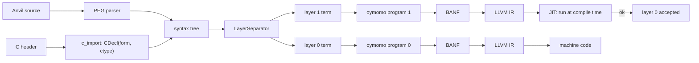
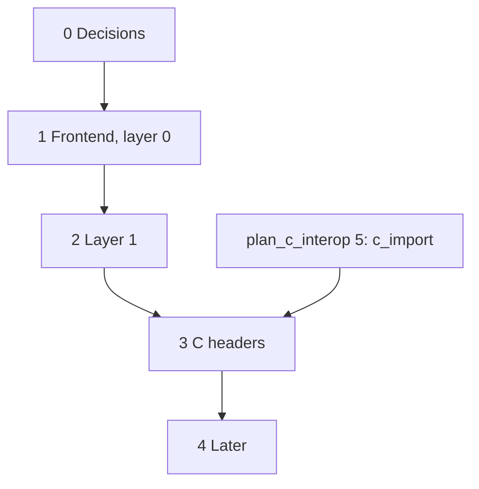

# Plan: Anvil, a two-layer language on oymomo

Status: **proposed**, with open questions; 0 of 5 phases.

This is a roadmap, not a single design change: each phase below is **one or more plans
of its own** (`plan_<name>.md`), and each of those has steps of one commit each. A phase
is checked off when all its plans are closed. The language is called **Anvil**
(step 0.1). It lives in `src/oymo/anvil/`, beside `oymomo/`.

Anvil has no C interop work of its own: it lowers to oymomo, and calling C or being
called by C are oymomo features ([plan_c_interop.md](plan_c_interop.md)). Its only
C-specific code is mapping C types to Anvil types for layer 1 ([Phase 3](#phase-3--c-headers-in-both-layers)),
since types are Anvil's, not oymomo's.

## Steps

- [ ] 0. Decisions: name, syntax, layer semantics, memory model ([Phase 0](#phase-0--decisions))
- [ ] 1. Anvil frontend, layer 0 only ([Phase 1](#phase-1--anvil-frontend-layer-0-only))
- [ ] 2. Layer 1: the type checker as code ([Phase 2](#phase-2--layer-1-the-type-checker-as-code))
- [ ] 3. C headers in both layers ([Phase 3](#phase-3--c-headers-in-both-layers))
- [ ] 4. Later: closures, multiple files ([Phase 4](#phase-4--later))

## Goal

Anvil is a language whose programs:

1. are written in one source file with **two layers**, as TAPL does for Python:
   layer 0 is what runs, layer 1 is the type checker, and it is real code;
2. lower **each layer to its own oymomo program**, then to BANF, LLVM IR and machine code.

Layer 1 is compiled to machine code and **run during compilation** (llvmlite MCJIT). If
it finishes without error, layer 0 type-checks. This mirrors TAPL's `a1.py`.

## Where we start from

| oymo has | Missing for Anvil |
|---|---|
| PEG engine ([peg.py](../src/oymo/core/peg.py)) | Anvil grammar, layer separation, lowering to oymomo |
| oymomo → BANF → LLVM IR | A JIT run of layer 1 at compile time |
| `c_import` giving `CDecl(form, ctype)`, once [plan_c_interop.md](plan_c_interop.md) Phase 5 lands | Mapping a ctype to an Anvil type |

## Phases

### Phase 0 — decisions

Each decision is written down in this file (or a plan of its own) before Phase 1 starts.

**0.1 Name and file extension.** Name: **Anvil** (decided). File extension: **`.oymo`**
(decided), as for every language on oymo; the file's first line is `language anvil`
([roadmap.md](roadmap.md#one-file-extension-a-language-header)).

**0.2 Syntax.** The main choice:
- A: C/Zig-like braces. Familiar to C users.
- B: TAPL `pythonlike` indentation. Reuses the chunker and the layer syntax (`^expr`,
  `<expr:Type>`).

To settle with sample programs written both ways: hello world, a struct with a function
on it, a function passed as an argument, a type-level function (`Matrix(^2, ^3)`), and
a C header import. Then a grammar sketch and precedence table in the style of
[notes.md › oymomo syntax](notes.md#oymomo-syntax).

**0.3 What layer 1 means.** Proposal: as in TAPL. A type is a value in layer 1; each
function's layer-1 version checks its arguments' types; an error stops the build.

**0.4 Memory model.** Manual (`malloc` / `free`, as C and Zig) to start. No GC.

### Phase 1 — Anvil frontend, layer 0 only

- Grammar on the PEG engine; syntax tree classes with `separate()`, as in TAPL.
- Lower layer 0 to an oymomo program (the `module -> {...}` shape).
- Surface constructs map to oymomo ones: functions → structs of blocks, `if` / `while`
  → blocks and jumps, locals → `alloca`, structs → struct forms.
- **Milestone: hello world**, built and run.

### Phase 2 — layer 1: the type checker as code

- Lower layer 1 to a second oymomo program, compile it, JIT-run it at compile time.
- A small layer-1 runtime: type values (`Int32`, `Ptr(T)`, struct types), equality,
  errors with source locations.
- `^expr` (lift) and `<expr:Type>` (a two-layer expression), as in TAPL.
- **Milestone:** a type error in layer 0 stops the build with a message.

### Phase 3 — C headers in both layers

A header import (syntax from 0.2) calls `c_import` once, with the build's target and
flags. Each `CDecl(form, ctype)` is a two-layer value, `<form:ctype>`, so the
`LayerSeparator` splits it like any other:

- **Layer 0** gets the form, unchanged: an import in `module`'s form, a struct form, or
  a constant.
- **Layer 1** gets the ctype, mapped to an Anvil type value: `int` → `c_int`,
  `const char *` → `Ptr(Const(c_char))`, a struct → a struct type, a typedef → its name
  for messages and its target for equality. The mapping is the only C-specific code in
  Anvil.

Rules:

- Both layers see the same names: a name `c_import` skipped is missing from both, with
  its reason in the error message.
- Layer 1 runs on the host but checks the **target's** C types: `c_long` is what the
  target's `long` is, as `c_import` reported it.
- A test checks the mapping against the forms: every Anvil type made from a ctype has
  the ctype's form.
- **Milestone:** an Anvil program imports `<stdio.h>`, calls `printf` and `puts`, and
  `puts(42)` is a layer-1 error.

### Phase 4 — later

Closures, multiple files and separate compilation, debug info mapped to Anvil source (`!dbg` attachments and the metadata table, [plan_metadata.md](plan_metadata.md)).

## Order and dependencies

## Open questions

1. Does layer 1 lower to oymomo *exactly* like layer 0, or may it use features layer 0
   can't (closures, a GC)? If layer 1 only ever runs in the JIT, it could.
2. Does layer 1 run only on the host (JIT), or in Spindle ([plan_vm.md](plan_vm.md))?
3. How strict is the C mapping: is `int` to `long` an implicit conversion as in C, or
   an error? Is `char *` to `const char *` accepted?
