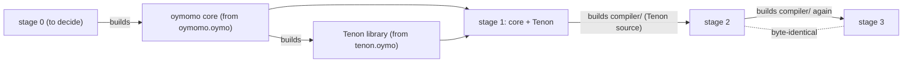
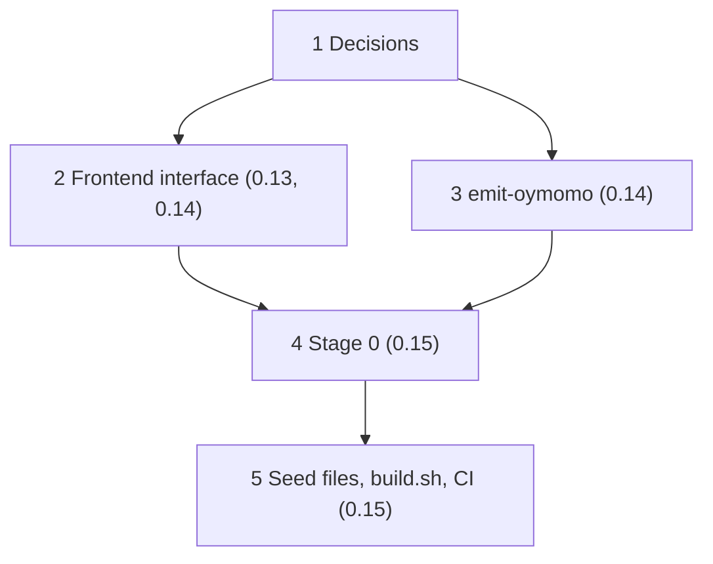

# Plan: the bootstrap seed in oymomo

Status: **proposed**, under discussion; 0 of 5 steps.

> [!IMPORTANT]
> Roadmap: this plan designs the seed of oymo 0.15 (self-hosting), and answers
> [roadmap.md › Open questions](roadmap.md#open-questions) 3 (how the seed is stored
> and refreshed). Its decisions are needed before 0.13, since they shape how the
> Tenon-written compiler is split into an oymomo core and a Tenon frontend.

## Steps

Tentative, until the open questions below are answered.

- [ ] 1. Decisions: what builds stage 0, what form the seed takes, how Tenon is found ([Open questions](#open-questions)) — before oymo 0.13
- [ ] 2. The frontend interface: the Tenon frontend sits behind the same interface as any language's, and the compiler is an oymomo core plus frontends — oymo 0.13, 0.14
- [ ] 3. `oymo emit-oymomo`: the compiler writes the oymomo it lowers a program to, as one file — oymo 0.14
- [ ] 4. Stage 0, whatever step 1 chooses — oymo 0.15
- [ ] 5. The seed files, `build.sh`, and CI building from the seed on every change — oymo 0.15

## Goal

**A machine with `clang` and nothing else builds oymo from a fresh clone**, as the
roadmap's 0.15 milestone says, with a seed that:

1. **changes rarely**, so the repository doesn't fill with regenerated multi-megabyte
   files, and a Tenon syntax change doesn't force a new seed for everything;
2. **is as target-independent as possible**, so the 1.x targets don't each need a seed;
3. **can be checked**: builds from it are reproducible, and the seed can be compared
   with what the current compiler would write.

## The proposal

Today's roadmap commits the whole compiler as one `.ll` file (`bootstrap/oymo.ll`).
The proposal: commit it **as oymomo instead, in two files**, split along the line the
compiler already has between oymomo and the languages on it.

| Seed file | What it holds | Changes when |
|---|---|---|
| `bootstrap/oymomo.oymo` | the oymomo core (parser, reduction, `shape`, translation to `.ll`, driver), lowered to oymomo | oymomo changes: rarely |
| `bootstrap/tenon.oymo` | the Tenon frontend (grammar, both layers' lowering), lowered to oymomo, as a **language library** the core finds when it compiles a `language tenon` file | Tenon changes: often, before 1.0 |

Both are `language oymomo` files, made by the compiler from its own Tenon source
(layer 0 only: layer 1 is erased, and a seed needs no type checking).



```
build.sh, sketched:
  <stage 0> bootstrap/oymomo.oymo -o core      # an oymomo compiler
  core      bootstrap/tenon.oymo  -o tenon.o   # the Tenon language library
  link core + tenon.o             -o stage1    # oymomo and Tenon
  stage1    compiler/             -o stage2    # the real compiler, from Tenon source
  stage2    compiler/             -o stage3    # again; stage2 and stage3 must match
```

### What it gets

- **Seed churn is split.** A Tenon change regenerates `tenon.oymo` only; `oymomo.oymo`
  stays put for months.
- **Target independence, mostly.** A `.ll` file has the C ABI, data layout and triple
  baked in; oymomo is above them, so one seed may serve every target (see
  [Open questions](#open-questions) 4 for the limits).
- **Tenon is built as a language library from the start**, through the interface a
  language author's frontend uses, so that interface is tested by the largest
  frontend there is long before 0.20–0.21.
- **No Python**, as the roadmap requires from 0.15.

### What it costs

- **Something must build the first oymomo file** on a machine with only `clang`: stage
  0 ([Open questions](#open-questions) 1). This is the core question of the plan.
- **The seed is generated, not written**: the compiler lowered to oymomo, likely
  megabytes. Reduction and `shape` must handle a term that size in reasonable time,
  and a reviewer reads diffs of it no better than diffs of `.ll`.
- **A plugin mechanism**, if Tenon is loaded at run time rather than linked in
  ([Open questions](#open-questions) 3).

## Prior art

| Project | Seed | Stage 0 |
|---|---|---|
| OCaml | `boot/ocamlc`, the compiler as portable bytecode, committed | the bytecode interpreter, in C |
| Zig | `zig1.wasm`, a reduced compiler as WebAssembly, committed | `wasm2c`, in C, turns it into C for the system compiler |
| Go | none committed: a previous Go release (Go 1.4, written in C, was the root) | the previous release |
| Rust, GHC | none committed: a previous release, downloaded | the previous release |

This proposal is closest to OCaml and Zig: a **portable intermediate form, committed**,
and a **small stage 0 that needs only a C toolchain**. oymomo plays the part of
OCaml's bytecode or Zig's wasm.

## Open questions

1. **What builds stage 0?** Something must turn `oymomo.oymo` into a running program
   with only `clang`. Options:
   - **a. A small `.ll` of the oymomo core** (`bootstrap/oymomo.ll`), next to the
     oymomo seeds. Simple; much smaller and steadier than the whole compiler's `.ll`;
     but tied to one target, so one per 1.x target, and `oymomo.oymo` is then
     redundant with it.
   - **b. An oymomo compiler written by hand in C.** Works on every target; but a
     second implementation of parser, reduction, `shape` and translation to keep in
     agreement with the real one (the Python compiler is about 4.6k lines).
   - **c. A minimal translator in C for *shaped* oymomo only.** The seed is committed
     after `shape`, in the form the translation reads directly, so stage 0 needs a
     parser and the translation to `.ll`, but no reduction. Much smaller than b, and
     the full core is then built from `oymomo.oymo` by it. Needs the shaped form to be
     printable and stable.
   - **d. An oymomo interpreter in C**, as OCaml's bytecode interpreter: it runs the
     core from `oymomo.oymo` directly, slowly, once, to build the native core.
   - **e. The frozen Python compiler.** No new code; but Python is back in the
     bootstrap, against the roadmap's 0.15 milestone.

   Leaning: **c**, if the shaped form is small enough to translate simply; otherwise
   **a**.
2. **Is `oymomo.oymo` needed at all?** With option a, the `.ll` already is the core.
   With b, c or d it is the core's portable source. Decide with question 1.
3. **How does the core find Tenon?** Options:
   - **a. Linked in at build time.** `build.sh` links the core with the Tenon library
     into one binary; Tenon is built like a library, but there is no loading at run
     time. Nothing new is needed before 0.19.
   - **b. A static table of built-in languages**, filled at link time, so adding a
     native language is relinking, not editing the core.
   - **c. Loaded at run time**, as a `.so` found on a search path (`OYMO_LANGUAGE_PATH`)
     through a C interface (`frontend(source, length, out_tree)`). The most like a
     language author's package; but it needs a stable plugin interface and the C API
     (0.19) before the bootstrap, and the standalone binary (0.39) has to find it.

   Leaning: **a** for 0.15, moving to **c** when the C API and the registry (0.19,
   0.20) exist, so native language libraries and Python ones are found the same way.
4. **How target-independent is the seed really?** oymomo has explicit integer widths
   and leaves the C ABI to the translation, but:
   - from 0.28 the compiler imports C headers (libc, libclang), and `c_import`
     resolves `long`, `size_t` and struct layouts for one target, so the lowered
     oymomo carries them;
   - pointer size and struct layout come from the data layout at translation.

   Options: keep the compiler's own source free of target-dependent C types (a rule,
   checked in CI by building the seed for two targets); or accept one seed per target
   for the parts that import C.
5. **What does the frontend interface look like?** Source text and file name in; an
   oymomo tree (or a Tenon tree, for high-level frontends) with locations out; errors
   as data. The same interface serves Tenon, `calc` and Python frontends through the
   binding (0.19). Designed in step 2.
6. **How big and slow is the seed?** Measure on the compiler at 0.13: the size of the
   lowered oymomo, and the time to build it. If reduction is too slow on a term that
   size, the shaped seed of 1c is needed anyway.
7. **Regeneration and storage.** When is each seed file regenerated (only when the
   source uses something the old seed can't build, or on every release), and is it
   committed as is, kept in Git LFS, or published as a release artifact?
8. **Trust.** A seed is a binary in disguise ("Reflections on Trusting Trust"). Should
   CI check it by diverse double compilation: build the compiler once from the seed
   and once from the frozen Python compiler (until it is removed), and compare stage 3
   of both?

## Order and dependencies



- Step 1 before 0.13: the split between the core and the Tenon frontend is built into
  the Tenon-written compiler from its first line.
- Steps 2 and 3 land with the rewrite (0.13, 0.14), as part of the port, not as new
  features: the Python compiler gets `emit-oymomo` too only if the seed is checked
  against it (question 8).
- Steps 4 and 5 are 0.15.
