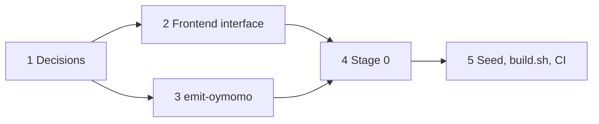

# Plan: the bootstrap seed in oymomo

**Status:** proposed · 0 of 5 steps · for oymo 0.15 (self-hosting), decide before 0.13
· answers [roadmap › Open questions](roadmap.md#open-questions) 3

## Goal

Build oymo from a fresh clone with only `clang`, using a seed that:

- **rarely changes**: a language change doesn't regenerate everything
- **is target-independent**: one seed for every target, if possible
- **can be checked**: builds are reproducible

## Steps

- [ ] 1. Answer the [open questions](#open-questions) (before 0.13)
- [ ] 2. Frontend interface: the compiler is an oymomo core plus frontends (0.13–0.14)
- [ ] 3. `oymo emit-oymomo`: write a program's shaped oymomo as text, one file per module (0.14)
- [ ] 4. Stage 0: `stage0.ll`, translates shaped oymomo text to `.ll` (0.15)
- [ ] 5. Seed files, `build.sh`, CI builds from the seed (0.15)

## Proposal

### Two languages

The user-facing language is split into two ([story.md](story.md)):

| Language | Header | What | In the seed |
|---|---|---|---|
| **Alcor** | `language alcor` | kernel systems language: only what the compiler needs to compile itself | yes |
| **Mizar** | `language mizar` | general-purpose language: extends Alcor | no, built by stage 1 |

- The compiler is written in **Alcor**, **permanently**; CI checks it by building
  `compiler/` with stage 1.
- **Mizar** is an **extension** of Alcor through oymo's public language-extension
  interface, the same one users get; not a fork, no access to internals.
- Left out of Alcor, for example: floats, threads, atomics, SIMD, `goto`, `union`,
  `switch` fall-through, side-effecting expressions (inspired by seL4's StrictC subset,
  plus recursion, heap and tagged enums). New features go into Mizar; they move down
  only when the compiler needs them.
- Data structures are library code: the shaped seed keeps only what the compiler uses.
  What matters is the language features they need (e.g. generics for hash maps).

### Seed

Commit the seed as **shaped oymomo in text form**, split so the core and Alcor change
independently, instead of one `bootstrap/oymo.ll`:

| File | Holds | Changes |
|---|---|---|
| `bootstrap/stage0.ll` | stage 0: shaped oymomo text → `.ll` | almost never |
| `bootstrap/oymomo.oymo` | oymomo core: parser, reduction, `shape`, translation, extension interface, driver | rarely, once settled |
| `bootstrap/alcor/*.oymo` | Alcor frontend, as a language library, one file per part | rarely |
| `bootstrap/clang-version` | minimum and tested clang version | on LLVM upgrades |

All `.oymo` files are generated from the compiler's source (Alcor, layer 0 only).

```
clang   stage0.ll                  -> stage0
stage0  oymomo.oymo                -> oymomo.ll
stage0  alcor/*.oymo               -> alcor/*.ll
clang   oymomo.ll alcor/*.ll       -> stage1     # knows Alcor only
stage1  compiler/                  -> stage2     # adds Mizar
stage2  compiler/                  -> stage3     # must match stage2 byte for byte
```

`compiler/` holds both frontends, all written in Alcor; stage 1 builds Mizar from
source as an extension.

- **Pro:** the seed changes only when the core or Alcor does; Mizar changes never
  touch it; no floats, atomics or threads for stage 0 to translate (the most
  target-specific `.ll`); text is diffable and reviewable; no target baked in; no
  Python; the extension interface is tested by its largest user.
- **Con:** needs a stage 0; the seed is generated and large (megabytes); the compiler
  is limited to Alcor; the extension interface must exist by 0.15.

The split needs:

- **Linkage in shaped oymomo:** each file declares the symbols it exports and imports;
  `clang` links the resulting `.ll` files.
- **No specialization across files:** `shape` stops at the file boundary, so an Alcor
  change cannot ripple into `oymomo.oymo`. The core ↔ language boundary is the
  frontend interface (question 5).
- **The extension interface in the seed:** stage 1 must build Mizar as an extension
  (questions 3, 11).

## Open questions

1. ~~What builds stage 0 with only `clang`?~~ **Decided:** a small `stage0.ll` that
   translates *shaped* oymomo text only (no reduction): 1a and 1c combined.
   Rejected: b (second implementation), d (interpreter).
2. ~~Is `oymomo.oymo` needed?~~ **Decided:** yes, separate from the language
   frontend, so the core settles.
3. **How does the core find a language?** Leaning: **a** for 0.15, **c** after 0.19–0.20.
   - a. Linked in at build time (as in the pipeline above)
   - b. Static table of built-in languages, filled at link time
   - c. Loaded at run time as a `.so` (needs the C API)
4. **Is the seed really target-independent?** Leaning: yes, for **64-bit targets**.
   `stage0.ll` and its output use the portable `.ll` subset (see notes); 32-bit
   targets (wasm32) need a second `stage0.ll` or are left out. `c_import` (from 0.28)
   bakes in `long`, `size_t` and struct layouts: ban target-dependent C types in the
   compiler (checked in CI), or keep one seed per target.
5. **Frontend interface?** Source in; tree with locations and errors out. Designed in step 2.
6. **Seed size and build time?** Measure at 0.13.
7. **When to regenerate, and where to store?** In the repo, Git LFS or release artifacts.
8. **Trust:** should CI compare builds from the seed and from the frozen Python compiler?
9. **How is `stage0.ll` produced?** Generated once from a small oymo program and
   committed, or written by hand.
10. **How are the Alcor files split?** For example by part (lexer, parser, checker,
    lowering). Each file is a linkage unit; fewer cross-file symbols keep stage 0
    simple.
11. **What does the extension interface look like, and is it ready by 0.15?** Mizar
    uses only it. Today's roadmap has the language-author interface at 0.20–0.21; Mizar
    needs it earlier.
12. **What is in Alcor?** Start from what the compiler uses: integers, pointers,
    structs, arrays, strings, tagged enums, `switch`, recursion, heap; generics and
    closures only if the compiler needs them.
13. **Which language owns layer 1?** If the compiler's source has layer-1 types, Alcor
    must at least parse and erase them; checking could be added by Mizar (stage 2).
14. **Which language do users extend?** Usually Mizar; Alcor could be a minimal base
    (e.g. for new targets).
15. ~~Names?~~ **Decided:** **Alcor** (`language alcor`) for the kernel systems
    language and **Mizar** (`language mizar`) for the general-purpose language
    ([story.md](story.md)).

## Dependencies



## Background (for agents)

Context kept for reference; not needed to follow the plan.

### Prior art

| Project | Seed | Stage 0 |
|---|---|---|
| OCaml | `boot/ocamlc`, portable bytecode, committed | bytecode interpreter in C |
| Zig | `zig1.wasm`, reduced compiler as wasm, committed | `wasm2c` turns it into C |
| Go | none: previous release (root: Go 1.4, in C) | previous release |
| Rust, GHC | none: previous release, downloaded | previous release |

This plan is closest to OCaml and Zig: a committed portable form (oymomo plays the
part of bytecode / wasm) and a small stage 0 that needs only `clang`.

### Rejected options

- **Stage 0 = the frozen Python compiler** (was 1e): no new code, but puts Python
  back in the bootstrap, against the roadmap's 0.15 milestone.
- **Whole compiler as one `.ll`** (today's roadmap): fills the repo with regenerated
  multi-megabyte files, a language syntax change regenerates everything, and it bakes in
  one target's C ABI, data layout and triple.
- **Binary seed:** a smaller stage 0, but not diffable or reviewable (question 8).
- **One seed file for core and Alcor:** an Alcor change regenerates the core.
- **One language (Alcor and Mizar merged) in the seed:** every feature (floats, threads) lands in the seed; it
  changes often and stage 0 must translate target-specific `.ll`.
- **Compiler language and general language as two separate frontends:** two
  implementations to keep in agreement; an extension shares one.

### Notes on the open questions

- 1: the Python compiler is ~4.6k lines; a second implementation (1b) would have to
  stay in agreement. Stage 0 needs the shaped form printable as text and stable.
- 3c: search path `OYMO_LANGUAGE_PATH`, C interface like
  `frontend(source, length, out_tree)`; needs a stable plugin interface and the C API
  (0.19) before the bootstrap, and the standalone binary (0.39) must find it. Moving
  to 3c later lets native and Python language libraries be found the same way.
- 4: Clang's own `.ll` is target-specific (triple, data layout, C ABI lowering). A
  generated `.ll` is portable if it:
  - leaves out `target triple` and `target datalayout` (clang uses the host's)
  - uses only `i8`/`i32`/`i64`, `ptr`, and `getelementptr` for offsets
  - never hard-codes pointer size
  - calls C with scalars and pointers only, no structs by value
  - avoids C `long` (32-bit on Windows); treats `size_t` as `i64` (the 64-bit limit)
  
  The CI check would build the seed for two targets.
- `clang-version`: LLVM keeps old bitcode readable, not old `.ll` text. Opaque `ptr`
  needs LLVM ≥ 15 (typed pointers removed in 17). CI builds with the minimum and
  tested versions.
- 5: the same interface serves Alcor, Mizar, `calc` and Python frontends (via the 0.19
  binding); high-level frontends may return a Mizar tree.
- Building the general language as an extension tests the language-author interface
  with the largest frontend long before 0.20–0.21.
- Prior art for "the compiler uses a subset": Go's compiler must build with an older
  Go release; Zig's `zig1` is a reduced compiler.
- Reduction and `shape` must handle a megabyte-size term in reasonable time.
- Step 3: the Python compiler gets `emit-oymomo` only if the seed is checked against
  it (question 8). Question 8 is diverse double compilation ("Reflections on
  Trusting Trust"): compare stage 3 from both builds.
