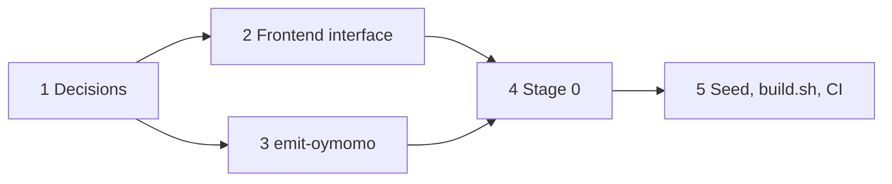

# Plan: the bootstrap seed in oymomo

**Status:** proposed · 0 of 5 steps · for oymo 0.15 (self-hosting), decide before 0.13
· answers [roadmap › Open questions](roadmap.md#open-questions) 3

## Goal

Build oymo from a fresh clone with only `clang`, using a seed that:

- **rarely changes**: a Tenon change doesn't regenerate everything
- **is target-independent**: one seed for every target, if possible
- **can be checked**: builds are reproducible

## Steps

- [ ] 1. Answer the [open questions](#open-questions) (before 0.13)
- [ ] 2. Frontend interface: the compiler is an oymomo core plus frontends (0.13–0.14)
- [ ] 3. `oymo emit-oymomo`: write a program's lowered oymomo to one file (0.14)
- [ ] 4. Stage 0 (0.15)
- [ ] 5. Seed files, `build.sh`, CI builds from the seed (0.15)

## Proposal

Commit the seed as **two oymomo files** instead of one `bootstrap/oymo.ll`:

| File | Holds | Changes |
|---|---|---|
| `bootstrap/oymomo.oymo` | oymomo core: parser, reduction, `shape`, translation, driver | rarely |
| `bootstrap/tenon.oymo` | Tenon frontend, as a language library | often |

Both are generated from the compiler's Tenon source (layer 0 only).

```
<stage 0> oymomo.oymo -> core       # oymomo compiler
core      tenon.oymo  -> tenon.o    # Tenon library
core + tenon.o        -> stage1
stage1    compiler/   -> stage2
stage2    compiler/   -> stage3     # must match stage2 byte for byte
```

- **Pro:** Tenon changes touch only `tenon.oymo`; no target baked in; no Python.
- **Con:** needs a stage 0; the seed is generated and large (megabytes).

## Open questions

1. **What builds stage 0 with only `clang`?** Leaning: **c**, else **a**.
   - a. Small `.ll` of the core (one per target)
   - b. oymomo compiler written by hand in C (a second implementation to maintain)
   - c. C translator for *shaped* oymomo only (no reduction needed)
   - d. oymomo interpreter in C
2. **Is `oymomo.oymo` needed?** Not with 1a. Decide with question 1.
3. **How does the core find Tenon?** Leaning: **a** for 0.15, **c** after 0.19–0.20.
   - a. Linked in at build time
   - b. Static table of built-in languages, filled at link time
   - c. Loaded at run time as a `.so` (needs the C API)
4. **Is the seed really target-independent?** `c_import` (from 0.28) bakes in
   `long`, `size_t` and struct layouts. Either ban target-dependent C types in the
   compiler (checked in CI), or keep one seed per target.
5. **Frontend interface?** Source in; tree with locations and errors out. Designed in step 2.
6. **Seed size and build time?** Measure at 0.13. If too slow, use 1c.
7. **When to regenerate, and where to store?** In the repo, Git LFS or release artifacts.
8. **Trust:** should CI compare builds from the seed and from the frozen Python compiler?

## Dependencies



## Background (for agents)

Context kept for reference; not needed to follow the plan.

### Prior art

| Project | Seed | Stage 0 |
|---|---|---|
| OCaml | `boot/ocamlc`, portable bytecode, committed | bytecode interpreter in C |
| Zig | `zig1.wasm`, reduced compiler as wasm, committed | `wasm2c` turns it into C |
| Go | none: previous release (root: Go 1.4, in C) | previous release |
| Rust, GHC | none: previous release, downloaded | previous release |

This plan is closest to OCaml and Zig: a committed portable form (oymomo plays the
part of bytecode / wasm) and a small stage 0 that needs only a C toolchain.

### Rejected options

- **Stage 0 = the frozen Python compiler** (was 1e): no new code, but puts Python
  back in the bootstrap, against the roadmap's 0.15 milestone.
- **Whole compiler as one `.ll`** (today's roadmap): fills the repo with regenerated
  multi-megabyte files, a Tenon syntax change regenerates everything, and it bakes in
  one target's C ABI, data layout and triple.

### Notes on the open questions

- 1a makes `oymomo.oymo` redundant with the `.ll`. 1b: the Python compiler is ~4.6k
  lines to keep in agreement. 1c needs the shaped form printable and stable; the full
  core is then built from `oymomo.oymo`. 1d runs the core slowly, once, to build the
  native core.
- 3c: search path `OYMO_LANGUAGE_PATH`, C interface like
  `frontend(source, length, out_tree)`; needs a stable plugin interface and the C API
  (0.19) before the bootstrap, and the standalone binary (0.39) must find it. Moving
  to 3c later lets native and Python language libraries be found the same way.
- 4: pointer size and struct layout also come from the data layout at translation.
  The CI check would build the seed for two targets.
- 5: the same interface serves Tenon, `calc` and Python frontends (via the 0.19
  binding); high-level frontends may return a Tenon tree.
- Building Tenon as a language library from the start tests the language-author
  interface with the largest frontend long before 0.20–0.21.
- A generated seed is diffed no better than `.ll`; reduction and `shape` must handle
  a megabyte-size term in reasonable time.
- Step 3: the Python compiler gets `emit-oymomo` only if the seed is checked against
  it (question 8). Question 8 is diverse double compilation ("Reflections on
  Trusting Trust"): compare stage 3 from both builds.
