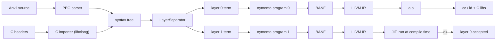
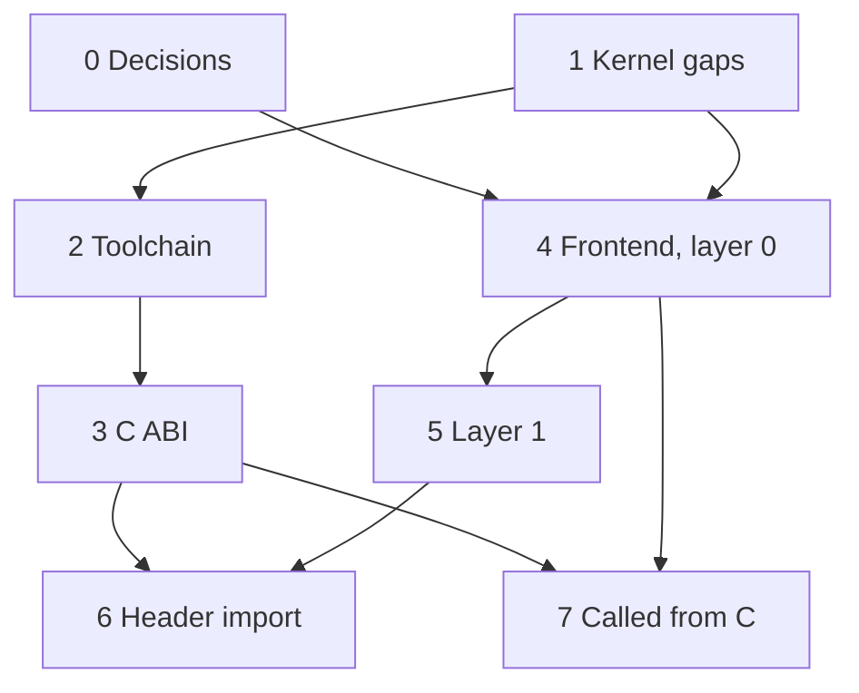

# Plan: a two-layer, C-interoperable language on oymomo

Status: **proposed**, with open questions; 0 of 9 phases.

This is a roadmap, not a single design change: each phase below is **one or more plans
of its own** (`plan_<name>.md`), and each of those has steps of one commit each. A phase
is checked off when all its plans are closed. The language is called **Anvil**
(step 0.1). It lives in `src/oymo/anvil/`, beside `oymomo/`.

## Steps

- [ ] 0. Decisions: name, syntax, layer semantics, memory model ([Phase 0](#phase-0--decisions))
- [ ] 1. oymomo kernel gaps for C ([Phase 1](#phase-1--oymomo-kernel-gaps-for-c))
- [ ] 2. Toolchain: from oymomo to a running binary ([Phase 2](#phase-2--toolchain-from-oymomo-to-a-running-binary))
- [ ] 3. C ABI lowering in `llvm_abi.py` ([Phase 3](#phase-3--c-abi-lowering-llvm_abipy))
- [ ] 4. Anvil frontend, layer 0 only ([Phase 4](#phase-4--anvil-frontend-layer-0-only))
- [ ] 5. Layer 1: the type checker as code ([Phase 5](#phase-5--layer-1-the-type-checker-as-code))
- [ ] 6. Import C headers ([Phase 6](#phase-6--import-c-headers))
- [ ] 7. Called from C ([Phase 7](#phase-7--called-from-c))
- [ ] 8. Later: separate compilation, debug info, more targets ([Phase 8](#phase-8--later))

Suggested start: Phase 0, then 1.1 + 1.2 + Phase 2. That gives an oymomo program calling
`puts` as a real binary, before any Anvil syntax exists.

## Goal

Anvil is a language whose programs:

1. are written in one source file with **two layers**, as TAPL does for Python:
   layer 0 is what runs, layer 1 is the type checker, and it is real code;
2. lower **each layer to its own oymomo program**, then to BANF, LLVM IR and machine code;
3. **call C and are called by C** with no glue code: same ABI, same symbols, same
   memory layout, and C headers usable directly;
4. can **replace a single library or file in a C stack**, without rewriting any code
   above it (its callers) or below it (what it calls): the Anvil version exports the same
   symbols, ABI and struct layouts, uses the same header, and links as the same `.o`,
   `.a` or `.so`.

Layer 1 is compiled to machine code and **run during compilation** (llvmlite MCJIT). If
it finishes without error, layer 0 type-checks. This mirrors TAPL's `a1.py`.

## Where we start from

| oymo has | Missing for C interop |
|---|---|
| Ints `i1..i64`, int opcodes | Floats (`f32`, `f64`) and their ops and conversions |
| Structs as values, by-value params | **C ABI lowering**: LLVM passes `{i32, i32}` as an aggregate; C on x86-64 SysV passes it as one `i64` |
| Imported functions and data, one LLVM symbol each | Linkage and visibility (`internal`, exported), C name ≠ label |
| Every function returns a value | `void` functions (`=> {}`) |
| First-order calls by symbol | Function pointers and indirect calls (callbacks, `qsort`) |
| Immutable values | Memory: regions, load, store ([plan_memory.md](plan_memory.md)); a raw `'ptr'` and the bridge between C memory and regions |
| — | Field and element addresses (GEP), arrays `T[N]`, unions |
| — | Varargs calls (`printf`) |
| LLVM IR text | Object files, linking, a driver CLI |
| `data_layout=''` | A real target triple and data layout (sizes of `int`, `long`, pointers) |
| PEG engine ([peg.py](../src/oymo/core/peg.py)) | Anvil grammar, layer separation, lowering to oymomo |

## How other languages interoperate with C

| Language | Calling C | Being called by C | Reading headers | ABI lowering |
|---|---|---|---|---|
| **Zig** | `extern fn`, `callconv(.C)` | `export fn` | `@cImport` / `translate-c`, built on clang | Own, per target |
| **Rust** | `extern "C" { ... }` | `#[no_mangle] extern "C" fn` | `bindgen` (libclang), external tool | Own, per target, in rustc |
| **Swift** | Direct: headers are modules | `@_cdecl` | ClangImporter (embeds clang) | **Reuses clang's CodeGen** |
| **D** | `extern(C)` | `extern(C)` | ImportC: the compiler contains a C parser | Own |
| **Odin / C3 / Hare** | `foreign import` / `extern fn` | `@export` / `export` | Hand-written bindings | Own; C ABI is the default |
| **Nim / V** | `importc` | `exportc` | `c2nim` / built-in | None: they **compile to C** |
| **Go (cgo)** | `import "C"` with a comment preamble | `//export` | Runs gcc on the preamble | Generated C stubs; costly stack switch |
| **Carbon** | Imports C++ headers | — | Embeds clang | Reuses clang |

What they share:

1. **One declaration form for a foreign function**: explicit C calling convention,
   explicit types, no name mangling.
2. **`repr(C)`-style structs**: fields in order, aligned as C aligns them. oymomo structs
   are already ordered, so an oymomo struct form is a C struct.
3. **C-named types whose width depends on the target**: `c_int`, `c_long`.
4. **ABI lowering is the hard part.** LLVM IR does *not* implement the C ABI: each
   frontend lowers by-value structs, small ints (`zeroext`, `signext`), `sret` returns
   and varargs per target. They write it (Zig, Rust), borrow clang's (Swift, Carbon), or
   avoid it (Nim emits C, cgo emits C stubs).
5. **Headers are read with clang**, not a hand-written C parser (D is the exception).

Chosen direction: Zig/Rust-style declarations; header import through libclang (Python
`clang.cindex`), an **optional** dependency needed only for header import; and an
**ABI lowering pass in the LLVM stage**, checked against clang by differential tests.
The ABI is a layout fact, so it belongs in `llvm_*.py`, and BANF stays
target-independent (see [notes.md › BANF does not depend on LLVM](notes.md#banf-does-not-depend-on-llvm)).

## Phases

### Phase 0 — decisions

Each decision is written down in this file (or a plan of its own) before Phase 4 starts.
Phases 1–3 don't depend on them.

**0.1 Name and file extension.** Name: **Anvil** (decided). File extension: open.

**0.2 Syntax.** The main choice:
- A: C/Zig-like braces. Familiar to C users; C declarations map almost word for word.
- B: TAPL `pythonlike` indentation. Reuses the chunker and the layer syntax (`^expr`,
  `<expr:Type>`).

To settle with sample programs written both ways: hello world, a struct with a function
on it, a call to `qsort` with a callback, a type-level function (`Matrix(^2, ^3)`), and
an `extern` / `export` declaration. Then a grammar sketch and precedence table in the
style of [notes.md › oymomo syntax](notes.md#oymomo-syntax).

**0.3 What layer 1 means.** Proposal: as in TAPL. A type is a value in layer 1; each
function's layer-1 version checks its arguments' types; an error stops the build.

**0.4 Memory model.** Manual (`malloc` / `free`, as C and Zig) to start. No GC, so
pointers pass freely to C.

### Phase 1 — oymomo kernel gaps for C

| # | Plan | Why C needs it |
|---|---|---|
| 1.1 | Memory: regions, load, store (exists: [plan_memory.md](plan_memory.md)); then `'ptr'`, `$region {address, size}` and `$address {mem}` to cross between C memory and regions, with a token for imports | Pointers are C's main data type |
| 1.2 | `void`: `=> {}` returns, a call as a statement | Most C APIs return `void` |
| 1.3 | Floats: `'f32'`, `'f64'`, arithmetic, comparisons, int↔float (exists: [plan_floats.md](plan_floats.md)) | `double` everywhere in libc and libm |
| 1.4 | Field and element addresses: `$gep` on a struct or array form | `&s->x`, `a[i]`; offsets stay in LLVM, not in the kernel |
| 1.5 | Array form `T[N]`, and a decision on unions | C structs contain arrays and unions |
| 1.6 | Function pointers: `module.f` as an address, indirect call | Callbacks (`qsort`, `atexit`) |
| 1.7 | Varargs declarations and calls | `printf`, `open` |
| 1.8 | Linkage: internal vs exported symbols, symbol name ≠ label | Export to C, hide helpers |
| 1.9 | Switch (exists: [plan_switch.md](implemented/plan_switch.md)) | C `switch`, enums |

### Phase 2 — toolchain: from oymomo to a running binary

- A real `Target`: triple and data layout from llvmlite's host target.
- Emit `.o` with llvmlite's `TargetMachine`; link with the system `cc`.
- A driver: `oymo build a.oymo -o a`, `oymo run`.
- End-to-end tests that call libc and a small C test library and check the output.

### Phase 3 — C ABI lowering (`llvm_abi.py`)

1. Scalars and pointers: `zeroext` / `signext` on `i1`, `i8`, `i16` where the target
   needs it. That is enough for most of libc.
2. By-value structs and `sret` returns for **x86-64 SysV**, then **AArch64**, then
   **Win64**.
3. Differential tests: for each signature, a C caller and callee compiled by clang,
   linked with the oymo side, checked in both directions.

Fallback if 2 is too costly at first: reject by-value structs at the C boundary (pass a
`'ptr'`), and say so in the error message.

### Phase 4 — Anvil frontend, layer 0 only

- Grammar on the PEG engine; syntax tree classes with `separate()`, as in TAPL.
- Lower layer 0 to an oymomo program (the `module -> {...}` shape).
- Surface constructs map to kernel ones: functions → structs of blocks, `if` / `while`
  → blocks and jumps, locals → `alloca`, structs → struct forms.
- `extern` declarations → `module` imports; `export` → exported symbols.
- **Milestone: hello world** calling `puts`, built and run.

### Phase 5 — layer 1: the type checker as code

- Lower layer 1 to a second oymomo program, compile it, JIT-run it at compile time.
- A small layer-1 runtime: type values (`Int32`, `Ptr(T)`, struct types), equality,
  errors with source locations.
- `^expr` (lift) and `<expr:Type>` (a two-layer expression), as in TAPL.
- **Milestone:** a type error in layer 0 stops the build with a message.

### Phase 6 — import C headers

- An import of a C header (syntax from 0.2) runs libclang on it.
- Each C declaration gives **both layers**: a layer-0 `extern` and a layer-1 type.
  `int` and `long` map through the target (`c_int`, `c_long`).
- First functions, structs, enums, typedefs and simple `#define` constants. Later
  unions, bitfields and function-like macros (Zig translates only some).
- Struct layout checked against clang's `sizeof` and `offsetof`.

### Phase 7 — called from C

- `export` functions with a C name, the C ABI and no mangling.
- Generate a `.h` for the exported API (as `cbindgen` and `zig -femit-h` do).
- **Milestone:** a C `main` calls Anvil functions and passes callbacks in.

### Phase 8 — later

Separate compilation and multiple files, debug info (DWARF), more targets (wasm32),
closures (they would not cross into C). C++ is out of scope.

## Order and dependencies

## Open questions

1. Does layer 1 lower to oymomo *exactly* like layer 0, or may it use features layer 0
   can't (closures, a GC)? If layer 1 only ever runs in the JIT, it could.
2. Should C types in layer 1 depend on the target (`c_long` is 4 bytes on Win64, 8 on
   Linux), so a cross-compile type-checks differently?
3. ABI lowering: our own Python code (control, more work) or clang's CodeGen (exact, but
   a C++ dependency on top of llvmlite)?
4. Unions: a form of their own, or a byte array with a size and alignment (a layout fact
   the kernel avoids today)?
5. Does layer 1 run only on the host (JIT), and may it call C (e.g. `printf` for errors)?
