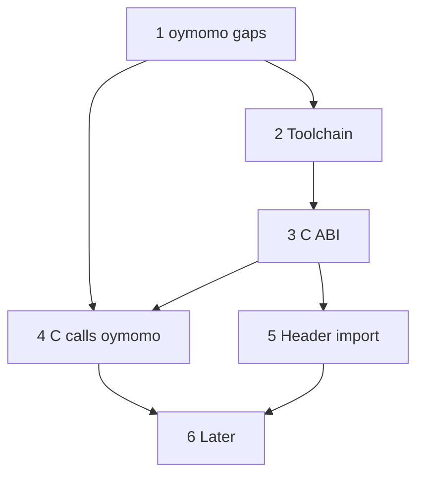
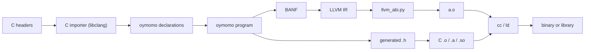

# Plan: oymomo and C, both directions, seamlessly

**Status:** proposed · 0 of 6 phases · ships 0.3 to 1.x
· release map in [roadmap.md](roadmap.md) (summary in [Background](#release-map))

A roadmap, not one change: each phase is one or more plans (`plan_<name>.md`) of
one-commit steps; a phase is done when all its plans are closed.

## Goal

oymomo and C call each other as if both were C: no glue code, no stubs, no runtime.

1. **oymomo calls C**: any C function: `void`, `double`, by-value structs, varargs
   (`printf`), callbacks (`qsort`).
2. **C calls oymomo**: an oymomo function in a `.o` is called through a normal
   prototype, and can be passed to C as a function pointer.
3. **Same memory**: pointers, structs, arrays have one layout on both sides. Memory
   is manual (`malloc` / `free`); no GC.
4. **Same toolchain**: one link step (`cc a.o b.o -lc`); an oymomo `.o`, `.a` or `.so`
   looks like a C one.
5. **Headers both ways**: C header → oymomo declarations (Phase 5); oymomo module →
   C header (Phase 4).
6. **Drop-in replacement**: an oymomo library replaces one C library or file, with no
   change above or below it (same symbols, ABI, layouts, header).

## Steps

- [ ] 1. oymomo gaps for C ([Phase 1](#phase-1--oymomo-gaps-for-c))
- [ ] 2. Toolchain: from oymomo to a running binary ([Phase 2](#phase-2--toolchain-from-oymomo-to-a-running-binary))
- [ ] 3. C ABI lowering in `llvm_abi.py` ([Phase 3](#phase-3--c-abi-lowering-llvm_abipy))
- [ ] 4. C calls oymomo: exports and callbacks ([Phase 4](#phase-4--c-calls-oymomo-exports-and-callbacks))
- [ ] 5. C headers to oymomo declarations ([Phase 5](#phase-5--c-headers-to-oymomo-declarations))
- [ ] 6. Later: TLS, separate compilation, more targets ([Phase 6](#phase-6--later))

## Decisions

- **C interop is an oymomo feature.** A language that lowers to oymomo gets all of it,
  with no C work of its own.
- **"Seamless" is measured at the binary level**, not in oymomo syntax (oymomo is a
  generated IR); the generator decides how C looks to its users.
- **Declaration form:** `module` imports, as today (`declare i32 @putchar(i8 %c)`).
- **ABI lowering:** a pass in the LLVM stage (`llvm_abi.py`), checked against
  clang by differential tests. The ABI is a layout fact; BANF stays target-independent.
- **Header import:** through libclang, an optional dependency needed only for it.
- **`c_import` gives a pair per declaration**, `CDecl(form, ctype)` (was open question 5).
- **oymomo has no `#include`**: a file holds only the resolved declarations it uses.
- **The preprocessor runs** as part of the parse; object-like macros are evaluated by clang.
- **Does not cross:**
  - closures as bare function pointers: no trampolines; a closure crosses as a
    `module` function plus a `void *` environment, where the C API takes user data
    (`qsort_r`, `pthread_create`)
  - ownership: nothing tracks who frees a pointer, as in C
  - C++: no classes, templates, exceptions or name mangling

## Phases

### Phase 1 — oymomo gaps for C

| # | Plan | Why C needs it |
|---|---|---|
| 1.1 | Memory exists ([plan_memory.md](implemented/plan_memory.md)); then null, pointer comparison, casts ([plan_memory_advanced.md](plan_memory_advanced.md) steps 1–2) | pointers everywhere; `NULL` ends lists |
| 1.2 | `void`: `=> {}` returns, a call as a statement | most C APIs return `void` |
| 1.3 | Floats: `'f32'`, `'f64'`, arithmetic, comparisons, int↔float ([plan_floats.md](plan_floats.md)) | `double` in libc and libm |
| 1.4 | Field and element addresses (exists: `'getelementptr'`) | `&s->x`, `a[i]`; offsets stay in LLVM |
| 1.5 | Arrays (exist: `{'array', count, element}`); decide unions | structs hold arrays and unions |
| 1.6 | Function pointers: `module.f` as an address; indirect call through `'ptr'` with a function form | callbacks, C library vtables |
| 1.7 | Varargs: declarations, calls, `va_list` in definitions | `printf`, `open`; `vprintf`-style functions |
| 1.8 | Linkage: internal vs exported; symbol name ≠ label | export to C, hide helpers |
| 1.9 | Switch (exists: [plan_switch.md](implemented/plan_switch.md)) | `switch`, enums |
| 1.10 | Atomics (`'atomicrmw'`, `'cmpxchg'`, `'fence'`, ordered `'load'`/`'store'`), `volatile`, inline asm; own plan | C11 atomics, threads, MMIO |

### Phase 2 — toolchain: from oymomo to a running binary

- Real `Target`: host triple and data layout in the `.ll`.
- `.o` via `clang -c` on the `.ll`; link with system `cc`.
- Driver: `oymo build a.oymo -o a`, `oymo run`, `-c`.
- End-to-end tests calling libc and a small C test library.
- **Milestone: oymomo calls C** (`puts`, built and run).

### Phase 3 — C ABI lowering (`llvm_abi.py`)

1. Scalars and pointers: `zeroext` / `signext` on `i1`, `i8`, `i16` where needed
   (enough for most of libc).
2. By-value structs and `sret`: x86-64 SysV (0.24), then AArch64, Win64 (1.x).
3. Same lowering on both sides: imports, C-callable definitions, indirect calls (1.6).
   Internal oymomo-to-oymomo calls may skip it.
4. Varargs: default promotions (`float` → `double`, small ints → `int`), register
   rules (`%al` on x86-64).
5. Differential tests: per signature, C caller and callee from clang, both directions.

Fallback if 2 is too costly: reject by-value structs at the boundary (pass `'ptr'`),
with a clear error.

### Phase 4 — C calls oymomo: exports and callbacks

- Exported functions (1.8): C name, C ABI, no mangling; the rest `internal`.
- Exported data and cells (`extern int counter;` reads a `'global'`).
- Callbacks: oymomo function passed to C (1.6) and called back.
- Generated `.h` from the exported part of `module` (like `cbindgen`,
  `zig -femit-h`): prototypes, structs, include guards. Uses layer-1 types if the
  frontend gives them (Alcor/Mizar: `unsigned`, `const char *`, named structs); forms alone
  give `int`-sized and `void *` types.
- Build-system flags (Make, CMake): `-c`, `-o`, `-MD` / `-MF`, `compile_commands.json`.
- Output `.a` and `.so` too.
- **Milestone: C calls oymomo** through the generated header, with a callback.
- **Milestone: drop-in** (0.24, needs by-value structs): a one-file C library rewritten
  in Mizar or oymomo passes its unchanged C test suite.

### Phase 5 — C headers to oymomo declarations

`c_import(header, target, flags)` runs libclang **once** and returns one
`CDecl(form, ctype)` per declaration; the generator splices them in.

- **form** (term half): what oymomo needs: a `module` field, a struct form, or a
  byte-array constant.
- **ctype** (type half): the C type as plain data (signedness, width, pointee, `const`,
  fields, typedef/enum names, function pointer signatures), each with its form. Not
  tied to any type system; generators without types ignore it.
- **origin** (file, line, column), written as metadata ([plan_metadata.md](plan_metadata.md)).

| C declaration | form | ctype |
|---|---|---|
| function | import signature `{...} => R` | parameter and result C types |
| variable | data form, or `'ptr'` for a cell | C type, `const` or not |
| struct / typedef / enum | struct form / form / `'i32'` | named C type with fields or constants |
| `#define N 42` | byte array `[2a000000]~'i32'` | `int` |

- `flags` (`-I`, `-D`, `--target`) are part of the import, like the target.
- Object-like macros: evaluated by clang (see [Background](#notes-on-phase-5)).
- Skipped and listed: non-constant macros, function-like macros
  ([open question 4](#open-questions)).
- Mapping: `int`, `long` through the target (`long` = `'i64'` on Linux, `'i32'` on
  Win64); pointers → `'ptr'`; structs → struct forms in field order.
- Scope first: functions, structs, enums, typedefs, object-like macros. Later: unions,
  bitfields, function-like macros.
- Struct layout checked against clang's `sizeof` / `offsetof`.
- **Milestone:** import `<stdio.h>`, `<string.h>`; call `printf`, `strlen` with no
  hand-written declaration.

### Phase 6 — later

- Thread-local data (`_Thread_local` exports; glibc's `errno` is a function call).
- `static inline` functions in headers: no symbol to call ([open question 4](#open-questions)).
- Separate compilation and multiple modules (0.32). Debug info: [plan_metadata.md](plan_metadata.md).
- More targets: Linux AArch64, macOS AArch64, Windows x86-64 (1.x); wasm32 not planned.

## Open questions

1. **ABI lowering: own Python code or clang's CodeGen?** Own: control, more work.
   Clang: exact, but a C++ dependency on top of llvmlite.
2. **Unions?**
   - a. A form of their own
   - b. A byte array with size and alignment (a layout fact oymomo avoids today)
3. **Where is an export written?**
   - a. A tag on the definition in `module`'s form (like `noalias` in
     [plan_memory_advanced.md](plan_memory_advanced.md))
   - b. A separate export list
4. **`static inline` functions and function-like macros in headers?**
   - a. Skip them
   - b. Translate to oymomo (as Zig's `translate-c`, partially); shares work with
     `oymo translate-c` after 1.0 ([roadmap.md](roadmap.md#after-10--oymo-translate-c))
   - c. Compile with clang into a small `.o`: exact, but glue code
5. ~~Forms only, or also C types?~~ Decided: both, a pair per declaration
   ([Phase 5](#phase-5--c-headers-to-oymomo-declarations)).

## Dependencies

Not every gap blocks every phase: Phase 2 needs only 1.2; Phase 4's first milestone
needs only 1.6 and 1.8 with scalar signatures.

## Background (for agents)

Context kept for reference; not needed to follow the plan.

### Release map

Set by [roadmap.md](roadmap.md):

| oymo | From this plan |
|---|---|
| 0.3 | BANF removed: oymomo → LLVM IR `.ll` text directly; C ABI work done there |
| 0.5 | 1.1 null, pointer comparison, casts; 1.2 `void` (C calls, `oymo run`) |
| 0.6 | Phase 2, 3.1 (small ints) |
| 0.7 | 1.5 union decision, as far as tagged unions need it |
| 0.10 | 1.6 function pointers, callbacks |
| 0.13–0.15 | compiler rewritten in Alcor: same translation and `.ll`, built by `clang` |
| 0.18 | 1.8 linkage, Phase 4 (exports, `.h`, `.a`, `.so`) |
| 0.22 | Phase 4 build-system flags; `-I`, `-L`, `-l`, pkg-config |
| 0.23 | 1.3 floats |
| 0.24 | 1.5 C unions, 3.2–3.3 and 3.5 for x86-64 SysV, drop-in milestone |
| 0.25 | 1.7 varargs, 3.4 |
| 0.26 | 1.10 `volatile`, inline asm |
| 0.27 | Phase 5 (header import via libclang's C API) |
| 0.32 | Phase 6: separate compilation |
| 0.34 | `static inline`, function-like macros (open question 4) |
| 0.36 | 1.10 atomics |
| 0.37 | Phase 6: thread-local data |
| 1.1–1.3 | 3.2 for AArch64, Win64, with their targets |
| after 1.0 | `oymo translate-c` |

### Pipeline

See [notes.md › A generated IR](notes.md#a-generated-ir-no-checks-for-user-mistakes)
and [notes.md › BANF does not depend on LLVM](notes.md#banf-does-not-depend-on-llvm).

### Starting point

| oymo has | Missing for C interop |
|---|---|
| Ints `i1..i64`, int opcodes | floats (`f32`, `f64`), ops, conversions |
| `'ptr'`, `'alloca'`, `'load'`, `'store'`, `'getelementptr'`, `'global'`, arrays, packed structs ([plan_memory.md](implemented/plan_memory.md)) | pointer comparison, null, casts, `memcpy` ([plan_memory_advanced.md](plan_memory_advanced.md)) |
| Structs as values, by-value params | C ABI lowering: LLVM passes `{i32, i32}` as an aggregate; x86-64 SysV C passes one `i64` |
| Imported functions, data, cells in `module`'s form ([notes.md › module](notes.md#module-declares-every-symbol)) | linkage, visibility, C name ≠ label |
| Defined functions are external by LLVM default (C can link `@fact`) | control over exports; generated `.h` |
| Every function returns a value | `void` functions (`=> {}`) |
| First-order calls by symbol | function pointers, indirect calls |
| — | unions |
| — | varargs calls and definitions (`va_list`) |
| Switch ([plan_switch.md](implemented/plan_switch.md)) | — |
| LLVM IR text | object files, linking, driver CLI |
| `data_layout=''` | real triple and data layout (`int`, `long`, pointer sizes) |

### Prior art

| Language | Calling C | Called by C | Headers | ABI lowering |
|---|---|---|---|---|
| Zig | `extern fn`, `callconv(.C)` | `export fn` | `@cImport` / `translate-c` (clang) | own, per target |
| Rust | `extern "C" { ... }` | `#[no_mangle] extern "C" fn` | `bindgen` (libclang), external | own, in rustc |
| Swift | direct: headers are modules | `@_cdecl` | ClangImporter (embeds clang) | reuses clang CodeGen |
| D | `extern(C)` | `extern(C)` | ImportC: built-in C parser | own |
| Odin / C3 / Hare | `foreign import` / `extern fn` | `@export` / `export` | hand-written bindings | own; C ABI default |
| Nim / V | `importc` | `exportc` | `c2nim` / built-in | none: compile to C |
| Go (cgo) | `import "C"` + comment preamble | `//export` | gcc on the preamble | generated C stubs; costly stack switch |
| Carbon | imports C++ headers | — | embeds clang | reuses clang |

What they share:

1. One foreign-function declaration form: explicit C convention and types, no mangling.
2. `repr(C)` structs: fields in order, C alignment. oymomo structs already are.
3. Target-width C types: `c_int`, `c_long`.
4. ABI lowering is the hard part: LLVM IR does not implement the C ABI (by-value
   structs, `zeroext`/`signext`, `sret`, varargs per target). Write it (Zig, Rust),
   borrow clang's (Swift, Carbon), or avoid it (Nim, cgo emit C).
5. Headers read with clang, not a hand-written parser (D excepted).

This plan: `module` imports are (1); libclang (Python `clang.cindex` originally,
libclang's C API from the compiler in Alcor) for (5); an ABI pass in the LLVM stage for (4).

### Notes on Phase 5

- **Why one call with a pair**, not one import per half: both halves come from the
  same parse, flags and target, so they can't disagree on `long`, an `#ifdef` or a
  field, and every name has both. A declaration is a two-layer value, `<term:type>`
  as TAPL writes it.
- **Why no `#include`** (LLVM IR from clang has none either): the header name belongs
  to the source language (Alcor/Mizar import, Zig `@cImport`). So an oymomo file means the
  same everywhere (no search paths, `-D`, libclang), reduction never reads a file,
  and every C call shows its form where used.
- **Preprocessor:** C can't be parsed without it (`#include`, `#ifdef`); libclang runs
  it with `flags`. Macros come from the same parse (`PARSE_DETAILED_PROCESSING_RECORD`).
- **Object-like macros** (`#define N 42`, `#define FLAGS (A | B)`): the importer adds
  `static const __auto_type __oymo_N = (N);` and reads value and type with
  `clang_Cursor_Evaluate`. C's rules (suffixes, promotions, other macros) give the
  ctype; the form follows. bindgen does the same.
- **Skipped macros**: expansion not a constant expression (a type, a statement, a
  string used as a token), and function-like macros. Skipped names are listed so a
  generator can say why a name is missing.
- Zig translates only some function-like macros.
- Phase 6: glibc's `errno` is a macro for `__errno_location()`, but other libraries
  export `_Thread_local` variables.
