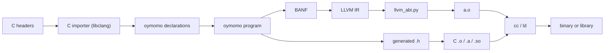
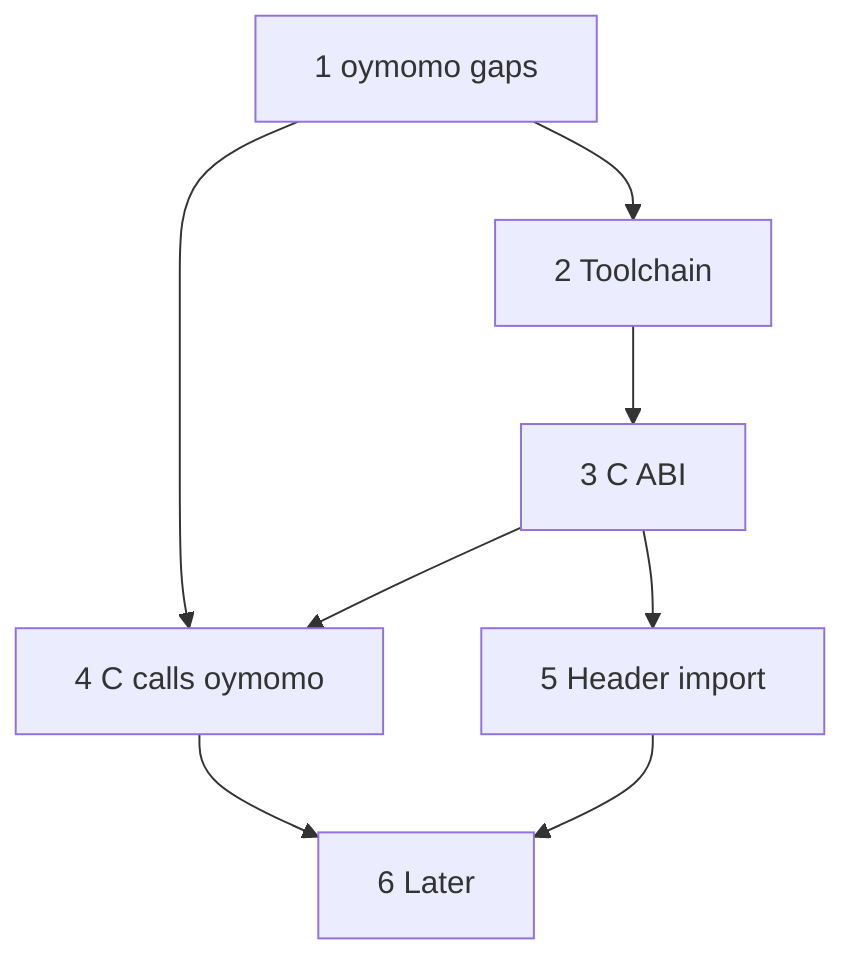

# Plan: oymomo and C, both directions, seamlessly

Status: **proposed**, with open questions; 0 of 6 phases.

This is a roadmap, not a single design change: each phase below is **one or more plans
of its own** (`plan_<name>.md`), and each of those has steps of one commit each. A phase
is checked off when all its plans are closed. C interop is an oymomo feature: a
language that lowers to oymomo gets all of it by generating oymomo, with no C interop
work of its own.

## Steps

- [ ] 1. oymomo gaps for C ([Phase 1](#phase-1--oymomo-gaps-for-c))
- [ ] 2. Toolchain: from oymomo to a running binary ([Phase 2](#phase-2--toolchain-from-oymomo-to-a-running-binary))
- [ ] 3. C ABI lowering in `llvm_abi.py` ([Phase 3](#phase-3--c-abi-lowering-llvm_abipy))
- [ ] 4. C calls oymomo: exports and callbacks ([Phase 4](#phase-4--c-calls-oymomo-exports-and-callbacks))
- [ ] 5. C headers to oymomo declarations ([Phase 5](#phase-5--c-headers-to-oymomo-declarations))
- [ ] 6. Later: TLS, separate compilation, more targets ([Phase 6](#phase-6--later))

Suggested start: 1.2 + Phase 2. That gives an oymomo program calling `puts` as a real
binary. Then 1.6 + 1.8 and a C `main` calling oymomo, so both directions run early,
before the ABI work.

## Goal

**oymomo and C call each other as if both were C.** In both directions, with no glue
code, no stubs and no runtime between them:

1. **oymomo calls C**: any C function, including `void` ones, `double` arguments,
   by-value structs, varargs (`printf`) and callbacks (`qsort`).
2. **C calls oymomo**: an oymomo function, compiled to a `.o`, is called from C through
   an ordinary prototype, and can be passed to C as a function pointer.
3. **Same memory**: a pointer, a struct or an array has the same layout on both sides,
   so it crosses as is. Memory is manual on both sides (`malloc` / `free`): no GC owns
   anything.
4. **Same toolchain**: one link step (`cc a.o b.o -lc`) builds a mixed program; an
   oymomo `.o`, `.a` or `.so` is indistinguishable from a C one.
5. **Headers both ways**: a C header gives oymomo declarations (Phase 5), and an oymomo
   module gives a C header (Phase 4).
6. **Drop-in replacement**: an oymomo library can replace a single C library or file in
   a C stack, without changing code above it (its callers) or below it (what it
   calls): same symbols, ABI, struct layouts and header.

Because oymomo is a generated IR ([notes.md › A generated IR](notes.md#a-generated-ir-no-checks-for-user-mistakes)),
"seamless" is measured at the binary level, not in oymomo's syntax: whatever generates
oymomo decides how C looks to its users.

### What does not cross

- **Closures as bare function pointers.** A C function pointer is a code address
  only, and trampolines (code made at run time to bundle a closure into one address)
  are a non-goal. What goes to C is a first-order `module` function; a closure crosses
  only as that function plus a `void *` to its environment, where the C API takes a
  user-data pointer (`qsort_r`, `pthread_create`).
- **Ownership.** Nothing tracks who frees a pointer, as in C.
- **C++.** Out of scope: no classes, templates, exceptions or name mangling.

## Where we start from

| oymo has | Missing for C interop |
|---|---|
| Ints `i1..i64`, int opcodes | Floats (`f32`, `f64`) and their ops and conversions |
| Memory: `'ptr'`, `'alloca'`, `'load'`, `'store'`, `'getelementptr'`, `'global'`, arrays and packed structs ([plan_memory.md](implemented/plan_memory.md)) | Pointer comparison, null, casts, `memcpy` ([plan_memory_advanced.md](plan_memory_advanced.md)) |
| Structs as values, by-value params | **C ABI lowering**: LLVM passes `{i32, i32}` as an aggregate; C on x86-64 SysV passes it as one `i64` |
| Imported functions, data and cells in `module`'s form: `declare i32 @putchar(i8 %c)` ([notes.md › module](notes.md#module-declares-every-symbol)) | Linkage and visibility (`internal`, exported), C name ≠ label |
| Defined functions, external by LLVM's default, so C can already link to `@fact` | Control over what is exported; a generated `.h` |
| Every function returns a value | `void` functions (`=> {}`) |
| First-order calls by symbol | Function pointers and indirect calls (callbacks, `qsort`) |
| — | Unions |
| — | Varargs calls (`printf`) and definitions (`va_list`) |
| Switch ([plan_switch.md](implemented/plan_switch.md)) | — |
| LLVM IR text | Object files, linking, a driver CLI |
| `data_layout=''` | A real target triple and data layout (sizes of `int`, `long`, pointers) |

## How other languages interoperate with C

| Language | Calling C | Being called by C | Reading headers | ABI lowering |
|---|---|---|---|---|
| **Zig** | `extern fn`, `callconv(.C)` | `export fn` | `@cImport` / `translate-c`, built on clang | Own, per target |
| **Rust** | `extern "C" { ... }` | `#[no_mangle] extern "C" fn` | `bindgen` (libclang), external tool | Own, per target, in rustc |
| **Swift** | Direct: headers are modules | `@_cdecl` | ClangImporter (embeds clang) | **Reuses clang's CodeGen** |
| **D** | `extern(C)` | `extern(C)` | ImportC: the compiler contains a C parser | Own |
| **Odin / C3 / Hare** | `foreign import` / `extern fn` | `@export` / `export` | Hand-written bindings | Own; C ABI is the default |
| **Nim / V** | `importc` | `exportc` | `c2nim` / built-in | None: they **compile to C** |
| **Go (cgo)** | `import "C"` with a comment preamble | `//export` | Runs gcc on the preamble | Generated C stubs; costly stack switch |
| **Carbon** | Imports C++ headers | — | Embeds clang | Reuses clang |

What they share:

1. **One declaration form for a foreign function**: explicit C calling convention,
   explicit types, no name mangling.
2. **`repr(C)`-style structs**: fields in order, aligned as C aligns them. oymomo structs
   are already ordered, so an oymomo struct form is a C struct.
3. **C-named types whose width depends on the target**: `c_int`, `c_long`.
4. **ABI lowering is the hard part.** LLVM IR does *not* implement the C ABI: each
   frontend lowers by-value structs, small ints (`zeroext`, `signext`), `sret` returns
   and varargs per target. They write it (Zig, Rust), borrow clang's (Swift, Carbon), or
   avoid it (Nim emits C, cgo emits C stubs).
5. **Headers are read with clang**, not a hand-written C parser (D is the exception).

Chosen direction: oymomo's `module` imports are already the declaration form (1); header
import through libclang (Python `clang.cindex`), an **optional** dependency needed only
for header import; and an **ABI lowering pass in the LLVM stage**, checked against clang
by differential tests. The ABI is a layout fact, so it belongs in `llvm_*.py`, and BANF
stays target-independent (see [notes.md › BANF does not depend on LLVM](notes.md#banf-does-not-depend-on-llvm)).

## Phases

### Phase 1 — oymomo gaps for C

| # | Plan | Why C needs it |
|---|---|---|
| 1.1 | Memory: regions, load, store (exists: [plan_memory.md](implemented/plan_memory.md)); then null, pointer comparison and casts ([plan_memory_advanced.md](plan_memory_advanced.md) steps 1–2) | Pointers are C's main data type; `NULL` ends every list |
| 1.2 | `void`: `=> {}` returns, a call as a statement | Most C APIs return `void` |
| 1.3 | Floats: `'f32'`, `'f64'`, arithmetic, comparisons, int↔float ([plan_floats.md](plan_floats.md)) | `double` everywhere in libc and libm |
| 1.4 | Field and element addresses (exists: `'getelementptr'`, [plan_memory.md](implemented/plan_memory.md)) | `&s->x`, `a[i]`; offsets stay in LLVM, not in oymomo |
| 1.5 | Arrays (exist: `{'array', count, element}`), and a decision on unions | C structs contain arrays and unions |
| 1.6 | Function pointers: `module.f` as an address, indirect call through a `'ptr'` with a function form | Callbacks (`qsort`, `atexit`), vtables of C libraries |
| 1.7 | Varargs: declarations, calls, and `va_list` for definitions | `printf`, `open`; an oymomo `vprintf`-style function |
| 1.8 | Linkage: internal vs exported symbols, symbol name ≠ label | Export to C, hide helpers |
| 1.9 | Switch (exists: [plan_switch.md](implemented/plan_switch.md)) | C `switch`, enums |

### Phase 2 — toolchain: from oymomo to a running binary

- A real `Target`: triple and data layout from llvmlite's host target.
- Emit `.o` with llvmlite's `TargetMachine`; link with the system `cc`.
- A driver: `oymo build a.oymo -o a`, `oymo run`, and `-c` for a `.o` only.
- End-to-end tests that call libc and a small C test library and check the output.
- **Milestone: oymomo calls C.** An oymomo program calls `puts`, built and run.

### Phase 3 — C ABI lowering (`llvm_abi.py`)

1. Scalars and pointers: `zeroext` / `signext` on `i1`, `i8`, `i16` where the target
   needs it. That is enough for most of libc.
2. By-value structs and `sret` returns for **x86-64 SysV**, then **AArch64**, then
   **Win64**.
3. The same lowering on **both sides of a call**: an import, a defined function that C
   may call, and an indirect call (1.6). An oymomo-to-oymomo call to an internal
   function may skip it.
4. Varargs calls: default argument promotions (`float` → `double`, small ints →
   `int`) and the target's register rules (`%al` on x86-64).
5. Differential tests: for each signature, a C caller and callee compiled by clang,
   linked with the oymo side, checked in both directions.

Fallback if 2 is too costly at first: reject by-value structs at the C boundary (pass a
`'ptr'`), and say so in the error message.

### Phase 4 — C calls oymomo: exports and callbacks

- Exported functions (1.8) with a C name, the C ABI (Phase 3) and no mangling; all
  others `internal`.
- Exported data and cells: a C `extern int counter;` reads an oymomo `'global'`.
- Callbacks: an oymomo function passed to C as a pointer (1.6), called back by C.
- Generate a `.h` from the exported part of `module` (as `cbindgen` and
  `zig -femit-h` do): prototypes, struct definitions from struct forms, include guards.
- Build `.a` and `.so` as well as `.o`.
- **Milestone: C calls oymomo.** A C `main` calls oymomo functions through the generated
  header, and passes a callback in.
- **Milestone: drop-in.** A small C library (one `.c` file and its header) is rewritten
  in oymomo; its C test suite links against the oymomo `.o` unchanged and passes.

### Phase 5 — C headers to oymomo declarations

A Python API, `c_import(header, target, flags)`, runs libclang on a header **once** and
gives, for each declaration, a **pair**: `CDecl(form, ctype)`. Whatever generates
oymomo splices the result into its program.

**oymomo has no `#include`**, as LLVM IR from clang has none: the header name belongs
to the source language (Tenon's import, Zig's `@cImport`), and the oymomo file holds
only the declarations it uses, already resolved. So an oymomo file means the same thing
on every machine (no search paths, `-D` flags or libclang), reduction never reads a
file, and every call into C shows its form where it is used. Where a declaration came
from is kept as metadata ([plan_metadata.md](plan_metadata.md)): `c_import` also gives
each `CDecl` an `origin` (file, line, column) that a generator writes as a metadata node.

- **form**, the term half: what an oymomo program needs to use the declaration. A
  `module` field (import signature, data form, or `'ptr'` for a cell), a struct form for
  `alloca` and `getelementptr`, or a byte array for a constant.
- **ctype**, the type half: the C type as plain data (signed or unsigned, bit width,
  pointee, `const`, struct fields, typedef and enum names, function pointer
  signatures), each with its form. It is not tied to any language's type system: a
  generator with types maps it to its own, and a generator without types ignores it.

| C declaration | form | ctype |
|---|---|---|
| function | import signature `{...} => R` | parameter and result C types |
| variable | data form, or `'ptr'` for a cell | C type, `const` or not |
| struct / typedef / enum | struct form / form / `'i32'` | named C type with its fields or constants |
| `#define N 42` | byte array `[2a000000]~'i32'` | `int` |

Why one call with a pair, not one import per half: both halves come from the same
parse, flags and target, so they can't disagree about `long`, an `#ifdef` or a field,
and every name has both halves. A declaration is a two-layer value, `<term:type>` as
TAPL writes it.

**The preprocessor runs, as part of the parse.** C can't be parsed without it
(`#include`, `#ifdef`), and libclang runs it with the given `flags` (`-I`, `-D`,
`--target`); they are part of the import, like the target. Macros are read from the
same parse (`PARSE_DETAILED_PROCESSING_RECORD`):

- **Object-like macros** (`#define N 42`, `#define FLAGS (A | B)`) are evaluated by
  clang, not by our code: for each one, the importer adds a declaration
  `static const __auto_type __oymo_N = (N);` to the parse and reads its value and type
  with `clang_Cursor_Evaluate`. C's own rules (suffixes, promotions, other macros) give
  the ctype; the form follows from it. bindgen does the same.
- **Skipped**: a macro whose expansion isn't a constant expression (a type, a
  statement, a string used as a token), and function-like macros
  ([open question 4](#open-questions)). Skipped names are listed, so a generator can
  say why a name is missing.

Mapping and scope:

- `int` and `long` map through the target (`'i32'`, or `'i64'` for `long` on Linux,
  `'i32'` on Win64), every pointer to `'ptr'`, structs to struct forms in field order.
- First functions, structs, enums, typedefs and object-like macros. Later unions,
  bitfields and function-like macros (Zig translates only some).
- Struct layout checked against clang's `sizeof` and `offsetof`.
- **Milestone:** `<stdio.h>` and `<string.h>` import, and a program calls `printf` and
  `strlen` with no hand-written declaration.

### Phase 6 — later

- Thread-local data: `errno` is a macro for `__errno_location()` in glibc, but other
  libraries export `_Thread_local` variables.
- `static inline` functions in headers: they have no symbol to call (see
  [open question 4](#open-questions)).
- Separate compilation and multiple modules, more targets (wasm32). Debug info and
  provenance are in [plan_metadata.md](plan_metadata.md).

## Order and dependencies

Not every gap blocks every phase: Phase 2 needs only 1.2, and Phase 4's first milestone
needs only 1.6 and 1.8 with scalar signatures.

## Open questions

1. ABI lowering: our own Python code (control, more work) or clang's CodeGen (exact, but
   a C++ dependency on top of llvmlite)?
2. Unions: a form of their own, or a byte array with a size and alignment (a layout fact
   oymomo avoids today)?
3. Where is an export written: a tag on the definition in `module`'s form (as `noalias`
   is a tag in [plan_memory_advanced.md](plan_memory_advanced.md)), or a separate
   export list?
4. `static inline` functions and function-like macros in headers: skip them, translate
   them to oymomo (as Zig's `translate-c` does, partially), or compile them with clang
   into a small `.o`? The last is exact, but it is glue code.
5. ~~Does the header importer give forms only, or also C types?~~ Decided: both, as a
   pair per declaration ([Phase 5](#phase-5--c-headers-to-oymomo-declarations)).
