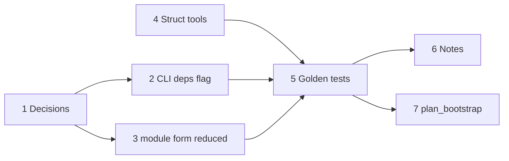

# Plan: `deps`, compile-time dependencies between `.oymo` files

**Status:** proposed · 0 of 7 steps · for oymo 0.9 (after 0.3; [roadmap](roadmap.md#stage-a--the-bootstrap-set-in-python))

## Goal

Several `.oymo` files build as one program, with:

- **no file names in source**: which file is which comes only from the command line
- **any term as a dependency**: a struct, a lambda, a form, a byte array
- **manual, in oymomo**: wiring and `module` declarations are written in oymomo, built
  with struct tools (concatenate, modify, build); nothing is automatic, nothing is
  listed twice by hand
- **pipeline unchanged**: `A D` reduces to today's `module~{declarations} -> {definitions}`,
  then naming, then `convert`
- **reuse by reduction**: library code is substituted and specialized into the program
  (generics by beta reduction)

## Steps

- [ ] 1. Answer the [open questions](#open-questions)
- [ ] 2. CLI: a flag says how deps are passed, `single` or `struct` ([Command line](#command-line))
- [ ] 3. Before naming: reduce the `module` binder's form to a literal, so it can be built
- [ ] 4. Struct tools: concatenate, modify, build structs (own plan, to be written)
- [ ] 5. Golden tests: diamond wiring, template pattern, built `module` declarations
- [ ] 6. Notes: [notes.md › The shape of a program](notes.md#the-shape-of-a-program), glossary
- [ ] 7. Use in [plan_bootstrap.md](plan_bootstrap.md): seed files are shaped output, no `deps`

## Proposal

### Source shape

```
deps -> module~{ declarations } -> { definitions }      the program (head file)
anything                                                 a dependency file
```

- The head takes one argument; its name is free (`deps` here).
- A dependency file is any term. If it needs other dependencies, it is a lambda and the
  head passes them by hand.

### Command line

The CLI may break before 1.0 ([roadmap.md](roadmap.md#stage-a--the-bootstrap-set-in-python)),
so this can be redesigned freely until then.

```
$ oymo a.oymo                                          program = A
$ oymo a.oymo --deps=single b.oymo                     program = A B
$ oymo a.oymo --deps=struct lib=b.oymo util=c.oymo     program = A {lib = B, util = C}
```

- `A`, `B`, `C` are the files' terms (after their frontends, if not `language oymomo`).
- `single`: one dependency, any term.
- `struct`: a struct of file terms, labeled by the command line.
- The CLI only reads files and applies; it adds no `$fix` and no wiring.
- Output by flag: shaped oymomo or `.ll`.

### Wiring and diamonds

A uses B and C; B and C both use D. Pure code may be inlined twice with no harm (only
code size); a `module` symbol or a cell must exist once. Wiring is manual, so the head
makes D once and passes the same value to both:

```
$ oymo a.oymo --deps=struct b=b.oymo c=c.oymo d=d.oymo

// a.oymo
deps -> let d = deps.d in let b = deps.b d in let c = deps.c d in
  module~{...} -> {...}
```

Cycles are written by hand with `$fix`.

### `module` declarations are built, not listed

Forms are terms ([plan_term_as_form](implemented/plan_term_as_form.md)), so a dependency
can export its declarations and definitions, and the head combines them with struct
tools (step 4; `concat` is a placeholder name):

```
// b.oymo
module -> {decls = {sort = => 'i32'}, defs = {sort = f -> {...}}}

// a.oymo
deps -> module~(concat {main = => 'i32'} (deps.lib module).decls) ->
  concat {main = f -> {...}} (deps.lib module).defs
```

- Today `shape` never reduces a form, and BANF needs literal forms. Step 3: the
  `module` binder's form is reduced to a literal struct before naming.
- The definitions struct is in BANF's skeleton, so `shape` already reduces it.

### Shape

```
A D  --shape-->  module~{...} -> {...}  --naming-->  --convert-->  BANF
```

- `deps` exists only during reduction: compile-time input, as headers, macros and
  `comptime` are for C and Zig.
- Shaping a file whose `deps` is not given (partial shaping) is postponed: an
  optimization ([open question 7](#open-questions)).
- Linking to separately compiled code stays in `module` declarations (`{...} => R`
  imports). Two kinds of reuse:

  | | When | Becomes |
  |---|---|---|
  | `deps.lib.x` | compile time | inlined and specialized; disappears |
  | `module.x` (import) | link time | a symbol; separate `.ll` |

### Template pattern

Recursive or large library functions can't be inlined forever; the head turns them into
module symbols:

```
// b.oymo
{sort = elem -> module -> f -> {entry = args~{...} -> ... module.sort ...}}

// a.oymo
deps -> module~{sort = => 'i32', main = => 'i32'} -> {
  sort = deps.lib.sort 'i32' module,       // a concrete i32 sort, emitted as @sort
  main = f -> {... module.sort ...},
}
```

## Open questions

1. **Flag:** name and values (`--deps=single|struct`?). Default when no deps are given?
2. **Inline terms:** may a dependency be written on the command line (`--deps=single "'i64'"`),
   or only as a file?
3. **Struct labels:** valid label, unique in the command; an unknown `deps.x` names the
   missing label.
4. **Termination:** a hand-written `$fix` can make reduction loop. Fuel limit and
   error? Depends on [plan_confluence.md](plan_confluence.md).
5. **Code size:** every `deps.lib.x` use is inlined. Warn on large inlined terms?
6. **Locations:** errors inside inlined library code point into the library file.
7. **Partial shaping:** shape a file while its `deps` is not given. Postponed.
8. **Struct tools:** which operations (concatenate, modify, build) and where they live:
   built-ins or oymomo functions over `$struct_to_fields` / `$fields_to_struct`.

## Dependencies


