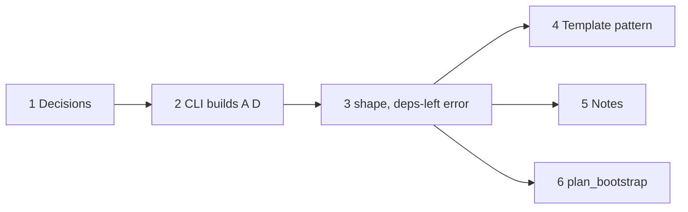

# Plan: `deps`, compile-time dependencies between `.oymo` files

**Status:** proposed · 0 of 6 steps · release to decide (before the compiler rewrite, 0.13)

## Goal

Several `.oymo` files build as one program, with:

- **no file names in source**: which file is which comes only from the command line
- **no new linker concept**: `deps` is reduced away by `shape`; `convert` and the BANF
  shape are unchanged
- **reuse by reduction**: library code is substituted and specialized into the program
  (generics by beta reduction)

## Steps

- [ ] 1. Answer the [open questions](#open-questions)
- [ ] 2. CLI: `oymo a.oymo lib=b.oymo util=c.oymo` reads every file, builds `D` and `A D` in memory
- [ ] 3. `shape`: reduce `A D` to today's `module~{...} -> {...}`; error if `deps` is left
- [ ] 4. Template pattern: a generic library function instantiated as a module symbol (golden test)
- [ ] 5. Notes: [notes.md › The shape of a program](notes.md#the-shape-of-a-program), glossary
- [ ] 6. Use in [plan_bootstrap.md](plan_bootstrap.md): seed files are shaped output, no `deps`

## Proposal

### Source shape

```
deps -> module~{ declarations } -> { definitions }      the program (head file)
deps -> { ... }                                          a library file
```

### Command line

```
$ oymo a.oymo lib=b.oymo util=c.oymo
```

- First file: the **head**, the program. The others: libraries, each with an **alias**.
- In memory, `oymo` builds:

  ```
  D = $fix (deps -> {lib = B deps, util = C deps})
  program = A D
  ```

  `A`, `B`, `C` are the files' terms (after their frontends, if not `language oymomo`).
- Every file gets the same `D`: libraries use each other (`deps.util.calculate` inside
  `b.oymo`); no diamonds; cycles allowed.
- Output by flag: shaped oymomo or `.ll`.

### Shape

```
A D  --shape-->  module~{...} -> {...}        no `deps` left; convert reads it as today
```

- `deps` exists only during reduction: compile-time input, as headers, macros and
  `comptime` are for C and Zig.
- A `deps` left after shaping is an error: "`deps.lib.sort` did not reduce away."
- Linking to separately compiled code stays in `module` declarations (`{...} => R`
  imports). Two kinds of reuse:

  | | When | Becomes |
  |---|---|---|
  | `deps.lib.x` | compile time | inlined and specialized; disappears |
  | `module.x` (import) | link time | a symbol; separate `.ll` |

### Template pattern

Recursive or large library functions can't be inlined forever; the head turns them into
module symbols:

```
// b.oymo
deps -> {sort = elem -> module -> f -> {entry = args~{...} -> ... module.sort ...}}

// a.oymo
deps -> module~{sort = => 'i32', main = => 'i32'} -> {
  sort = deps.lib.sort 'i32' module,       // a concrete i32 sort, emitted as @sort
  main = f -> {... module.sort ...},
}
```

## Open questions

1. **Library file shape:** `deps -> {...}` (uses other libraries) or a plain `{...}`?
   Leaning: `deps -> {...}`, one outer shape for every file.
2. **Library declarations:** may a library add symbols to the head's module, or does the
   head list every symbol? Leaning: the head lists them, possibly merging declarations a
   library provides (forms are terms, [plan_term_as_form](implemented/plan_term_as_form.md)).
3. **Name:** `deps`, `given`, `use`? Shaping renames binders, so this is the printed name.
4. **Termination:** a cyclic or wrong library can make reduction loop. Fuel limit and
   error? Depends on [plan_confluence.md](plan_confluence.md).
5. **Code size:** every `deps.lib.x` use is inlined. Warn on large inlined terms?
6. **Locations:** errors inside inlined library code point into the library file.
7. **Alias rules:** valid label, unique in the command, unknown `deps.x` names the
   missing alias.
8. **Positional form too?** `oymo a.oymo b.oymo` with `deps` as a tuple, or names only?
   Leaning: names only; position is easy to get wrong and forms are never checked.

## Dependencies


