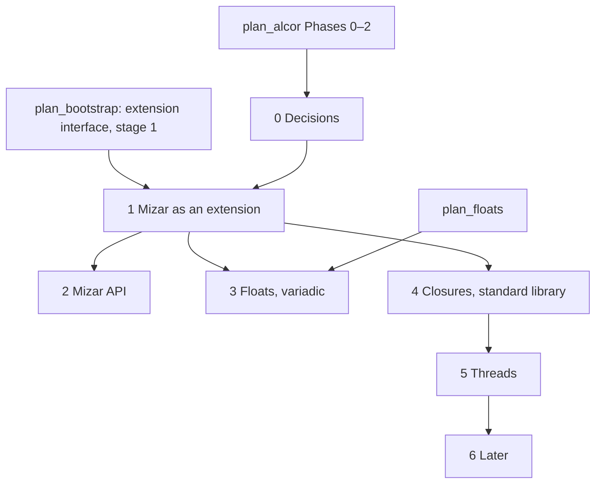

# Plan: Mizar, a general-purpose language extending Alcor

**Status:** proposed · 0 of 6 phases · oymo 0.15 to after 1.0
· stages and releases in [roadmap.md](roadmap.md)

A roadmap, not one change: each phase is one or more plans (`plan_<name>.md`) of
one-commit steps; a phase is done when all its plans are closed. Code lives in
`src/oymo/mizar/`, beside `alcor/`.

Mizar is the general-purpose language ([story.md](story.md)). It is everything in
[plan_alcor.md](plan_alcor.md) (two layers, types, memory safety, C interop) plus what
the compiler doesn't need.

## Goal

Mizar programs:

1. are **Alcor plus more**: every Alcor program is a Mizar program;
2. are **built as an extension** of Alcor through oymo's public language-extension
   interface, the same one users get; not a fork, no access to Alcor's internals;
3. are **never in the bootstrap seed**: stage 1 builds Mizar from source
   ([plan_bootstrap.md](plan_bootstrap.md)), so Mizar changes never regenerate it;
4. can be **built by other languages**: a frontend builds a Mizar tree through the
   public Mizar API, with its own locations, and gets Mizar's type checker, C headers
   and C ABI ([roadmap.md › One package, three ways in](roadmap.md#one-package-three-ways-in)).

## Steps

- [ ] 0. Decisions: what Mizar adds, syntax of the additions ([Phase 0](#phase-0--decisions)) — before 0.15
- [ ] 1. Mizar as an extension: `language mizar` = Alcor, built by stage 1 ([Phase 1](#phase-1--mizar-as-an-extension)) — oymo 0.15
- [ ] 2. Mizar API for language authors; cross-language imports ([Phase 2](#phase-2--mizar-api)) — oymo 0.21
- [ ] 3. Floats and variadic functions ([Phase 3](#phase-3--floats-and-variadic-functions)) — oymo 0.23, 0.25
- [ ] 4. Closures and the full standard library ([Phase 4](#phase-4--closures-and-the-full-standard-library)) — oymo 0.33
- [ ] 5. Threads: atomics, thread-locals, threads in the standard library ([Phase 5](#phase-5--threads)) — oymo 0.36–0.38
- [ ] 6. Later: SIMD, language versions, tools ([Phase 6](#phase-6--later)) — 0.35 and after 1.0

## Decisions

- **Extension only:** Mizar uses only the public extension interface. If it needs
  something the interface lacks, the interface grows, for every language author.
- **Mizar-only features:** floats, threads, atomics, SIMD, closures (unless the compiler
  needs them, [plan_alcor.md](plan_alcor.md) OQ 7), the full standard library.
- **Moving down:** a feature moves from Mizar to Alcor only when the compiler needs it.
- **Same syntax as Alcor:** additions follow Alcor's syntax decisions and its survey
  ([plan_alcor.md › Phase 0](plan_alcor.md#phase-0--decisions)).

## Phases

### Phase 0 — decisions

- **0.1 Name:** **Mizar** (`language mizar`, [story.md](story.md)).
- **0.2 Additions:** list what Mizar adds and the syntax of each, checked against
  Alcor's survey.
- **0.3 How Mizar lowers:** to an Alcor tree, or straight to oymomo (OQ 1).

### Phase 1 — Mizar as an extension

- `language mizar` registered as an extension of Alcor that adds nothing yet.
- Built by stage 1 from `compiler/` ([plan_bootstrap.md](plan_bootstrap.md)).
- **Milestone:** every Alcor test passes as `language mizar`; stage 2 knows Mizar.

### Phase 2 — Mizar API

- Public tree classes and constructors, locations from any file.
- Module interfaces across languages ([plan_alcor.md › Phase 2](plan_alcor.md#phase-2--layer-1-the-type-checker-as-code)).
- **Milestone:** a `calc` → Mizar type error points into the `calc` file; Mizar
  imports from `calc` with type checks.

### Phase 3 — floats and variadic functions

- `f32`, `f64` on [plan_floats.md](plan_floats.md); libm through headers.
- Variadic functions: call C's `printf`; a Mizar `...` function called from C.
- **Milestone:** Mizar calls `sqrt` and `pow`; `printf("%d %f %s\n", ...)` from Mizar.

### Phase 4 — closures and the full standard library

- Closures; split into code + `void *` environment when passed to C.
- Formatted I/O, containers, pool and Boehm GC allocators.

### Phase 5 — threads

- Atomics syntax (0.36), thread-local storage (0.37), threads in the standard library,
  thread-safe allocators (0.38) ([plan_c_interop.md](plan_c_interop.md)).
- **Milestone:** two pthreads share an atomic counter; a C `_Thread_local` read from Mizar.

### Phase 6 — later

- `oymo fmt` for Mizar (0.35).
- SIMD.
- Language versions in the header (`language mizar 2`).
- Target of `oymo translate-c` and the Spindle port ([roadmap.md](roadmap.md)).

## Open questions

1. **Does Mizar lower to an Alcor tree or straight to oymomo?** An Alcor tree reuses
   Alcor's checker; oymomo gives full control.
2. **Can an extension add types to layer 1** (`f32`, atomics), or only syntax?
3. **Is the extension interface ready by 0.15?** ([plan_bootstrap.md](plan_bootstrap.md) OQ 11).
4. **Which language owns layer-1 checking?** ([plan_bootstrap.md](plan_bootstrap.md) OQ 13).
5. **How does a closure capture a linear value?** May a function value be linear
   (called exactly once)?

## Dependencies

