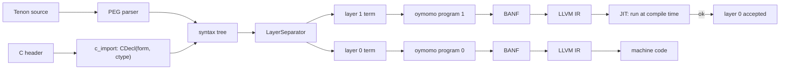
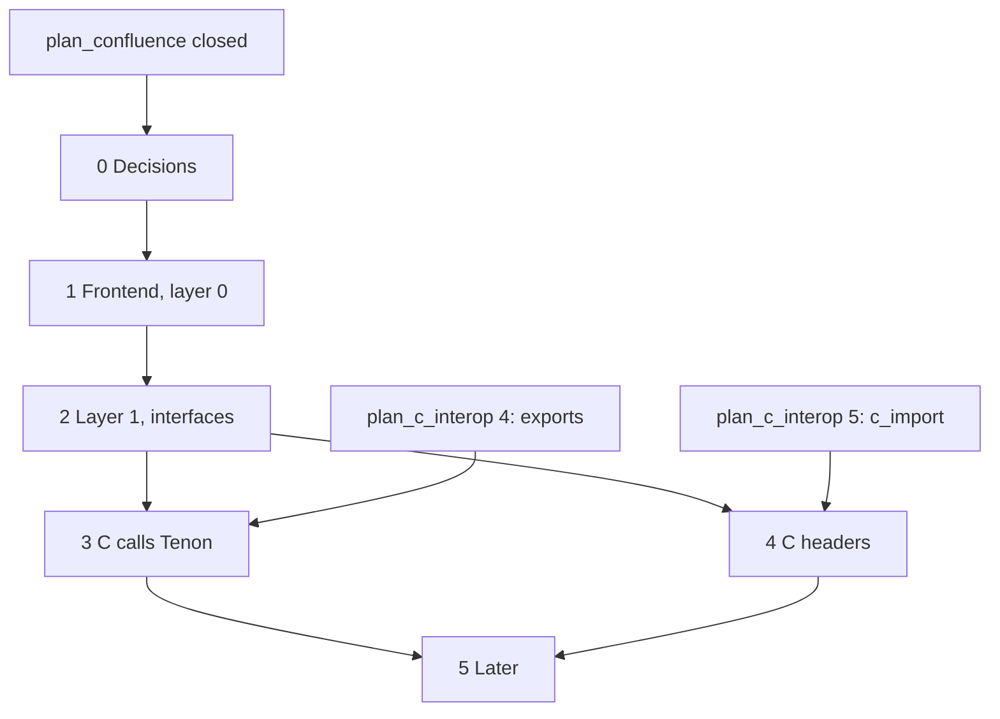

# Plan: Tenon, a two-layer language on oymomo

Status: **proposed**, with open questions; 0 of 6 phases.

This is a roadmap, not a single design change: each phase below is **one or more plans
of its own** (`plan_<name>.md`), and each of those has steps of one commit each. A phase
is checked off when all its plans are closed. The language is called **Tenon**
(step 0.1). It lives in `src/oymo/tenon/`, beside `oymomo/`.

Tenon has no C ABI work of its own: it lowers to oymomo, and calling C or being
called by C are oymomo features ([plan_c_interop.md](plan_c_interop.md)). Its
C-specific code is the syntax for them (`extern`, `export`, header import) and the
mapping between C types and Tenon types in layer 1, in both directions: a C header's
types become Tenon types ([Phase 4](#phase-4--c-headers-in-both-layers)), and Tenon
types make a generated header read as hand-written ([Phase 3](#phase-3--c-calls-tenon)).
Types are Tenon's, not oymomo's.

**When each phase ships** is set by [roadmap.md](roadmap.md), which builds Tenon in two
stages. **Stage A, in the Python compiler, only what writing a compiler in Tenon
needs:** Phase 0 and the first part of Phase 1 (functions, integers) are oymo 0.3, as
early as possible, in the JIT; BANF is removed from the compiler in 0.4; memory and `extern` are 0.5; enums and tagged unions
0.7; layer 1 (Phase 2) 0.8 and module interfaces 0.9; function values (Phase 3) 0.10;
the bootstrap part of the standard library (Phase 5) 0.11. **Stage B** (0.12–0.14)
rewrites the compiler, this frontend included, in Tenon. **Stage C, in the Tenon
compiler:** `export` and generated headers (Phase 3) 0.15, the Tenon API for language
authors 0.18, header import (Phase 4) 0.25, and the rest of Phase 5 spread over
0.26–0.35 and after 1.0.

## Steps

- [ ] 0. Decisions: name, syntax, layer semantics, memory model, undefined behaviour, dependent and substructural types ([Phase 0](#phase-0--decisions)) — oymo 0.3
- [ ] 1. Tenon frontend, layer 0 only ([Phase 1](#phase-1--tenon-frontend-layer-0-only)) — oymo 0.3, 0.5, 0.7
- [ ] 2. Layer 1: the type checker as code, dependent and substructural types, module interfaces ([Phase 2](#phase-2--layer-1-the-type-checker-as-code)) — oymo 0.8, 0.9 (across languages 0.18)
- [ ] 3. C calls Tenon: `export`, function values, generated headers ([Phase 3](#phase-3--c-calls-tenon)) — oymo 0.10, 0.15
- [ ] 4. C headers in both layers ([Phase 4](#phase-4--c-headers-in-both-layers)) — oymo 0.25
- [ ] 5. Later: closures, separate compilation, debug info, safety checks, standard library ([Phase 5](#phase-5--later)) — oymo 0.11 (bootstrap standard library), 0.26–0.35 and after 1.0

## Goal

Tenon is a language whose programs:

1. are written in one source file with **two layers**, as TAPL does for Python:
   layer 0 is what runs, layer 1 is the type checker, and it is real code;
2. are **memory safe where they say so**, checked at build time by layer 1 with
   dependent and substructural types (decision 0.6), at no run-time cost and with no
   garbage collector; raw pointers and C stay unchecked, as in C;
3. lower **each layer to its own oymomo program**, then to LLVM IR and machine code
   (directly, with no BANF, from oymo 0.4; the Tenon-written compiler, from oymo 0.12,
   writes the same LLVM IR as text and runs `clang`);
4. can be **built by other languages**: a language author's frontend builds a Tenon
   syntax tree through the public Tenon API, with its own source locations, and gets
   Tenon's type checker, C headers and C ABI ([roadmap.md › One package, three ways in](roadmap.md#one-package-three-ways-in)).



Layer 1 is compiled to machine code and **run during compilation** (llvmlite MCJIT). If
it finishes without error, layer 0 type-checks. This mirrors TAPL's `a1.py`.

## Where we start from

| oymo has | Missing for Tenon |
|---|---|
| PEG engine ([peg.py](../src/oymo/core/peg.py)) | Tenon grammar, layer separation, lowering to oymomo |
| oymomo → BANF → LLVM IR | A JIT run of layer 1 at compile time |
| `c_import` giving `CDecl(form, ctype)`, once [plan_c_interop.md](plan_c_interop.md) Phase 5 lands | Mapping a ctype to a Tenon type |

## Phases

### Phase 0 — decisions

**Tenon starts only after [plan_confluence.md](plan_confluence.md) is closed**
(roadmap 0.2): both layers lower to oymomo, so reduction must give one result whatever
the order before anything is built on it.

Each decision is written down in this file (or a plan of its own) before Phase 1 starts.

**0.1 Name and file extension.** Name: **Tenon** (decided). A tenon is the tongue of a
mortise-and-tenon joint: it fits its slot exactly, with no nails or glue. So does
Tenon fit into C: no glue code, the same ABI and memory, one link step. It was chosen
over Anvil, whose name is taken by a typed HDL, Foundry's `anvil` and anvil.works,
and over names that spell out C (C-like, seelike, Calque), since a name need not say
the syntax, but the first page of the docs must. File extension: **`.oymo`**
(decided), as for every language on oymo; the file's first line is `language tenon`
([roadmap.md](roadmap.md#one-file-extension-a-language-header)).

**0.2 Syntax.** C, with small modern changes (decided): braces, statements and
operators as in C, so a C programmer reads it at once; each change from C is a
decision of its own, listed here with its reason.

- **0.2.1 `name: Type` declarations** (decided, the first change). The name comes
  first and the type after a colon, as in Rust, Zig, Go (without the colon), Swift,
  TypeScript and Python's annotations:

  ```
  count: i32 = 0;
  fn add(a: i32, b: i32) -> i32 { return a + b; }
  ```

  Why: a declaration reads left to right (`p: Ptr(Ptr(c_char))`, not C's spiral
  `char **p`), a declaration starts with its name so it is easy to find, and the
  grammar has no C ambiguity between a declaration and an expression (`a * b;`).
  It is also TAPL's syntax for a two-layer value, `<expr:Type>`, so the type after
  the colon is a layer-1 expression, computed like any other (`m: Matrix(^2, ^3)`).
  The keyword for functions (`fn` above) and the exact forms are open.

**How the rest of the syntax is designed: learn from the C successors first.** Zig,
C3, Odin, Hare and Jai have each answered "C, but modern" already, and in different
ways. Before a syntax decision is taken, the survey is written, and each decision
cites it.

1. **Survey**, in `tenon_syntax_survey.md`. It starts with each language's status and
   aim (as of October 2026: Zig 0.16, pre-1.0; C3 0.8, 1.0 planned for 2028; Odin,
   stable with no 1.0 label; Hare 0.26, pre-1.0; Jai, closed beta). Then one section
   per topic, and in each a table of how the five languages write it, with pros and
   cons, and what C writes. Topics, in the order Tenon needs them:

   | Topic | Questions to answer |
   |---|---|
   | Declarations | `name: Type`, `:=` inference, `const` / `var` / `let`, `::` constants (Odin, Jai) |
   | Functions | keyword or none (`fn`, `proc`, `name :: (...)`), parameters, results, multiple results |
   | Types | pointer and array syntax (`*T`, `[*]T`, `[]T`, `[N]T`), slices, optionals, integer names (`i32`, `u8`, C's `int`) |
   | Structs, enums, unions | declaration, literals, field access through a pointer (`.` or `->`) |
   | Control flow | `if` / `while` / `for`, `switch` and its fallthrough, `defer`, labelled `break` |
   | Errors | error unions (Zig `!T`), optionals and faults (C3), multiple results (Odin), tagged unions (Hare) |
   | Compile-time code | Zig `comptime`, Jai `#run`, C3 macros; how close each is to Tenon's layer 1 |
   | Generics | Zig types as values, Odin `$T`, C3 generic modules; which map onto layer-1 functions (`Matrix(^2, ^3)`) |
   | Modules and C | imports, visibility, `extern` / `export`, C header import (Zig `@cImport`) |
   | Memory | allocators as parameters (Zig, Odin's context), `defer free`, no hidden allocation; syntax for owned pointers, borrows and unchecked code (decision 0.6) |
   | Lexical details | semicolons, comments, string and number literals, keyword count |

2. **Decide**, here as `0.2.n` entries: for each topic, what Tenon takes, from whom,
   and what it rejects and why, with one example. The rules for choosing:
   - **A C programmer reads it at once.** Prefer C's form unless a change fixes a known
     C problem (the declaration spiral, `switch` fallthrough, header files).
   - **It fits the two layers.** A type is a layer-1 expression; a construct that only
     exists because another language has no layer 1 (C3 macros, Zig's `comptime`
     keyword) may not be needed.
   - **It lowers simply to oymomo**, and a language author's tree can build it (the
     Tenon API).
   - **Borrowed, not invented**: when two of the five agree, that is the default.

3. **Check** with the sample programs below, written in the chosen syntax, then the
   grammar sketch and precedence table.

Still to settle with sample programs: hello world, a struct with a function on it, a
function passed as an argument, a type-level function (`Matrix(^2, ^3)`), and a C
header import. Then a grammar sketch and precedence table in the style of
[notes.md › oymomo syntax](notes.md#oymomo-syntax). TAPL's `pythonlike` indentation
syntax is not used.

**0.3 What layer 1 means.** Proposal: as in TAPL. A type is a value in layer 1; each
function's layer-1 version checks its arguments' types; an error stops the build.

**0.4 Memory model.** **Allocators, chosen by the user** (decided). Memory is never
allocated behind the user's back: code that allocates takes an allocator, explicitly,
as in Zig (Odin passes it in an implicit context; the survey compares both). Most
allocators are manual (`malloc` / `free`, arena, pool); a garbage-collecting
allocator, such as one over the Boehm collector, is one more choice. There is no
built-in GC and no runtime every program carries. Phase 1 starts with plain
`malloc` / `free` through `extern`; the allocator interface comes with the standard
library.

**0.5 Undefined behaviour.** What integer overflow, an out-of-bounds index, a null
dereference and a use after free do. Proposal, as Zig and C3: two build modes. A
**checked** build traps with a message and the source location on overflow,
out-of-bounds and null; an **optimized** build leaves them undefined, as C and LLVM
do, so the code is as fast as C. Use after free and double free are not checked at
run time in either: for owned pointers they are layer-1 errors (0.6); for raw
pointers they stay undefined. Out-of-bounds is a run-time check only where layer 1
could not prove the index in bounds (0.6). The survey (0.2) compares how the five
languages do it; decided before Phase 1, implemented in oymo 0.28
([roadmap.md](roadmap.md#028--safety-checks-and-sanitizers)).

**0.6 Dependent and substructural types in layer 1.** Both (decided); the details
below are a proposal. The aim is **memory safety at build time**: no use after free,
no double free, no leak, no out-of-bounds access, with no run-time cost and no GC.
It is done in layer 1, as code, not by a fixed checker built into the compiler, so a
library (or a language author) defines new safe types the same way. Layer 0 does not
change: every type below is erased, and `Own(T, A)` lowers to the same pointer form
as `Ptr(T)`.

Prior art, to survey beside the C successors (0.2): **ATS** (dependent and linear
types over C, for exactly this), **Idris 2** (quantitative type theory: dependent and
linear in one system), **Austral** (linear types and borrows, kept small on purpose),
**Rust** (affine types, borrow checker), **Hylo** and **Vale** (second-class
references, regions), **Liquid Haskell** (refinement types for bounds).

- **0.6.1 Dependent types.** A type may depend on a value. A type is already a
  layer-1 value, so a type-level function is a plain function. Two kinds of value:
  1. **Known at build time**, lifted with `^`, as in TAPL: `Array(u8, ^16)`,
     `Matrix(^2, ^3)`. This comes with layer 1 at no extra cost.
  2. **Known only at run time**: a slice's length, an index. Layer 1 can't compute
     them, so it names them: a layer-1 value stands for a layer-0 variable, and types
     refer to it, as in `buf: Ptr(Array(u8, n))` and `i: Index(n)` (an integer in
     `0 .. n`). Layer 1 learns facts from layer-0 tests: inside `if (i < n) { ... }`,
     `i` has type `Index(n)`. `buf[i]` type-checks only when `i: Index(n)`; otherwise
     it is a layer-1 error, or the user writes a checked access, which traps.

  First version: facts are equalities and `<` / `<=` between variables and
  constants, recorded by layer 1 as it walks the function; no SMT solver, so checking
  stays fast and its errors stay readable.
- **0.6.2 Substructural types.** A type says how many times a value may be used:

  | Kind | Uses | Tenon examples |
  |---|---|---|
  | linear | exactly once | `Own(T, A)`: memory from allocator `A`, freed or passed on exactly once; a file handle; an allocator itself |
  | affine | at most once | a value that may be dropped but not copied, if a use for one appears (open question 5) |
  | unrestricted | any number | integers, `Ref(T)`, raw `Ptr(T)` |

  So use after free (a use of a consumed value), double free (two consumptions) and a
  leak (a value still live at the end of its scope) are layer-1 errors. A struct or
  tagged union with a linear field is linear.
- **0.6.3 Borrows.** A linear value is lent without being consumed: `&p` gives a
  `Ref(T)`, usable many times, while `p` can't be freed or moved. First version, as
  in Hylo and Austral: **second-class borrows**, passed to a call and never stored or
  returned, so there are no lifetime annotations and no lifetime inference. Stored
  references (regions or lifetimes as layer-1 values) are a later plan, if the
  compiler's own source needs them.
- **0.6.4 How layer 1 checks it.** Layer 1 runs each function body once, statement
  by statement, with an environment from names to types. For a linear name it also
  keeps a state: live, consumed or borrowed. A use of a consumed name is an error; a
  live linear name at a `return` or at the end of its block is an error. After an
  `if`, both branches must leave the same names consumed; a loop body must leave the
  state as it found it. The facts of 0.6.1 live in the same environment and are
  dropped when a test's branch ends.
- **0.6.5 Allocators.** They fit decision 0.4: `alloc(a, T)` returns `Own(T, A)` and
  `free(a, p)` consumes `p`. An arena hands out `Ref(T)` tied to the arena, and
  freeing the arena consumes it, allowed only with no borrow alive. A
  garbage-collecting allocator hands out unrestricted references.
- **0.6.6 The escape hatch, and C.** Raw `Ptr(T)` is unrestricted and unchecked, as
  in C, and converting between `Ptr(T)` and `Own(T, A)` is explicit (its syntax, such
  as an `unsafe` marker, comes from the survey). C declarations, written by hand or
  imported (Phase 4), give raw types; an annotation says that a C function returns
  an owned value (`malloc`, `fopen`) or consumes one (`free`, `fclose`), and the
  standard library's wrappers do so.
- **0.6.7 What stays unchecked**: raw pointers, C code, data races (until threads,
  roadmap 0.33–0.35), and integer overflow, which the checked build traps (0.5).

Why in layer 1 and not in a separate pass: the rule for every Tenon type, a type is
code. A library writes `Own`, `Index` and its own linear handles in layer 1, and a
language author lowering to Tenon gets them through the Tenon API with no extra work.

### Phase 1 — Tenon frontend, layer 0 only

- Grammar on the PEG engine; syntax tree classes with `separate()`, as in TAPL.
- Lower layer 0 to an oymomo program (the `module -> {...}` shape).
- Surface constructs map to oymomo ones: functions → structs of blocks, `if` / `while`
  → blocks and jumps, locals → `alloca`, structs → struct forms.
- `extern` declarations written by hand, to call C; calls are first-order.
- The frontend registered as `language tenon`; the Tenon API: syntax tree classes and
  their constructors public, a tree carrying the source locations of any file.
- **Milestone: hello world**, built and run; a linked list with `malloc` / `free`; a
  call into a `.c` file built in the same command.

### Phase 2 — layer 1: the type checker as code

- Lower layer 1 to a second oymomo program, compile it, and run it at compile time: in
  the JIT in the Python compiler, as a native subprocess in the Tenon-written compiler
  (roadmap 0.13), so the product needs no JIT.
- A small layer-1 runtime: type values (`Int32`, `Ptr(T)`, struct types), equality,
  errors with source locations.
- `^expr` (lift) and `<expr:Type>` (a two-layer expression), as in TAPL.
- **Dependent types** (decision 0.6.1): lifted constants first, then run-time values
  named in types (`Array(u8, n)`, `Index(n)`), with facts learnt from tests.
- **Substructural types** (decisions 0.6.2–0.6.6): `Own(T, A)`, second-class borrows
  `Ref(T)`, the live / consumed / borrowed state of each name, and owned allocation
  and `free` on the libc allocator. A plan of its own, `plan_tenon_safety.md`.
- **Module interfaces**, here because types appear in layer 1: what a module exports,
  each name as a pair `<form:type>` (the form for layer 0, the type for layer 1), the
  same shape as `c_import`'s `CDecl(form, ctype)`. Files import each other through
  them, and so do languages on oymo: a frontend that lowers to Tenon writes both
  halves; one that lowers to oymomo writes forms only, and its names are unchecked in
  layer 1. The generated C header (roadmap 0.15) is made from the same interface.
- **Milestone:** a type error in layer 0 stops the build with a message; the linked
  list of Phase 1, rewritten with `Own`, type-checks, and a use after free, a double
  free or a leak in it stops the build; `buf[i]` with no bounds test before it stops
  the build; a call from one file into another, or into a `language calc` file, is
  type-checked across the file boundary, ownership included.

### Phase 3 — C calls Tenon

- `export` on a function or a global, lowering to oymomo's exports
  ([plan_c_interop.md](plan_c_interop.md) 1.8, Phase 4).
- Function values, lowering to function pointers (plan_c_interop 1.6): a plain
  function crosses to C as a C function pointer. A closure crosses only as its code
  plus a `void *` to its environment, where the C API takes one; trampolines are a
  non-goal ([roadmap.md › Non-goals](roadmap.md#non-goals)).
- The generated C header is made from the module interface (Phase 2) and uses its
  layer-1 types: `unsigned`, `const char *`, named structs, which forms alone can't
  tell from `int` and `void *`.
- **Milestone:** a C `main` calls a Tenon library through its generated header, which
  reads as a hand-written one would; a Tenon function is passed to `qsort`.

### Phase 4 — C headers in both layers

A header import (syntax from 0.2) calls `c_import` once, with the build's target and
flags. Each `CDecl(form, ctype)` is a two-layer value, `<form:ctype>`, so the
`LayerSeparator` splits it like any other:

- **Layer 0** gets the form, unchanged: an import in `module`'s form, a struct form, or
  a constant.
- **Layer 1** gets the ctype, mapped to a Tenon type value: `int` → `c_int`,
  `const char *` → `Ptr(Const(c_char))`, a struct → a struct type, a typedef → its name
  for messages and its target for equality. Pointers map to raw `Ptr(T)`, never to
  `Own` (decision 0.6.6). The mapping is the only C-specific code in Tenon.

Rules:

- Both layers see the same names: a name `c_import` skipped is missing from both, with
  its reason in the error message.
- Layer 1 runs on the host but checks the **target's** C types: `c_long` is what the
  target's `long` is, as `c_import` reported it.
- A test checks the mapping against the forms: every Tenon type made from a ctype has
  the ctype's form.
- **Milestone:** a Tenon program imports `<stdio.h>`, calls `printf` and `puts`, and
  `puts(42)` is a layer-1 error.

### Phase 5 — later

Each a plan of its own, in a [roadmap.md](roadmap.md) release (the bootstrap standard library in 0.11, the rest between 0.26 and 1.0), or after 1.0:

- Closures, and splitting a closure into code plus a `void *` environment when it is
  passed to C (Phase 3).
- Separate compilation, on top of Phase 2's module interfaces.
- Debug info mapped to Tenon source (`!dbg` attachments and the metadata table,
  [plan_metadata.md](plan_metadata.md)).
- The checked build mode of decision 0.5: traps on overflow, out-of-bounds and null.
- The standard library: strings, slices, I/O, and the allocator interface of decision
  0.4 with its first allocators.
- Language versions in the header (`language tenon 2`).

## Order and dependencies



## Open questions

1. Does layer 1 lower to oymomo *exactly* like layer 0, or may it use features layer 0
   can't (closures, a GC)? If layer 1 only ever runs in the JIT, it could.
2. ~~Does layer 1 run only on the host (JIT), or in Spindle ([plan_vm.md](plan_vm.md))?~~
   Decided: the host, in the LLVM JIT. Spindle is a side project
   ([roadmap.md › Decided](roadmap.md#decided)).
3. How strict is the C mapping: is `int` to `long` an implicit conversion as in C, or
   an error? Is `char *` to `const char *` accepted?
4. How strong are dependent-type proofs (0.6.1)? The first version records simple
   facts with no solver; is an SMT solver (Z3, as Liquid Haskell and F* use) ever
   worth its cost in build time and as a dependency?
5. Are affine types needed beside linear ones, or is "linear, plus an explicit
   `drop`" enough? Austral has linear types only; Rust has affine types only.
6. Do second-class borrows (0.6.3) suffice for the compiler's own source (Stage B),
   or are stored references with regions needed before 0.12?
7. How does a closure (Phase 5) capture a linear value, and may a function value be
   linear (called exactly once)?
