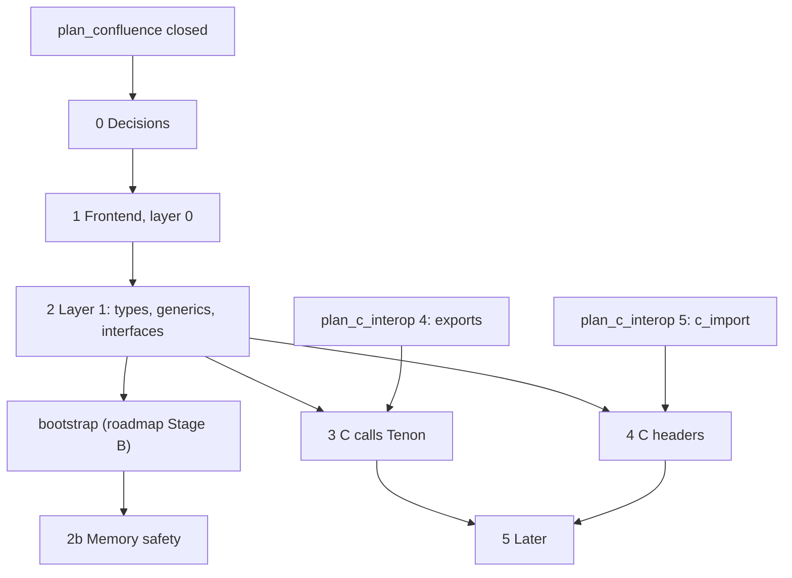
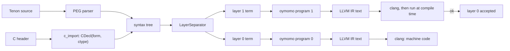

# Plan: Tenon, a two-layer language on oymomo

**Status:** proposed · 0 of 7 phases · oymo 0.4 to after 1.0
· stages and releases in [roadmap.md](roadmap.md) (summary in [Background](#release-stages))

A roadmap, not one change: each phase is one or more plans (`plan_<name>.md`) of
one-commit steps; a phase is done when all its plans are closed. Code lives in
`src/oymo/tenon/`, beside `oymomo/`.

## Goal

Tenon programs:

1. have **two layers** in one file, as TAPL does for Python: layer 0 runs, layer 1 is
   the type checker, as real code;
2. are **memory safe where they say so**: checked at build time by layer 1 with
   dependent and substructural types (0.6, from oymo 0.16); no run-time cost, no GC;
   raw pointers and C stay unchecked;
3. lower **each layer to its own oymomo program**, then to LLVM IR text (no BANF, from
   0.3) built by `clang`; the Tenon-written compiler (from 0.13) writes the same text;
4. can be **built by other languages**: a frontend builds a Tenon tree through the
   public Tenon API, with its own locations, and gets Tenon's type checker, C headers
   and C ABI ([roadmap.md › One package, three ways in](roadmap.md#one-package-three-ways-in)).

## Steps

- [ ] 0. Decisions: name, syntax, layer semantics, memory model, undefined behaviour, generics, dependent and substructural types ([Phase 0](#phase-0--decisions)) — oymo 0.4
- [ ] 1. Tenon frontend, layer 0 only ([Phase 1](#phase-1--tenon-frontend-layer-0-only)) — oymo 0.4, 0.5, 0.7
- [ ] 2. Layer 1: the type checker as code, basic types, generics, module interfaces ([Phase 2](#phase-2--layer-1-the-type-checker-as-code)) — oymo 0.8, 0.9 (across languages 0.21)
- [ ] 2b. Memory safety: dependent and substructural types ([Phase 2b](#phase-2b--memory-safety-dependent-and-substructural-types)) — oymo 0.16, 0.17
- [ ] 3. C calls Tenon: `export`, function values, generated headers ([Phase 3](#phase-3--c-calls-tenon)) — oymo 0.10, 0.18
- [ ] 4. C headers in both layers ([Phase 4](#phase-4--c-headers-in-both-layers)) — oymo 0.28
- [ ] 5. Later: closures, separate compilation, debug info, safety checks, standard library ([Phase 5](#phase-5--later)) — oymo 0.11 (bootstrap standard library), 0.12 (line tables), 0.29–0.38 and after 1.0

## Decisions

- **No C ABI work of its own**: calling C and being called by C are oymomo features
  ([plan_c_interop.md](plan_c_interop.md)). Tenon's C code is only syntax (`extern`,
  `export`, header import) and the C type ↔ Tenon type mapping in layer 1
  (Phases 3, 4). Types are Tenon's, not oymomo's.
- **Layer 1 runs at compile time**: compiled to machine code by `clang`, run as a
  subprocess; errors come back with locations; no error = layer 0 type-checks
  (as TAPL's `a1.py`).
- **No JIT before 1.0**: every oymomo program, layer 1's included, is `.ll` text built
  by `clang` ([roadmap.md › Decided](roadmap.md#decided)).
- **Starts after [plan_confluence.md](plan_confluence.md) is closed** (roadmap 0.2):
  both layers lower to oymomo, so reduction must be order-independent first.
- Phase 0 decisions below (0.1–0.7), each written here or in its own plan before Phase 1.

## Phases

### Phase 0 — decisions

- **0.1 Name:** **Tenon**, working name, under review (Cymo and others; decided before
  0.4, [roadmap.md › Open questions](roadmap.md#open-questions)). **Extension:
  `.oymo`** (decided); first line `language tenon`
  ([roadmap.md](roadmap.md#one-file-extension-a-language-header)).
- **0.2 Syntax:** C with small modern changes (decided); each change is its own
  `0.2.n` decision with its reason.
  - **0.2.1 `name: Type` declarations** (decided):
    `count: i32 = 0;` · `fn add(a: i32, b: i32) -> i32 { return a + b; }`.
    Keyword for functions (`fn`) and exact forms are open.
  - Rest: survey Zig, C3, Odin, Hare, Jai first (`tenon_syntax_survey.md`), then
    decide per topic, then check with sample programs and a grammar sketch
    (method in [Background](#syntax-method)).
- **0.3 What layer 1 means** (proposal): as in TAPL. A type is a layer-1 value; each
  function's layer-1 version checks its arguments' types; an error stops the build.
- **0.4 Memory model:** **allocators, chosen by the user** (decided). Code that
  allocates takes an allocator explicitly (as Zig). Manual (`malloc`/`free`, arena,
  pool) or GC (e.g. Boehm) allocators; no built-in GC or runtime. Phase 1 uses
  `malloc`/`free` via `extern`; the interface comes with the standard library.
- **0.5 Undefined behaviour** (proposal, as Zig and C3): two build modes.
  - **checked**: traps with message and location on overflow, out-of-bounds, null
  - **optimized**: undefined, as C and LLVM
  - use after free / double free: never checked at run time; layer-1 errors for owned
    pointers (0.6), undefined for raw ones
  - out-of-bounds checked at run time only where layer 1 proved nothing (0.6)
  - decided before Phase 1; implemented in 0.31 ([roadmap.md](roadmap.md#031--safety-checks-and-sanitizers))
- **0.6 Dependent and substructural types in layer 1:** both (decided), checked from
  0.16 and 0.17 ([Phase 2b](#phase-2b--memory-safety-dependent-and-substructural-types));
  syntax decided in Phase 0; details below are a proposal. Aim: no use after free,
  double free, leak or out-of-bounds, at build time. Written in layer 1 as code, so
  libraries define safe types too. Layer 0 unchanged: types erased; `Own(T, A)` lowers
  like `Ptr(T)`.
  - **0.6.1 Dependent types.** Build-time values lifted with `^` (`Array(u8, ^16)`,
    `Matrix(^2, ^3)`). Run-time values named in types (`buf: Ptr(Array(u8, n))`,
    `i: Index(n)` = integer in `0 .. n`). Facts from tests: inside `if (i < n)`,
    `i: Index(n)`. `buf[i]` needs `i: Index(n)`, else layer-1 error or a checked
    (trapping) access. First version: equalities and `<`/`<=` on variables and
    constants; no SMT solver.
  - **0.6.2 Substructural types.**

    | Kind | Uses | Examples |
    |---|---|---|
    | linear | exactly once | `Own(T, A)` (memory from allocator `A`), file handle, an allocator |
    | affine | at most once | if a use appears (open question 5) |
    | unrestricted | any | integers, `Ref(T)`, raw `Ptr(T)` |

    Use after free, double free and leaks are layer-1 errors. A struct or tagged
    union with a linear field is linear.
  - **0.6.3 Borrows.** `&p` gives `Ref(T)`, usable many times; `p` can't be freed or
    moved meanwhile. **Second-class** (as Hylo, Austral): passed to calls, never stored
    or returned; no lifetimes. Stored references: a later plan if needed.
  - **0.6.4 Checking.** One pass per body with an environment name → type, plus
    live / consumed / borrowed for linear names. Errors: use of consumed; live linear
    name at `return` or block end. `if` branches must consume the same names; loop
    bodies keep the state. 0.6.1 facts live there and drop at branch end.
  - **0.6.5 Allocators.** `alloc(a, T)` → `Own(T, A)`; `free(a, p)` consumes `p`. An
    arena gives `Ref(T)` tied to it; freeing it needs no live borrow. A GC allocator
    gives unrestricted references.
  - **0.6.6 Escape hatch and C.** Raw `Ptr(T)` is unchecked; `Ptr(T)` ↔ `Own(T, A)` is
    explicit (syntax from the survey, e.g. `unsafe`). C declarations give raw types;
    annotations mark C functions that return (`malloc`, `fopen`) or consume (`free`,
    `fclose`) owned values; standard-library wrappers use them.
  - **0.6.7 Unchecked:** raw pointers, C code, data races (until threads, 0.36–0.38),
    integer overflow (trapped by the checked build, 0.5).
- **0.7 Generics:** System F style (decided): `List(T)`, `Map(K, V)`,
  `fn get(T: Type, l: List(T), i: usize) -> T`; checked once for every `T`; a type
  parameter is a layer-1 value. To decide: syntax, inference of type arguments,
  lowering (one copy per type, or one shared copy taking sizes). Ships in 0.8.

### Phase 1 — Tenon frontend, layer 0 only

- Grammar on the PEG engine; tree classes with `separate()`, as in TAPL.
- Layer 0 → oymomo program (`module -> {...}`): functions → structs of blocks,
  `if`/`while` → blocks and jumps, locals → `alloca`, structs → struct forms.
- Hand-written `extern` declarations to call C; first-order calls.
- Registered as `language tenon`; Tenon API: public tree classes and constructors,
  locations from any file.
- **Milestone:** hello world; linked list with `malloc`/`free`; a call into a `.c` file
  built in the same command.

### Phase 2 — layer 1: the type checker as code

Oymo 0.8 and 0.9, Python compiler, before the bootstrap.

- Layer 1 → second oymomo program → `.ll` → `clang` → run as a subprocess (in both
  compilers); errors with locations.
- Small layer-1 runtime: type values (`Int32`, `Ptr(T)`, struct types), equality,
  located errors.
- `<expr:Type>` two-layer expressions, as in TAPL.
- **Basic types:** integers, raw `Ptr(T)`, structs, enums, tagged unions, function types.
- **Generics** (0.7).
- **Module interfaces:** each export as `<form:type>` (same shape as `CDecl(form, ctype)`).
  Used between files and languages: a frontend lowering to Tenon gives both halves; one
  lowering to oymomo gives forms only (unchecked in layer 1). The generated C header
  (0.18) comes from it.
- **Milestone:** a layer-0 type error stops the build; `List(T)` at two types, a wrong
  type argument is an error; calls across files are type-checked.

### Phase 2b — memory safety: dependent and substructural types

Oymo 0.16 and 0.17, Tenon-written compiler, after the bootstrap; the compiler moves
from raw pointers module by module.

- **Dependent types** (0.6.1): lifted constants, then run-time values in types, facts
  from tests. 0.16.
- **Substructural types** (0.6.2–0.6.6): `Own(T, A)`, `Ref(T)`, name states, owned
  `alloc`/`free`; interfaces carry ownership. Own plan: `plan_tenon_safety.md`. 0.17.
- **Milestone:** Phase 1's list with `Own` type-checks; use after free, double free,
  leak, or unchecked `buf[i]` stop the build; calls across files or into
  `language calc` are checked with ownership.

### Phase 3 — C calls Tenon

- `export` on a function or global → oymomo exports
  ([plan_c_interop.md](plan_c_interop.md) 1.8, Phase 4).
- Function values → function pointers (plan_c_interop 1.6). A closure crosses only as
  code + `void *` environment; no trampolines ([roadmap.md › Non-goals](roadmap.md#non-goals)).
- Generated C header from the module interface, with layer-1 types (`unsigned`,
  `const char *`, named structs).
- **Milestone:** C `main` calls a Tenon library via a header that reads hand-written;
  a Tenon function passed to `qsort`.

### Phase 4 — C headers in both layers

A header import (syntax from 0.2) calls `c_import` once with the build's target and
flags. Each `CDecl(form, ctype)` is `<form:ctype>`; `LayerSeparator` splits it:

- **Layer 0:** the form, unchanged (import, struct form, constant).
- **Layer 1:** ctype → Tenon type: `int` → `c_int`, `const char *` →
  `Ptr(Const(c_char))`, struct → struct type, typedef → its name in messages, its
  target for equality. Pointers → raw `Ptr(T)`, never `Own` (0.6.6). The only
  C-specific code in Tenon.
- Same names in both layers; a skipped name is missing from both, with its reason.
- Layer 1 runs on the host but checks the **target's** C types (`c_long` as
  `c_import` reported it).
- Test: every Tenon type made from a ctype has the ctype's form.
- **Milestone:** import `<stdio.h>`, call `printf`, `puts`; `puts(42)` is a layer-1 error.

### Phase 5 — later

Each its own plan, in a roadmap release (bootstrap standard library 0.11, line tables
0.12, the rest 0.29–1.0) or after 1.0:

- Closures; split into code + `void *` environment when passed to C.
- Separate compilation, on Phase 2's interfaces.
- Debug info for Tenon source (`!dbg`, metadata table, [plan_metadata.md](plan_metadata.md)).
- The checked build mode (0.5).
- Standard library: strings, slices, I/O, allocator interface (0.4) and first allocators.
- Language versions in the header (`language tenon 2`).

## Open questions

1. **Does layer 1 lower exactly like layer 0**, or may it use features layer 0 can't
   (closures, a GC)? It only runs on the host, so it could.
2. ~~Host (JIT) or Spindle ([plan_vm.md](plan_vm.md))?~~ Decided: host, built with
   `clang`, run as a subprocess; Spindle is a side project ([roadmap.md › Decided](roadmap.md#decided)).
3. **How strict is the C mapping?** Is `int` → `long` implicit (as C) or an error? Is
   `char *` → `const char *` accepted?
4. **How strong are dependent-type proofs (0.6.1)?** Is an SMT solver (Z3, as Liquid
   Haskell and F*) ever worth its build time and dependency?
5. **Affine types too, or linear plus explicit `drop`?** Austral: linear only; Rust:
   affine only.
6. **Do second-class borrows (0.6.3) suffice** for the compiler's source (ownership
   from 0.17), or are stored references with regions needed?
7. **How does a closure (Phase 5) capture a linear value?** May a function value be
   linear (called exactly once)?

## Dependencies

## Background (for agents)

Context kept for reference; not needed to follow the plan.

### Release stages

From [roadmap.md](roadmap.md):

- **Stage A, Python compiler, only what a Tenon-written compiler needs:** BANF removed
  0.3 (before Tenon); Phase 0 and Phase 1 functions and integers 0.4; memory and
  `extern` 0.5; enums and tagged unions 0.7; Phase 2 layer 1, basic types, generics
  0.8; module interfaces 0.9; Phase 3 function values 0.10; bootstrap standard library
  (Phase 5) 0.11; line tables and language server 0.12.
- **Stage B (0.13–0.15):** the compiler, this frontend included, rewritten in Tenon.
- **Stage C, Tenon compiler:** Phase 2b 0.16, 0.17; `export` and headers (Phase 3)
  0.18; Tenon API for language authors 0.21; header import (Phase 4) 0.28; rest of
  Phase 5 over 0.29–0.38 and after 1.0.

### Pipeline

### Starting point

| oymo has | Missing for Tenon |
|---|---|
| PEG engine ([peg.py](../src/oymo/core/peg.py)) | grammar, layer separation, lowering to oymomo |
| oymomo → BANF → LLVM IR (BANF removed in 0.3) | building and running layer 1 at compile time |
| `c_import` → `CDecl(form, ctype)`, once [plan_c_interop.md](plan_c_interop.md) Phase 5 lands | ctype → Tenon type mapping |

### Notes on the name (0.1)

- A tenon is the tongue of a mortise-and-tenon joint: fits its slot exactly, no nails
  or glue. Tenon fits C the same way: no glue code, same ABI and memory, one link.
- Rejected: Anvil (taken: a typed HDL, Foundry's `anvil`, anvil.works); names spelling
  out C (C-like, seelike, Calque): the name need not say the syntax, but the first
  docs page must.

### Syntax method

- 0.2.1 rationale: as Rust, Zig, Go (no colon), Swift, TypeScript, Python annotations.
  Reads left to right (`p: Ptr(Ptr(c_char))`, not C's spiral `char **p`); starts with
  the name, easy to find; no declaration/expression ambiguity (`a * b;`). It is TAPL's
  `<expr:Type>`: the type is a layer-1 expression (`m: Matrix(^2, ^3)`).
- Zig, C3, Odin, Hare, Jai each answered "C, but modern" differently; the survey is
  written before any syntax decision, and each decision cites it.
- **1. Survey** (`tenon_syntax_survey.md`): status and aim of each (Oct 2026: Zig 0.16
  pre-1.0; C3 0.8, 1.0 planned 2028; Odin stable, no 1.0 label; Hare 0.26 pre-1.0;
  Jai closed beta); then per topic, a table of the five with pros/cons, plus C:

  | Topic | Questions |
  |---|---|
  | Declarations | `name: Type`, `:=` inference, `const`/`var`/`let`, `::` constants (Odin, Jai) |
  | Functions | keyword or none (`fn`, `proc`, `name :: (...)`), params, results, multiple results |
  | Types | pointers and arrays (`*T`, `[*]T`, `[]T`, `[N]T`), slices, optionals, int names (`i32`, `u8`, `int`) |
  | Structs, enums, unions | declaration, literals, field access through a pointer (`.` or `->`) |
  | Control flow | `if`/`while`/`for`, `switch` and fallthrough, `defer`, labelled `break` |
  | Errors | error unions (Zig `!T`), optionals and faults (C3), multiple results (Odin), tagged unions (Hare) |
  | Compile-time code | Zig `comptime`, Jai `#run`, C3 macros; closeness to layer 1 |
  | Generics | Zig types as values, Odin `$T`, C3 generic modules; fit to layer-1 functions |
  | Modules and C | imports, visibility, `extern`/`export`, header import (Zig `@cImport`) |
  | Memory | allocators as params (Zig, Odin's context), `defer free`, no hidden allocation; owned pointers, borrows, unchecked code (0.6) |
  | Lexical details | semicolons, comments, string and number literals, keyword count |

- **2. Decide** (`0.2.n`): per topic, what Tenon takes, from whom, what it rejects and
  why, one example. Rules:
  - a C programmer reads it at once: keep C's form unless fixing a known C problem
    (declaration spiral, `switch` fallthrough, header files)
  - fits the two layers: a type is a layer-1 expression; constructs that exist only
    for lack of a layer 1 (C3 macros, Zig's `comptime` keyword) may be unneeded
  - lowers simply to oymomo, and a language author's tree can build it
  - borrowed, not invented: when two of the five agree, that is the default
- **3. Check** with sample programs: hello world, a struct with a function on it, a
  function as an argument, a type-level function (`Matrix(^2, ^3)`), a C header
  import. Then a grammar sketch and precedence table in the style of
  [notes.md › oymomo syntax](notes.md#oymomo-syntax). TAPL's `pythonlike` indentation
  syntax is not used.

### Notes on 0.4 and 0.6

- 0.4: Odin passes the allocator in an implicit context; the survey compares both.
- 0.5: the survey compares how the five languages handle undefined behaviour.
- 0.6 prior art (survey beside 0.2): **ATS** (dependent + linear over C), **Idris 2**
  (quantitative type theory), **Austral** (linear + borrows, small on purpose),
  **Rust** (affine, borrow checker), **Hylo**, **Vale** (second-class references,
  regions), **Liquid Haskell** (refinement types for bounds).
- 0.6.1: lifted constants come with layer 1 at no extra cost; run-time values can't be
  computed by layer 1, so a layer-1 value stands for a layer-0 variable. No solver
  keeps checking fast and errors readable.
- 0.6.3: stored references would be regions or lifetimes as layer-1 values.
- Why layer 1 and not a separate pass: a type is code. A library writes `Own`, `Index`
  and its own linear handles in layer 1; a language author lowering to Tenon gets them
  through the Tenon API for free.
- 0.7: one copy per type is what Zig, C3 and Rust do; the syntax comes from the
  survey's Generics topic.
- Phase 3 / 4: generated headers use layer-1 types because forms alone can't tell
  `unsigned`, `const char *` or named structs from `int` and `void *`.
