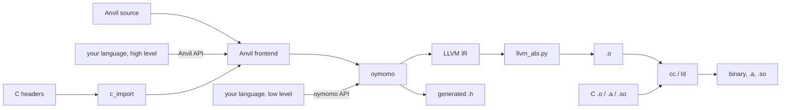
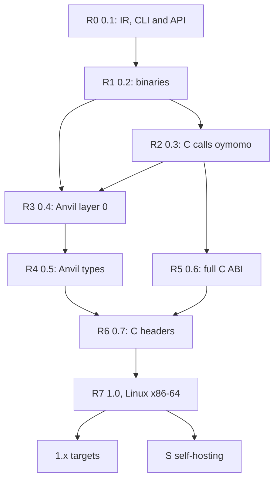

# Roadmap: from oymomo to a production Anvil toolchain

Status: **proposed**; 0 of 8 releases.

This is the top-level order of work. It does not design anything: designs live in the
plans ([plans.md](plans.md)), mostly in the two roadmaps
[plan_c_interop.md](plan_c_interop.md) and [plan_anvil.md](plan_anvil.md). This file
cuts those plans into **releases**, so that work lands incrementally and **every
release is a toolchain someone can install and use**, not a half-built pipeline.

## Releases

- [ ] R0. `oymo 0.1` — oymomo to LLVM IR: a CLI and a library ([R0](#r0--oymo-01-oymomo-to-llvm-ir))
- [ ] R1. `oymo 0.2` — oymomo to a native binary that calls libc ([R1](#r1--oymo-02-native-binaries-that-call-c))
- [ ] R2. `oymo 0.3` — C calls oymomo: exports, callbacks, generated `.h` ([R2](#r2--oymo-03-c-calls-oymomo))
- [ ] R3. `oymo 0.4` — Anvil layer 0: a small C-like language on oymomo ([R3](#r3--oymo-04-anvil-layer-0))
- [ ] R4. `oymo 0.5` — Anvil layer 1: the type checker as code ([R4](#r4--oymo-05-anvil-layer-1-types))
- [ ] R5. `oymo 0.6` — the full C ABI: floats, by-value structs, varargs ([R5](#r5--oymo-06-the-full-c-abi))
- [ ] R6. `oymo 0.7` — C headers, no hand-written declarations ([R6](#r6--oymo-07-c-headers))
- [ ] R7. `oymo 1.0` — production, on Linux x86-64 ([R7](#r7--oymo-10-production))
- [ ] 1.x. More targets: Linux AArch64, macOS AArch64, Windows x86-64 ([1.x](#1x--more-targets))
- [ ] S. Self-hosting: oymo rewritten in Anvil, after 1.0 ([S](#s--self-hosting-oymo-in-anvil))

## Goal

**Anyone can write Anvil, or their own language, and it mixes with C in one program
with no glue code.** The mixing is oymomo's job ([plan_c_interop.md](plan_c_interop.md)):
whatever lowers to oymomo gets C interop by generating oymomo.

### One package, three ways in

There is **one package, `oymo`**, with one version number. It contains oymomo, Anvil
and the toolchain, and is used in three ways:

| Who | Writes | Gets |
|---|---|---|
| An Anvil user | Anvil source | types (layer 1), C headers, binaries and libraries |
| A language author, high level | a frontend that **lowers to Anvil** | all of Anvil's: a type checker as code, C headers, C ABI |
| A language author, low level | a frontend that **lowers to oymomo** | full control of the code; C ABI, linking, `.h` generation |

A language author's frontend is **their own library**, in their own package and
repository, that depends on `oymo` and uses only its **public API**: nothing of theirs
lives in `oymo`. TAPL's Python languages are the model: a language is a library, and
the toolchain is shared.

```
oymo build app.oymo util.c -o app         # `language anvil` and C, one command, one binary
oymo build lib.oymo --emit=h,a,so         # an Anvil library C can use unchanged
oymo build gen.oymo -o app                 # `language oymomo`, from a generator
```

### One file extension, a `language` header

Every source file is a **`.oymo` file**, whatever its language. Its first line names
the language, and the rest of the file is in that language (the golden tests already
start with `language oymomo`):

```
language anvil
...
```

- `oymomo` and `anvil` are built in. Any other name is looked up in the installed
  packages: a language author's package registers its frontend under the Python entry
  point group `oymo.languages` (`calc = "calc_lang:frontend"`), so `pip install
  calc-lang` is enough for `oymo build hello.oymo` to build a `language calc` file.
- A frontend is a function from source text to a tree, an oymomo tree or an Anvil
  tree (the two lowering targets), with source locations. The driver does the rest.
- So a **mixed build is one command**: `oymo build a.oymo b.oymo c.c`, where `a` is
  `language anvil`, `b` is `language calc` and `c.c` is C, links into one binary.
- An unknown name is an error that says which package to install, if known, and lists
  the installed languages.

```python
# a language author's library, in its own package
import oymo.anvil, oymo.build
tree = my_lang_to_anvil(parse(source))          # or: my_lang_to_oymomo(...)
oymo.build.executable(tree, c_files=['util.c'], output='app')
```



### The public API

Each release adds to a **public API**: the modules a language author may import. Every
other module is internal and may change in any release. The API has a layer for each
way in:

- **oymomo API**: build oymomo terms (or give oymomo text), check them, and get errors
  as data, with locations.
- **Anvil API**: build an Anvil syntax tree (or give Anvil text), with the source
  locations of the author's language attached, so a layer-1 error points at *their*
  source, not at generated Anvil.
- **Build API**: target, emit (`.ll`, `.o`, `.a`, `.so`, `.h`, binary), link with C
  files and libraries, JIT-run. The CLI is a thin layer over it.
- **C API**: `c_import`, giving `CDecl(form, ctype)` (R6).

## Rules for every release

A release is cut only when all of these hold:

1. **Installable**: `pip install oymo` (later a standalone binary, R7) gives the CLI
   and the library.
2. **Usable alone**: a README section shows a real task done with only this release.
3. **End-to-end tests**: each milestone below is a test in CI that builds and runs a
   binary, not only a golden `.ll` file.
4. **The API is tested from outside**: an example language lives in its own package
   (`examples/<name>/`, with its own `pyproject.toml`), installs `oymo` as a
   dependency, imports only the public API, and is built and run in CI. If an example
   needs an internal module, the API is missing something.
5. **Errors, not crashes**: input the release does not support yet gets a message that
   names the missing feature, never a Python traceback.
6. **Green**: `hatch run full-check` passes; the plans it closes are moved to
   [implemented/](implemented/).

Before 1.0 a release may break the oymomo syntax, the Anvil syntax, the public API or
the CLI; its notes say how to migrate. From 1.0 on, all four are stable
([R7](#r7--oymo-10-production)).

## R0 — `oymo 0.1`: oymomo to LLVM IR

**Who uses it:** a language author who wants a simple IR above LLVM. Most of the
pipeline exists; this release packages it as a CLI and a library.

- A driver: `oymo emit-llvm a.oymo -o a.ll`, `oymo check a.oymo` (parse, reduce,
  verify BANF, print stuck terms), `oymo fmt` (the printer).
- Errors with file, line and column for parse errors and stuck terms.
- `oymo run --jit a.oymo`: llvmlite MCJIT runs `main` and prints its result. This
  is also the start of R4's compile-time run of layer 1.
- First public API: the oymomo API (terms, printer, check) and the build API
  (`emit_llvm`, `jit_run`). `oymo/__init__.py` says what is public.
- The `language` header read by the driver, with `oymomo` built in and the
  `oymo.languages` entry point group for everything else.
- **Example language `calc`** in `examples/calc/`: arithmetic expressions, lowered to
  oymomo terms through the public API, registered as `language calc`.

**Milestones:** `oymo run --jit fact.oymo` prints `120`; with `calc` installed from
its own package, `oymo run --jit one.oymo` on `language calc` / `1 + 2 * 3` prints `7`.

## R1 — `oymo 0.2`: native binaries that call C

**Who uses it:** the same people, now shipping executables.

| From | Work |
|---|---|
| [plan_c_interop.md](plan_c_interop.md) 1.2 | `void` functions |
| [plan_c_interop.md](plan_c_interop.md) Phase 2 | real `Target`, `.o` from `TargetMachine`, link with `cc`, `oymo build`, `-c` |
| [plan_memory_advanced.md](plan_memory_advanced.md) 1 | pointer comparison and `'null' {}`, needed to check `malloc` |
| [plan_c_interop.md](plan_c_interop.md) 3.1 | `zeroext` / `signext` on small ints, enough for most of libc |
| new | build API: `executable`, `object_file` |

**Milestones (oymomo calls C):** an oymomo program calls `puts`, `malloc`, `free` and
`strlen`, built with `oymo build` and run, on Linux x86-64; `calc` builds a binary
that prints its result with `printf`.

## R2 — `oymo 0.3`: C calls oymomo

**Who uses it:** someone who wants a fast routine in a C program, written by a
generator or by hand in oymomo.

| From | Work |
|---|---|
| [plan_c_interop.md](plan_c_interop.md) 1.6 | function pointers and indirect calls |
| [plan_c_interop.md](plan_c_interop.md) 1.8 | linkage: exported vs internal; C name ≠ label |
| [plan_c_interop.md](plan_c_interop.md) Phase 4 | exported data, callbacks, generated `.h`, `.a` and `.so` |
| [plan_memory_advanced.md](plan_memory_advanced.md) 2, 3 | pointer casts, `'memcpy'` / `'memset'` |
| new | build API: `static_library`, `shared_library`, `header` |

Scalars and pointers only at the C boundary; a by-value struct there is an error that
says "pass a `'ptr'`" (the fallback in plan_c_interop Phase 3).

**Milestones:** a C `main` calls oymomo through the generated header, and an oymomo
function is passed to `qsort`.

## R3 — `oymo 0.4`: Anvil layer 0

**Who uses it:** anyone who wants to write native code in a small language instead of
an IR, and language authors who want a higher target than oymomo. This is the first
release for people who are not compiler writers.

| From | Work |
|---|---|
| [plan_anvil.md](plan_anvil.md) Phase 0 | syntax, memory model: decided |
| [plan_anvil.md](plan_anvil.md) Phase 1 | grammar on the PEG engine, lowering of layer 0 to oymomo |
| new | `extern` declarations written by hand, to call C (no header import yet) |
| new | `export` on a function, lowering to R2's exports, so C can call Anvil |
| new | `oymo build app.oymo util.c`: `.c` files in the same command are compiled with `cc` |
| new | Anvil API: syntax tree classes and their constructors are public; a tree carries source locations of the author's files |
| new | example language `calc` gets a second backend that lowers to Anvil, beside the oymomo one |

Layer 0 has forms (sizes and layout: `i32`, `ptr`, structs), but no type checker:
a mistake gives wrong code, as in C without warnings. The release notes say so.

**Milestones:** hello world; a linked list with `malloc` / `free`; an Anvil function
called from a C `main`; `calc` lowered to Anvil gives the same binary output as `calc`
lowered to oymomo.

## R4 — `oymo 0.5`: Anvil layer 1, types

**Who uses it:** the same users, now with type errors at build time; and language
authors who lower to Anvil, who get a type checker without writing one.

| From | Work |
|---|---|
| [plan_anvil.md](plan_anvil.md) Phase 2 | layer 1 lowered to a second oymomo program, JIT-run at compile time (R0's `--jit`) |
| [plan_metadata.md](plan_metadata.md) 1–3 | source locations kept through reduction, so a layer-1 error points at the source |
| new | Anvil API: layer-1 errors as data (location, message), so a frontend can show them in its own format |

**Milestones:** `puts(42)` with a hand-written `extern` stops the build with
`app.oymo:3:6: expected Ptr(c_char), got Int32`; a type error in a `calc` program
lowered to Anvil is reported at the line and column of its `language calc` file.

## R5 — `oymo 0.6`: the full C ABI

**Who uses it:** anyone calling real C libraries (libm, SQLite, zlib, SDL), from Anvil,
oymomo or their own language. Anvil gets all of it with no work of its own, except
mapping new forms to types.

| From | Work |
|---|---|
| [plan_floats.md](plan_floats.md) 1–5 | `'f32'`, `'f64'` and their ops |
| [plan_c_interop.md](plan_c_interop.md) 1.x | unions and the remaining gaps of Phase 1 |
| [plan_c_interop.md](plan_c_interop.md) Phase 3 | by-value structs, `sret`, varargs calls, for x86-64 SysV (other targets in 1.x) |
| [plan_c_interop.md](plan_c_interop.md) 3.5 | differential tests against clang, both directions |

**Milestones:** `printf("%d %f\n", ...)` from Anvil; and **drop-in**: a small C library
rewritten in Anvil passes its unchanged C test suite.

## R6 — `oymo 0.7`: C headers

**Who uses it:** everyone; this is when "seamless" is true from the user's seat.

| From | Work |
|---|---|
| [plan_c_interop.md](plan_c_interop.md) Phase 5 | `c_import` with libclang: `CDecl(form, ctype)`, public as the C API |
| [plan_anvil.md](plan_anvil.md) Phase 3 | header import in Anvil, forms to layer 0, ctypes to layer 1 |
| [plan_metadata.md](plan_metadata.md) 6 | origins of imported names in error messages |
| new | `oymo import-c stdio.h` prints oymomo declarations, for frontends that lower to oymomo |

**Milestones:** an Anvil program imports `<stdio.h>`, `<string.h>` and `<math.h>`,
with no `extern` written by hand, and `puts(42)` is a layer-1 error; `calc` calls
`sqrt` from `<math.h>` through `c_import`, in both of its backends.

## R7 — `oymo 1.0`: production

**Who uses it:** teams shipping software on Linux x86-64, and language authors
publishing languages built on oymo. Nothing new in the language is required; this
release is about trust. Each item is a plan of its own, written when R6 lands.

| Area | Work |
|---|---|
| Stability | oymomo syntax and semantics frozen and versioned; Anvil language spec; public API frozen, semantic versioning, deprecation policy |
| BANF removed | once the oymomo shape is frozen, oymomo translates to LLVM IR directly and BANF goes ([todo.md](todo.md)); BANF's checks move into that translation |
| Correctness | [plan_confluence.md](plan_confluence.md); fuzzing of parser, reduction and translation; differential tests against clang at `-O0` and `-O2` |
| Debugging | [plan_metadata.md](plan_metadata.md) 4–5: DWARF, so `gdb` / `lldb` step through the source, Anvil's or a language author's |
| Optimization | `-O0..-O3` through LLVM's pass pipeline; `noalias` ([plan_memory_advanced.md](plan_memory_advanced.md) 5) |
| Scale | multiple files, modules and separate compilation (plan_c_interop Phase 6, plan_anvil Phase 4); incremental builds |
| Target | Linux x86-64 (ELF, SysV ABI, glibc and musl); `--target` written so 1.x only adds entries |
| C, the rest | TLS (`errno`), `static inline` functions and function-like macros (plan_c_interop open question 4) |
| Speed of the compiler | measured on a large program; a budget per 10k lines; profile and fix the slowest pass |
| Distribution | `pip install oymo`, and a standalone binary with LLVM bundled (no Python needed by Anvil users); pinned LLVM version |
| Developer tools | formatter, a language server (go to definition, errors in the editor), syntax highlighting |
| Library | a small Anvil standard library over libc: strings, slices, allocators, I/O |
| Docs | tutorial, Anvil reference, C interop guide, and a **language author's guide**: lowering to Anvil, lowering to oymomo, the public API reference |

**Milestones:** a real program of a few thousand lines (for example a JSON library and
a CLI tool using it) is written in Anvil, mixed with existing C, built on Linux
x86-64, debugged with `gdb`, and its C users can't tell it isn't C; and a second
example language, written by someone who doesn't work on oymo, is built from the
language author's guide alone.

## 1.x — more targets

Each target is one 1.x release: a `Target` entry, its C ABI rules in `llvm_abi.py`
([plan_c_interop.md](plan_c_interop.md) Phase 3), its object format and linker, and
the differential tests against clang run on it in CI. Language authors get each new
target with no change to their code.

| Target | What is new |
|---|---|
| Linux AArch64 (ARM servers, Raspberry Pi) | AAPCS64 ABI: structs up to 16 bytes in registers, HFAs (structs of floats) in float registers |
| macOS AArch64 (Apple Silicon) | Apple's AAPCS64 variant (varargs always on the stack), Mach-O objects, `ld64`, `_` symbol prefix |
| Windows x86-64 | Win64 ABI (structs over 8 bytes by pointer, `long` is 32 bits), COFF objects, `link.exe` / `lld-link`, `.dll` and `.lib` |

## S — self-hosting: oymo in Anvil

Oymo, the Anvil frontend included, is rewritten in Anvil. This is the proof that Anvil
is ready, and it removes Python from the compiler.

- **Starts after 1.0** (decided): it targets a frozen oymomo, a frozen Anvil and a
  frozen public API, so no change is made twice, in the Python compiler and the Anvil
  one. By then it has everything it needs: floats, structs, types, and C headers
  (libLLVM's C API, `llvm-c/Core.h`, imported with `c_import`).
- The Python oymo stays the **bootstrap** compiler until the Anvil one builds itself
  and gives the same output on every test (a three-stage bootstrap, as GCC's).
- BANF is already gone (R7), so the rewrite translates oymomo to LLVM IR directly and
  ports no code that goes away.
- **The public API survives the rewrite.** The Anvil compiler exports a C API with a
  generated `.h` (R2), and the `oymo` Python package becomes a thin binding over it,
  with the same Python API. Language authors' libraries keep working unchanged; the
  example languages in CI are the test. Later, a language author may also write a
  frontend in Anvil or C against the C API.

## Order and dependencies



Anvil comes before the full C ABI on purpose: users can start writing Anvil (R3) with
scalars and pointers, which cover most C APIs, while R5 fills in floats, structs and
varargs. R4 and R5 don't depend on each other and can be worked on in parallel; since
they are one package, whichever lands first is 0.5. After 1.0, the 1.x targets and
self-hosting are independent tracks.

## Decided

- **One package, `oymo`**, with oymomo, Anvil and the toolchain, one version number
  and one CLI command (`oymo`). Languages built on it are separate libraries that
  depend on it, through its public API.
- **Two lowering targets for language authors**: Anvil (types and C headers for free)
  and oymomo (full control). Both are public API.
- **BANF goes away** once the oymomo shape is settled (frozen in R7). Until then it
  stays, as the place where shape rules are checked.
- **Spindle ([plan_vm.md](plan_vm.md)) is a side project**, not on the path to 1.0.
  Layer 1 runs in the LLVM JIT.
- **1.0 is Linux x86-64 only**; other targets are 1.x releases.
- **Oymo is rewritten in Anvil after 1.0** (track S). Before 1.0 the syntaxes and the
  API still change, BANF is removed in R7, and 1.0 reaches users sooner; R7's
  milestone program already tests Anvil on a large program. 1.0 ships the Python
  compiler, so its speed is a 1.0 requirement (R7's "Speed of the compiler" row).
- **The roadmap doesn't depend on where the code lives** (this repository or its own).
- **One file extension, `.oymo`**, and a `language <name>` first line in every file.
  `oymomo` and `anvil` are built in; other languages are found through the
  `oymo.languages` entry point group, so mixed builds are one `oymo build` command.
- **Lowering to Anvil is by tree**, not text: a frontend builds an Anvil syntax tree
  with its own source locations, so errors point at the author's source.

## Open questions

None at the roadmap level. Each release's plans have their own (for example
[plan_anvil.md](plan_anvil.md)'s syntax choice, decision 0.2, before R3).
