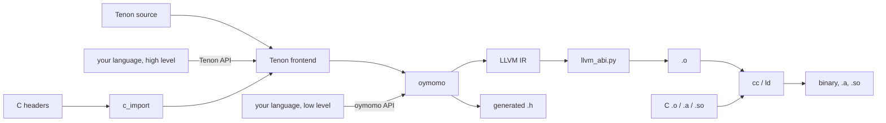
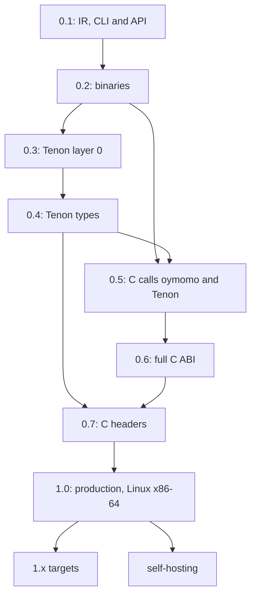

# Roadmap: from oymomo to a production Tenon toolchain

Status: **proposed**; 0 of 8 releases.

This is the top-level order of work. It does not design anything: designs live in the
plans ([plans.md](plans.md)), mostly in the two roadmaps
[plan_c_interop.md](plan_c_interop.md) and [plan_tenon.md](plan_tenon.md). This file
cuts those plans into **releases**, so that work lands incrementally and **every
release is a toolchain someone can install and use**, not a half-built pipeline.

## Releases

- [ ] [0.1](#01--oymomo-to-llvm-ir) — oymomo to LLVM IR: a CLI and a library
- [ ] [0.2](#02--native-binaries-that-call-c) — oymomo to a native binary that calls libc
- [ ] [0.3](#03--tenon-layer-0) — Tenon layer 0: a small C-like language on oymomo
- [ ] [0.4](#04--tenon-layer-1-types) — Tenon layer 1: the type checker as code
- [ ] [0.5](#05--c-calls-oymomo-and-tenon) — C calls oymomo and Tenon: exports, callbacks, generated `.h`
- [ ] [0.6](#06--the-full-c-abi) — the full C ABI: floats, by-value structs, varargs
- [ ] [0.7](#07--c-headers) — C headers, no hand-written declarations
- [ ] [1.0](#10--production) — production, on Linux x86-64
- [ ] [1.x](#1x--more-targets) — more targets: Linux AArch64, macOS AArch64, Windows x86-64
- [ ] [After 1.0](#after-10--self-hosting-oymo-in-tenon) — self-hosting: oymo rewritten in Tenon

## Goal

**Anyone can write Tenon, or their own language, and it mixes with C in one program
with no glue code.** The mixing is oymomo's job ([plan_c_interop.md](plan_c_interop.md)):
whatever lowers to oymomo gets C interop by generating oymomo.

### One package, three ways in

There is **one package, `oymo`**, with one version number. It contains oymomo, Tenon
and the toolchain, and is used in three ways:

| Who | Writes | Gets |
|---|---|---|
| A Tenon user | Tenon source | types (layer 1), C headers, binaries and libraries |
| A language author, high level | a frontend that **lowers to Tenon** | all of Tenon's: a type checker as code, C headers, C ABI |
| A language author, low level | a frontend that **lowers to oymomo** | full control of the code; C ABI, linking, `.h` generation |

A language author's frontend is **their own library**, in their own package and
repository, that depends on `oymo` and uses only its **public API**: nothing of theirs
lives in `oymo`. TAPL's Python languages are the model: a language is a library, and
the toolchain is shared.

```
oymo build app.oymo util.c -o app         # `language tenon` and C, one command, one binary
oymo build lib.oymo --emit=h,a,so         # a Tenon library C can use unchanged
oymo build gen.oymo -o app                 # `language oymomo`, from a generator
```

### One file extension, a `language` header

Every source file is a **`.oymo` file**, whatever its language. Its first line names
the language, and the rest of the file is in that language (the golden tests already
start with `language oymomo`):

```
language tenon
...
```

- `oymomo` and `tenon` are built in. Any other name is looked up in the installed
  packages: a language author's package registers its frontend under the Python entry
  point group `oymo.languages` (`calc = "calc_lang:frontend"`), so `pip install
  calc-lang` is enough for `oymo build hello.oymo` to build a `language calc` file.
- A frontend is a function from source text to a tree, an oymomo tree or a Tenon
  tree (the two lowering targets), with source locations. The driver does the rest.
- So a **mixed build is one command**: `oymo build a.oymo b.oymo c.c`, where `a` is
  `language tenon`, `b` is `language calc` and `c.c` is C, links into one binary.
- An unknown name is an error that says which package to install, if known, and lists
  the installed languages.

```python
# a language author's library, in its own package
import oymo.tenon, oymo.build
tree = my_lang_to_tenon(parse(source))          # or: my_lang_to_oymomo(...)
oymo.build.executable(tree, c_files=['util.c'], output='app')
```



### The public API

Each release adds to a **public API**: the modules a language author may import. Every
other module is internal and may change in any release. The API has a layer for each
way in:

- **oymomo API**: build oymomo terms (or give oymomo text), check them, and get errors
  as data, with locations.
- **Tenon API**: build a Tenon syntax tree (or give Tenon text), with the source
  locations of the author's language attached, so a layer-1 error points at *their*
  source, not at generated Tenon.
- **Build API**: target, emit (`.ll`, `.o`, `.a`, `.so`, `.h`, binary), link with C
  files and libraries, JIT-run. The CLI is a thin layer over it.
- **C API**: `c_import`, giving `CDecl(form, ctype)` (from 0.7).

## Rules for every release

A release is cut only when all of these hold:

1. **Installable**: `pip install oymo` (from 1.0 also a standalone binary) gives the CLI
   and the library.
2. **Usable alone**: a README section shows a real task done with only this release.
3. **End-to-end tests**: each milestone below is a test in CI that builds and runs a
   binary, not only a golden `.ll` file.
4. **The API is tested from outside**: an example language lives in its own package
   (`examples/<name>/`, with its own `pyproject.toml`), installs `oymo` as a
   dependency, imports only the public API, and is built and run in CI. If an example
   needs an internal module, the API is missing something.
5. **Errors, not crashes**: input the release does not support yet gets a message that
   names the missing feature, never a Python traceback.
6. **Green**: `hatch run full-check` passes; the plans it closes are moved to
   [implemented/](implemented/).

Before 1.0 a release may break the oymomo syntax, the Tenon syntax, the public API or
the CLI; its notes say how to migrate. From 1.0 on, all four are stable
([1.0](#10--production)).

## 0.1 — oymomo to LLVM IR

**Who uses it:** a language author who wants a simple IR above LLVM. Most of the
pipeline exists; this release packages it as a CLI and a library.

- A driver: `oymo emit-llvm a.oymo -o a.ll`, `oymo check a.oymo` (parse, reduce,
  verify BANF, print stuck terms), `oymo fmt` (the printer).
- Errors with file, line and column for parse errors and stuck terms.
- `oymo run --jit a.oymo`: llvmlite MCJIT runs `main` and prints its result. This
  is also the start of 0.4's compile-time run of layer 1.
- First public API: the oymomo API (terms, printer, check) and the build API
  (`emit_llvm`, `jit_run`). `oymo/__init__.py` says what is public.
- The `language` header read by the driver, with `oymomo` built in and the
  `oymo.languages` entry point group for everything else.
- **Example language `calc`** in `examples/calc/`: arithmetic expressions, lowered to
  oymomo terms through the public API, registered as `language calc`.

**Milestones:** `oymo run --jit fact.oymo` prints `120`; with `calc` installed from
its own package, `oymo run --jit one.oymo` on `language calc` / `1 + 2 * 3` prints `7`.

## 0.2 — native binaries that call C

**Who uses it:** the same people, now shipping executables.

| From | Work |
|---|---|
| [plan_c_interop.md](plan_c_interop.md) 1.2 | `void` functions |
| [plan_c_interop.md](plan_c_interop.md) Phase 2 | real `Target`, `.o` from `TargetMachine`, link with `cc`, `oymo build`, `-c` |
| [plan_memory_advanced.md](plan_memory_advanced.md) 1 | pointer comparison and `'null' {}`, needed to check `malloc` |
| [plan_c_interop.md](plan_c_interop.md) 3.1 | `zeroext` / `signext` on small ints, enough for most of libc |
| new | build API: `executable`, `object_file` |

**Milestones (oymomo calls C):** an oymomo program calls `puts`, `malloc`, `free` and
`strlen`, built with `oymo build` and run, on Linux x86-64; `calc` builds a binary
that prints its result with `printf`.

## 0.3 — Tenon layer 0

**Who uses it:** anyone who wants to write native code in a small language instead of
an IR, and language authors who want a higher target than oymomo. This is the first
release for people who are not compiler writers.

| From | Work |
|---|---|
| [plan_tenon.md](plan_tenon.md) Phase 0 | syntax, memory model: decided |
| [plan_tenon.md](plan_tenon.md) Phase 1 | grammar on the PEG engine, lowering of layer 0 to oymomo |
| new | `extern` declarations written by hand, to call C (no header import yet) |
| new | `oymo build app.oymo util.c`: `.c` files in the same command are compiled with `cc`, and Tenon calls them |
| new | Tenon API: syntax tree classes and their constructors are public; a tree carries source locations of the author's files |
| new | example language `calc` gets a second backend that lowers to Tenon, beside the oymomo one |

Layer 0 has forms (sizes and layout: `i32`, `ptr`, structs), but no type checker:
a mistake gives wrong code, as in C without warnings. The release notes say so.
Calls go one way, Tenon to C, and are first-order: function pointers come in 0.5.

**Milestones:** hello world; a linked list with `malloc` / `free`; a Tenon program
calls a function in a `.c` file built in the same command; `calc` lowered to Tenon
gives the same binary output as `calc` lowered to oymomo.

## 0.4 — Tenon layer 1, types

**Who uses it:** the same users, now with type errors at build time; and language
authors who lower to Tenon, who get a type checker without writing one.

| From | Work |
|---|---|
| [plan_tenon.md](plan_tenon.md) Phase 2 | layer 1 lowered to a second oymomo program, JIT-run at compile time (0.1's `--jit`) |
| [plan_metadata.md](plan_metadata.md) 1–3 | source locations kept through reduction, so a layer-1 error points at the source |
| new | Tenon API: layer-1 errors as data (location, message), so a frontend can show them in its own format |

**Milestones:** `puts(42)` with a hand-written `extern` stops the build with
`app.oymo:3:6: expected Ptr(c_char), got Int32`; a type error in a `calc` program
lowered to Tenon is reported at the line and column of its `language calc` file.

## 0.5 — C calls oymomo and Tenon

**Who uses it:** someone who wants a fast routine in a C program, written in Tenon, in
their own language, or generated as oymomo; and Tenon programs that pass callbacks to
C (`qsort`).

| From | Work |
|---|---|
| [plan_c_interop.md](plan_c_interop.md) 1.6 | function pointers and indirect calls |
| [plan_c_interop.md](plan_c_interop.md) 1.8 | linkage: exported vs internal; C name ≠ label |
| [plan_c_interop.md](plan_c_interop.md) Phase 4 | exported data, callbacks, generated `.h`, `.a` and `.so` |
| [plan_memory_advanced.md](plan_memory_advanced.md) 2, 3 | pointer casts, `'memcpy'` / `'memset'` |
| new | Tenon: `export` on a function or a global, and function values that lower to function pointers |
| new | the generated `.h` uses Tenon's layer-1 types where there are any: `unsigned`, `const char *` and named structs, which oymomo's forms alone can't tell from `int` and `void *` |
| new | build API: `static_library`, `shared_library`, `header` |

Scalars and pointers only at the C boundary; a by-value struct there is an error that
says "pass a `'ptr'`" (the fallback in plan_c_interop Phase 3).

**Milestones:** a C `main` calls a Tenon library through its generated header, and
the header reads as a hand-written one would; a Tenon function is passed to `qsort`;
the same for an oymomo program, for frontends that lower to oymomo.

## 0.6 — the full C ABI

**Who uses it:** anyone calling real C libraries (libm, SQLite, zlib, SDL), from Tenon,
oymomo or their own language. Tenon gets all of it with no work of its own, except
mapping new forms to types.

| From | Work |
|---|---|
| [plan_floats.md](plan_floats.md) 1–5 | `'f32'`, `'f64'` and their ops |
| [plan_c_interop.md](plan_c_interop.md) 1.x | unions and the remaining gaps of Phase 1 |
| [plan_c_interop.md](plan_c_interop.md) Phase 3 | by-value structs, `sret`, varargs calls, for x86-64 SysV (other targets in 1.x) |
| [plan_c_interop.md](plan_c_interop.md) 3.5 | differential tests against clang, both directions |

**Milestones:** `printf("%d %f\n", ...)` from Tenon; and **drop-in**: a small C library
rewritten in Tenon passes its unchanged C test suite.

## 0.7 — C headers

**Who uses it:** everyone; this is when "seamless" is true from the user's seat.

| From | Work |
|---|---|
| [plan_c_interop.md](plan_c_interop.md) Phase 5 | `c_import` with libclang: `CDecl(form, ctype)`, public as the C API |
| [plan_tenon.md](plan_tenon.md) Phase 3 | header import in Tenon, forms to layer 0, ctypes to layer 1 |
| [plan_metadata.md](plan_metadata.md) 6 | origins of imported names in error messages |
| new | `oymo import-c stdio.h` prints oymomo declarations, for frontends that lower to oymomo |

**Milestones:** a Tenon program imports `<stdio.h>`, `<string.h>` and `<math.h>`,
with no `extern` written by hand, and `puts(42)` is a layer-1 error; `calc` calls
`sqrt` from `<math.h>` through `c_import`, in both of its backends.

## 1.0 — production

**Who uses it:** teams shipping software on Linux x86-64, and language authors
publishing languages built on oymo. Nothing new in the language is required; this
release is about trust. Each item is a plan of its own, written when 0.7 lands.

| Area | Work |
|---|---|
| Stability | oymomo syntax and semantics frozen and versioned; Tenon language spec; public API frozen, semantic versioning, deprecation policy |
| BANF removed | once the oymomo shape is frozen, oymomo translates to LLVM IR directly and BANF goes ([todo.md](todo.md)); BANF's checks move into that translation |
| Correctness | [plan_confluence.md](plan_confluence.md); fuzzing of parser, reduction and translation; differential tests against clang at `-O0` and `-O2` |
| Debugging | [plan_metadata.md](plan_metadata.md) 4–5: DWARF, so `gdb` / `lldb` step through the source, Tenon's or a language author's |
| Optimization | `-O0..-O3` through LLVM's pass pipeline; `noalias` ([plan_memory_advanced.md](plan_memory_advanced.md) 5) |
| Scale | multiple files, modules and separate compilation (plan_c_interop Phase 6, plan_tenon Phase 4); incremental builds |
| Target | Linux x86-64 (ELF, SysV ABI, glibc and musl); `--target` written so 1.x only adds entries |
| C, the rest | TLS (`errno`), `static inline` functions and function-like macros (plan_c_interop open question 4) |
| Speed of the compiler | measured on a large program; a budget per 10k lines; profile and fix the slowest pass |
| Distribution | `pip install oymo`, and a standalone binary with LLVM bundled (no Python needed by Tenon users); pinned LLVM version |
| Developer tools | formatter, a language server (go to definition, errors in the editor), syntax highlighting |
| Library | a small Tenon standard library over libc: strings, slices, allocators, I/O |
| Docs | tutorial, Tenon reference, C interop guide, and a **language author's guide**: lowering to Tenon, lowering to oymomo, the public API reference |

**Milestones:** a real program of a few thousand lines (for example a JSON library and
a CLI tool using it) is written in Tenon, mixed with existing C, built on Linux
x86-64, debugged with `gdb`, and its C users can't tell it isn't C; and a second
example language, written by someone who doesn't work on oymo, is built from the
language author's guide alone.

## 1.x — more targets

Each target is one 1.x release: a `Target` entry, its C ABI rules in `llvm_abi.py`
([plan_c_interop.md](plan_c_interop.md) Phase 3), its object format and linker, and
the differential tests against clang run on it in CI. Language authors get each new
target with no change to their code.

| Target | What is new |
|---|---|
| Linux AArch64 (ARM servers, Raspberry Pi) | AAPCS64 ABI: structs up to 16 bytes in registers, HFAs (structs of floats) in float registers |
| macOS AArch64 (Apple Silicon) | Apple's AAPCS64 variant (varargs always on the stack), Mach-O objects, `ld64`, `_` symbol prefix |
| Windows x86-64 | Win64 ABI (structs over 8 bytes by pointer, `long` is 32 bits), COFF objects, `link.exe` / `lld-link`, `.dll` and `.lib` |

## After 1.0 — self-hosting: oymo in Tenon

Oymo, the Tenon frontend included, is rewritten in Tenon. This is the proof that Tenon
is ready, and it removes Python from the compiler.

- **Starts after 1.0** (decided): it targets a frozen oymomo, a frozen Tenon and a
  frozen public API, so no change is made twice, in the Python compiler and the Tenon
  one. By then it has everything it needs: floats, structs, types, and C headers
  (libLLVM's C API, `llvm-c/Core.h`, imported with `c_import`).
- The Python oymo stays the **bootstrap** compiler until the Tenon one builds itself
  and gives the same output on every test (a three-stage bootstrap, as GCC's).
- BANF is already gone (removed in 1.0), so the rewrite translates oymomo to LLVM IR directly and
  ports no code that goes away.
- **The public API survives the rewrite.** The Tenon compiler exports a C API with a
  generated `.h` (0.5), and the `oymo` Python package becomes a thin binding over it,
  with the same Python API. Language authors' libraries keep working unchanged; the
  example languages in CI are the test. Later, a language author may also write a
  frontend in Tenon or C against the C API.

## Order and dependencies



Tenon comes early on purpose: from 0.3 users write whole programs in Tenon that call
C, which is the common case and needs only scalars and pointers. The other direction,
C calling Tenon (0.5), comes after types (0.4), so a Tenon library's generated header
has real C types (`unsigned`, `const char *`, named structs), not only what oymomo's
forms say. The oymomo half of 0.5 needs only 0.2 and may start earlier. The full C
ABI (0.6) needs both directions, since it lowers both sides of a call. After 1.0, the
1.x targets and self-hosting are independent tracks.

## Decided

- **One package, `oymo`**, with oymomo, Tenon and the toolchain, one version number
  and one CLI command (`oymo`). Languages built on it are separate libraries that
  depend on it, through its public API.
- **Two lowering targets for language authors**: Tenon (types and C headers for free)
  and oymomo (full control). Both are public API.
- **BANF goes away** once the oymomo shape is settled (frozen in 1.0). Until then it
  stays, as the place where shape rules are checked.
- **Spindle ([plan_vm.md](plan_vm.md)) is a side project**, not on the path to 1.0.
  Layer 1 runs in the LLVM JIT.
- **1.0 is Linux x86-64 only**; other targets are 1.x releases.
- **Oymo is rewritten in Tenon after 1.0** ([self-hosting](#after-10--self-hosting-oymo-in-tenon)). Before 1.0 the syntaxes and the
  API still change, BANF is removed in 1.0, and 1.0 reaches users sooner; 1.0's
  milestone program already tests Tenon on a large program. 1.0 ships the Python
  compiler, so its speed is a 1.0 requirement (1.0's "Speed of the compiler" row).
- **The roadmap doesn't depend on where the code lives** (this repository or its own).
- **One file extension, `.oymo`**, and a `language <name>` first line in every file.
  `oymomo` and `tenon` are built in; other languages are found through the
  `oymo.languages` entry point group, so mixed builds are one `oymo build` command.
- **Lowering to Tenon is by tree**, not text: a frontend builds a Tenon syntax tree
  with its own source locations, so errors point at the author's source.

## Open questions

None at the roadmap level. Each release's plans have their own (for example
[plan_tenon.md](plan_tenon.md)'s syntax choice, its Phase 0 syntax decision, before 0.3).
