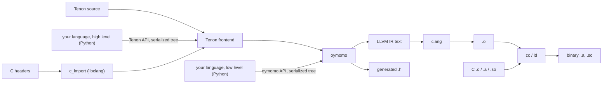

# Roadmap: from oymomo to a production Tenon toolchain

Status: **proposed**; 0 of 39 releases before 1.0.

This is the top-level order of work. It does not design anything: designs live in the
plans ([plans.md](plans.md)), mostly in the two roadmaps
[plan_c_interop.md](plan_c_interop.md) and [plan_tenon.md](plan_tenon.md). This file
cuts those plans into **releases**, so that work lands incrementally and **every
release is a toolchain someone can install and use**, not a half-built pipeline.
Releases are **as small as possible**: each adds one capability, so each lands soon
and each can be tried on its own.

From the first release, the compiler writes **LLVM IR as text** and hands it to
`clang`; there is **no JIT before 1.0** ([Decided](#decided)).

The releases come in four stages:

1. **Stage A — the bootstrap set, in Python.** Only what is needed to write a compiler
   in Tenon: BANF removed, Tenon layer 0 as early as possible, then `oymo build`,
   tagged unions, layer 1 with basic types and generics, imports between files,
   function pointers, a small standard library, and the tools to debug and edit it.
2. **Stage B — bootstrap.** oymo is rewritten in Tenon, builds itself, and the Python
   compiler is frozen: no Python in the compiler.
3. **Stage C — single-threaded, in the Tenon compiler**: memory safety (dependent and
   substructural types), C calling Tenon, the Python package and language authors'
   API, the full C ABI, C headers, full debug info, optimization, safety checks and
   developer tools.
4. **Stage D — threads, distribution and 1.0**: atomics, thread-local storage, threads
   in the standard library, a standalone binary, then 1.0.

## Releases

Each line says what the release delivers; its section below has the work and the
milestone.

### [Stage A — the bootstrap set, in Python](#stage-a--the-bootstrap-set-in-python)

- [ ] [0.1](#01--oymomo-to-llvm-ir-from-the-command-line) — **oymomo to LLVM IR, from the
  command line.** An `oymo` command: `emit-llvm` writes a `.ll` file, `check` reports
  parse errors and stuck terms with file, line and column, `fmt` prints the program,
  and `run` builds the `.ll` with `clang`, runs `main` and prints its result.
- [ ] [0.2](#02--confluence-reduction-order-doesnt-change-the-result) — **confluence:
  reduction order doesn't change the result.** A full-β reference reducer and a
  confluence test over every golden program and generated terms; the known
  counterexample (a form on a form) fixed; built-in rules and `shape` made to
  commute with reduction.
- [ ] [0.3](#03--banf-removed) — **BANF removed.** oymomo translates straight to LLVM
  IR through a small IR-builder interface that writes `.ll` text; BANF's checks move
  into that translation and `shape`, BANF's code is deleted, and llvmlite is no longer
  a dependency. Same output on every test.
- [ ] [0.4](#04--tenon-layer-0-first-part-functions-and-integers) — **Tenon layer 0,
  first part: functions and integers.** Tenon's syntax decided (after a survey of Zig,
  C3, Odin, Hare and Jai), and `language tenon` files with functions, integers,
  locals, `if`, loops and `switch` run with `oymo run`. No type checker yet.
- [ ] [0.5](#05--tenon-layer-0-second-part-memory-and-calls-to-c) — **Tenon layer 0,
  second part: memory and calls to C.** Pointers, structs, arrays and string literals;
  `void` functions, null, pointer casts, `memcpy` / `memset` in oymomo; hand-written
  `extern` declarations call libc (`puts`, `malloc`, `free`).
- [ ] [0.6](#06--oymo-build-executables-objects-and-c-files) — **`oymo build`:
  executables, objects and C files.** `oymo build` writes executables and, with `-c`,
  `.o` files for Linux x86-64; `.c` files on the same command line are compiled and
  linked in, and Tenon calls them.
- [ ] [0.7](#07--enums-and-tagged-unions) — **enums and tagged unions.** Tenon enums,
  and tagged unions with a `switch` that matches on the tag and binds the payload,
  enough to write syntax trees and a recursive evaluator over them.
- [ ] [0.8](#08--tenon-layer-1-basic-types-and-generics) — **Tenon layer 1, basic types
  and generics.** The type checker as code: layer 1 is built with `clang` and run at
  compile time, and stops the build with located errors. Basic types (integers,
  pointers, structs, tagged unions, functions) and generics in the style of System F
  (`List(T)`, `Map(K, V)`).
- [ ] [0.9](#09--module-interfaces-and-imports-between-files) — **module interfaces
  and imports between files.** A program spans many `.oymo` files that import each
  other, built in one command; each exported name carries its form and its layer-1
  type, so a wrong call across files is a type error.
- [ ] [0.10](#010--function-pointers-and-callbacks) — **function pointers and
  callbacks.** Indirect calls in oymomo and function values in Tenon; a Tenon function
  passes to C as a callback (`qsort`), with a `void *` environment where C takes one
  (`qsort_r`).
- [ ] [0.11](#011--the-bootstrap-standard-library-and-oymo-test) — **the bootstrap
  standard library, and `oymo test`.** A Tenon library over libc with generic growable
  arrays and hash maps, strings, number formatting, file I/O, running a process and
  allocators (arena, libc); `oymo test` runs test functions in `.oymo` files; the new
  `oymo/` folder begins.
- [ ] [0.12](#012--debugging-and-editor-support) — **debugging and editor support.**
  `-g` line tables, so `gdb` and `lldb` stop on Tenon lines and show Tenon backtraces;
  ASan on Tenon programs; `oymo lsp`, a language server giving errors as you type; a
  VS Code extension with highlighting, the language server and debugging.

### [Stage B — bootstrap](#stage-b--bootstrap)

- [ ] [0.13](#013--oymo-in-tenon-first-part-oymomo-to-llvm-ir) — **oymo in Tenon, first
  part: oymomo to LLVM IR.** The PEG engine and the oymomo pipeline (parser,
  reduction, `shape`, the translation and its IR builder) ported to Tenon; it writes
  the same `.ll` text as the Python compiler on every oymomo test.
- [ ] [0.14](#014--oymo-in-tenon-second-part-the-tenon-frontend) — **oymo in Tenon,
  second part: the Tenon frontend.** The Tenon grammar, both layers' lowering, the
  layer-1 subprocess and `oymo lsp` ported to Tenon; it matches the Python compiler on
  every Tenon test, layer-1 errors included.
- [ ] [0.15](#015--self-hosting) — **self-hosting.** The compiler builds itself to
  byte-identical output; a committed seed (`bootstrap/oymo.ll`) builds it from scratch
  with `clang` alone; the Python compiler is frozen, and `oymo/` moves to its own
  repository.

### [Stage C — single-threaded, in the Tenon compiler](#stage-c--single-threaded-in-the-tenon-compiler)

- [ ] [0.16](#016--dependent-types-bounds-checked-at-build-time) — **dependent types:
  bounds checked at build time.** Values in types: lifted constants
  (`Array(u8, ^16)`) and run-time values named in types (`Array(u8, n)`, `Index(n)`),
  with facts learnt from tests, so an index not proven in bounds is a build error.
- [ ] [0.17](#017--substructural-types-memory-safety) — **substructural types: memory
  safety.** `Own(T, A)` and second-class borrows, so use after free, double free and
  leaks are build errors, with no run-time cost; the standard library moves to them,
  and the compiler's own source starts to.
- [ ] [0.18](#018--c-calls-tenon-exports-generated-headers-libraries) — **C calls Tenon:
  exports, generated headers, libraries.** `export` on Tenon functions and globals;
  `oymo build` emits `.a`, `.so` and a generated `.h` that uses Tenon's types and
  reads as hand-written. Scalars and pointers only at the boundary.
- [ ] [0.19](#019--the-c-api-and-the-python-package) — **the C API and the Python
  package.** The compiler exports a C API; `pip install oymo` returns, as a wheel with
  the native compiler, a Python binding and a build API (`executable`,
  `shared_library`, `header`…), plus a serialized tree format for Python frontends.
- [ ] [0.20](#020--the-language-registry-and-the-oymomo-api) — **the language registry
  and the oymomo API.** Language authors build oymomo terms from Python; a package
  registers a `language <name>` through the `oymo.languages` entry point; the example
  language `calc` ships as its own package.
- [ ] [0.21](#021--the-tenon-api-for-language-authors) — **the Tenon API for language
  authors.** Public Tenon syntax-tree classes, carrying the author's own source
  locations, so a frontend that lowers to Tenon gets its type checker; Tenon and other
  languages import each other's names.
- [ ] [0.22](#022--build-system-integration) — **build-system integration.** `oymo`
  takes `cc`-style flags (`-c`, `-o`, `-MD` / `-MF`, `-I`, `-L`, `-l`), writes
  `compile_commands.json` entries and finds libraries through pkg-config, so Make and
  CMake projects add Tenon files.
- [ ] [0.23](#023--floats) — **floats.** `f32` and `f64` in oymomo and Tenon:
  arithmetic, comparisons, conversions and exact intrinsics; libm callable.
- [ ] [0.24](#024--by-value-structs-the-c-abi-for-x86-64) — **by-value structs: the C
  ABI for x86-64.** Structs and unions passed and returned by value across the C
  boundary in both directions, as clang does on x86-64 SysV, checked by differential
  tests against clang.
- [ ] [0.25](#025--varargs) — **varargs.** Calling C varargs functions (`printf`) with
  C's argument promotions, and defining Tenon functions with `...` that C calls,
  through `va_list`.
- [ ] [0.26](#026--volatile-and-inline-asm) — **`volatile` and inline asm.**
  `volatile` loads and stores, and inline assembly, each as LLVM has it.
- [ ] [0.27](#027--c-headers-to-oymomo-declarations) — **C headers to oymomo
  declarations.** `c_import` reads C headers through libclang and gives each
  declaration as a form and a C type; `oymo import-c` prints them, so oymomo frontends
  need no hand-written declarations.
- [ ] [0.28](#028--c-headers-in-tenon) — **C headers in Tenon.** Tenon imports C
  headers directly, with C types mapped to Tenon types, so calls into C are
  type-checked and no `extern` is written by hand; errors name a name's header.
- [ ] [0.29](#029--full-debug-info) — **full debug info.** On top of 0.12's line
  tables: parameters, locals and their types in DWARF, so `gdb` and `lldb` print
  variables in Tenon or a language author's source, in programs mixed with C.
- [ ] [0.30](#030--optimization-and-lto) — **optimization and LTO.** `-O0` to `-O3`,
  `noalias` on pointers, and link-time optimization across C and Tenon, so calls
  between them are inlined.
- [ ] [0.31](#031--safety-checks-and-sanitizers) — **safety checks and sanitizers.** A
  checked build mode that traps on overflow, out-of-bounds and null with the source
  location (bounds only where layer 1 proved nothing), and UBSan for the C side of
  mixed programs.
- [ ] [0.32](#032--separate-compilation) — **separate compilation.** Each file compiles
  to its own object against its imports' interfaces, and only changed files and their
  dependents are rebuilt.
- [ ] [0.33](#033--the-full-standard-library) — **the full standard library.**
  Formatted I/O, more containers, a pool allocator, and an optional garbage-collecting
  allocator over the Boehm collector.
- [ ] [0.34](#034--the-rest-of-c) — **the rest of C.** `static inline` functions and
  function-like macros from C headers, usable from Tenon.
- [ ] [0.35](#035--developer-tools) — **developer tools.** `oymo fmt` for Tenon; the
  language server gains go to definition (into C headers too), hover with layer-1
  types, completion and rename; the VS Code extension is published.

### [Stage D — threads, distribution and 1.0](#stage-d--threads-distribution-and-10)

- [ ] [0.36](#036--atomics) — **atomics.** Atomic loads, stores, read-modify-write,
  compare-and-swap and fences with memory orderings, in oymomo and Tenon, and C11
  `_Atomic` types from headers.
- [ ] [0.37](#037--thread-local-storage) — **thread-local storage.** Thread-local
  globals in oymomo and Tenon, and `_Thread_local` variables shared with C in both
  directions.
- [ ] [0.38](#038--threads-in-the-standard-library) — **threads in the standard
  library.** Threads, mutexes and condition variables over pthreads, thread-safe
  allocators, and TSan on mixed programs.
- [ ] [0.39](#039--distribution) — **distribution.** A standalone binary with clang
  and lld bundled (no Python or system clang needed), a CMake module, and reproducible
  builds: the same input gives byte-identical objects.
- [ ] [1.0](#10--production) — **production.** No new features: oymomo, Tenon and the
  public API frozen and versioned (`language tenon 2` for later changes), a language
  spec, fuzzing, benchmarks against `clang -O2`, compile-time budgets, and full docs,
  including a language author's guide.

### After 1.0

- [ ] [1.x](#1x--more-targets) — **more targets.** One release each for Linux AArch64,
  macOS AArch64 and Windows x86-64: the target's C ABI, object format and linker, with
  differential tests against clang; language authors get each with no change.
- [ ] [After 1.0](#after-10--oymo-translate-c) — **`oymo translate-c`.** C source
  translated to Tenon that builds and passes the C file's own tests; what Tenon can't
  express stays C and is listed in a report.
- [ ] [After 1.0](#after-10--spindle-in-tenon) — **Spindle in Tenon.** The embeddable
  VM rewritten in Tenon, with a C API and generated header so C and Python programs
  embed it like Lua, giving the same results as the LLVM-compiled code.

## Goal

**Anyone can write Tenon, or their own language, and it mixes with C in one program
with no glue code.** The mixing is oymomo's job ([plan_c_interop.md](plan_c_interop.md)):
whatever lowers to oymomo gets C interop by generating oymomo.

### One package, three ways in

There is **one package, `oymo`**, with one version number. It contains oymomo, Tenon
and the toolchain, and is used in three ways:

| Who | Writes | Gets |
|---|---|---|
| A Tenon user | Tenon source | types (layer 1), C headers, binaries and libraries |
| A language author, high level | a frontend that **lowers to Tenon** | all of Tenon's: a type checker as code, C headers, C ABI |
| A language author, low level | a frontend that **lowers to oymomo** | full control of the code; C ABI, linking, `.h` generation |

A language author's frontend is **their own library**, in their own package and
repository, that depends on `oymo` and uses only its **public API**: nothing of theirs
lives in `oymo`. TAPL's Python languages are the model: a language is a library, and
the toolchain is shared.

From Stage B on, the compiler is a native program written in Tenon. The `oymo` Python
package (from 0.19) ships it with a Python binding over its C API, so language authors
still write their frontends in Python.

```
oymo build app.oymo util.c -o app         # `language tenon` and C, one command, one binary
oymo build lib.oymo --emit=h,a,so         # a Tenon library C can use unchanged
oymo build gen.oymo -o app                 # `language oymomo`, from a generator
```

### One file extension, a `language` header

Every source file is a **`.oymo` file**, whatever its language. Its first line names
the language, and the rest of the file is in that language (the golden tests already
start with `language oymomo`):

```
language tenon
...
```

- `oymomo` and `tenon` are built into the compiler. Any other name is looked up in the
  installed Python packages: a language author's package registers its frontend under
  the entry point group `oymo.languages` (`calc = "calc_lang:frontend"`), so
  `pip install calc-lang` is enough for `oymo build hello.oymo` to build a
  `language calc` file (from 0.20).
- A frontend is a Python function from source text to a tree, an oymomo tree or a
  Tenon tree (the two lowering targets), with source locations. The tree crosses to
  the native compiler in a serialized form that keeps the locations.
- So a **mixed build is one command**: `oymo build a.oymo b.oymo c.c`, where `a` is
  `language tenon`, `b` is `language calc` and `c.c` is C, links into one binary.
- An unknown name is an error that says which package to install, if known, and lists
  the installed languages. The standalone binary (0.39), with no Python, builds the
  built-in languages only.

```python
# a language author's library, in its own package
import oymo.tenon, oymo.build
tree = my_lang_to_tenon(parse(source))          # or: my_lang_to_oymomo(...)
oymo.build.executable(tree, c_files=['util.c'], output='app')
```



### The public API

From 0.19, each release adds to a **public API**: the Python modules a language author
may import. Every other module is internal and may change in any release. The API has
a layer for each way in:

- **oymomo API**: build oymomo terms (or give oymomo text), check them, and get errors
  as data, with locations.
- **Tenon API**: build a Tenon syntax tree (or give Tenon text), with the source
  locations of the author's language attached, so a layer-1 error points at *their*
  source, not at generated Tenon.
- **Build API**: target, emit (`.ll`, `.o`, `.a`, `.so`, `.h`, binary), link with C
  files and libraries. The CLI is a thin layer over it.
- **C API**: `c_import`, giving `CDecl(form, ctype)` (from 0.27).

## Rules for every release

A release is cut only when all of these hold:

1. **Installable**: in Stage A, `pip install oymo` (the Python compiler, with `clang`
   on the `PATH`); in Stage B, built from the repository with `clang` alone (the seed,
   0.15); from 0.19, `pip install oymo` again (the native compiler with its Python
   binding); from 0.39 also a standalone binary.
2. **Usable alone**: a README section shows a real task done with only this release.
3. **End-to-end tests**: each milestone below is a test in CI that builds the program
   with `clang` and runs it, not only a golden `.ll` file.
4. **The API is tested from outside** (from 0.20): an example language lives in its own
   package (`examples/<name>/`, with its own `pyproject.toml`), installs `oymo` as a
   dependency, imports only the public API, and is built and run in CI. If an example
   needs an internal module, the API is missing something.
5. **Errors, not crashes**: input the release does not support yet gets a message that
   names the missing feature, never a crash or a traceback.
6. **Green**: the full check passes (`hatch run full-check` in Stage A, the Tenon
   compiler's own test suite from Stage B); the plans it closes are moved to
   [implemented/](implemented/).

Before 1.0 a release may break the oymomo syntax, the Tenon syntax, the public API or
the CLI; its notes say how to migrate. From 1.0 on, all four are stable
([1.0](#10--production)). From 0.15 a Tenon syntax change also means changing the
compiler's own source, so Tenon's syntax is decided with care in 0.4–0.8.

## Repository layout

The Tenon-written oymo will move to **its own repository**, named `oymo`. So everything
it needs lives in **one self-contained folder** from the first day it exists, and the
move is one command.

At 0.11, today's `oymo/` folder (the Python compiler) is renamed **`oymo-py/`**, and a
new **`oymo/`** is created for the product:

```
tapl/
  oymo-py/               the Python compiler (Stage A), removed after 0.15
    src/oymo/, tests/, pyproject.toml, docs/ (until 0.15)
  oymo/                  everything the new repository holds:
    README.md, LICENSE
    lib/                 Tenon's standard library (0.11)
    tests/goldens/       moved here from oymo-py (0.11): `.oymo` inputs and expected
                         outputs, run against both compilers in Stage B
    editors/vscode/      the VS Code extension (0.12)
    compiler/            the compiler in Tenon (0.13), mirroring oymo-py/src/oymo:
      core/                PEG engine
      oymomo/              parser, reduction, shape, translation
      ir/                  the IR builder (text first; the LLVM C API later)
      tenon/               the Tenon frontend, both layers
      driver/              the `oymo` command, `oymo lsp` included
    bootstrap/oymo.ll    the seed (0.15)
    build.sh             builds from the seed with `clang` alone (0.15)
    docs/                roadmap, plans and notes, moved from oymo-py (0.15)
    python/              the Python package (0.19): pyproject.toml, src/oymo/
    examples/calc/       the example language, its own package (0.20)
```

- **One rule: nothing inside `oymo/` refers to a path outside it.** Dependencies go one
  way: during Stages A and B the Python compiler in `oymo-py/` reads
  `oymo/tests/goldens/` and builds `oymo/lib/` and `oymo/compiler/`; nothing in
  `oymo/` reaches back into `oymo-py/`. CI checks it by building and testing a copy of
  `oymo/` alone. The VS Code extension runs whichever `oymo` is on the `PATH`.
- **`compiler/` mirrors `oymo-py/src/oymo/`** (`core/`, `oymomo/`, `tenon/`), so each
  Python module has an obvious Tenon counterpart and the port is reviewed file by file.
- **New tests are goldens or `oymo test` files**, which both compilers run; tests
  written in Python stay with the Python compiler.
- **The docs move at 0.15.** They describe the Python code today (notes.md links to
  its files), so they stay in `oymo-py/docs/` until the Python compiler is retired;
  at 0.15 they move to `oymo/docs/`, with those links pointing at `compiler/`.
- **The export, after 0.15**: `git subtree split --prefix=oymo` (or `git filter-repo`)
  makes the new repository with the folder's full history. The CI workflow, which
  must sit at the tapl root until then, moves to the new repository's `.github/`.
  `oymo-py/` is then deleted from tapl, with a git tag (`oymo-py-final`) kept.

## Stage A — the bootstrap set, in Python

What a compiler written in Tenon needs, and nothing more. The test for each feature:
does the rewrite of oymo (0.13, 0.14) need it? Floats, by-value structs at the C
boundary, varargs, C headers, memory safety and threads don't, so they wait for
Stages C and D. Debugging and editor support (0.12) are in, because the compiler is
the first large Tenon program and is written with them.

## 0.1 — oymomo to LLVM IR, from the command line

**Who uses it:** a language author who wants a simple IR above LLVM. Most of the
pipeline exists; this release puts a command in front of it.

- `oymo emit-llvm a.oymo -o a.ll`, `oymo check a.oymo` (parse, reduce, verify BANF,
  print stuck terms; from 0.3, check the shaped program), `oymo fmt` (the printer),
  `oymo run a.oymo` (writes the `.ll`, builds it with `clang` into a temporary binary,
  runs `main` and prints its result; Tenon runs in it from 0.4, and layer 1 from 0.8).
- Errors with file, line and column for parse errors and stuck terms.
- `clang` is required from this release on; `oymo` says so if it is missing.

**Milestone:** `oymo run fact.oymo` prints `120`.

## 0.2 — confluence: reduction order doesn't change the result

**Who uses it:** everyone who generates oymomo: what it means no longer depends on how
oymo happens to reduce it.

| From | Work |
|---|---|
| [plan_confluence.md](plan_confluence.md) 1–4 | a full-β reference reducer and a confluence test; a form on a form is replaced; built-in rules commute with reduction; `shape` is a reduction |

**Neither BANF's removal nor Tenon starts before this release**: Tenon's layers lower
to oymomo, and so does every language author's code, and this release settles
oymomo's shape, so BANF can be removed next (0.3).

**Milestone:** the confluence test passes on every golden program and on generated
terms, with the known counterexample fixed.

## 0.3 — BANF removed

**Who uses it:** nobody sees a change; the compiler gets simpler before anything is
built on it, and before it is rewritten.

| From | Work |
|---|---|
| [todo.md](todo.md) | oymomo translates to LLVM IR directly and BANF goes; BANF's checks move into that translation and into `shape` |
| new | **the IR builder**: the translation calls a small builder interface (new module, new function, new block, add instruction, add global), never LLVM or text directly. Its implementation writes `.ll` text itself, so llvmlite is no longer needed, and the Tenon compiler ports it line for line (0.13) |

Why here: confluence (0.2) has settled oymomo's shape, and Tenon has not started, so
Tenon is built on the final pipeline and its output never went through BANF. Every
oymomo feature after this (`void`, null, casts, `memcpy`, unions, function pointers)
is built once, in the direct translation, and the rewrite (0.13, 0.14) ports that
translation as it is, **with no change of behaviour or logic**.

llvmlite leaves the compiler, but tests and plans that run code under its JIT or read
its target data (the edge-operand tests of [plan_floats.md](plan_floats.md),
Spindle's layout in [plan_vm.md](plan_vm.md)) either build with `clang` instead or
keep llvmlite as a test-only dependency; decided in this release.

**Milestone:** every test and example gives the same output as in 0.2, with BANF's code
deleted and llvmlite removed from the dependencies.

## 0.4 — Tenon layer 0, first part: functions and integers

> **Reminder: the name.** "Tenon" is a working name, still under review (Cymo and
> others are candidates). Decide it before this release's Phase 0 work starts, since
> it appears in the `language` header, the folders and every doc
> ([Open questions](#open-questions) 2).

**Who uses it:** anyone who wants to try Tenon. The first release for people who are
not compiler writers.

| From | Work |
|---|---|
| [plan_tenon.md](plan_tenon.md) Phase 0 | syntax (from a survey of Zig, C3, Odin, Hare and Jai, pros and cons per topic), memory model and undefined behaviour: decided; the syntax for generics, ownership and dependent types is decided too, though they are checked only from 0.8, 0.16 and 0.17 |
| [plan_tenon.md](plan_tenon.md) Phase 1 | grammar on the PEG engine and lowering to oymomo for functions, integers, locals, `if`, loops, `switch`; `language tenon` built in |

Programs run with `oymo run`; there is no `oymo build` yet. Layer 0 has forms but no
type checker: a mistake gives wrong code, as in C without warnings. The release notes
say so.

**Milestone:** `fact`, `fib` and `gcd` written in Tenon run with `oymo run`.

## 0.5 — Tenon layer 0, second part: memory and calls to C

**Who uses it:** the same users, now with pointers, structs and libc.

| From | Work |
|---|---|
| [plan_tenon.md](plan_tenon.md) Phase 1 | pointers, structs, arrays, string literals |
| [plan_c_interop.md](plan_c_interop.md) 1.2 | `void` functions |
| [plan_memory_advanced.md](plan_memory_advanced.md) 1–3 | pointer comparison, `'null' {}`, pointer casts, `'memcpy'` / `'memset'` |
| new | `extern` declarations written by hand, to call C; `oymo run` links libc |

Calls go one way, Tenon to C, and are first-order.

**Milestones:** hello world with `puts`; a linked list with `malloc` / `free`; both
with `oymo run`.

## 0.6 — `oymo build`: executables, objects and C files

**Who uses it:** Tenon and oymomo users, now shipping executables.

| From | Work |
|---|---|
| [plan_c_interop.md](plan_c_interop.md) Phase 2 | a real `Target` (triple and data layout in the `.ll`), `.o` files from `clang -c`, link with `cc`, `oymo build`, `-c` |
| [plan_c_interop.md](plan_c_interop.md) 3.1 | `zeroext` / `signext` on small ints, enough for most of libc |
| new | `oymo build app.oymo util.c`: `.c` files in the same command are compiled with `cc`, and Tenon calls them |

**Milestones:** `oymo build hello.oymo util.c -o hello` gives a binary that runs on
Linux x86-64; a Tenon program reads a file named on its command line and writes it
back reversed.

## 0.7 — enums and tagged unions

**Who uses it:** anyone modelling data with variants; the compiler's syntax trees
(0.13) need them.

| From | Work |
|---|---|
| [plan_tenon.md](plan_tenon.md) Phase 1 | enums; tagged unions and a `switch` that matches on the tag and binds the payload, lowered to oymomo structs and switch |
| [plan_c_interop.md](plan_c_interop.md) 1.5 | the decision on unions in oymomo, as far as tagged unions need it |

**Milestone:** an expression evaluator in Tenon: a tagged union for the syntax tree, a
recursive `eval` over it.

## 0.8 — Tenon layer 1, basic types and generics

**Who uses it:** Tenon users, now with type errors at build time. A compiler of the
size of oymo is not written without them.

| From | Work |
|---|---|
| [plan_tenon.md](plan_tenon.md) Phase 2 | layer 1 lowered to a second oymomo program, written as `.ll`, built with `clang` and run as a subprocess at compile time; its errors come back with their locations |
| [plan_tenon.md](plan_tenon.md) Phase 2 | **basic types**: integers, raw pointers `Ptr(T)`, structs, enums, tagged unions and function types, checked in layer 1 |
| [plan_tenon.md](plan_tenon.md) Phase 2 | **generics, in the style of System F**: functions and types that take types as parameters (`List(T)`, `Map(K, V)`, `fn get(T: Type, l: List(T), i: usize) -> T`), checked once for every `T`; how generic code lowers to layer 0 (one copy per type, or one shared copy) is decided in Phase 0 |
| [plan_metadata.md](plan_metadata.md) 1–3 | source locations kept through reduction, so a layer-1 error points at the source |

Memory stays as in C: raw `Ptr(T)` with `malloc` / `free` and, from 0.11, arenas.
Dependent types and ownership come after the bootstrap (0.16, 0.17).

Why in Stage A: the compiler (0.13, 0.14) is the largest Tenon program, and needs type
errors; generics let the standard library (0.11) write its containers once.

**Milestones:** `puts(42)` with a hand-written `extern` stops the build with
`app.oymo:3:6: expected Ptr(c_char), got Int32`; the expression evaluator of 0.7
type-checks; a generic `List(T)` is used at two types, and passing a `List(i32)` where
a `List(u8)` is expected is a layer-1 error.

## 0.9 — module interfaces and imports between files

**Who uses it:** anyone whose program outgrows one file, as the compiler will.

| From | Work |
|---|---|
| [plan_tenon.md](plan_tenon.md) Phase 2 | **module interfaces**: each exported name as a pair like `c_import`'s, the **form** (layer 0, what oymomo needs to call it) and the **layer-1 type**, which appears here because types appear in layer 1. Other languages on oymo read and write them from 0.21 |
| new | **imports between files**, through those interfaces: a program in several `.oymo` files, built in one command (separate compilation comes in 0.32) |

**Milestone:** a program of ten Tenon files, importing each other; calling an imported
function with the wrong type is a layer-1 error.

## 0.10 — function pointers and callbacks

**Who uses it:** Tenon programs with tables of functions (the compiler's parser and
passes), and programs that pass callbacks to C.

| From | Work |
|---|---|
| [plan_c_interop.md](plan_c_interop.md) 1.6 | function pointers and indirect calls |
| [plan_tenon.md](plan_tenon.md) Phase 3 | Tenon function values, lowering to function pointers; a closure crosses to C as code plus a `void *` environment, written by hand ([Non-goals](#non-goals)) |

**Milestone:** a Tenon function is passed to `qsort` and to `qsort_r` with a `void *`
environment.

## 0.11 — the bootstrap standard library, and `oymo test`

**Who uses it:** anyone writing a real program in Tenon; first of all the rewrite of
oymo.

| From | Work |
|---|---|
| [plan_tenon.md](plan_tenon.md) Phase 5 | the part of the standard library a compiler needs, written in Tenon over libc: generic growable arrays and a generic hash map (0.8), strings and a string builder, number formatting (no `printf`: varargs come in 0.25), file I/O, running a process (to call `clang`), and the allocator interface with an arena and the libc allocator |
| new | the [repository layout](#repository-layout) begins: `oymo/` renamed `oymo-py/`; the new `oymo/` holds `lib/` (this library) and `tests/goldens/`, moved from `oymo-py` |
| new | `oymo test`: test functions in `.oymo` files, run and reported, as `zig test` does |

**Milestone:** a word-count program over a large file, with a hash map and an arena;
its tests run with `oymo test`.

## 0.12 — debugging and editor support

**Who uses it:** anyone writing a large Tenon program; first of all the rewrite of oymo
(0.13), which would otherwise be debugged with no line numbers and no editor help.

| From | Work |
|---|---|
| [plan_metadata.md](plan_metadata.md) 4 (part) | `oymo build -g` / `oymo run -g`: **line tables** in the `.ll` (`DICompileUnit`, `DISubprogram`, `!DILocation`) from the locations of 0.8, so `gdb` and `lldb` set breakpoints on Tenon lines, step by line and show backtraces with Tenon function names. Variables and types come with full debug info (0.29) |
| new | **ASan**: `oymo build -fsanitize=address`, passed to `clang`, which instruments the `.ll`; a use after free or an out-of-bounds access in Tenon is reported with its Tenon line. UBSan's checks are inserted by clang's C frontend, so they don't apply to `.ll`; Tenon's own come with the checked build (0.31) |
| new | **`oymo lsp`**: a language server (LSP) for `.oymo` files, any language: parse errors and layer-1 errors as you type, with their locations. More features come in 0.35 |
| new | **a VS Code extension** in `oymo/editors/vscode/`: syntax highlighting for oymomo and Tenon, picked by the `language` header; the language server; breakpoints in `.oymo` files and launch configurations that debug a program through `gdb` or `lldb` |

**Milestones:** in VS Code, a type error is underlined while the file is typed; a
breakpoint on a Tenon line stops there and the call stack shows Tenon functions; a use
after `free` in the linked list of 0.5 is caught by ASan with its Tenon line.

## Stage B — bootstrap

oymo is rewritten in Tenon, compiled by the Python compiler, then by itself. Both
compilers already write `.ll` text and run `clang`, and layer 1 already runs as a
subprocess, so the rewrite changes the language the compiler is written in, not what
it does. At the end of Stage B the Python compiler is frozen and the product no longer
needs Python.

## 0.13 — oymo in Tenon, first part: oymomo to LLVM IR

**Who uses it:** oymomo users: the same language, now compiled by a native program.

| From | Work |
|---|---|
| new | in `oymo/compiler/` ([layout](#repository-layout)): the **PEG engine** (`core/`), which the oymomo parser is built on, and the oymomo pipeline in Tenon, ported as it is: parser, reduction, `shape`, and the direct translation to LLVM IR (0.3) with its IR builder and the line tables of 0.12. There is no BANF to port |
| new | the confluence test of 0.2 and every oymomo golden test, run against the Tenon compiler |

Integer constants need no wide arithmetic: oymomo's widest integer form is `i64`, so
`u64` / `i64` cover every constant the translation prints. 128-bit integers (C's
`__int128`), if oymomo ever gains them, are a Stage C feature.

**Milestone:** the Tenon-written compiler, built by the Python compiler, writes the
same `.ll` text as the Python compiler, byte for byte, on every oymomo test.

## 0.14 — oymo in Tenon, second part: the Tenon frontend

**Who uses it:** Tenon users: the same language, now compiled by a native program.

| From | Work |
|---|---|
| new | the Tenon grammar (on the PEG engine of 0.13) and the lowering of both layers, in Tenon |
| new | the layer-1 subprocess and the channel its errors come back on, as in 0.8 |
| new | `oymo lsp` (0.12), in the driver |

**Milestone:** the Tenon-written compiler, built by the Python compiler, gives the same
output as the Python compiler on every Tenon test, layer-1 errors included, and the
VS Code extension works with it unchanged.

## 0.15 — self-hosting

**Who uses it:** everyone: the compiler is now one native program, built from the
repository with `clang` alone.

| From | Work |
|---|---|
| new | **three-stage build**: the compiler built by the Python compiler (stage 1) builds itself (stage 2), which builds itself again (stage 3); stages 2 and 3 must be byte-identical |
| new | **the seed**: the compiler's own LLVM IR, committed as `oymo/bootstrap/oymo.ll`. Building from scratch is `clang bootstrap/oymo.ll -o oymo-seed`, then the seed builds today's source. The seed is regenerated when the compiler's source starts using a feature the old seed doesn't know ([Open questions](#open-questions) 3). An oymomo seed instead, split into the oymomo core and the Tenon frontend, is proposed in [plan_bootstrap.md](plan_bootstrap.md) |
| new | the Python compiler is frozen |
| new | the docs move from `oymo-py/docs/` to `oymo/docs/`; `build.sh` builds from the seed |
| new | **the export**: `oymo/` becomes its own repository, with its history; `oymo-py/` is removed from tapl, tagged `oymo-py-final` ([layout](#repository-layout)) |

**Milestone:** on a machine with `clang` and no Python, a fresh clone of the new
repository builds from the seed, builds itself twice to identical output, and passes
every test.

## Stage C — single-threaded, in the Tenon compiler

Every remaining feature is added to the Tenon compiler only. Stage C covers
single-threaded programs (0.16–0.35); Stage D adds threads and finishes 1.0.

## 0.16 — dependent types: bounds checked at build time

**Who uses it:** Tenon users who want out-of-bounds access caught at build time, with
no run-time cost.

| From | Work |
|---|---|
| [plan_tenon.md](plan_tenon.md) 0.6.1, Phase 2b | **values in types**: lifted constants (`Array(u8, ^16)`, `Matrix(^2, ^3)`), and run-time values named in types (`buf: Ptr(Array(u8, n))`, `i: Index(n)`); facts learnt from layer-0 tests (inside `if (i < n)`, `i: Index(n)`), with no solver |
| [plan_tenon.md](plan_tenon.md) 0.6.1 | `buf[i]` type-checks only with `i: Index(n)`; otherwise it is a layer-1 error, or the user writes a checked access, which traps |
| new | the standard library's arrays and slices (0.11) take their lengths in their types |

**Milestones:** an index with no bounds test before it stops the build; the same code
with `if (i < n)` around it builds; the word count of 0.11 type-checks with sized
slices.

## 0.17 — substructural types: memory safety

**Who uses it:** Tenon users who want use after free, double free and leaks caught at
build time, with no run-time cost and no GC.

| From | Work |
|---|---|
| [plan_tenon.md](plan_tenon.md) 0.6.2–0.6.6, Phase 2b | **`Own(T, A)`** (linear: freed or passed on exactly once), **second-class borrows** `Ref(T)`, and the live / consumed / borrowed state of each name; `alloc` and `free` on allocators; explicit conversion between `Ptr(T)` and `Own(T, A)`; annotations on C functions that return or consume an owned value (`malloc`, `free`) |
| [plan_tenon.md](plan_tenon.md) Phase 2 | module interfaces (0.9) carry ownership, so it is checked across files |
| new | the standard library moves to `Own` and `Ref`; the compiler's own source starts to, module by module, with raw `Ptr(T)` still allowed |

Why after the bootstrap: ownership is the hardest part of Tenon to design and to
write a large program in. Keeping it out of Stages A and B lets the compiler be
written first, as in C, and keeps Stage A small; the cost is adopting it in the
compiler afterwards ([Risks](#risks)).

**Milestones:** the linked list of 0.5, rewritten with `Own`, type-checks, and a use
after free, a double free or a leak in it stops the build; one module of the compiler
is rewritten with `Own` and type-checks.

## 0.18 — C calls Tenon: exports, generated headers, libraries

**Who uses it:** someone who wants a fast routine in a C program, written in Tenon or
generated as oymomo.

| From | Work |
|---|---|
| [plan_c_interop.md](plan_c_interop.md) 1.8 | linkage: exported vs internal; C name ≠ label |
| [plan_c_interop.md](plan_c_interop.md) Phase 4 | exported data, generated `.h`, `.a` and `.so` |
| [plan_tenon.md](plan_tenon.md) Phase 3 | `export` on a function or a global |
| new | the generated `.h` is made from the module interface (0.9) and uses its layer-1 types where there are any: `unsigned`, `const char *` and named structs, which oymomo's forms alone can't tell from `int` and `void *` |

Scalars and pointers only at the C boundary; a by-value struct there is an error that
says "pass a pointer" until 0.24.

**Milestone:** a C `main` calls a Tenon library through its generated header, and the
header reads as a hand-written one would.

## 0.19 — the C API and the Python package

**Who uses it:** Python users and language authors, who get `pip install oymo` back,
now with the native compiler inside.

| From | Work |
|---|---|
| new | the compiler exports a C API (with 0.18's exports and generated header): build, emit, check, errors as data |
| new | the `oymo` Python package, in `oymo/python/`: a wheel with the native compiler and a Python binding over its C API; the `oymo` command is its driver |
| new | the build API in Python: `executable`, `object_file`, `static_library`, `shared_library`, `header`, `emit_llvm` |
| new | the serialized tree format, with source locations, in which a Python frontend's tree crosses to the compiler |

**Milestone:** `pip install oymo` on a fresh machine, then `oymo build hello.oymo` and
a Python script that builds the same program through the build API.

## 0.20 — the language registry and the oymomo API

**Who uses it:** a language author who generates oymomo from Python.

| From | Work |
|---|---|
| new | the oymomo API: build oymomo terms in Python, check them, errors as data |
| new | the `language` header resolved by the driver: `oymomo` and `tenon` built in, the `oymo.languages` entry point group for everything else |
| new | **example language `calc`** in `oymo/examples/calc/`: arithmetic expressions, lowered to oymomo terms through the public API, registered as `language calc` |

**Milestone:** with `calc` installed from its own package, `oymo build one.oymo` on
`language calc` / `1 + 2 * 3` gives a binary that prints `7`.

## 0.21 — the Tenon API for language authors

**Who uses it:** language authors who want a higher target than oymomo, with types.

| From | Work |
|---|---|
| new | the Tenon API: syntax tree classes and their constructors are public; a tree carries the source locations of the author's files; layer-1 errors as data |
| new | `calc` gets a second backend that lowers to Tenon |
| [plan_tenon.md](plan_tenon.md) Phase 2 | module interfaces across languages: a frontend that lowers to Tenon gives forms and types; one that lowers to oymomo gives forms only, and its names are unchecked in layer 1 |

**Milestones:** a type error in a `calc` program lowered to Tenon is reported at the
line and column of its `language calc` file; a Tenon file imports a function from a
`language calc` file, and calling it with the wrong type is a layer-1 error.

## 0.22 — build-system integration

**Who uses it:** C projects that add Tenon files to an existing build.

| From | Work |
|---|---|
| new | flags so Make and CMake call `oymo` as they call `cc`: `-c`, `-o`, `-MD` / `-MF` dependency files, and an entry in `compile_commands.json` |
| new | finding C libraries: `-I`, `-L`, `-l` and `oymo build --pkg-config sdl2` |

**Milestone:** a Makefile builds a mixed C and Tenon project with `oymo -c` in place of
`cc -c`, rebuilds only what changed, and links SDL found through pkg-config.

## 0.23 — floats

| From | Work |
|---|---|
| [plan_floats.md](plan_floats.md) 1–5 | `'f32'`, `'f64'`, arithmetic, comparisons, conversions, exact intrinsics |

**Milestone:** a Tenon program calls `sqrt` and `pow` from libm and prints the result.

## 0.24 — by-value structs: the C ABI for x86-64

| From | Work |
|---|---|
| [plan_c_interop.md](plan_c_interop.md) 1.5 | unions as C has them |
| [plan_c_interop.md](plan_c_interop.md) Phase 3.2–3.3 | by-value structs and `sret`, on both sides of a call, for x86-64 SysV (other targets in 1.x) |
| [plan_c_interop.md](plan_c_interop.md) 3.5 | differential tests against clang, both directions |

**Milestone (drop-in):** a small C library rewritten in Tenon passes its unchanged C
test suite.

## 0.25 — varargs

| From | Work |
|---|---|
| [plan_c_interop.md](plan_c_interop.md) 1.7, 3.4 | varargs declarations and calls, default argument promotions, `va_list` for definitions |

**Milestone:** `printf("%d %f %s\n", ...)` from Tenon; a Tenon function with `...`
called from C.

## 0.26 — `volatile` and inline asm

| From | Work |
|---|---|
| [plan_c_interop.md](plan_c_interop.md) 1.10 | a `volatile` flag on `'load'` / `'store'`, and `'asm'`, each as LLVM has it |

**Milestone:** a signal handler sets a `volatile` flag that the main loop reads; a
function uses `rdtsc` through inline asm.

## 0.27 — C headers to oymomo declarations

| From | Work |
|---|---|
| [plan_c_interop.md](plan_c_interop.md) Phase 5 | `c_import`, calling libclang's C API from the Tenon compiler: `CDecl(form, ctype)`, public as the C API (in Python through the binding) |
| new | `oymo import-c stdio.h` prints oymomo declarations |

**Milestone:** `calc` calls `sqrt` from `<math.h>` through `c_import`, with no
hand-written declaration.

## 0.28 — C headers in Tenon

**Who uses it:** every Tenon user; this is when "seamless" is true from the user's
seat.

| From | Work |
|---|---|
| [plan_tenon.md](plan_tenon.md) Phase 4 | header import in Tenon, forms to layer 0, ctypes to layer 1 |
| [plan_metadata.md](plan_metadata.md) 6 | origins of imported names in error messages |
| new | the compiler's own hand-written `extern`s for libc and libclang replaced by header imports |

**Milestone:** a Tenon program imports `<stdio.h>`, `<string.h>` and `<math.h>`, with
no `extern` written by hand, and `puts(42)` is a layer-1 error.

## 0.29 — full debug info

| From | Work |
|---|---|
| [plan_metadata.md](plan_metadata.md) 4–5 | the rest of DWARF, on top of 0.12's line tables: parameters, locals and their types, so `gdb` / `lldb` print variables in the source, Tenon's or a language author's |

**Milestone:** `gdb` sets a breakpoint in a Tenon function, steps line by line and
prints locals, in a program mixed with C.

## 0.30 — optimization and LTO

| From | Work |
|---|---|
| new | `-O0..-O3`, passed to `clang` |
| [plan_memory_advanced.md](plan_memory_advanced.md) 5 | `noalias` |
| new | **LTO across C and Tenon**: both compile to LLVM, so `oymo -c -flto` emits LLVM bitcode and clang's `-flto` link inlines C into Tenon and back. Few languages offer this cheaply, and it strengthens the drop-in story |

**Milestone:** a call from C into a small Tenon function is inlined under `-flto`
(checked in the disassembly).

## 0.31 — safety checks and sanitizers

| From | Work |
|---|---|
| [plan_tenon.md](plan_tenon.md) 0.5 | the checked build mode: traps on overflow, out-of-bounds and null, with the source location; out-of-bounds checks only where layer 1 (0.16) proved nothing |
| new | **UBSan** on the C side of a mixed program (ASan has worked since 0.12; TSan comes with threads, 0.38) |

**Milestone:** an out-of-bounds write in Tenon is caught by the checked build and, in
an optimized build, by ASan, both with the Tenon source line.

## 0.32 — separate compilation

| From | Work |
|---|---|
| [plan_c_interop.md](plan_c_interop.md) Phase 6 | modules and separate compilation, on top of 0.9's interfaces |
| new | incremental builds: only changed files and their dependents are rebuilt |

**Milestone:** changing one function body in the compiler's own source rebuilds one
object.

## 0.33 — the full standard library

| From | Work |
|---|---|
| [plan_tenon.md](plan_tenon.md) Phase 5 | the rest of the single-threaded standard library on top of 0.11's: formatted I/O, more containers, a pool allocator, and a garbage-collecting allocator over the Boehm collector |

**Milestone:** the same program runs with the arena allocator and with the Boehm
allocator, changed in one line.

## 0.34 — the rest of C

| From | Work |
|---|---|
| [plan_c_interop.md](plan_c_interop.md) open question 4 | `static inline` functions and function-like macros in headers |

**Milestone:** a program calls a `static inline` function and uses a function-like
macro from a system header.

## 0.35 — developer tools

| From | Work |
|---|---|
| new | `oymo fmt` for Tenon |
| new | the language server of 0.12 gains go to definition (into C headers too), hover with layer-1 types, completion, find references and rename |
| new | the VS Code extension published on the Visual Studio Marketplace and Open VSX; any LSP editor (Neovim, Emacs, Helix) works with `oymo lsp` |

**Milestone:** an editor shows layer-1 errors as you type, goes to the definition of a
name imported from a C header, and shows a name's type on hover.

## Stage D — threads, distribution and 1.0

What sharing memory between threads needs, then the release work for 1.0. pthreads
themselves can be called from Tenon before this stage, through C headers (0.28).

## 0.36 — atomics

| From | Work |
|---|---|
| [plan_c_interop.md](plan_c_interop.md) 1.10 | `'atomicrmw'`, `'cmpxchg'`, `'fence'`, atomic `'load'` / `'store'` with a memory ordering, each as LLVM has it; Tenon syntax for them; C11 `_Atomic` types from headers |

**Milestone:** a Tenon program with two threads (pthreads, from `<pthread.h>`) shares a
counter through atomics and always gets the right total.

## 0.37 — thread-local storage

| From | Work |
|---|---|
| [plan_c_interop.md](plan_c_interop.md) Phase 6 | thread-local globals in oymomo (LLVM `thread_local`); Tenon syntax for them; `_Thread_local` variables imported from and exported to C |

**Milestone:** each of four threads counts in its own thread-local variable; a C
library's `_Thread_local` variable is read from Tenon.

## 0.38 — threads in the standard library

| From | Work |
|---|---|
| new | a thread API in the standard library over pthreads: threads, mutexes, condition variables |
| new | thread-safe allocators: the libc allocator, per-thread arenas, and the Boehm allocator in its threaded mode |
| new | **TSan**: `-fsanitize=thread` on a mixed C and Tenon program |

**Milestone:** a parallel program (a worker pool over a queue) runs clean under TSan.

## 0.39 — distribution

| From | Work |
|---|---|
| new | a standalone binary with LLVM (clang and lld) bundled, for users with no Python and no system clang; pinned LLVM version |
| new | a CMake module (`find_package(oymo)`, `.oymo` as a source language), on top of 0.22's flags |
| new | **reproducible builds**: the same input always gives byte-identical `.o` files (no time stamps, paths mapped as `-ffile-prefix-map` does); CI builds twice and compares |

**Milestone:** a CMake project with C and Tenon builds with the standalone binary on a
machine with no Python and no clang, twice, to identical objects.

## 1.0 — production

**Who uses it:** teams shipping software on Linux x86-64, and language authors
publishing languages built on oymo. Nothing new in the language; this release is
about trust.

| Area | Work |
|---|---|
| Stability | oymomo syntax and semantics frozen and versioned; Tenon language spec; public API frozen, semantic versioning, deprecation policy; **language versions** in the header (`language tenon 2`), so a language can change after 1.0 without breaking old files, as Rust's editions do |
| Correctness | the confluence test of 0.2 kept green and extended to every new rule; fuzzing of parser, reduction and translation; differential tests against clang at `-O0` and `-O2` |
| Speed of the code | a benchmark set (the same programs in C and Tenon); target: within a set percentage of `clang -O2`, measured in CI |
| Speed of the compiler | measured on its own source; a budget per 10k lines; layer-1 results cached between builds, so the type checker is not rebuilt for unchanged files; if text IR is too slow, a second IR-builder implementation over the **LLVM C API** (in-process, no printing and re-parsing), behind the same interface |
| Target | Linux x86-64 (ELF, SysV ABI, glibc and musl); `--target` written so 1.x only adds entries |
| Libraries | how one Tenon library uses another, decided and documented: a package manager, or none (vendored sources, or pip packages that ship `.oymo` files) |
| Docs | tutorial, Tenon reference, C interop guide, and a **language author's guide**: lowering to Tenon, lowering to oymomo, the public API reference |

**Milestones:** a real program of a few thousand lines (for example a JSON library and
a multi-threaded CLI tool using it) is written in Tenon, mixed with existing C, built
on Linux x86-64, debugged with `gdb`, and its C users can't tell it isn't C; and a
second example language, written by someone who doesn't work on oymo, is built from
the language author's guide alone. The compiler itself, a Tenon program of tens of
thousands of lines, is the largest test.

## 1.x — more targets

Each target is one 1.x release: a `Target` entry, its C ABI rules
([plan_c_interop.md](plan_c_interop.md) Phase 3), its object format and linker, and
the differential tests against clang run on it in CI. Language authors get each new
target with no change to their code. The seed gains an `.ll` file per target.

| Release | Target | What is new |
|---|---|---|
| 1.1 | Linux AArch64 (ARM servers, Raspberry Pi) | AAPCS64 ABI: structs up to 16 bytes in registers, HFAs (structs of floats) in float registers |
| 1.2 | macOS AArch64 (Apple Silicon) | Apple's AAPCS64 variant (varargs always on the stack), Mach-O objects, `ld64`, `_` symbol prefix |
| 1.3 | Windows x86-64 | Win64 ABI (structs over 8 bytes by pointer, `long` is 32 bits), COFF objects, `link.exe` / `lld-link`, `.dll` and `.lib` |

## After 1.0 — `oymo translate-c`

`oymo translate-c lib.c -o lib.oymo` turns C source into Tenon, as Zig's
`translate-c` and c2rust do, so rewriting a C file in Tenon starts from a working
translation instead of a blank file.

- It builds on 0.27: libclang already parses the file, with the same flags and target,
  and `c_import` already maps declarations and types. translate-c adds function
  bodies: statements and expressions to Tenon syntax.
- The output builds and passes the C file's own tests unchanged (the drop-in milestone
  of 0.24, done by a tool). Idiomatic Tenon is the user's next step, not the tool's.
- Not translated: what Tenon can't express, such as some preprocessor tricks; those
  parts are left as C, called through the C ABI, and listed in a report.
- It shares its code with 0.34 (`static inline` functions and function-like macros in
  headers).

## After 1.0 — Spindle in Tenon

Spindle ([plan_vm.md](plan_vm.md)), the tiny VM embedded like Lua, is written in Tenon
instead of Python. It stays a side project, so no release waits for it; after 1.0 it
becomes a real product.

- **Why Tenon**: plan_vm.md already designs Spindle "so a C port is a straight
  translation" (a stack bytecode, a pure interpreter, state as host objects). Tenon is
  that port: C-level speed and no runtime, with Tenon's types.
- **Embeddable from C and Python**: Spindle exports a C API with a generated header
  (0.18), as Lua does (`spindle_new`, `fiber_resume`, host functions registered from
  C), so a C program embeds it with one `.a` or `.so`. Python reaches it through the
  same C API.
- **What it runs**: BANF is gone (0.3), so Spindle's input is the shaped oymomo
  program, or LLVM IR as plan_vm.md's second pipeline proposes, with LLVM's optimizer
  in front. Decided in plan_vm.md before the rewrite starts.
- **Same results as LLVM**: the differential tests of plan_vm.md, every program run
  both in Spindle and compiled by LLVM, carry over unchanged.

## Non-goals

Not planned, before or after 1.0, so no release waits for them:

- **C++ interop**: no classes, templates, exceptions or name mangling (Carbon's and
  Swift's problem, not ours).
- **A built-in garbage collector**: memory is managed through **allocators the user
  chooses**, passed explicitly (as in Zig). Most are manual (`malloc` / `free`, arena,
  pool); a garbage-collecting allocator (for example the Boehm collector, a C library)
  is one more choice, not a runtime every program carries.
- **Trampolines**: a closure is never packed into a bare C function pointer, since
  that needs machine code made at run time in writable and executable memory, which
  hardened systems forbid. Two ways cross instead, both from 0.10
  ([plan_c_interop.md](plan_c_interop.md)):
  1. **A plain function**, capturing nothing, crosses as a C function pointer
     (`qsort`).
  2. **A closure crosses as two values**, its code and a `void *` to its environment,
     where the C API takes a user-data pointer (`qsort_r`, `pthread_create`, most
     callback APIs). The code is a plain function that reads its captures through
     the pointer. From 0.10 this is written by hand, as in C; once Tenon has closures
     (plan_tenon Phase 5), Tenon splits a closure into the two values itself.

## Risks

- **Syntax changes after bootstrap are expensive.** From 0.15 every Tenon syntax
  change edits the compiler's source and may need a new seed. Phase 0's decisions
  (0.4) are made with the compiler in mind, including the syntax of ownership and
  dependent types, so adopting them later (0.16, 0.17) changes types, not syntax; and
  `oymo fmt` can migrate source.
- **The seed must stay buildable.** `bootstrap/oymo.ll` is regenerated whenever the
  compiler's source needs a newer compiler; CI builds from the seed on every change,
  so a stale seed is caught at once.
- **Two compilers during Stage B.** Until 0.15, a change to oymomo or Tenon is made in
  both the Python and the Tenon compiler. Stage B is kept short, and no feature is
  added during it.
- **The build runs code.** Layer 1 executes during compilation, so building untrusted
  code runs it, as Rust's `build.rs` and Zig's `build.zig` do. The docs say so from
  0.8; a sandbox for layer 1 is a later option.
- **No JIT makes the edit-run loop slower.** `oymo run` and layer 1 pay a `clang`
  build on every run (from 0.1 and 0.8). Measured from 0.8; caching is in 1.0's
  "Speed of the compiler" row, and a JIT can be reconsidered after 1.0.
- **Memory safety is adopted late.** The compiler is written with raw pointers in
  Stages A and B and moves to `Own` from 0.17. Raw `Ptr(T)` stays legal, so the move
  is module by module, never all at once; the risk is that it never finishes, or that
  second-class borrows turn out too weak for the compiler's code (plan_tenon open
  question 6), which 0.17's milestone module tests first.
- **`clang` is required** from 0.1 (gcc can't read LLVM IR), until the standalone
  binary (0.39) bundles it.
- **Text IR is slower** than building IR in memory: the compiler prints it and `clang`
  parses it again. Measured on the compiler's own source from 0.15; the fix, if
  needed, is the LLVM C API behind the IR builder (1.0's "Speed of the compiler"
  row), a local change.
- **Moving targets.** Zig, C3 and Carbon all aim at 1.0 in 2027–2028; Tenon's
  difference (types as code, a platform for other languages) must stay visible in the
  docs from 0.4.

## Order and dependencies

```mermaid
flowchart TD
  subgraph A["Stage A: the bootstrap set, in Python"]
    v01["0.1 CLI"] --> v02["0.2 confluence"] --> v03["0.3 BANF removed"]
    v03 --> v04["0.4 Tenon: functions, integers"] --> v05["0.5 Tenon: memory, C calls"] --> v06["0.6 oymo build"]
    v06 --> v07["0.7 tagged unions"] --> v08["0.8 layer 1: types, generics"] --> v09["0.9 interfaces, imports"]
    v09 --> v10["0.10 function pointers"] --> v11["0.11 bootstrap std library, test"] --> v12["0.12 debugging, editor"]
  end
  subgraph B["Stage B: bootstrap"]
    v13["0.13 PEG engine, oymomo in Tenon"] --> v14["0.14 Tenon frontend in Tenon"] --> v15["0.15 self-hosting, seed"]
  end
  subgraph C["Stage C: single-threaded"]
    v16["0.16 dependent types"] --> v17["0.17 memory safety"] --> v18["0.18 exports, headers"]
    v18 --> v19["0.19 C API, Python package"] --> v20["0.20 registry, oymomo API"] --> v21["0.21 Tenon API"]
    v21 --> v22["0.22 build systems"] --> v23["0.23 floats"] --> v24["0.24 by-value structs"]
    v24 --> v25["0.25 varargs"] --> v26["0.26 volatile, asm"] --> v27["0.27 c_import"]
    v27 --> v28["0.28 headers in Tenon"] --> v29["0.29 full debug info"] --> v30["0.30 optimization, LTO"]
    v30 --> v31["0.31 safety checks"] --> v32["0.32 separate compilation"] --> v33["0.33 full std library"]
    v33 --> v34["0.34 rest of C"] --> v35["0.35 developer tools"]
  end
  subgraph D["Stage D: threads, distribution, 1.0"]
    v36["0.36 atomics"] --> v37["0.37 thread-local storage"] --> v38["0.38 threads in std library"]
    v38 --> v39["0.39 distribution"] --> v100["1.0 production"]
  end
  v12 --> v13
  v15 --> v16
  v35 --> v36
  v100 --> X["1.1-1.3 targets"]
  v100 --> T["translate-c"]
  v100 --> V["Spindle in Tenon"]
```



The chain is the order of **releases**, not of all work: a release ships when its
work is done, and work for later releases may start earlier. The real dependencies:

- **Confluence (0.2) before BANF's removal (0.3) and Tenon (0.4)**, a hard gate.
- **BANF removed (0.3) before Tenon (0.4) and any new oymomo feature**, so Tenon is
  built on the final pipeline, each oymomo feature is built once, in the direct
  translation, and the rewrite is a straight port.
- **Tenon layer 0 as early as possible**: 0.4 and 0.5 run with `oymo run`, before
  `oymo build` (0.6).
- **Stage A holds only what the rewrite needs**, and the tools to write it (0.12). Its
  test: does oymo's own source need the feature? Everything else waits for Stages C
  and D, so Stage B starts as soon as it can.
- **Nothing new during Stage B**: features are added to one compiler, not two.
- **Memory safety (0.16, 0.17) first in Stage C**, so the compiler adopts it early,
  and the Tenon API (0.21) and C header import (0.28) are built with ownership in
  place.
- **The Python package (0.19) after C calls Tenon (0.18)**, since the binding goes
  through the compiler's C API. The language authors' API (0.20, 0.21) follows it.
- **Header import (0.27, 0.28) after the full C ABI (0.23–0.25)**, since real headers
  declare floats, by-value structs and varargs functions.
- **Single-threaded (Stage C) before multi-threaded (Stage D)**: Stage D adds what
  sharing memory between threads needs; pthreads themselves can be called before.
- Independent of each other, and free to swap numbers if one is ready first: 0.22–0.26
  among themselves, and 0.29–0.35 among themselves.

After 1.0, the 1.x targets, translate-c and Spindle in Tenon are independent tracks.

## Decided

- **One package, `oymo`**, with oymomo, Tenon and the toolchain, one version number
  and one CLI command (`oymo`). Languages built on it are separate libraries that
  depend on it, through its public API.
- **Two lowering targets for language authors**: Tenon (types and C headers for free)
  and oymomo (full control). Both are public API.
- **Bootstrap early.** oymo is rewritten in Tenon as soon as Tenon has what a compiler
  needs (Stage A), with layer 1's basic types and generics included; memory safety and
  all other features are added afterwards, to the Tenon compiler only. This replaces
  the earlier decision to self-host after 1.0.
- **The seed** for building from scratch is the compiler's own LLVM IR, committed as
  `bootstrap/oymo.ll`; the Python compiler is frozen at 0.15.
- **LLVM IR as text, and no JIT before 1.0.** Both compilers, Python and Tenon, write
  `.ll` text through a small IR-builder interface (from 0.3) and run `clang`:
  `oymo run` builds a binary and runs it, and layer 1 runs as a compiled subprocess.
  So the two compilers do the same thing, the port is mechanical, the seed builds with
  `clang` alone, and llvmlite is dropped at 0.3. A second builder over the **LLVM C
  API** is an option in Stage C, when there is a reason: compile speed, in-process
  optimization and LTO (0.30), or bundling libLLVM in the standalone binary (0.39).
  This is how most languages differ: Rust, Odin, C3 and Crystal use the LLVM API; GHC
  writes `.ll` text; Zig moved from the C++ API to writing bitcode itself, to stay
  independent of LLVM's API. A JIT, for `oymo run` or for layer 1, is reconsidered
  only after 1.0.
- **BANF goes away before Tenon (0.3)**, right after confluence (0.2) settles
  oymomo's shape, so Tenon never runs through BANF, the rewrite is a port with no
  change of behaviour or logic, and no oymomo feature is ever built in BANF.
- **Debugging and editor support before the bootstrap (0.12)**: line tables, ASan, a
  language server and a VS Code extension, since the compiler is the first large Tenon
  program. Full debug info (0.29) and the full language server (0.35) come later.
- **Language authors write frontends in Python**, through a binding over the
  compiler's C API (0.19); their trees cross in a serialized form with locations.
- **Spindle ([plan_vm.md](plan_vm.md)) is a side project**, written in Tenon after 1.0
  ([Spindle in Tenon](#after-10--spindle-in-tenon)).
- **1.0 is Linux x86-64 only**; other targets are 1.x releases.
- **The Tenon-written oymo gets its own repository**, `oymo`, after 0.15. Until then it
  lives in one self-contained folder, `tapl/oymo/`, next to the Python compiler,
  renamed `oymo-py/` ([Repository layout](#repository-layout)).
- **One file extension, `.oymo`**, and a `language <name>` first line in every file.
  `oymomo` and `tenon` are built in; other languages are found through the
  `oymo.languages` entry point group, so mixed builds are one `oymo build` command.
- **Lowering to Tenon is by tree**, not text: a frontend builds a Tenon syntax tree
  with its own source locations, so errors point at the author's source.
- **Layer 1 in two steps.** Stage A has basic types and generics in the style of
  System F (0.8). Memory safety, with dependent and substructural types, comes after
  the bootstrap (0.16, 0.17): use after free, double free, leaks and out-of-bounds
  access become build-time errors, with no run-time cost and no GC; raw pointers and C
  stay unchecked ([plan_tenon.md](plan_tenon.md) 0.6).
- **Four stages**: A (bootstrap set, in Python), B (bootstrap), C (single-threaded, in
  the Tenon compiler), D (threads, distribution and 1.0).

## Open questions

1. **When is the public launch?** Options:
   - **0.4**, the first Tenon release. Early feedback, while the syntax can still
     change; but no types and no `oymo build`, so Tenon looks like one more C-like
     language.
   - **0.17**, when the compiler is written in Tenon and memory safety works. "A
     memory-safe language whose compiler is written in itself, with types as code" is
     a strong first message, and the syntax has been tested on a large program; but C
     interop is only one way, and there is no Python package for language authors yet.
   - **0.28**, when C headers import into Tenon. The full "seamless with C" story, with
     the language authors' API; but feedback comes late, after most design is fixed.

   Recommended: a **soft launch at 0.17** (a website, the tutorial, a post to
   programming-language communities), and the **main launch at 0.28**, when the claim
   "Zig-level C interop, for any language you build" is true end to end. Decide before
   0.15 ships.
2. **The name.** "Tenon" is a working name; others, such as Cymo, are under review.
   Decide before 0.4 (see its reminder), since the name is in the `language` header,
   the `tenon/` folders, the API (`oymo.tenon`) and every doc.
3. **The seed: how it is stored and refreshed.** `bootstrap/oymo.ll` is the whole
   compiler as LLVM IR for one target: likely megabytes, regenerated often, and one
   more file per 1.x target. Options: commit it as is and regenerate only when the
   source needs a newer compiler; keep it in Git LFS; publish it as a release artifact
   instead of committing it; or a target-independent seed, as Zig's `zig1.wasm` with a
   small WebAssembly interpreter in C; or **an oymomo seed**, in two files (the oymomo
   core and the Tenon frontend as a language library), proposed and discussed in
   [plan_bootstrap.md](plan_bootstrap.md). Decide before 0.13, since the oymomo seed
   shapes how the Tenon-written compiler is split.

Each release's plans have their own open questions (for example
[plan_tenon.md](plan_tenon.md)'s Phase 0 syntax decisions, before 0.4).
