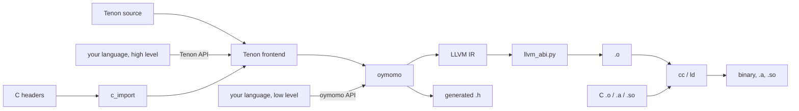
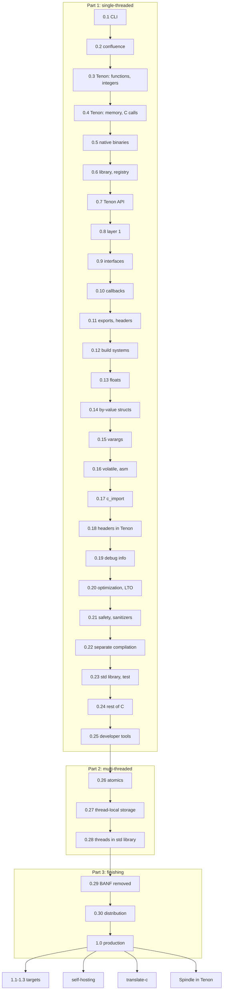

# Roadmap: from oymomo to a production Tenon toolchain

Status: **proposed**; 0 of 30 releases before 1.0.

This is the top-level order of work. It does not design anything: designs live in the
plans ([plans.md](plans.md)), mostly in the two roadmaps
[plan_c_interop.md](plan_c_interop.md) and [plan_tenon.md](plan_tenon.md). This file
cuts those plans into **releases**, so that work lands incrementally and **every
release is a toolchain someone can install and use**, not a half-built pipeline.
Releases are **as small as possible**: each adds one capability, so each lands soon
and each can be tried on its own. They come in three parts: **single-threaded
programs** first, with Tenon layer 0 as early as it can be, then **multi-threaded
programs**, then finishing and 1.0.

## Releases

### [Part 1 — single-threaded programs](#part-1--single-threaded-programs)

- [ ] [0.1](#01--oymomo-to-llvm-ir-from-the-command-line) — oymomo to LLVM IR, from the command line
- [ ] [0.2](#02--confluence-reduction-order-doesnt-change-the-result) — confluence: reduction order doesn't change the result
- [ ] [0.3](#03--tenon-layer-0-first-part-functions-and-integers) — Tenon layer 0, first part: functions and integers
- [ ] [0.4](#04--tenon-layer-0-second-part-memory-and-calls-to-c) — Tenon layer 0, second part: memory and calls to C
- [ ] [0.5](#05--native-binaries) — native binaries
- [ ] [0.6](#06--oymo-as-a-library-and-the-language-registry) — oymo as a library, and the language registry
- [ ] [0.7](#07--the-tenon-api-for-language-authors) — the Tenon API for language authors
- [ ] [0.8](#08--tenon-layer-1-types) — Tenon layer 1, types
- [ ] [0.9](#09--module-interfaces-and-imports-between-files) — module interfaces and imports between files
- [ ] [0.10](#010--function-pointers-and-callbacks) — function pointers and callbacks
- [ ] [0.11](#011--c-calls-tenon-exports-generated-headers-libraries) — C calls Tenon: exports, generated headers, libraries
- [ ] [0.12](#012--build-system-integration) — build-system integration
- [ ] [0.13](#013--floats) — floats
- [ ] [0.14](#014--by-value-structs-the-c-abi-for-x86-64) — by-value structs: the C ABI for x86-64
- [ ] [0.15](#015--varargs) — varargs
- [ ] [0.16](#016--volatile-and-inline-asm) — `volatile` and inline asm
- [ ] [0.17](#017--c-headers-to-oymomo-declarations) — C headers to oymomo declarations
- [ ] [0.18](#018--c-headers-in-tenon) — C headers in Tenon
- [ ] [0.19](#019--debug-info) — debug info
- [ ] [0.20](#020--optimization-and-lto) — optimization and LTO
- [ ] [0.21](#021--safety-checks-and-sanitizers) — safety checks and sanitizers
- [ ] [0.22](#022--separate-compilation) — separate compilation
- [ ] [0.23](#023--standard-library-and-oymo-test) — standard library and `oymo test`
- [ ] [0.24](#024--the-rest-of-c) — the rest of C
- [ ] [0.25](#025--developer-tools) — developer tools

### [Part 2 — multi-threaded programs](#part-2--multi-threaded-programs)

- [ ] [0.26](#026--atomics) — atomics
- [ ] [0.27](#027--thread-local-storage) — thread-local storage
- [ ] [0.28](#028--threads-in-the-standard-library) — threads in the standard library

### [Part 3 — finishing and 1.0](#part-3--finishing-and-10)

- [ ] [0.29](#029--banf-removed) — BANF removed
- [ ] [0.30](#030--distribution) — distribution
- [ ] [1.0](#10--production) — production

### After 1.0

- [ ] [1.x](#1x--more-targets) — more targets
- [ ] [After 1.0](#after-10--self-hosting-oymo-in-tenon) — self-hosting: oymo in Tenon
- [ ] [After 1.0](#after-10--oymo-translate-c) — `oymo translate-c`
- [ ] [After 1.0](#after-10--spindle-in-tenon) — Spindle in Tenon

## Goal

**Anyone can write Tenon, or their own language, and it mixes with C in one program
with no glue code.** The mixing is oymomo's job ([plan_c_interop.md](plan_c_interop.md)):
whatever lowers to oymomo gets C interop by generating oymomo.

### One package, three ways in

There is **one package, `oymo`**, with one version number. It contains oymomo, Tenon
and the toolchain, and is used in three ways:

| Who | Writes | Gets |
|---|---|---|
| A Tenon user | Tenon source | types (layer 1), C headers, binaries and libraries |
| A language author, high level | a frontend that **lowers to Tenon** | all of Tenon's: a type checker as code, C headers, C ABI |
| A language author, low level | a frontend that **lowers to oymomo** | full control of the code; C ABI, linking, `.h` generation |

A language author's frontend is **their own library**, in their own package and
repository, that depends on `oymo` and uses only its **public API**: nothing of theirs
lives in `oymo`. TAPL's Python languages are the model: a language is a library, and
the toolchain is shared.

```
oymo build app.oymo util.c -o app         # `language tenon` and C, one command, one binary
oymo build lib.oymo --emit=h,a,so         # a Tenon library C can use unchanged
oymo build gen.oymo -o app                 # `language oymomo`, from a generator
```

### One file extension, a `language` header

Every source file is a **`.oymo` file**, whatever its language. Its first line names
the language, and the rest of the file is in that language (the golden tests already
start with `language oymomo`):

```
language tenon
...
```

- `oymomo` and `tenon` are built in. Any other name is looked up in the installed
  packages: a language author's package registers its frontend under the Python entry
  point group `oymo.languages` (`calc = "calc_lang:frontend"`), so `pip install
  calc-lang` is enough for `oymo build hello.oymo` to build a `language calc` file.
- A frontend is a function from source text to a tree, an oymomo tree or a Tenon
  tree (the two lowering targets), with source locations. The driver does the rest.
- So a **mixed build is one command**: `oymo build a.oymo b.oymo c.c`, where `a` is
  `language tenon`, `b` is `language calc` and `c.c` is C, links into one binary.
- An unknown name is an error that says which package to install, if known, and lists
  the installed languages.

```python
# a language author's library, in its own package
import oymo.tenon, oymo.build
tree = my_lang_to_tenon(parse(source))          # or: my_lang_to_oymomo(...)
oymo.build.executable(tree, c_files=['util.c'], output='app')
```



### The public API

Each release adds to a **public API**: the modules a language author may import. Every
other module is internal and may change in any release. The API has a layer for each
way in:

- **oymomo API**: build oymomo terms (or give oymomo text), check them, and get errors
  as data, with locations.
- **Tenon API**: build a Tenon syntax tree (or give Tenon text), with the source
  locations of the author's language attached, so a layer-1 error points at *their*
  source, not at generated Tenon.
- **Build API**: target, emit (`.ll`, `.o`, `.a`, `.so`, `.h`, binary), link with C
  files and libraries, JIT-run. The CLI is a thin layer over it.
- **C API**: `c_import`, giving `CDecl(form, ctype)` (from 0.17).

## Rules for every release

A release is cut only when all of these hold:

1. **Installable**: `pip install oymo` (from 0.30 also a standalone binary) gives the CLI
   and the library.
2. **Usable alone**: a README section shows a real task done with only this release.
3. **End-to-end tests**: each milestone below is a test in CI that builds and runs the
   program (in the JIT before 0.5, as a binary from 0.5), not only a golden `.ll` file.
4. **The API is tested from outside**: an example language lives in its own package
   (`examples/<name>/`, with its own `pyproject.toml`), installs `oymo` as a
   dependency, imports only the public API, and is built and run in CI. If an example
   needs an internal module, the API is missing something.
5. **Errors, not crashes**: input the release does not support yet gets a message that
   names the missing feature, never a Python traceback.
6. **Green**: `hatch run full-check` passes; the plans it closes are moved to
   [implemented/](implemented/).

Before 1.0 a release may break the oymomo syntax, the Tenon syntax, the public API or
the CLI; its notes say how to migrate. From 1.0 on, all four are stable
([1.0](#10--production)).

## Part 1 — single-threaded programs

Everything a program with one thread needs, from the first Tenon program to debug
info, the standard library and editor support. Tenon layer 0 comes as early as it
can: right after the command line and the confluence gate, first in the JIT, before
native binaries.

## 0.1 — oymomo to LLVM IR, from the command line

**Who uses it:** a language author who wants a simple IR above LLVM. Most of the
pipeline exists; this release puts a command in front of it.

- `oymo emit-llvm a.oymo -o a.ll`, `oymo check a.oymo` (parse, reduce, verify BANF,
  print stuck terms), `oymo fmt` (the printer), `oymo run --jit a.oymo` (llvmlite
  MCJIT runs `main` and prints its result; Tenon runs in it from 0.3, and layer 1 from
  0.8).
- Errors with file, line and column for parse errors and stuck terms.

**Milestone:** `oymo run --jit fact.oymo` prints `120`.

## 0.2 — confluence: reduction order doesn't change the result

**Who uses it:** everyone who generates oymomo: what it means no longer depends on how
oymo happens to reduce it.

| From | Work |
|---|---|
| [plan_confluence.md](plan_confluence.md) 1–4 | a full-β reference reducer and a confluence test; a form on a form is replaced; built-in rules commute with reduction; `shape` is a reduction |

**Tenon does not start before this release**: both its layers lower to oymomo, and so
does every language author's code.

**Milestone:** the confluence test passes on every golden program and on generated
terms, with the known counterexample fixed.

## 0.3 — Tenon layer 0, first part: functions and integers

**Who uses it:** anyone who wants to try Tenon. The first release for people who are
not compiler writers.

| From | Work |
|---|---|
| [plan_tenon.md](plan_tenon.md) Phase 0 | syntax (from a survey of Zig, C3, Odin, Hare and Jai, pros and cons per topic), memory model and undefined behaviour: decided |
| [plan_tenon.md](plan_tenon.md) Phase 1 | grammar on the PEG engine and lowering to oymomo for functions, integers, locals, `if`, loops, `switch`; `language tenon` built in |

Programs run with `oymo run --jit`; there are no native binaries yet. Layer 0 has forms
but no type checker: a mistake gives wrong code, as in C without warnings. The release
notes say so.

**Milestone:** `fact`, `fib` and `gcd` written in Tenon run with `oymo run --jit`.

## 0.4 — Tenon layer 0, second part: memory and calls to C

**Who uses it:** the same users, now with pointers, structs and libc.

| From | Work |
|---|---|
| [plan_tenon.md](plan_tenon.md) Phase 1 | pointers, structs, arrays, string literals |
| [plan_c_interop.md](plan_c_interop.md) 1.2 | `void` functions |
| [plan_memory_advanced.md](plan_memory_advanced.md) 1 | pointer comparison and `'null' {}`, needed to check `malloc` |
| new | `extern` declarations written by hand, to call C; the JIT finds libc's symbols in the running process |

Calls go one way, Tenon to C, and are first-order.

**Milestones:** hello world with `puts`; a linked list with `malloc` / `free`; both in
the JIT.

## 0.5 — native binaries

**Who uses it:** Tenon and oymomo users, now shipping executables.

| From | Work |
|---|---|
| [plan_c_interop.md](plan_c_interop.md) Phase 2 | real `Target`, `.o` from `TargetMachine`, link with `cc`, `oymo build`, `-c` |
| [plan_c_interop.md](plan_c_interop.md) 3.1 | `zeroext` / `signext` on small ints, enough for most of libc |
| new | `oymo build app.oymo util.c`: `.c` files in the same command are compiled with `cc`, and Tenon calls them |

**Milestones:** `oymo build hello.oymo util.c -o hello` gives a binary that runs on
Linux x86-64; an oymomo program calls `puts`, `malloc`, `free` and `strlen` natively.

## 0.6 — oymo as a library, and the language registry

**Who uses it:** a language author who generates oymomo from Python.

- First public API: the oymomo API (terms, printer, check) and the build API
  (`emit_llvm`, `jit_run`, `executable`, `object_file`). `oymo/__init__.py` says what
  is public.
- The `language` header read by the driver, with `oymomo` and `tenon` built in and the
  `oymo.languages` entry point group for everything else.
- **Example language `calc`** in `examples/calc/`: arithmetic expressions, lowered to
  oymomo terms through the public API, registered as `language calc`.

**Milestone:** with `calc` installed from its own package, `oymo build one.oymo` on
`language calc` / `1 + 2 * 3` gives a binary that prints `7`.

## 0.7 — the Tenon API for language authors

**Who uses it:** language authors who want a higher target than oymomo.

| From | Work |
|---|---|
| new | Tenon API: syntax tree classes and their constructors are public; a tree carries the source locations of the author's files |
| new | example language `calc` gets a second backend that lowers to Tenon, beside the oymomo one |

**Milestone:** `calc` lowered to Tenon gives the same binary output as `calc` lowered
to oymomo, from its own package, through the public API only.

## 0.8 — Tenon layer 1, types

**Who uses it:** Tenon users, now with type errors at build time; and language authors
who lower to Tenon, who get a type checker without writing one.

| From | Work |
|---|---|
| [plan_tenon.md](plan_tenon.md) Phase 2 | layer 1 lowered to a second oymomo program, JIT-run at compile time (0.1's `--jit`) |
| [plan_metadata.md](plan_metadata.md) 1–3 | source locations kept through reduction, so a layer-1 error points at the source |
| new | Tenon API: layer-1 errors as data (location, message), so a frontend can show them in its own format |

**Milestones:** `puts(42)` with a hand-written `extern` stops the build with
`app.oymo:3:6: expected Ptr(c_char), got Int32`; a type error in a `calc` program
lowered to Tenon is reported at the line and column of its `language calc` file.

## 0.9 — module interfaces and imports between files

**Who uses it:** anyone whose program outgrows one file, and anyone mixing languages
on oymo.

| From | Work |
|---|---|
| [plan_tenon.md](plan_tenon.md) Phase 2 | **module interfaces**: how files, and languages on oymo, see each other's declarations. Each exported name is a pair like `c_import`'s: the **form** (layer 0, what oymomo needs to call it) and the **layer-1 type**, which appears here because types appear in layer 1. A frontend that lowers to Tenon gives both; one that lowers to oymomo gives forms only, and its names are unchecked in layer 1, as hand-written `extern`s are |
| new | **imports between files**, through those interfaces: a program in several `.oymo` files, in Tenon or in any language on oymo, built in one command (separate compilation comes in 0.22) |

**Milestone:** a Tenon file imports a function from a `language calc` file, and
calling it with the wrong type is a layer-1 error.

## 0.10 — function pointers and callbacks

**Who uses it:** Tenon and oymomo programs that pass callbacks to C.

| From | Work |
|---|---|
| [plan_c_interop.md](plan_c_interop.md) 1.6 | function pointers and indirect calls |
| [plan_tenon.md](plan_tenon.md) Phase 3 | Tenon function values, lowering to function pointers; a closure crosses as code plus a `void *` environment, written by hand ([Non-goals](#non-goals)) |

**Milestone:** a Tenon function is passed to `qsort` and to `qsort_r` with a `void *`
environment; the same for an oymomo program.

## 0.11 — C calls Tenon: exports, generated headers, libraries

**Who uses it:** someone who wants a fast routine in a C program, written in Tenon, in
their own language, or generated as oymomo.

| From | Work |
|---|---|
| [plan_c_interop.md](plan_c_interop.md) 1.8 | linkage: exported vs internal; C name ≠ label |
| [plan_c_interop.md](plan_c_interop.md) Phase 4 | exported data, generated `.h`, `.a` and `.so` |
| [plan_memory_advanced.md](plan_memory_advanced.md) 2, 3 | pointer casts, `'memcpy'` / `'memset'` |
| [plan_tenon.md](plan_tenon.md) Phase 3 | `export` on a function or a global |
| new | the generated `.h` is made from the module interface (0.9) and uses its layer-1 types where there are any: `unsigned`, `const char *` and named structs, which oymomo's forms alone can't tell from `int` and `void *` |
| new | build API: `static_library`, `shared_library`, `header` |

Scalars and pointers only at the C boundary; a by-value struct there is an error that
says "pass a `'ptr'`" until 0.14.

**Milestone:** a C `main` calls a Tenon library through its generated header, and the
header reads as a hand-written one would.

## 0.12 — build-system integration

**Who uses it:** C projects that add Tenon files to an existing build.

| From | Work |
|---|---|
| new | flags so Make and CMake call `oymo` as they call `cc`: `-c`, `-o`, `-MD` / `-MF` dependency files, and an entry in `compile_commands.json` |
| new | finding C libraries: `-I`, `-L`, `-l` and `oymo build --pkg-config sdl2` |

**Milestone:** a Makefile builds a mixed C and Tenon project with `oymo -c` in place of
`cc -c`, rebuilds only what changed, and links SDL found through pkg-config.

## 0.13 — floats

**Who uses it:** anyone computing with `float` and `double`, or calling libm.

| From | Work |
|---|---|
| [plan_floats.md](plan_floats.md) 1–5 | `'f32'`, `'f64'`, arithmetic, comparisons, conversions, exact intrinsics |

**Milestone:** a Tenon program calls `sqrt` and `pow` from libm and prints the result
with its own formatting code.

## 0.14 — by-value structs: the C ABI for x86-64

**Who uses it:** anyone calling C APIs that pass structs by value (SDL, many math and
graphics libraries).

| From | Work |
|---|---|
| [plan_c_interop.md](plan_c_interop.md) 1.5 | unions |
| [plan_c_interop.md](plan_c_interop.md) Phase 3.2–3.3 | by-value structs and `sret`, on both sides of a call, for x86-64 SysV (other targets in 1.x) |
| [plan_c_interop.md](plan_c_interop.md) 3.5 | differential tests against clang, both directions |

**Milestone (drop-in):** a small C library rewritten in Tenon passes its unchanged C
test suite.

## 0.15 — varargs

**Who uses it:** anyone calling `printf`, `open`, `ioctl`.

| From | Work |
|---|---|
| [plan_c_interop.md](plan_c_interop.md) 1.7, 3.4 | varargs declarations and calls, default argument promotions, `va_list` for definitions |

**Milestone:** `printf("%d %f %s\n", ...)` from Tenon; a Tenon function with `...`
called from C.

## 0.16 — `volatile` and inline asm

**Who uses it:** drivers, memory-mapped I/O, signal handlers, hand-tuned code.

| From | Work |
|---|---|
| [plan_c_interop.md](plan_c_interop.md) 1.10 | a `volatile` flag on `'load'` / `'store'`, and `'asm'`, each as LLVM has it |

**Milestone:** a signal handler sets a `volatile` flag that the main loop reads; a
function uses `rdtsc` through inline asm.

## 0.17 — C headers to oymomo declarations

**Who uses it:** frontends that lower to oymomo and want C declarations without
writing them.

| From | Work |
|---|---|
| [plan_c_interop.md](plan_c_interop.md) Phase 5 | `c_import` with libclang: `CDecl(form, ctype)`, public as the C API |
| new | `oymo import-c stdio.h` prints oymomo declarations |

**Milestone:** `calc` calls `sqrt` from `<math.h>` through `c_import`, with no
hand-written declaration.

## 0.18 — C headers in Tenon

**Who uses it:** every Tenon user; this is when "seamless" is true from the user's
seat.

| From | Work |
|---|---|
| [plan_tenon.md](plan_tenon.md) Phase 4 | header import in Tenon, forms to layer 0, ctypes to layer 1 |
| [plan_metadata.md](plan_metadata.md) 6 | origins of imported names in error messages |

**Milestone:** a Tenon program imports `<stdio.h>`, `<string.h>` and `<math.h>`, with
no `extern` written by hand, and `puts(42)` is a layer-1 error.

## 0.19 — debug info

| From | Work |
|---|---|
| [plan_metadata.md](plan_metadata.md) 4–5 | DWARF, so `gdb` / `lldb` step through the source, Tenon's or a language author's |

**Milestone:** `gdb` sets a breakpoint in a Tenon function, steps line by line and
prints locals, in a program mixed with C.

## 0.20 — optimization and LTO

| From | Work |
|---|---|
| new | `-O0..-O3` through LLVM's pass pipeline |
| [plan_memory_advanced.md](plan_memory_advanced.md) 5 | `noalias` |
| new | **LTO across C and Tenon**: both compile to LLVM, so `oymo -c -flto` emits LLVM bitcode and clang's `-flto` link inlines C into Tenon and back. Few languages offer this cheaply, and it strengthens the drop-in story |

**Milestone:** a call from C into a small Tenon function is inlined under `-flto`
(checked in the disassembly).

## 0.21 — safety checks and sanitizers

| From | Work |
|---|---|
| [plan_tenon.md](plan_tenon.md) 0.5 | the checked build mode: traps on overflow, out-of-bounds and null, with the source location |
| new | **sanitizers**: ASan and UBSan are LLVM passes, so `-fsanitize=address,undefined` works on a mixed C and Tenon program, as a production C toolchain is expected to (TSan comes with threads, 0.28) |

**Milestone:** an out-of-bounds write in Tenon is caught by the checked build and, in
an optimized build, by ASan, both with the Tenon source line.

## 0.22 — separate compilation

| From | Work |
|---|---|
| [plan_c_interop.md](plan_c_interop.md) Phase 6 | modules and separate compilation, on top of 0.9's interfaces |
| new | incremental builds: only changed files and their dependents are rebuilt |

**Milestone:** in a 50-file program, changing one function body rebuilds one object.

## 0.23 — standard library and `oymo test`

| From | Work |
|---|---|
| [plan_tenon.md](plan_tenon.md) Phase 5 | a small standard library over libc, single-threaded: strings, slices, I/O, and the allocator interface with its first allocators (libc, arena, pool, and a garbage-collecting one over the Boehm collector) |
| new | `oymo test`: test functions in `.oymo` files, run and reported, as `zig test` does |

**Milestone:** the same program runs with the arena allocator and with the Boehm
allocator, changed in one line; its tests run with `oymo test`.

## 0.24 — the rest of C

| From | Work |
|---|---|
| [plan_c_interop.md](plan_c_interop.md) open question 4 | `static inline` functions and function-like macros in headers |

**Milestone:** a program calls a `static inline` function and uses a function-like
macro from a system header.

## 0.25 — developer tools

| From | Work |
|---|---|
| new | formatter (`oymo fmt` for Tenon), a language server (go to definition, errors in the editor), syntax highlighting |

**Milestone:** an editor shows layer-1 errors as you type, and goes to the definition
of a name imported from a C header.

## Part 2 — multi-threaded programs

What a program with more than one thread needs on top of Part 1. Threads themselves
come from the C library (pthreads), so Part 2 is about sharing memory between them
correctly.

## 0.26 — atomics

**Who uses it:** threads that share data, lock-free code.

| From | Work |
|---|---|
| [plan_c_interop.md](plan_c_interop.md) 1.10 | `'atomicrmw'`, `'cmpxchg'`, `'fence'`, atomic `'load'` / `'store'` with a memory ordering, each as LLVM has it; Tenon syntax for them; C11 `_Atomic` types from headers |

**Milestone:** a Tenon program with two threads (pthreads, from `<pthread.h>`) shares a
counter through atomics and always gets the right total.

## 0.27 — thread-local storage

**Who uses it:** libraries with per-thread state, and C libraries that export it.

| From | Work |
|---|---|
| [plan_c_interop.md](plan_c_interop.md) Phase 6 | thread-local globals in oymomo (LLVM `thread_local`); Tenon syntax for them; `_Thread_local` variables imported from and exported to C |

**Milestone:** each of four threads counts in its own thread-local variable; a C
library's `_Thread_local` variable is read from Tenon.

## 0.28 — threads in the standard library

**Who uses it:** anyone writing a multi-threaded Tenon program without calling pthreads
by hand.

| From | Work |
|---|---|
| new | a thread API in the standard library over pthreads: threads, mutexes, condition variables |
| new | thread-safe allocators: the libc allocator, per-thread arenas, and the Boehm allocator in its threaded mode |
| new | **TSan**: `-fsanitize=thread` on a mixed C and Tenon program |

**Milestone:** a parallel program (a worker pool over a queue) runs clean under TSan.

## Part 3 — finishing and 1.0

## 0.29 — BANF removed

**Who uses it:** nobody sees a change; the compiler gets simpler before it is frozen.
It comes after Part 2 because atomics and thread-local data are the last changes to
oymomo's shape.

| From | Work |
|---|---|
| [todo.md](todo.md) | the oymomo shape is settled, so oymomo translates to LLVM IR directly and BANF goes; BANF's checks move into that translation |

**Milestone:** every test and example gives the same output as in 0.28, with BANF's
code deleted.

## 0.30 — distribution

| From | Work |
|---|---|
| new | a standalone binary with LLVM bundled (no Python needed by Tenon users); pinned LLVM version |
| new | a CMake module (`find_package(oymo)`, `.oymo` as a source language), on top of 0.12's flags |
| new | **reproducible builds**: the same input always gives byte-identical `.o` files (no time stamps, paths mapped as `-ffile-prefix-map` does); CI builds twice and compares |

**Milestone:** a CMake project with C and Tenon builds with the standalone binary on a
machine with no Python, twice, to identical objects.

## 1.0 — production

**Who uses it:** teams shipping software on Linux x86-64, and language authors
publishing languages built on oymo. Nothing new in the language; this release is
about trust.

| Area | Work |
|---|---|
| Stability | oymomo syntax and semantics frozen and versioned; Tenon language spec; public API frozen, semantic versioning, deprecation policy; **language versions** in the header (`language tenon 2`), so a language can change after 1.0 without breaking old files, as Rust's editions do |
| Correctness | the confluence test of 0.2 kept green and extended to every new rule; fuzzing of parser, reduction and translation; differential tests against clang at `-O0` and `-O2` |
| Speed of the code | a benchmark set (the same programs in C and Tenon); target: within a set percentage of `clang -O2`, measured in CI |
| Speed of the compiler | measured on a large program; a budget per 10k lines; layer-1 results cached between builds, so the type checker is not JIT-compiled again for unchanged files |
| Target | Linux x86-64 (ELF, SysV ABI, glibc and musl); `--target` written so 1.x only adds entries |
| Libraries | how one Tenon library uses another, decided and documented: a package manager, or none (vendored sources, or pip packages that ship `.oymo` files) |
| Docs | tutorial, Tenon reference, C interop guide, and a **language author's guide**: lowering to Tenon, lowering to oymomo, the public API reference |

**Milestones:** a real program of a few thousand lines (for example a JSON library and
a multi-threaded CLI tool using it) is written in Tenon, mixed with existing C, built
on Linux x86-64, debugged with `gdb`, and its C users can't tell it isn't C; and a
second example language, written by someone who doesn't work on oymo, is built from
the language author's guide alone.

## 1.x — more targets

Each target is one 1.x release: a `Target` entry, its C ABI rules in `llvm_abi.py`
([plan_c_interop.md](plan_c_interop.md) Phase 3), its object format and linker, and
the differential tests against clang run on it in CI. Language authors get each new
target with no change to their code.

| Release | Target | What is new |
|---|---|---|
| 1.1 | Linux AArch64 (ARM servers, Raspberry Pi) | AAPCS64 ABI: structs up to 16 bytes in registers, HFAs (structs of floats) in float registers |
| 1.2 | macOS AArch64 (Apple Silicon) | Apple's AAPCS64 variant (varargs always on the stack), Mach-O objects, `ld64`, `_` symbol prefix |
| 1.3 | Windows x86-64 | Win64 ABI (structs over 8 bytes by pointer, `long` is 32 bits), COFF objects, `link.exe` / `lld-link`, `.dll` and `.lib` |

## After 1.0 — self-hosting: oymo in Tenon

Oymo, the Tenon frontend included, is rewritten in Tenon. This is the proof that Tenon
is ready, and it removes Python from the compiler.

- **Starts after 1.0** (decided): it targets a frozen oymomo, a frozen Tenon and a
  frozen public API, so no change is made twice, in the Python compiler and the Tenon
  one. By then it has everything it needs: floats, structs, types, and C headers
  (libLLVM's C API, `llvm-c/Core.h`, imported with `c_import`).
- The Python oymo stays the **bootstrap** compiler until the Tenon one builds itself
  and gives the same output on every test (a three-stage bootstrap, as GCC's).
- BANF is already gone (removed in 0.29), so the rewrite translates oymomo to LLVM IR directly and
  ports no code that goes away.
- **The public API survives the rewrite.** The Tenon compiler exports a C API with a
  generated `.h` (0.11), and the `oymo` Python package becomes a thin binding over it,
  with the same Python API. Language authors' libraries keep working unchanged; the
  example languages in CI are the test. Later, a language author may also write a
  frontend in Tenon or C against the C API.

## After 1.0 — `oymo translate-c`

`oymo translate-c lib.c -o lib.oymo` turns C source into Tenon, as Zig's
`translate-c` and c2rust do, so rewriting a C file in Tenon starts from a working
translation instead of a blank file.

- It builds on 0.17: libclang already parses the file, with the same flags and target,
  and `c_import` already maps declarations and types. translate-c adds function
  bodies: statements and expressions to Tenon syntax.
- The output builds and passes the C file's own tests unchanged (the drop-in milestone
  of 0.14, done by a tool). Idiomatic Tenon is the user's next step, not the tool's.
- Not translated: what Tenon can't express, such as some preprocessor tricks; those
  parts are left as C, called through the C ABI, and listed in a report.
- It also answers plan_c_interop's open question 4: `static inline` functions and
  function-like macros in headers can be translated with the same code.

## After 1.0 — Spindle in Tenon

Spindle ([plan_vm.md](plan_vm.md)), the tiny VM embedded like Lua, is written in Tenon
instead of Python. It stays a side project, so no release waits for it; after 1.0 it
becomes a real product, and the second large Tenon program after the compiler itself.

- **Why Tenon**: plan_vm.md already designs Spindle "so a C port is a straight
  translation" (a stack bytecode, a pure interpreter, state as host objects). Tenon is
  that port: C-level speed and no runtime, with Tenon's types.
- **Embeddable from C and Python**: Spindle exports a C API with a generated header
  (0.11), as Lua does (`spindle_new`, `fiber_resume`, host functions registered from
  C), so a C program embeds it with one `.a` or `.so`. Python reaches it through the
  same C API.
- **What it runs**: BANF is gone by then (0.29), so Spindle's input changes from BANF to
  the shaped oymomo program, or to LLVM IR as plan_vm.md's second pipeline proposes,
  with LLVM's optimizer in front. Decided in plan_vm.md before the rewrite starts.
- **Same results as LLVM**: the differential tests of plan_vm.md, every program run
  both in Spindle and compiled by LLVM, carry over unchanged.
- **Order with self-hosting**: independent. Spindle is smaller, so it may come first
  and test Tenon on a medium-sized program before the compiler is rewritten.

## Non-goals

Not planned, before or after 1.0, so no release waits for them:

- **C++ interop**: no classes, templates, exceptions or name mangling (Carbon's and
  Swift's problem, not ours).
- **A built-in garbage collector**: memory is managed through **allocators the user
  chooses**, passed explicitly (as in Zig). Most are manual (`malloc` / `free`, arena,
  pool); a garbage-collecting allocator (for example the Boehm collector, a C library)
  is one more choice, not a runtime every program carries.
- **Trampolines**: a closure is never packed into a bare C function pointer, since
  that needs machine code made at run time in writable and executable memory, which
  hardened systems forbid. Two ways cross instead, both from 0.10
  ([plan_c_interop.md](plan_c_interop.md)):
  1. **A plain function**, capturing nothing, crosses as a C function pointer
     (`qsort`).
  2. **A closure crosses as two values**, its code and a `void *` to its environment,
     where the C API takes a user-data pointer (`qsort_r`, `pthread_create`, most
     callback APIs). The code is a plain function that reads its captures through
     the pointer. From 0.10 this is written by hand, as in C; once Tenon has closures
     (plan_tenon Phase 5), Tenon splits a closure into the two values itself.

## Risks

- **The build runs code.** Layer 1 executes during compilation, so building untrusted
  code runs it, as Rust's `build.rs` and Zig's `build.zig` do. The docs say so from
  0.8; a sandbox for layer 1 is a later option.
- **Layer 1 makes builds slow.** It is JIT-compiled and run on every build. Measured
  from 0.8; caching is in 1.0's "Speed of the compiler" row.
- **Python speed.** 1.0 ships the Python compiler (self-hosting is after 1.0), so its
  speed must meet the 1.0 budget.
- **Moving targets.** Zig, C3 and Carbon all aim at 1.0 in 2027–2028; Tenon's
  difference (types as code, a platform for other languages) must stay visible in the
  docs from 0.3.

## Order and dependencies



The chain is the order of **releases**, not of all work: a release ships when its
work is done, and work for later releases may start earlier. The real dependencies:

- **Single-threaded first.** Part 1 makes every one-thread program work, end to end;
  Part 2 adds what sharing memory between threads needs. Threads themselves come from
  pthreads, which a Part 1 program can already call, but without atomics or
  thread-local data it can't share memory safely.
- **Confluence (0.2) before Tenon (0.3)**, a hard gate.
- **Tenon layer 0 as early as possible**: 0.3 and 0.4 run in the JIT, before native
  binaries (0.5), the library API (0.6) and everything else.
- **C calling Tenon (0.11) after types (0.8) and interfaces (0.9)**, so a Tenon
  library's generated header has real C types, not only what oymomo's forms say.
- **Header import (0.17, 0.18) after the full C ABI (0.13–0.15)**, since real headers
  declare floats, by-value structs and varargs functions.
- **BANF removed (0.29) after Part 2**, once atomics and thread-local data, the last
  changes to oymomo's shape, are in.
- Independent of each other, and free to swap numbers if one is ready first: 0.13–0.16
  among themselves, and 0.19–0.25 among themselves.

After 1.0, the 1.x targets, self-hosting, translate-c and Spindle in Tenon are
independent tracks.

## Decided

- **One package, `oymo`**, with oymomo, Tenon and the toolchain, one version number
  and one CLI command (`oymo`). Languages built on it are separate libraries that
  depend on it, through its public API.
- **Two lowering targets for language authors**: Tenon (types and C headers for free)
  and oymomo (full control). Both are public API.
- **BANF goes away** in 0.29, once the oymomo shape is settled, just before it is
  frozen in 1.0. Until then it stays, as the place where shape rules are checked.
- **Spindle ([plan_vm.md](plan_vm.md)) is a side project**, not on the path to 1.0.
  After 1.0 it is written in Tenon ([Spindle in Tenon](#after-10--spindle-in-tenon)).
  Layer 1 runs in the LLVM JIT.
- **1.0 is Linux x86-64 only**; other targets are 1.x releases.
- **Oymo is rewritten in Tenon after 1.0** ([self-hosting](#after-10--self-hosting-oymo-in-tenon)). Before 1.0 the syntaxes and the
  API still change, BANF is removed in 0.29, and 1.0 reaches users sooner; 1.0's
  milestone program already tests Tenon on a large program. 1.0 ships the Python
  compiler, so its speed is a 1.0 requirement (1.0's "Speed of the compiler" row).
- **The roadmap doesn't depend on where the code lives** (this repository or its own).
- **One file extension, `.oymo`**, and a `language <name>` first line in every file.
  `oymomo` and `tenon` are built in; other languages are found through the
  `oymo.languages` entry point group, so mixed builds are one `oymo build` command.
- **Lowering to Tenon is by tree**, not text: a frontend builds a Tenon syntax tree
  with its own source locations, so errors point at the author's source.

## Open questions

1. **When is the public launch?** Options:
   - **0.3**, the first Tenon release. Early feedback, while the syntax can still
     change; but JIT only, no types, so Tenon looks like one more C-like language, and
     first impressions stick.
   - **0.8**, when layer 1 works. Tenon's difference, types as code and a platform
     other languages build on, is visible and can be tried, with native binaries and
     calls to C.
   - **0.18**, when C headers import into Tenon. The full "seamless with C" story; but
     feedback comes late, after most design is fixed.

   Recommended: a **soft launch at 0.8** (a website, the tutorial, a post to
   programming-language communities, asking for feedback on syntax and layer 1), and
   the **main launch at 0.18**, when the claim "Zig-level C interop, for any language
   you build" is true end to end. Decide before 0.8 ships.

Each release's plans have their own open questions (for example
[plan_tenon.md](plan_tenon.md)'s Phase 0 syntax decisions, before 0.3).
