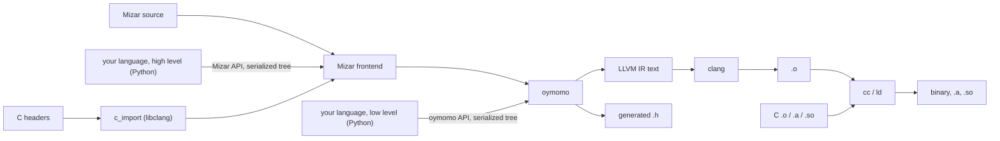

# Roadmap: from oymomo to a production Mizar toolchain

**Status:** proposed · 0 of 39 releases before 1.0

The order of work, cut into **releases**. Designs live in the plans ([plans.md](plans.md)),
mostly [plan_c_interop.md](plan_c_interop.md) and [plan_alcor.md](plan_alcor.md), [plan_mizar.md](plan_mizar.md).

- Every release is a toolchain someone can install and use.
- Releases are as small as possible: one capability each.
- The compiler writes **LLVM IR as text** and runs `clang`; **no JIT before 1.0** ([Decided](#decided)).

Four stages:

- **A — bootstrap set, in Python** (0.1–0.12): only what a compiler written in Alcor needs.
- **B — bootstrap** (0.13–0.15): oymo rewritten in Alcor, builds itself; Python compiler frozen.
- **C — single-threaded, in the Alcor-written compiler** (0.16–0.35): memory safety, C calls
  Mizar, Python package and language authors' API, full C ABI, C headers, tools.
- **D — threads, distribution, 1.0** (0.36–1.0).

## Goal

**Anyone can write Mizar, or their own language, and mix it with C in one program, with no
glue code.** oymomo does the mixing ([plan_c_interop.md](plan_c_interop.md)).

### One package, three ways in

One package, **`oymo`** (one version, one `oymo` command): oymomo, Alcor, Mizar and the
toolchain.

| Who | Writes | Gets |
|---|---|---|
| Mizar user | Mizar source | types (layer 1), C headers, binaries and libraries |
| Language author, high level | a frontend that **lowers to Mizar** | Mizar's type checker, C headers, C ABI |
| Language author, low level | a frontend that **lowers to oymomo** | full control; C ABI, linking, `.h` generation |

- A frontend is the author's own library and package, using only oymo's **public API** (from 0.19).
- From Stage B the compiler is native (Alcor); from 0.19 the Python package wraps it, so
  frontends are still written in Python.

### One file extension, a `language` header

- Every source file is `.oymo`; its first line is `language <name>`.
- `oymomo`, `alcor` and `mizar` are built in; others come from Python packages via the
  `oymo.languages` entry point (from 0.20).
- A mixed build is one command: `oymo build a.oymo b.oymo c.c`.

### Repository layout

- At 0.11, `oymo/` (Python compiler) becomes `oymo-py/`; a new self-contained `oymo/` holds
  the product. **Nothing in `oymo/` refers to a path outside it.**
- After 0.15, `oymo/` is exported to its own repository, `oymo`.

## Rules for every release

1. **Installable**: Stage A `pip install oymo` (+ `clang`); Stage B from the repo with `clang`
   alone; from 0.19 `pip install oymo` again; from 0.39 also a standalone binary.
2. **Usable alone**: a README section shows a real task done with this release.
3. **End-to-end tests**: each milestone is a CI test that builds with `clang` and runs.
4. **API tested from outside** (from 0.20): example languages are separate packages using
   only the public API.
5. **Errors, not crashes**: unsupported input names the missing feature.
6. **Green**: full check passes; closed plans move to [implemented/](implemented/).

Before 1.0, oymomo syntax, Alcor and Mizar syntax, public API and CLI may break (notes say
how to migrate); from 1.0 they are stable.

## Stage A — the bootstrap set, in Python

Test for each feature: does the rewrite of oymo (0.13, 0.14) need it?

| Release | Delivers | Depends on |
|---|---|---|
| [ ] 0.1 | `oymo` CLI: `emit-llvm`, `check` (located errors), `fmt`, `run` (via `clang`) | — |
| <a id="02--confluence-reduction-order-doesnt-change-the-result"></a>[ ] 0.2 | **confluence**: reference reducer + test; form-on-form fixed; rules and `shape` commute with reduction | [plan_confluence](plan_confluence.md) 1–4; 0.1 |
| [ ] 0.3 | **BANF removed**: direct oymomo → `.ll` text via an IR builder; llvmlite dropped | [todo.md](todo.md); 0.2 |
| [ ] 0.4 | **Alcor layer 0, part 1**: syntax decided; functions, integers, locals, `if`, loops, `switch` with `oymo run`; no type checker | plan_alcor Phase 0–1; 0.3 |
| [ ] 0.5 | **Alcor layer 0, part 2**: pointers, structs, arrays, strings; `void`, null, casts, `memcpy`/`memset`; hand-written `extern` to libc | plan_alcor Phase 1; plan_c_interop 1.2; plan_memory_advanced 1–3 |
| [ ] 0.6 | **`oymo build`**: executables, `-c` objects, `.c` files linked in (Linux x86-64) | plan_c_interop Phase 2, 3.1 |
| [ ] 0.7 | **enums and tagged unions**, `switch` binding the payload | plan_alcor Phase 1; plan_c_interop 1.5 (part) |
| [ ] 0.8 | **layer 1: basic types and generics** (System F style), compiled with `clang`, run at build time, located errors | plan_alcor Phase 2; plan_metadata 1–3 |
| [ ] 0.9 | **module interfaces and imports** between files (form + layer-1 type per name) | plan_alcor Phase 2; 0.8 |
| [ ] 0.10 | **function pointers and callbacks**; closures to C as code + `void *` | plan_c_interop 1.6; plan_alcor Phase 3 |
| [ ] 0.11 | **bootstrap standard library** over libc, `oymo test`; new `oymo/` folder | plan_alcor Phase 5 (part); 0.8 |
| [ ] 0.12 | **debugging and editors**: `-g` line tables, ASan, `oymo lsp`, VS Code extension | plan_metadata 4 (part); 0.8 |

Milestones:

- 0.1: `oymo run fact.oymo` prints `120`.
- 0.2: confluence test passes on every golden and generated terms; counterexample fixed.
- 0.3: same output as 0.2 on every test; BANF code and llvmlite gone.
- 0.4: `fact`, `fib`, `gcd` in Alcor run with `oymo run`.
- 0.5: hello world with `puts`; linked list with `malloc`/`free`.
- 0.6: `oymo build hello.oymo util.c -o hello` runs; a program reverses a file.
- 0.7: expression evaluator: tagged-union tree, recursive `eval`.
- 0.8: `puts(42)` → `app.oymo:3:6: expected Ptr(c_char), got Int32`; evaluator type-checks;
  `List(T)` at two types, `List(i32)` for `List(u8)` is an error.
- 0.9: ten Alcor files importing each other; wrong-type imported call is an error.
- 0.10: an Alcor function passed to `qsort` and `qsort_r`.
- 0.11: word count over a large file (hash map, arena), tests via `oymo test`.
- 0.12: VS Code underlines a type error; breakpoint on an Alcor line; ASan catches use after
  free in 0.5's list with its Alcor line.

## Stage B — bootstrap

The rewrite changes the language the compiler is written in, not what it does. Nothing new
is added during Stage B.

| Release | Delivers | Depends on |
|---|---|---|
| [ ] 0.13 | **oymo in Alcor, part 1**: PEG engine + oymomo pipeline (parser, reduction, `shape`, translation, IR builder) | 0.12; seed decision (OQ 3) |
| [ ] 0.14 | **oymo in Alcor, part 2**: Alcor grammar, both layers, layer-1 subprocess, `oymo lsp` | 0.13 |
| [ ] 0.15 | **self-hosting**: 3-stage build, committed seed, Python compiler frozen, docs move, `oymo/` exported | 0.14; [plan_bootstrap.md](plan_bootstrap.md) |

Milestones:

- 0.13: byte-identical `.ll` vs the Python compiler on every oymomo test.
- 0.14: same output as the Python compiler on every Alcor test (layer-1 errors too); VS Code
  extension works unchanged.
- 0.15: with `clang` and no Python, a fresh clone builds from the seed, builds itself twice
  to identical output, passes every test.

## Stage C — single-threaded, in the Alcor-written compiler

| Release | Delivers | Depends on |
|---|---|---|
| [ ] 0.16 | **dependent types**: `Array(u8, ^16)`, `Index(n)`; unproven index is a build error | plan_alcor 0.6.1, Phase 2b |
| [ ] 0.17 | **substructural types**: `Own(T, A)`, second-class borrows; stdlib moves, compiler starts to | plan_alcor 0.6.2–0.6.6, Phase 2b; 0.16 |
| [ ] 0.18 | **C calls Mizar**: `export`, `.a`/`.so`, generated `.h`; scalars and pointers only | plan_c_interop 1.8, Phase 4; plan_alcor Phase 3 |
| [ ] 0.19 | **C API and Python package**: wheel with native compiler, binding, build API, serialized trees | 0.18 |
| [ ] 0.20 | **language registry and oymomo API**; example `calc` package | 0.19 |
| [ ] 0.21 | **Mizar API** for language authors; cross-language imports | plan_mizar Phase 2; 0.20 |
| [ ] 0.22 | **build systems**: `cc`-style flags, `-MD`/`-MF`, `compile_commands.json`, pkg-config | — |
| [ ] 0.23 | **floats** `f32`/`f64`; libm | plan_floats 1–5; plan_mizar Phase 3 |
| [ ] 0.24 | **by-value structs**: C ABI for x86-64 SysV, both directions; unions as C has them | plan_c_interop 1.5, 3.2–3.3, 3.5 |
| [ ] 0.25 | **varargs**: call `printf`; define `...` functions via `va_list` | plan_c_interop 1.7, 3.4 |
| [ ] 0.26 | **`volatile` and inline asm** | plan_c_interop 1.10; plan_mizar Phase 5 |
| [ ] 0.27 | **C headers → oymomo**: `c_import` via libclang, `oymo import-c` | plan_c_interop Phase 5; 0.23–0.25 |
| [ ] 0.28 | **C headers in Mizar**: type-checked, no hand-written `extern` | plan_alcor Phase 4; plan_metadata 6; 0.27 |
| [ ] 0.29 | **full debug info**: params, locals, types in DWARF | plan_metadata 4–5; 0.12 |
| [ ] 0.30 | **optimization and LTO**: `-O0..-O3`, `noalias`, LTO across C and Mizar | plan_memory_advanced 5 |
| <a id="031--safety-checks-and-sanitizers"></a>[ ] 0.31 | **safety checks and sanitizers**: checked build traps on overflow / OOB / null; UBSan on C side | plan_alcor 0.5; 0.16 |
| [ ] 0.32 | **separate compilation**, incremental rebuilds | plan_c_interop Phase 6; 0.9 |
| [ ] 0.33 | **full standard library**: formatted I/O, containers, pool and Boehm GC allocators | plan_mizar Phase 4; 0.11 |
| [ ] 0.34 | **rest of C**: `static inline` and function-like macros from headers | plan_c_interop OQ 4 |
| [ ] 0.35 | **developer tools**: `oymo fmt` for Mizar, full LSP, published VS Code extension | 0.12 |

Milestones:

- 0.16: index with no bounds test fails; inside `if (i < n)` builds; word count uses sized slices.
- 0.17: 0.5's list with `Own` type-checks; use after free / double free / leak fails the build;
  one compiler module rewritten with `Own`.
- 0.18: a C `main` calls a Mizar library through a header that reads as hand-written.
- 0.19: `pip install oymo`, then `oymo build hello.oymo`, and the same via the Python build API.
- 0.20: with `calc` installed, `language calc` / `1 + 2 * 3` builds a binary printing `7`.
- 0.21: `calc`→Mizar type error located in the `calc` file; Mizar imports from `calc` with type checks.
- 0.22: a Makefile uses `oymo -c` for `cc -c`, rebuilds only changes, links SDL via pkg-config.
- 0.23: Mizar calls `sqrt` and `pow` from libm.
- 0.24 (drop-in): a small C library rewritten in Mizar passes its unchanged C tests.
- 0.25: `printf("%d %f %s\n", ...)` from Mizar; a Mizar `...` function called from C.
- 0.26: signal handler sets a `volatile` flag; `rdtsc` via inline asm.
- 0.27: `calc` calls `sqrt` from `<math.h>` via `c_import`.
- 0.28: Mizar imports `<stdio.h>`, `<string.h>`, `<math.h>`; `puts(42)` is a layer-1 error.
- 0.29: `gdb` breaks in Mizar, steps, prints locals, in a program mixed with C.
- 0.30: a C→Mizar call is inlined under `-flto` (checked in disassembly).
- 0.31: an OOB write is caught by the checked build and by ASan (optimized), with Mizar line.
- 0.32: changing one function body in the compiler rebuilds one object.
- 0.33: one program runs with arena and Boehm allocators, switched in one line.
- 0.34: a `static inline` function and a function-like macro from a system header.
- 0.35: editor shows errors as you type, goes to definition in C headers, hover types.

## Stage D — threads, distribution and 1.0

| Release | Delivers | Depends on |
|---|---|---|
| [ ] 0.36 | **atomics**: rmw, cmpxchg, fences, orderings; C11 `_Atomic` | plan_c_interop 1.10; plan_mizar Phase 5 |
| [ ] 0.37 | **thread-local storage**; `_Thread_local` shared with C | plan_c_interop Phase 6 |
| [ ] 0.38 | **threads in stdlib** (pthreads), thread-safe allocators, TSan | 0.36, 0.37 |
| [ ] 0.39 | **distribution**: standalone binary (bundled clang, lld), CMake module, reproducible builds | 0.22 |
| [ ] 1.0 | **production**: no new features; everything frozen and versioned, spec, fuzzing, benchmarks, docs | all above |

Milestones:

- 0.36: two pthreads share an atomic counter; total always right.
- 0.37: four threads count in thread-locals; a C `_Thread_local` read from Mizar.
- 0.38: a worker pool over a queue runs clean under TSan.
- 0.39: CMake project (C + Mizar) builds with the standalone binary, no Python or clang, twice,
  identical objects.
- 1.0: a few-thousand-line Mizar program mixed with C (e.g. JSON lib + threaded CLI), debugged
  with `gdb`, indistinguishable from C to its users; a second example language written by an
  outsider from the language author's guide alone. The compiler is the largest test.

## After 1.0

| Release | Delivers | Depends on |
|---|---|---|
| [ ] 1.1–1.3 | **more targets**: Linux AArch64, macOS AArch64, Windows x86-64 | plan_c_interop Phase 3 |
| <a id="after-10--oymo-translate-c"></a>[ ] After 1.0 | **`oymo translate-c`**: C → Mizar that passes the C file's own tests; leftovers stay C, listed | 0.27, 0.34 |
| <a id="after-10--spindle-in-mizar"></a>[ ] After 1.0 | **Spindle in Mizar**: embeddable VM with C API, same results as LLVM | [plan_vm.md](plan_vm.md); 0.18 |

## Non-goals

Not planned, before or after 1.0:

- **C++ interop**: no classes, templates, exceptions, name mangling.
- **A built-in GC**: memory through explicit, user-chosen allocators (as in Zig); a Boehm
  allocator is one choice, not a runtime.
- **Trampolines**: a closure never becomes a bare C function pointer (needs W+X memory). From
  0.10: a capture-free function crosses as a function pointer; a closure crosses as code +
  `void *` environment (by hand until Mizar has closures, plan_mizar Phase 4).

## Risks

| Risk | Mitigation |
|---|---|
| Syntax changes after 0.15 edit the compiler and may need a new seed | decide syntax (incl. ownership, dependent types) in 0.4; `oymo fmt` migrates |
| Stale seed | CI builds from the seed on every change |
| Two compilers in Stage B | keep it short; no features added |
| The build runs code (layer 1) | documented from 0.8; sandbox later |
| No JIT: slower edit-run loop | measure from 0.8; caching in 1.0; JIT after 1.0 |
| Memory safety adopted late; may never finish, borrows may be too weak (plan_alcor OQ 6) | raw `Ptr(T)` stays legal; move module by module; 0.17 milestone tests it |
| `clang` required (gcc can't read LLVM IR) | bundled in 0.39 |
| Text IR is slower | measure from 0.15; LLVM C API behind the IR builder if needed |
| Moving targets (Zig, C3, Carbon aim at 1.0 in 2027–28) | keep Mizar's difference visible in docs from 0.4 |

## Order and dependencies

```mermaid
flowchart TD
  subgraph A["Stage A: the bootstrap set, in Python"]
    v01["0.1 CLI"] --> v02["0.2 confluence"] --> v03["0.3 BANF removed"]
    v03 --> v04["0.4 Alcor: functions, integers"] --> v05["0.5 Alcor: memory, C calls"] --> v06["0.6 oymo build"]
    v06 --> v07["0.7 tagged unions"] --> v08["0.8 layer 1: types, generics"] --> v09["0.9 interfaces, imports"]
    v09 --> v10["0.10 function pointers"] --> v11["0.11 bootstrap std library, test"] --> v12["0.12 debugging, editor"]
  end
  subgraph B["Stage B: bootstrap"]
    v13["0.13 PEG engine, oymomo in Alcor"] --> v14["0.14 Alcor frontend in Alcor"] --> v15["0.15 self-hosting, seed"]
  end
  subgraph C["Stage C: single-threaded"]
    v16["0.16 dependent types"] --> v17["0.17 memory safety"] --> v18["0.18 exports, headers"]
    v18 --> v19["0.19 C API, Python package"] --> v20["0.20 registry, oymomo API"] --> v21["0.21 Mizar API"]
    v21 --> v22["0.22 build systems"] --> v23["0.23 floats"] --> v24["0.24 by-value structs"]
    v24 --> v25["0.25 varargs"] --> v26["0.26 volatile, asm"] --> v27["0.27 c_import"]
    v27 --> v28["0.28 headers in Mizar"] --> v29["0.29 full debug info"] --> v30["0.30 optimization, LTO"]
    v30 --> v31["0.31 safety checks"] --> v32["0.32 separate compilation"] --> v33["0.33 full std library"]
    v33 --> v34["0.34 rest of C"] --> v35["0.35 developer tools"]
  end
  subgraph D["Stage D: threads, distribution, 1.0"]
    v36["0.36 atomics"] --> v37["0.37 thread-local storage"] --> v38["0.38 threads in std library"]
    v38 --> v39["0.39 distribution"] --> v100["1.0 production"]
  end
  v12 --> v13
  v15 --> v16
  v35 --> v36
  v100 --> X["1.1-1.3 targets"]
  v100 --> T["translate-c"]
  v100 --> V["Spindle in Mizar"]
```



The chain orders **releases**, not work: later work may start early. Real dependencies:

- 0.2 (confluence) before 0.3 and 0.4: a hard gate.
- 0.3 (BANF removed) before 0.4 and any new oymomo feature.
- Alcor layer 0 as early as possible: 0.4–0.5 run with `oymo run`, before `oymo build` (0.6).
- Stage A holds only what the rewrite needs, plus tools to write it (0.12).
- Nothing new during Stage B.
- Memory safety (0.16, 0.17) first in Stage C.
- 0.18 before 0.19 (binding uses the C API); 0.20, 0.21 follow.
- Header import (0.27, 0.28) after the full C ABI (0.23–0.25).
- Stage C (single-threaded) before Stage D (threads).
- Free to swap: 0.22–0.26 among themselves; 0.29–0.35 among themselves.
- After 1.0: targets, translate-c and Spindle are independent tracks.

## Decided

- **One package, `oymo`**: oymomo, Alcor, Mizar, toolchain; one version, one `oymo` command.
  Languages built on it are separate libraries using its public API.
- **Two lowering targets**: Mizar (types, C headers for free) and oymomo (full control);
  both public API.
- **Bootstrap early**: rewrite in Alcor once Alcor has what a compiler needs (Stage A, incl.
  basic types and generics); everything else goes into Mizar, in the Alcor-written compiler.
  Replaces the earlier "self-host after 1.0".
- **The seed** is the compiler's own LLVM IR, `bootstrap/oymo.ll`; Python compiler frozen at
  0.15 (storage still open: OQ 3).
- **LLVM IR as text, no JIT before 1.0**: both compilers write `.ll` through an IR builder
  (from 0.3) and run `clang`; llvmlite dropped at 0.3. An LLVM C API builder is a Stage C
  option.
- **BANF goes before Alcor (0.3)**, right after confluence (0.2).
- **Debugging and editor support before the bootstrap (0.12)**; full versions in 0.29, 0.35.
- **Language authors write frontends in Python** via a binding over the C API (0.19); trees
  cross serialized, with locations.
- **Spindle** ([plan_vm.md](plan_vm.md)) is a side project, in Mizar after 1.0.
- **1.0 is Linux x86-64 only**; other targets are 1.x.
- **Own repository `oymo` after 0.15**; until then the self-contained `tapl/oymo/`, next to
  `oymo-py/` ([Repository layout](#repository-layout)).
- **One extension, `.oymo`**, with a `language <name>` first line; others via `oymo.languages`.
- **Lowering to Mizar is by tree**, not text, so errors point at the author's source.
- **Layer 1 in two steps**: basic types + System F generics (0.8); dependent and substructural
  types after bootstrap (0.16, 0.17), no run-time cost, no GC; raw pointers and C unchecked
  ([plan_alcor.md](plan_alcor.md) 0.6).
- **Four stages**: A, B, C, D as above.

## Open questions

1. **When is the public launch?** Recommended: **soft launch at 0.17** (site, tutorial, posts),
   **main launch at 0.28**. Decide before 0.15 ships.
   - 0.4: early feedback, but no types or `oymo build`.
   - 0.17: compiler in Alcor + memory safety; but C interop one way, no Python package.
   - 0.28: full "seamless with C" story; but feedback after most design is fixed.
2. **The name.** Decided: Alcor (kernel, compiler) and Mizar (general purpose), see
   [story.md](story.md).
3. **The seed: storage and refresh.** Decide before 0.13. Options:
   - commit `bootstrap/oymo.ll`, regenerate only when needed
   - Git LFS, or a release artifact
   - target-independent seed (like Zig's `zig1.wasm` + a small wasm interpreter in C)
   - **an oymomo seed** in two files (core + Alcor frontend), [plan_bootstrap.md](plan_bootstrap.md)

Plans have their own open questions (e.g. [plan_alcor.md](plan_alcor.md) Phase 0 syntax, before 0.4).

## Background (for agents)

Context kept for reference; not needed to follow the plan.

### Goal details

- TAPL's Python languages are the model: a language is a library, the toolchain is shared.
  Nothing of a language author's lives in `oymo`.
- A frontend is a Python function: source text → oymomo tree or Mizar tree, with locations;
  the tree crosses to the native compiler serialized, keeping locations.
- Entry point example: `calc = "calc_lang:frontend"`; `pip install calc-lang` is enough for
  `oymo build hello.oymo` on `language calc`. Golden tests already start with `language oymomo`.
- Unknown language name: error naming the package to install, if known, and listing installed
  languages. The standalone binary (0.39, no Python) builds built-in languages only.
- Mixed build example: `a` is `language mizar`, `b` is `language calc`, `c.c` is C → one binary.

```
oymo build app.oymo util.c -o app         # `language mizar` and C, one command, one binary
oymo build lib.oymo --emit=h,a,so         # a Mizar library C can use unchanged
oymo build gen.oymo -o app                 # `language oymomo`, from a generator
```

```python
# a language author's library, in its own package
import oymo.mizar, oymo.build
tree = my_lang_to_mizar(parse(source))          # or: my_lang_to_oymomo(...)
oymo.build.executable(tree, c_files=['util.c'], output='app')
```



**Public API** (from 0.19; every other module is internal and may change in any release):

- oymomo API: build terms (or give text), check, errors as data with locations.
- Mizar API: build a Mizar tree (or text) with the author's locations, so layer-1 errors
  point at *their* source.
- Build API: target, emit (`.ll`, `.o`, `.a`, `.so`, `.h`, binary), link C files and
  libraries; the CLI is a thin layer over it.
- C API: `c_import` → `CDecl(form, ctype)` (from 0.27).

### Rules details

- Rule 4: examples live in `examples/<name>/` with their own `pyproject.toml`, depend on
  `oymo`, built and run in CI; needing an internal module means the API lacks something.
- Rule 6: `hatch run full-check` in Stage A; the Alcor-written compiler's own suite from
  Stage B.
- From 0.15 an Alcor syntax change means changing the compiler's source, so syntax is decided
  with care in 0.4–0.8. 1.0 freezes all four (oymomo syntax,
  Alcor and Mizar syntax, API, CLI).

### Repository layout details

```
tapl/
  oymo-py/               the Python compiler (Stage A), removed after 0.15
    src/oymo/, tests/, pyproject.toml, docs/ (until 0.15)
  oymo/                  everything the new repository holds:
    README.md, LICENSE
    lib/                 the standard library: Alcor part (0.11), Mizar part (0.33)
    tests/goldens/       moved here from oymo-py (0.11): `.oymo` inputs and expected
                         outputs, run against both compilers in Stage B
    editors/vscode/      the VS Code extension (0.12)
    compiler/            the compiler in Alcor (0.13), mirroring oymo-py/src/oymo:
      core/                PEG engine
      oymomo/              parser, reduction, shape, translation
      ir/                  the IR builder (text first; the LLVM C API later)
      alcor/               the Alcor frontend, both layers
      mizar/               the Mizar frontend, an extension of Alcor
      driver/              the `oymo` command, `oymo lsp` included
    bootstrap/oymo.ll    the seed (0.15)
    build.sh             builds from the seed with `clang` alone (0.15)
    docs/                roadmap, plans and notes, moved from oymo-py (0.15)
    python/              the Python package (0.19): pyproject.toml, src/oymo/
    examples/calc/       the example language, its own package (0.20)
```

- Dependencies go one way: in Stages A–B `oymo-py/` reads `oymo/tests/goldens/` and builds
  `oymo/lib/` and `oymo/compiler/`; nothing in `oymo/` reaches into `oymo-py/`. CI checks by
  building and testing a copy of `oymo/` alone. The VS Code extension runs whichever `oymo`
  is on `PATH`.
- `compiler/` mirrors `oymo-py/src/oymo/` so the port is reviewed file by file.
- New tests are goldens or `oymo test` files (both compilers run them); Python-written tests
  stay with the Python compiler.
- Docs stay in `oymo-py/docs/` until 0.15 (notes.md links Python files), then move to
  `oymo/docs/` with links pointing at `compiler/`.
- Export: `git subtree split --prefix=oymo` (or `git filter-repo`) keeps history; CI workflow
  moves from tapl root to the new repo's `.github/`; `oymo-py/` deleted, tag `oymo-py-final`.

### Per-release details

Stage A excludes floats, by-value structs, varargs, C headers, memory safety and threads (the
rewrite doesn't need them); debugging and editors (0.12) are in because the compiler is the
first large Alcor program.

- **0.1** — for language authors wanting a simple IR above LLVM; most of the pipeline exists.
  `oymo emit-llvm a.oymo -o a.ll`; `check` parses, reduces, verifies BANF, prints stuck terms
  (from 0.3 checks the shaped program); `fmt` is the printer; `run` builds the `.ll` with
  `clang` into a temp binary and prints `main`'s result (Alcor from 0.4, layer 1 from 0.8).
  Errors with file:line:column. `clang` required from here; `oymo` says if missing.
- **0.2** — for everyone generating oymomo: meaning no longer depends on reduction order. The
  form-on-form counterexample is replaced; `shape` is a reduction. Neither BANF removal nor
  Alcor starts before it, since it settles oymomo's shape.
- **0.3** — no visible change; simpler compiler before building on it and rewriting it. IR
  builder interface: new module, block, instruction, global; never LLVM or text directly; it
  writes `.ll` text itself and is ported line for line in 0.13. Every later oymomo feature
  (`void`, null, casts, `memcpy`, unions, function pointers) is built once, in the direct
  translation; the rewrite ports it with no change of behaviour or logic. Tests/plans using
  llvmlite's JIT or target data (edge-operand tests of [plan_floats.md](plan_floats.md),
  Spindle's layout in [plan_vm.md](plan_vm.md)) switch to `clang` or keep llvmlite test-only;
  decided in 0.3.
- **0.4** — first release for non-compiler-writers. Phase 0: syntax from a survey of Zig,
  C3, Odin, Hare, Jai (pros/cons per topic), memory model, UB; syntax of generics, ownership
  and dependent types decided now, checked from 0.8, 0.16, 0.17. Phase 1: grammar on the PEG
  engine, lowering to oymomo, `language alcor` built in. No type checker: mistakes give wrong code, as in C without
  warnings; release notes say so.
- **0.5** — pointer comparison, `'null' {}`, pointer casts, `'memcpy'`/`'memset'`; `oymo run`
  links libc. Calls one way, Alcor → C, first-order.
- **0.6** — a real `Target` (triple, data layout in the `.ll`), `.o` via `clang -c`, link with
  `cc`; `zeroext`/`signext` on small ints (enough for most libc); `.c` files compiled with `cc`.
- **0.7** — the compiler's syntax trees need it. Tagged unions lower to oymomo structs and
  switch; plan_c_interop 1.5's union decision as far as tagged unions need it.
- **0.8** — a compiler of oymo's size needs type errors; generics let 0.11 write containers
  once. Layer 1 lowers to a second oymomo program, written as `.ll`, built with `clang`, run
  as a subprocess; errors come back located. Basic types: integers, `Ptr(T)`, structs, enums,
  tagged unions, function types. Generics e.g. `fn get(T: Type, l: List(T), i: usize) -> T`,
  checked once for every `T`; lowering (one copy per type or shared) decided in Phase 0.
  Locations kept through reduction. Memory stays C-like (`malloc`/`free`, arenas from 0.11).
- **0.9** — interface pair like `c_import`'s: form (layer 0, what oymomo needs to call) +
  layer-1 type. Other languages read/write them from 0.21. Separate compilation is 0.32.
- **0.10** — for tables of functions (the compiler's parser and passes) and C callbacks;
  closure env written by hand ([Non-goals](#non-goals)).
- **0.11** — generic growable arrays and hash map, strings and string builder, number
  formatting (no `printf` until 0.25), file I/O, running a process (to call `clang`),
  allocator interface with arena and libc allocator; `oymo test` as `zig test` does; repo
  layout begins (`oymo-py/` rename, `lib/`, `tests/goldens/` moved).
- **0.12** — otherwise 0.13 is debugged with no line numbers. `-g`: `DICompileUnit`,
  `DISubprogram`, `!DILocation` from 0.8's locations; breakpoints, line stepping, Alcor
  backtraces in `gdb`/`lldb`. ASan: `-fsanitize=address` passed to `clang`. UBSan checks come
  from clang's C frontend so don't apply to `.ll`; oymo's own come with 0.31. `oymo lsp`:
  any `.oymo` language, parse and layer-1 errors as you type. VS Code extension in
  `oymo/editors/vscode/`: highlighting for oymomo and Alcor picked by the header, the
  server, breakpoints and launch configs via `gdb`/`lldb`.
- **Stage B** — both compilers write `.ll` and run `clang`, layer 1 is already a subprocess.
- **0.13** — in `oymo/compiler/`; no BANF to port; confluence test and oymomo goldens run
  against it. No wide arithmetic needed: widest oymomo int is `i64`; 128-bit ints, if ever,
  are Stage C.
- **0.14** — Alcor grammar on 0.13's PEG engine; layer-1 subprocess and error channel as 0.8;
  `oymo lsp` in the driver.
- **0.15** — stage 1 (built by Python) → stage 2 → stage 3; 2 and 3 byte-identical. Seed:
  `clang bootstrap/oymo.ll -o oymo-seed`, then the seed builds today's source; regenerated
  when the source uses a feature the old seed lacks. `build.sh` builds from the seed.
- **Stage C** — every remaining feature goes into the Alcor-written compiler only, language
  features into Mizar.
- **0.16** — `Matrix(^2, ^3)`, `buf: Ptr(Array(u8, n))`; facts from layer-0 tests (inside
  `if (i < n)`, `i: Index(n)`), no solver. `buf[i]` needs `i: Index(n)`, else a layer-1 error
  or a checked access that traps. Stdlib arrays and slices carry lengths in types.
- **0.17** — `Own(T, A)` linear (freed or passed on exactly once), `Ref(T)` borrows,
  live/consumed/borrowed state per name; `alloc`/`free` on allocators; explicit `Ptr(T)` ↔
  `Own(T, A)`; annotations on C functions returning/consuming owned values (`malloc`, `free`);
  interfaces carry ownership. After the bootstrap because ownership is the hardest part to
  design and to write a large program in; cost: adopting it later ([Risks](#risks)).
- **0.18** — for a fast routine in a C program, in Mizar or generated oymomo. Linkage:
  exported vs internal, C name ≠ label; exported data. Header made from the module interface,
  using layer-1 types (`unsigned`, `const char *`, named structs), which forms alone can't
  tell from `int`/`void *`. By-value struct at the boundary: error "pass a pointer" until 0.24.
- **0.19** — C API (via 0.18's exports): build, emit, check, errors as data. Package in
  `oymo/python/`; the `oymo` command is its driver. Build API: `executable`, `object_file`,
  `static_library`, `shared_library`, `header`, `emit_llvm`.
- **0.20** — oymomo terms built in Python; the driver resolves the header; `calc` in
  `oymo/examples/calc/` (arithmetic → oymomo terms, registered as `language calc`).
- **0.21** — tree classes and constructors public, layer-1 errors as data; `calc` gets a
  Mizar backend. Cross-language interfaces: Mizar-lowering frontends give forms and types;
  oymomo-lowering ones give forms only, unchecked in layer 1.
- **0.22** — for C projects adding Mizar files; `oymo build --pkg-config sdl2`.
- **0.23** — `'f32'`, `'f64'`, arithmetic, comparisons, conversions, exact intrinsics.
- **0.24** — `sret`; other targets in 1.x; differential tests against clang both directions.
- **0.25** — default argument promotions.
- **0.26** — `volatile` flag on `'load'`/`'store'`, `'asm'`, as LLVM has them.
- **0.27** — libclang's C API called from the Alcor-written compiler; `CDecl` public (Python via
  the binding); `oymo import-c stdio.h` prints declarations.
- **0.28** — "seamless" true from the user's seat. Forms to layer 0, ctypes to layer 1; error
  messages name a name's header; the compiler's own `extern`s for libc and libclang replaced.
- **0.29** — variables printed in Mizar's or a language author's source.
- **0.30** — `-O` passed to `clang`; `oymo -c -flto` emits bitcode, clang's LTO link inlines
  C into Mizar and back; cheap and strengthens the drop-in story.
- **0.31** — ASan since 0.12; TSan with threads (0.38).
- **0.33** — on top of 0.11's library.
- **0.35** — LSP: go to definition (into C headers), hover with layer-1 types, completion,
  find references, rename; extension on VS Marketplace and Open VSX; any LSP editor (Neovim,
  Emacs, Helix) works with `oymo lsp`.
- **Stage D** — pthreads are callable before via headers (0.28).
- **0.36** — `'atomicrmw'`, `'cmpxchg'`, `'fence'`, atomic `'load'`/`'store'` as LLVM has them;
  Mizar syntax.
- **0.37** — LLVM `thread_local`; Mizar syntax; `_Thread_local` imported and exported.
- **0.38** — mutexes, condition variables; libc allocator, per-thread arenas, threaded Boehm.
- **0.39** — pinned LLVM; CMake `find_package(oymo)`, `.oymo` as a source language, on 0.22's
  flags; reproducible: no time stamps, paths mapped like `-ffile-prefix-map`; CI builds twice.

**1.0** — for teams shipping on Linux x86-64 and language authors publishing languages; about trust.

| Area | Work |
|---|---|
| Stability | oymomo frozen and versioned; Mizar spec; API frozen, semver, deprecation policy; language versions in the header (`language mizar 2`), like Rust editions |
| Correctness | 0.2's confluence test kept green and extended; fuzzing parser, reduction, translation; differential tests vs clang `-O0`/`-O2` |
| Speed of code | benchmark set (same programs in C and Mizar), within a set % of `clang -O2`, in CI |
| Speed of compiler | measured on its own source; budget per 10k lines; layer-1 results cached for unchanged files; if text IR too slow, an LLVM C API builder behind the same interface |
| Target | Linux x86-64 (ELF, SysV, glibc and musl); `--target` built so 1.x only adds entries |
| Libraries | how Mizar libraries use each other: package manager, or none (vendored, or pip packages shipping `.oymo`) |
| Docs | tutorial, Mizar reference, C interop guide, language author's guide (both lowerings, API reference) |

**1.x** — each target: a `Target` entry, its C ABI, object format, linker, differential tests
in CI; no change for language authors; the seed gains an `.ll` per target.

| Release | Target | What is new |
|---|---|---|
| 1.1 | Linux AArch64 (ARM servers, Raspberry Pi) | AAPCS64: structs ≤16 bytes in registers, HFAs in float registers |
| 1.2 | macOS AArch64 | Apple's AAPCS64 variant (varargs on stack), Mach-O, `ld64`, `_` prefix |
| 1.3 | Windows x86-64 | Win64 (structs >8 bytes by pointer, 32-bit `long`), COFF, `link.exe`/`lld-link`, `.dll`, `.lib` |

**translate-c** — `oymo translate-c lib.c -o lib.oymo`, like Zig's `translate-c` and c2rust:
start a rewrite from a working translation. Uses 0.27's libclang parsing (same flags and
target) and type mapping; adds function bodies. Output passes the C file's tests unchanged
(0.24's drop-in milestone, by a tool); idiomatic Mizar is the user's job. Untranslatable parts
(some preprocessor tricks) stay C via the C ABI and are reported. Shares code with 0.34.

**Spindle in Mizar** — the tiny VM, embedded like Lua; a side project, no release waits for it.
plan_vm.md designs it "so a C port is a straight translation" (stack bytecode, pure
interpreter, state as host objects); Mizar is that port. C API + generated header (0.18):
`spindle_new`, `fiber_resume`, host functions registered from C; one `.a`/`.so`; Python via the
same API. Input: shaped oymomo (BANF gone in 0.3) or LLVM IR (plan_vm.md's second pipeline,
with LLVM's optimizer), decided in plan_vm.md first. plan_vm.md's differential tests carry over.

### Rationale details

- **No JIT / text IR**: the two compilers do the same thing, the port is mechanical, the seed
  builds with `clang` alone. LLVM C API builder reasons: compile speed, in-process
  optimization and LTO (0.30), bundling libLLVM (0.39). Prior art: Rust, Odin, C3, Crystal use
  the LLVM API; GHC writes `.ll` text; Zig moved from the C++ API to writing bitcode itself.
  A JIT for `oymo run` or layer 1 is reconsidered only after 1.0.
- **BANF before Alcor**: Alcor never runs through BANF; no oymomo feature is built in BANF.
- **Memory safety first in Stage C**: the compiler adopts it early; the Mizar API (0.21) and
  header import (0.28) are built with ownership in place.
- **Risks, longer**: layer 1 runs code like Rust's `build.rs`, Zig's `build.zig`; `oymo run`
  and layer 1 pay a `clang` build per run (from 0.1, 0.8); the IR-builder swap is a local change.
- **Seed (OQ 3)**: whole compiler as LLVM IR for one target: likely megabytes, regenerated
  often, one more file per 1.x target. The oymomo seed shapes how the Alcor-written compiler is
  split.
- **Launch (OQ 1)**: 0.4 looks like one more C-like language; 0.17's message "a memory-safe
  language whose compiler is written in itself, with types as code", syntax tested on a large
  program; 0.28's claim "Zig-level C interop, for any language you build" is true end to end.
  Soft launch: website, tutorial, posts to programming-language communities.
